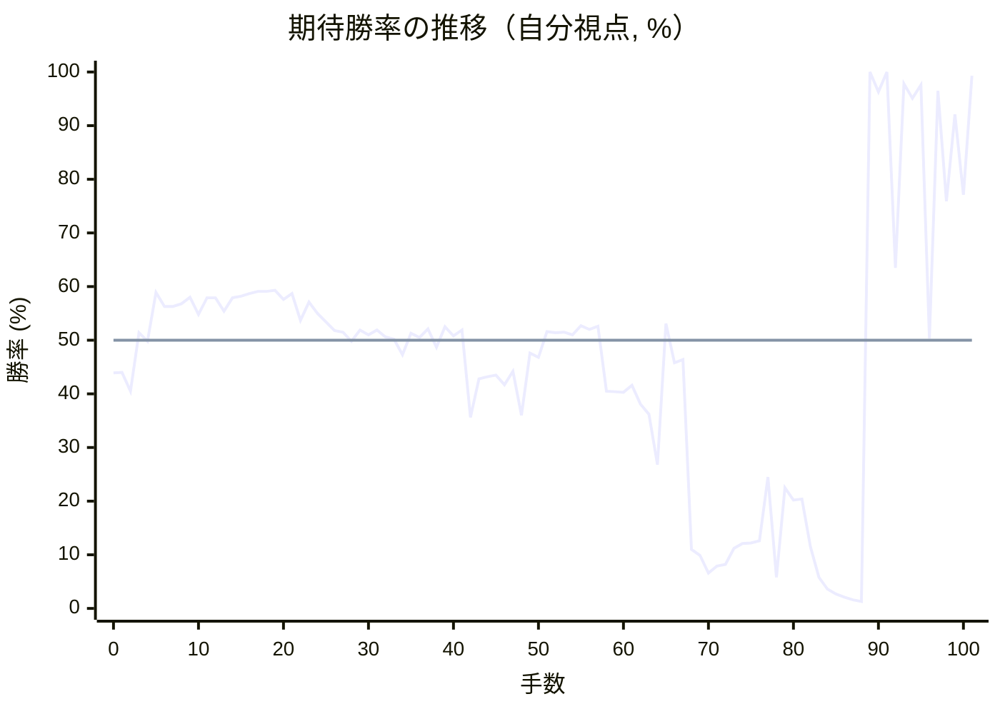

# 解析レポート sqjxvea27n7t

[README に戻る](../../../README.md)　/　棋譜: [CSA](../../../data/csa/shogi5/sqjxvea27n7t.csa)　/　解析の見方: [docs/mistake_analysis.md](../../../docs/mistake_analysis.md)

## 対局情報

| 項目 | 内容 |
|---|---|
| 日時 | 2026-11-10 02:01:14 |
| 持ち時間 | 5分 |
| 自分 | 後手（△）（1659） |
| 相手 | 相手（1949） |
| 結果 | 負け（時間切れ, 101手） |

## 解析環境

| 項目 | 内容 |
|---|---|
| エンジン | YaneuraOu NNUE 9.00git 64AVX2（V9.00/YANEURAOU_ENGINE_NNUE/AVX2） |
| 評価関数 | **水匠5**（`suisho5`） |
| nn.bin SHA-256 | `768068f0d534a0603a5d38bcd143de6bbca820d5f1c95a14d40863e5b7892d76` |
| 第1パス | movetime=150ms, MultiPV 1 |
| 第2パス | movetime=2000ms, MultiPV 3 |
| Threads / Hash | 8 / 512MB |
| 判定基準 | 疑問手 ≥5pt, 悪手 ≥10pt, 大悪手 ≥20pt（期待勝率 W(E)=1/(1+exp(-E/600))） |
| 解析日時 | 2026-11-11T20:12:32+09:00（解析バージョン 1, 68秒） |

## サマリー

| 自分の手数 | 深掘りした手 | 詰み逃し | 大悪手 | 悪手 | 疑問手 |
|--:|--:|--:|--:|--:|--:|
| 50 | 13 | 1 | 2 | 3 | 4 |

## 期待勝率の推移



<details><summary>1手ごとの数値（第1パス）</summary>

| 手数 | 指し手 | 評価値 | 勝率 | 低下 | 判定 |
|--:|---|--:|--:|--:|---|
| 1 | ▲７六歩(77) | -144 | 44.0% |  |  |
| 2 | △３四歩(33) | -232 | 40.5% | +3.6pt |  |
| 3 | ▲６六歩(67) | +34 | 51.4% |  |  |
| 4 | △８四歩(83) | -4 | 49.8% | +1.6pt |  |
| 5 | ▲６八飛(28) | +215 | 58.9% |  |  |
| 6 | △８五歩(84) | +151 | 56.3% | +2.6pt |  |
| 7 | ▲７七角(88) | +152 | 56.3% |  |  |
| 8 | △６二銀(71) | +164 | 56.8% | -0.5pt |  |
| 9 | ▲４八玉(59) | +194 | 58.0% |  |  |
| 10 | △５四歩(53) | +115 | 54.8% | +3.2pt |  |
| 11 | ▲３八玉(48) | +190 | 57.9% |  |  |
| 12 | △４二玉(51) | +192 | 57.9% | -0.1pt |  |
| 13 | ▲２八玉(38) | +131 | 55.4% |  |  |
| 14 | △１四歩(13) | +190 | 57.9% | -2.4pt |  |
| 15 | ▲１六歩(17) | +198 | 58.2% |  |  |
| 16 | △３二玉(42) | +210 | 58.7% | -0.5pt |  |
| 17 | ▲７八銀(79) | +221 | 59.1% |  |  |
| 18 | △５二金(61) | +221 | 59.1% | +0.0pt |  |
| 19 | ▲６七銀(78) | +225 | 59.3% |  |  |
| 20 | △２四歩(23) | +183 | 57.6% | +1.7pt |  |
| 21 | ▲３八銀(39) | +211 | 58.7% |  |  |
| 22 | △２三玉(32) | +88 | 53.7% | +5.0pt |  |
| 23 | ▲２六歩(27) | +171 | 57.1% |  |  |
| 24 | △３二銀(31) | +120 | 55.0% | +2.1pt |  |
| 25 | ▲２七銀(38) | +82 | 53.4% |  |  |
| 26 | △５三銀(62) | +44 | 51.8% | +1.6pt |  |
| 27 | ▲３八金(49) | +36 | 51.5% |  |  |
| 28 | △４四銀(53) | -5 | 49.8% | +1.7pt |  |
| 29 | ▲３六歩(37) | +46 | 51.9% |  |  |
| 30 | △３一角(22) | +23 | 51.0% | +1.0pt |  |
| 31 | ▲８八飛(68) | +45 | 51.9% |  |  |
| 32 | △７四歩(73) | +15 | 50.6% | +1.2pt |  |
| 33 | ▲３七桂(29) | +4 | 50.2% |  |  |
| 34 | △９四歩(93) | -64 | 47.3% | +2.8pt |  |
| 35 | ▲９六歩(97) | +31 | 51.3% |  |  |
| 36 | △３三桂(21) | +12 | 50.5% | +0.8pt |  |
| 37 | ▲５八金(69) | +51 | 52.1% |  |  |
| 38 | △６四角(31) | -31 | 48.7% | +3.4pt |  |
| 39 | ▲６五歩(66) | +61 | 52.5% |  |  |
| 40 | △７三角(64) | +20 | 50.8% | +1.7pt |  |
| 41 | ▲５六銀(67) | +45 | 51.9% |  |  |
| 42 | △３五歩(34) | -356 | 35.6% | +16.3pt | [疑問手](#ply-42) |
| 43 | ▲同歩(36) | -173 | 42.8% |  |  |
| 44 | △同銀(44) | -164 | 43.2% | -0.4pt |  |
| 45 | ▲３六歩打 | -158 | 43.5% |  |  |
| 46 | △４四銀(35) | -202 | 41.7% | +1.8pt |  |
| 47 | ▲４八金(58) | -141 | 44.2% |  |  |
| 48 | △１二玉(23) | -345 | 36.0% | +8.1pt | [疑問手](#ply-48) |
| 49 | ▲９八香(99) | -57 | 47.6% |  |  |
| 50 | △２三銀(32) | -76 | 46.8% | +0.8pt |  |
| 51 | ▲６六角(77) | +38 | 51.6% |  |  |
| 52 | △３二金(41) | +33 | 51.4% | +0.2pt |  |
| 53 | ▲７五歩(76) | +36 | 51.5% |  |  |
| 54 | △同歩(74) | +24 | 51.0% | +0.5pt |  |
| 55 | ▲同角(66) | +66 | 52.7% |  |  |
| 56 | △７四歩打 | +48 | 52.0% | +0.7pt |  |
| 57 | ▲６六角(75) | +63 | 52.6% |  |  |
| 58 | △２五歩(24) | -230 | 40.5% | +12.1pt | [悪手](#ply-58) |
| 59 | ▲同歩(26) | -234 | 40.4% |  |  |
| 60 | △同桂(33) | -237 | 40.3% | +0.1pt |  |
| 61 | ▲４六歩(47) | -203 | 41.6% |  |  |
| 62 | △３七桂成(25) | -290 | 38.1% | +3.5pt |  |
| 63 | ▲同金(48) | -340 | 36.2% |  |  |
| 64 | △２五歩打 | -604 | 26.8% | +9.4pt | [疑問手](#ply-64) |
| 65 | ▲４七金(37) | +75 | 53.1% |  |  |
| 66 | △８六歩(85) | -100 | 45.8% | +7.3pt | [疑問手](#ply-66) |
| 67 | ▲同歩(87) | -86 | 46.4% |  |  |
| 68 | △５五銀(44) | -1255 | 11.0% | +35.4pt | [大悪手](#ply-68) |
| 69 | ▲同銀(56) | -1325 | 9.9% |  |  |
| 70 | △同角(73) | -1588 | 6.6% | +3.3pt |  |
| 71 | ▲同角(66) | -1470 | 7.9% |  |  |
| 72 | △同歩(54) | -1448 | 8.2% | -0.3pt |  |
| 73 | ▲４一銀打 | -1241 | 11.2% |  |  |
| 74 | △４二金(52) | -1191 | 12.1% | -0.9pt |  |
| 75 | ▲３二銀成(41) | -1184 | 12.2% |  |  |
| 76 | △同金(42) | -1162 | 12.6% | -0.4pt |  |
| 77 | ▲３五角打 | -675 | 24.5% |  |  |
| 78 | △８七歩打 | -1674 | 5.8% | +18.7pt | [悪手](#ply-78) |
| 79 | ▲同飛(88) | -742 | 22.5% |  |  |
| 80 | △２六桂打 | -826 | 20.2% | +2.3pt |  |
| 81 | ▲４八金(38) | -817 | 20.4% |  |  |
| 82 | △４四銀打 | -1226 | 11.5% | +8.9pt | [悪手](#ply-82) |
| 83 | ▲２四歩打 | -1678 | 5.8% |  |  |
| 84 | △３五銀(44) | -1967 | 3.6% | +2.1pt |  |
| 85 | ▲２三歩成(24) | -2145 | 2.7% |  |  |
| 86 | △同金(32) | -2294 | 2.1% | +0.6pt |  |
| 87 | ▲３五歩(36) | -2478 | 1.6% |  |  |
| 88 | △３八歩打 | -2582 | 1.3% | +0.2pt |  |
| 89 | ▲３六桂打 | #+3 | 100.0% |  |  |
| 90 | △３九銀打 | +1955 | 96.3% | +3.7pt | [詰み逃し](#ply-90) |
| 91 | ▲２九玉(28) | +5118 | 100.0% |  |  |
| 92 | △６九角打 | +333 | 63.5% | +36.5pt |  |
| 93 | ▲３七銀打 | +2267 | 97.8% |  |  |
| 94 | △４八銀成(39) | +1777 | 95.1% | +2.7pt |  |
| 95 | ▲同金(47) | +2234 | 97.6% |  |  |
| 96 | △３九角打 | +7 | 50.3% | +47.3pt | [大悪手](#ply-96) |
| 97 | ▲２八銀打 | +1997 | 96.5% |  |  |
| 98 | △４八角成(39) | +687 | 75.9% | +20.7pt |  |
| 99 | ▲同銀(37) | +1476 | 92.1% |  |  |
| 100 | △８七角成(69) | +728 | 77.1% | +15.0pt |  |
| 101 | ▲２四歩打 | +2987 | 99.3% |  |  |

</details>

## 課題局面

<a id="ply-42"></a>
### 42手目 △３五歩(34) — 疑問手

| | 着手前 | 着手後 | 差 |
|---|--:|--:|--:|
| 期待勝率 | 51.5% | 43.1% | -8.4pt |
| 評価値 | +35 | -167 | |

着手前の局面:

```text
後手の持駒：なし
  ９ ８ ７ ６ ５ ４ ３ ２ １
+---------------------------+
|v香v桂 ・ ・ ・v金 ・ ・v香|一
| ・v飛 ・ ・v金 ・v銀 ・ ・|二
| ・ ・v角v歩 ・v歩v桂v玉 ・|三
|v歩 ・v歩 ・v歩v銀v歩v歩v歩|四
| ・v歩 ・ 歩 ・ ・ ・ ・ ・|五
| 歩 ・ 歩 ・ 銀 ・ 歩 歩 歩|六
| ・ 歩 角 ・ 歩 歩 桂 銀 ・|七
| ・ 飛 ・ ・ 金 ・ 金 玉 ・|八
| 香 桂 ・ ・ ・ ・ ・ ・ 香|九
+---------------------------+
先手の持駒：なし
後手番
手数＝41　▲５六銀　まで
```

| | 指し手 | 評価値 | 読み筋 |
|---|---|--:|---|
| 実戦 | △３五歩(34) | -167 | ▲４六歩(47) △同角(73) ▲４七金(58) △７三角(46) ▲４八飛(88) △５五歩(54) |
| AI 1位 | △２二玉(23) | +35 | △２二玉(23) ▲６八飛(88) △２三銀(32) ▲４六歩(47) △３二金(41) ▲４七金(58) |
| AI 2位 | △４二金(52) | +15 | △４二金(52) ▲６四歩(65) △同歩(63) ▲４六歩(47) △２二玉(23) ▲４七金(58) |
| AI 3位 | △５三金(52) | -41 | △５三金(52) ▲４八金(58) △２二玉(23) ▲８六歩(87) △５五歩(54) ▲６七銀(56) |

SFEN: `ln3g2l/1r2g1s2/2bp1pnk1/p1p1psppp/1p1P5/P1P1S1PPP/1PB1PPNS1/1R2G1GK1/LN6L w - 42`

<a id="ply-48"></a>
### 48手目 △１二玉(23) — 疑問手

| | 着手前 | 着手後 | 差 |
|---|--:|--:|--:|
| 期待勝率 | 46.1% | 38.5% | -7.6pt |
| 評価値 | -94 | -280 | |

着手前の局面:

```text
後手の持駒：歩
  ９ ８ ７ ６ ５ ４ ３ ２ １
+---------------------------+
|v香v桂 ・ ・ ・v金 ・ ・v香|一
| ・v飛 ・ ・v金 ・v銀 ・ ・|二
| ・ ・v角v歩 ・v歩v桂v玉 ・|三
|v歩 ・v歩 ・v歩v銀 ・v歩v歩|四
| ・v歩 ・ 歩 ・ ・ ・ ・ ・|五
| 歩 ・ 歩 ・ 銀 ・ 歩 歩 歩|六
| ・ 歩 角 ・ 歩 歩 桂 銀 ・|七
| ・ 飛 ・ ・ ・ 金 金 玉 ・|八
| 香 桂 ・ ・ ・ ・ ・ ・ 香|九
+---------------------------+
先手の持駒：なし
後手番
手数＝47　▲４八金左　まで
```

| | 指し手 | 評価値 | 読み筋 |
|---|---|--:|---|
| 実戦 | △１二玉(23) | -280 | ▲４六歩(47) △４二金(52) ▲８六歩(87) △同歩(85) ▲同飛(88) △同飛(82) |
| AI 1位 | △３四歩打 | -94 | △３四歩打 ▲６八飛(88) △４二金(52) ▲４六歩(47) △２二玉(23) ▲６四歩(65) |
| AI 2位 | △３四歩打 | -117 | △３四歩打 ▲６八飛(88) △４二金(52) ▲４六歩(47) △２二玉(23) ▲６四歩(65) |
| AI 3位 | △４二金(52) | -178 | △４二金(52) ▲４六歩(47) △３四歩打 ▲４七銀(56) △５五角(73) ▲同角(77) |

SFEN: `ln3g2l/1r2g1s2/2bp1pnk1/p1p1ps1pp/1p1P5/P1P1S1PPP/1PB1PPNS1/1R3GGK1/LN6L w p 48`

<a id="ply-58"></a>
### 58手目 △２五歩(24) — 悪手

| | 着手前 | 着手後 | 差 |
|---|--:|--:|--:|
| 期待勝率 | 52.6% | 39.6% | -13.0pt |
| 評価値 | +62 | -253 | |

着手前の局面:

```text
後手の持駒：歩
  ９ ８ ７ ６ ５ ４ ３ ２ １
+---------------------------+
|v香v桂 ・ ・ ・ ・ ・ ・v香|一
| ・v飛 ・ ・v金 ・v金 ・v玉|二
| ・ ・v角v歩 ・v歩v桂v銀 ・|三
|v歩 ・v歩 ・v歩v銀 ・v歩v歩|四
| ・v歩 ・ 歩 ・ ・ ・ ・ ・|五
| 歩 ・ ・ 角 銀 ・ 歩 歩 歩|六
| ・ 歩 ・ ・ 歩 歩 桂 銀 ・|七
| 香 飛 ・ ・ ・ 金 金 玉 ・|八
| ・ 桂 ・ ・ ・ ・ ・ ・ 香|九
+---------------------------+
先手の持駒：歩
後手番
手数＝57　▲６六角　まで
```

| | 指し手 | 評価値 | 読み筋 |
|---|---|--:|---|
| 実戦 | △２五歩(24) | -253 | ▲同歩(26) △同桂(33) ▲７八飛(88) △３七桂成(25) ▲同金(48) △５五歩(54) |
| AI 1位 | △４二金(52) | +62 | △４二金(52) ▲４六歩(47) △３五歩打 ▲同歩(36) △同銀(44) ▲４七銀(56) |
| AI 2位 | △５五歩(54) | +38 | △５五歩(54) ▲６七銀(56) △４二金(52) ▲４六歩(47) △３五歩打 ▲同歩(36) |
| AI 3位 | △５三金(52) | -21 | △５三金(52) ▲４六歩(47) △５五歩(54) ▲４七銀(56) △６四歩(63) ▲７七角(66) |

SFEN: `ln6l/1r2g1g1k/2bp1pns1/p1p1ps1pp/1p1P5/P2BS1PPP/1P2PPNS1/LR3GGK1/1N6L w Pp 58`

<a id="ply-64"></a>
### 64手目 △２五歩打 — 疑問手

| | 着手前 | 着手後 | 差 |
|---|--:|--:|--:|
| 期待勝率 | 38.1% | 28.5% | -9.6pt |
| 評価値 | -292 | -553 | |

着手前の局面:

```text
後手の持駒：桂　歩二
  ９ ８ ７ ６ ５ ４ ３ ２ １
+---------------------------+
|v香v桂 ・ ・ ・ ・ ・ ・v香|一
| ・v飛 ・ ・v金 ・v金 ・v玉|二
| ・ ・v角v歩 ・v歩 ・v銀 ・|三
|v歩 ・v歩 ・v歩v銀 ・ ・v歩|四
| ・v歩 ・ 歩 ・ ・ ・ ・ ・|五
| 歩 ・ ・ 角 銀 歩 歩 ・ 歩|六
| ・ 歩 ・ ・ 歩 ・ 金 銀 ・|七
| 香 飛 ・ ・ ・ ・ 金 玉 ・|八
| ・ 桂 ・ ・ ・ ・ ・ ・ 香|九
+---------------------------+
先手の持駒：桂　歩二
後手番
手数＝63　▲３七同左　まで
```

| | 指し手 | 評価値 | 読み筋 |
|---|---|--:|---|
| 実戦 | △２五歩打 | -553 | ▲７八飛(88) △７五桂打 ▲３五桂打 △２四銀(23) ▲４四角(66) △同歩(43) |
| AI 1位 | △２一玉(12) | -292 | △２一玉(12) ▲７八飛(88) △３四桂打 ▲７四飛(78) △２六歩打 ▲１八銀(27) |
| AI 2位 | △５五歩(54) | -316 | △５五歩(54) ▲４五銀(56) △同銀(44) ▲同歩(46) △２五桂打 ▲３五桂打 |
| AI 3位 | △３四歩打 | -401 | △３四歩打 ▲７八飛(88) △７五桂打 ▲２四歩打 △同銀(23) ▲１五歩(16) |

SFEN: `ln6l/1r2g1g1k/2bp1p1s1/p1p1ps2p/1p1P5/P2BSPP1P/1P2P1GS1/LR4GK1/1N6L w N2Pn2p 64`

<a id="ply-66"></a>
### 66手目 △８六歩(85) — 疑問手

| | 着手前 | 着手後 | 差 |
|---|--:|--:|--:|
| 期待勝率 | 52.6% | 43.3% | -9.3pt |
| 評価値 | +62 | -162 | |

着手前の局面:

```text
後手の持駒：桂　歩
  ９ ８ ７ ６ ５ ４ ３ ２ １
+---------------------------+
|v香v桂 ・ ・ ・ ・ ・ ・v香|一
| ・v飛 ・ ・v金 ・v金 ・v玉|二
| ・ ・v角v歩 ・v歩 ・v銀 ・|三
|v歩 ・v歩 ・v歩v銀 ・ ・v歩|四
| ・v歩 ・ 歩 ・ ・ ・v歩 ・|五
| 歩 ・ ・ 角 銀 歩 歩 ・ 歩|六
| ・ 歩 ・ ・ 歩 金 ・ 銀 ・|七
| 香 飛 ・ ・ ・ ・ 金 玉 ・|八
| ・ 桂 ・ ・ ・ ・ ・ ・ 香|九
+---------------------------+
先手の持駒：桂　歩二
後手番
手数＝65　▲４七金寄　まで
```

| | 指し手 | 評価値 | 読み筋 |
|---|---|--:|---|
| 実戦 | △８六歩(85) | -162 | ▲同歩(87) △５五歩(54) ▲６七銀(56) △６四歩(63) ▲７七桂(89) △５四桂打 |
| AI 1位 | △５五歩(54) | +62 | △５五歩(54) ▲４五銀(56) △同銀(44) ▲同歩(46) △５六歩(55) ▲３七桂打 |
| AI 2位 | △３四歩打 | +18 | △３四歩打 ▲７五歩打 △４二金(52) ▲３七桂打 △２一玉(12) ▲７四歩(75) |
| AI 3位 | △３四桂打 | -2 | △３四桂打 ▲３七金(38) △４二金(52) ▲４五歩(46) △５五歩(54) ▲４四歩(45) |

SFEN: `ln6l/1r2g1g1k/2bp1p1s1/p1p1ps2p/1p1P3p1/P2BSPP1P/1P2PG1S1/LR4GK1/1N6L w N2Pnp 66`

<a id="ply-68"></a>
### 68手目 △５五銀(44) — 大悪手

| | 着手前 | 着手後 | 差 |
|---|--:|--:|--:|
| 期待勝率 | 44.9% | 9.2% | -35.7pt |
| 評価値 | -124 | -1375 | |

着手前の局面:

```text
後手の持駒：桂　歩
  ９ ８ ７ ６ ５ ４ ３ ２ １
+---------------------------+
|v香v桂 ・ ・ ・ ・ ・ ・v香|一
| ・v飛 ・ ・v金 ・v金 ・v玉|二
| ・ ・v角v歩 ・v歩 ・v銀 ・|三
|v歩 ・v歩 ・v歩v銀 ・ ・v歩|四
| ・ ・ ・ 歩 ・ ・ ・v歩 ・|五
| 歩 歩 ・ 角 銀 歩 歩 ・ 歩|六
| ・ ・ ・ ・ 歩 金 ・ 銀 ・|七
| 香 飛 ・ ・ ・ ・ 金 玉 ・|八
| ・ 桂 ・ ・ ・ ・ ・ ・ 香|九
+---------------------------+
先手の持駒：桂　歩三
後手番
手数＝67　▲８六同歩　まで
```

| | 指し手 | 評価値 | 読み筋 |
|---|---|--:|---|
| 実戦 | △５五銀(44) | -1375 | ▲同銀(56) △同歩(54) ▲３五桂打 △５四桂打 ▲２三桂成(35) △同玉(12) |
| AI 1位 | △５五歩(54) | -124 | △５五歩(54) ▲６七銀(56) △６四歩(63) ▲７七桂(89) △５四桂打 ▲８五桂(77) |
| AI 2位 | △３四桂打 | -218 | △３四桂打 ▲３七金(38) △４二金(52) ▲８五歩(86) △８六歩打 ▲同飛(88) |
| AI 3位 | △４二金(52) | -223 | △４二金(52) ▲７七桂(89) △３三銀(44) ▲８五歩(86) △８七歩打 ▲６八飛(88) |

SFEN: `ln6l/1r2g1g1k/2bp1p1s1/p1p1ps2p/3P3p1/PP1BSPP1P/4PG1S1/LR4GK1/1N6L w N3Pnp 68`

<a id="ply-78"></a>
### 78手目 △８七歩打 — 悪手

| | 着手前 | 着手後 | 差 |
|---|--:|--:|--:|
| 期待勝率 | 17.8% | 2.2% | -15.5pt |
| 評価値 | -920 | -2272 | |

着手前の局面:

```text
後手の持駒：角　銀二　桂　歩
  ９ ８ ７ ６ ５ ４ ３ ２ １
+---------------------------+
|v香v桂 ・ ・ ・ ・ ・ ・v香|一
| ・v飛 ・ ・ ・ ・v金 ・v玉|二
| ・ ・ ・v歩 ・v歩 ・v銀 ・|三
|v歩 ・v歩 ・ ・ ・ ・ ・v歩|四
| ・ ・ ・ 歩v歩 ・ 角v歩 ・|五
| 歩 歩 ・ ・ ・ 歩 歩 ・ 歩|六
| ・ ・ ・ ・ 歩 金 ・ 銀 ・|七
| 香 飛 ・ ・ ・ ・ 金 玉 ・|八
| ・ 桂 ・ ・ ・ ・ ・ ・ 香|九
+---------------------------+
先手の持駒：金　桂　歩三
後手番
手数＝77　▲３五角　まで
```

| | 指し手 | 評価値 | 読み筋 |
|---|---|--:|---|
| 実戦 | △８七歩打 | -2272 | ▲７八飛(88) △２六桂打 ▲７四飛(78) △３八桂成(26) ▲同銀(27) △１三銀打 |
| AI 1位 | △２四銀打 | -920 | △２四銀打 ▲７一角成(35) △５二飛(82) ▲３五桂打 △５六歩(55) ▲２三桂成(35) |
| AI 2位 | △３三銀打 | -1202 | △３三銀打 ▲１三金打 △２一玉(12) ▲７一角成(35) △１三香(11) ▲８二馬(71) |
| AI 3位 | △２四桂打 | -1254 | △２四桂打 ▲７一角成(35) △５二飛(82) ▲３五桂打 △５六歩(55) ▲同歩(57) |

SFEN: `ln6l/1r4g1k/3p1p1s1/p1p5p/3Pp1Bp1/PP3PP1P/4PG1S1/LR4GK1/1N6L w GN3Pb2snp 78`

<a id="ply-82"></a>
### 82手目 △４四銀打 — 悪手

| | 着手前 | 着手後 | 差 |
|---|--:|--:|--:|
| 期待勝率 | 18.3% | 4.6% | -13.8pt |
| 評価値 | -896 | -1824 | |

着手前の局面:

```text
後手の持駒：角　銀二
  ９ ８ ７ ６ ５ ４ ３ ２ １
+---------------------------+
|v香v桂 ・ ・ ・ ・ ・ ・v香|一
| ・v飛 ・ ・ ・ ・v金 ・v玉|二
| ・ ・ ・v歩 ・v歩 ・v銀 ・|三
|v歩 ・v歩 ・ ・ ・ ・ ・v歩|四
| ・ ・ ・ 歩v歩 ・ 角v歩 ・|五
| 歩 歩 ・ ・ ・ 歩 歩v桂 歩|六
| ・ 飛 ・ ・ 歩 金 ・ 銀 ・|七
| 香 ・ ・ ・ ・ 金 ・ 玉 ・|八
| ・ 桂 ・ ・ ・ ・ ・ ・ 香|九
+---------------------------+
先手の持駒：金　桂　歩四
後手番
手数＝81　▲４八金寄　まで
```

| | 指し手 | 評価値 | 読み筋 |
|---|---|--:|---|
| 実戦 | △４四銀打 | -1824 | ▲２四歩打 △同銀(23) ▲同角(35) △３三銀打 ▲同角成(24) △同銀(44) |
| AI 1位 | △６九角打 | -896 | △６九角打 ▲８八飛(87) △７九銀打 ▲２四歩打 △３四銀(23) ▲２三金打 |
| AI 2位 | △２四銀打 | -1231 | △２四銀打 ▲７一角成(35) △５二飛(82) ▲３五桂打 △同銀(24) ▲同馬(71) |
| AI 3位 | △７六角打 | -1478 | △７六角打 ▲８八飛(87) △２四銀打 ▲７一角成(35) △９八角成(76) ▲同飛(88) |

SFEN: `ln6l/1r4g1k/3p1p1s1/p1p5p/3Pp1Bp1/PP3PPnP/1R2PG1S1/L4G1K1/1N6L w GN4Pb2s 82`

<a id="ply-90"></a>
### 90手目 △３九銀打 — 詰み逃し

| | 着手前 | 着手後 | 差 |
|---|--:|--:|--:|
| 期待勝率 | 100.0% | 100.0% | -0.0pt |
| 評価値 | 3手詰め | +6257 | |

着手前の局面:

```text
後手の持駒：角二　銀
  ９ ８ ７ ６ ５ ４ ３ ２ １
+---------------------------+
|v香v桂 ・ ・ ・ ・ ・ ・v香|一
| ・v飛 ・ ・ ・ ・ ・ ・v玉|二
| ・ ・ ・v歩 ・v歩 ・v金 ・|三
|v歩 ・v歩 ・ ・ ・ ・ ・v歩|四
| ・ ・ ・ 歩v歩 ・ 歩v歩 ・|五
| 歩 歩 ・ ・ ・ 歩 桂v桂 歩|六
| ・ 飛 ・ ・ 歩 金 ・ 銀 ・|七
| 香 ・ ・ ・ ・ 金v歩 玉 ・|八
| ・ 桂 ・ ・ ・ ・ ・ ・ 香|九
+---------------------------+
先手の持駒：金　銀二　歩三
後手番
手数＝89　▲３六桂　まで
```

| | 指し手 | 評価値 | 読み筋 |
|---|---|--:|---|
| 実戦 | △３九銀打 | +6257 | ▲２九玉(28) △４八銀成(39) ▲同金(47) △３九角打 ▲２四桂(36) △同金(23) |
| AI 1位 | △３九角打 | 3手詰め | △３九角打 ▲３七玉(28) △２八角打 |
| AI 2位 | △３九銀打 | +5006 | △３九銀打 ▲２九玉(28) △４八銀成(39) ▲同金(47) △３九角打 ▲３七銀打 |
| AI 3位 | △６九角打 | -394 | △６九角打 ▲３七玉(28) △３九銀打 ▲２九金打 △４八銀不成(39) ▲同金(47) |

SFEN: `ln6l/1r6k/3p1p1g1/p1p5p/3Pp1Pp1/PP3PNnP/1R2PG1S1/L4GpK1/1N6L w G2S3P2bs 90`

<a id="ply-96"></a>
### 96手目 △３九角打 — 大悪手

| | 着手前 | 着手後 | 差 |
|---|--:|--:|--:|
| 期待勝率 | 99.0% | 76.6% | -22.4pt |
| 評価値 | +2766 | +711 | |

着手前の局面:

```text
後手の持駒：角　金
  ９ ８ ７ ６ ５ ４ ３ ２ １
+---------------------------+
|v香v桂 ・ ・ ・ ・ ・ ・v香|一
| ・v飛 ・ ・ ・ ・ ・ ・v玉|二
| ・ ・ ・v歩 ・v歩 ・v金 ・|三
|v歩 ・v歩 ・ ・ ・ ・ ・v歩|四
| ・ ・ ・ 歩v歩 ・ 歩v歩 ・|五
| 歩 歩 ・ ・ ・ 歩 桂v桂 歩|六
| ・ 飛 ・ ・ 歩 ・ 銀 銀 ・|七
| 香 ・ ・ ・ ・ 金v歩 ・ ・|八
| ・ 桂 ・v角 ・ ・ ・ 玉 香|九
+---------------------------+
先手の持駒：金　銀二　歩三
後手番
手数＝95　▲４八同金　まで
```

| | 指し手 | 評価値 | 読み筋 |
|---|---|--:|---|
| 実戦 | △３九角打 | +711 | ▲２四歩打 △３六角成(69) ▲２三歩成(24) △同玉(12) ▲２六銀(27) △同歩(25) |
| AI 1位 | △８七角成(69) | +2766 | △８七角成(69) ▲３八金(48) △７九飛打 ▲３九銀打 △３八桂成(26) ▲同銀(27) |
| AI 2位 | △３九角打 | +998 | △３九角打 ▲２八金打 △８七角成(69) ▲３八金(48) △２八角成(39) ▲同玉(29) |
| AI 3位 | △３九角打 | +765 | △３九角打 ▲２四歩打 △３六角成(69) ▲２六銀(27) △同歩(25) ▲２三歩成(24) |

SFEN: `ln6l/1r6k/3p1p1g1/p1p5p/3Pp1Pp1/PP3PNnP/1R2P1SS1/L4Gp2/1N1b3KL w G2S3Pbg 96`

