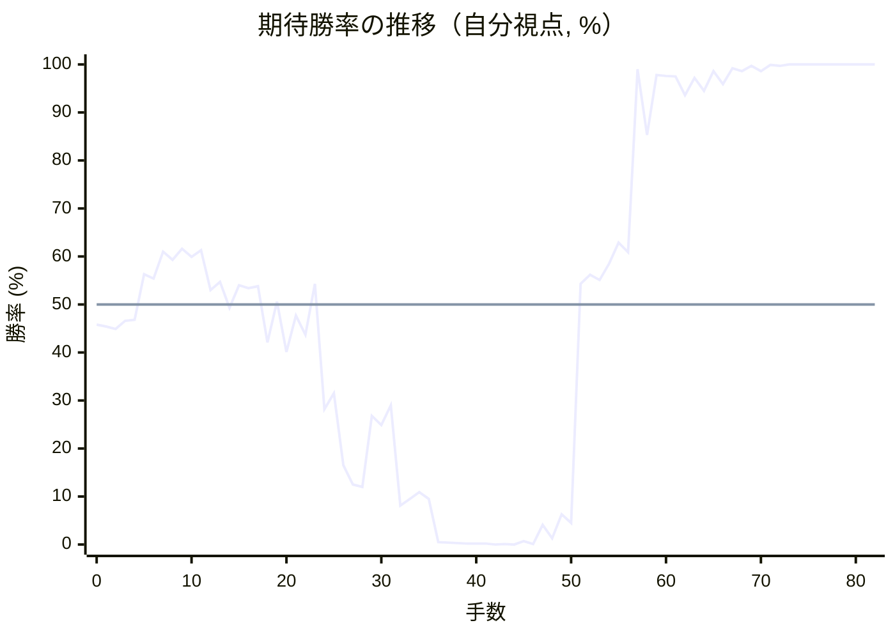

# 解析レポート sr88f783j6rj

[README に戻る](../../../README.md)　/　棋譜: [CSA](../../../data/csa/shogi5/sr88f783j6rj.csa)　/　解析の見方: [docs/mistake_analysis.md](../../../docs/mistake_analysis.md)

## 対局情報

| 項目 | 内容 |
|---|---|
| 日時 | 2026-10-27 20:43:38 |
| 持ち時間 | 5分 |
| 自分 | 後手（△）（1752） |
| 相手 | 相手（1772） |
| 結果 | 勝ち（投了, 82手） |

## 解析環境

| 項目 | 内容 |
|---|---|
| エンジン | YaneuraOu NNUE 9.00git 64AVX2（V9.00/YANEURAOU_ENGINE_NNUE/AVX2） |
| 評価関数 | **水匠5**（`suisho5`） |
| nn.bin SHA-256 | `768068f0d534a0603a5d38bcd143de6bbca820d5f1c95a14d40863e5b7892d76` |
| 第1パス | movetime=150ms, MultiPV 1 |
| 第2パス | movetime=2000ms, MultiPV 3 |
| Threads / Hash | 8 / 512MB |
| 判定基準 | 疑問手 ≥5pt, 悪手 ≥10pt, 大悪手 ≥20pt（期待勝率 W(E)=1/(1+exp(-E/600))） |
| 解析日時 | 2026-11-03T04:29:44+09:00（解析バージョン 1, 56秒） |

## サマリー

| 自分の手数 | 深掘りした手 | 詰み逃し | 大悪手 | 悪手 | 疑問手 |
|--:|--:|--:|--:|--:|--:|
| 41 | 11 | 1 | 1 | 3 | 3 |

## 期待勝率の推移



<details><summary>1手ごとの数値（第1パス）</summary>

| 手数 | 指し手 | 評価値 | 勝率 | 低下 | 判定 |
|--:|---|--:|--:|--:|---|
| 1 | ▲７六歩(77) | -110 | 45.4% |  |  |
| 2 | △８四歩(83) | -123 | 44.9% | +0.5pt |  |
| 3 | ▲７八銀(79) | -82 | 46.6% |  |  |
| 4 | △３四歩(33) | -77 | 46.8% | -0.2pt |  |
| 5 | ▲２二角成(88) | +151 | 56.3% |  |  |
| 6 | △同銀(31) | +131 | 55.4% | +0.8pt |  |
| 7 | ▲６八飛(28) | +268 | 61.0% |  |  |
| 8 | △３三銀(22) | +226 | 59.3% | +1.7pt |  |
| 9 | ▲４八玉(59) | +284 | 61.6% |  |  |
| 10 | △８五歩(84) | +242 | 59.9% | +1.7pt |  |
| 11 | ▲７七銀(78) | +276 | 61.3% |  |  |
| 12 | △３二金(41) | +71 | 53.0% | +8.3pt |  |
| 13 | ▲３八玉(48) | +114 | 54.7% |  |  |
| 14 | △６二銀(71) | -17 | 49.3% | +5.4pt |  |
| 15 | ▲２八玉(38) | +97 | 54.0% |  |  |
| 16 | △７四歩(73) | +82 | 53.4% | +0.6pt |  |
| 17 | ▲３八銀(39) | +92 | 53.8% |  |  |
| 18 | △６四歩(63) | -190 | 42.1% | +11.7pt | [悪手](#ply-18) |
| 19 | ▲８八飛(68) | +14 | 50.6% |  |  |
| 20 | △９四歩(93) | -240 | 40.1% | +10.5pt | [疑問手](#ply-20) |
| 21 | ▲１六歩(17) | -55 | 47.7% |  |  |
| 22 | △１四歩(13) | -152 | 43.7% | +4.0pt |  |
| 23 | ▲６六銀(77) | +103 | 54.3% |  |  |
| 24 | △７三桂(81) | -560 | 28.2% | +26.1pt | [大悪手](#ply-24) |
| 25 | ▲７五歩(76) | -466 | 31.5% |  |  |
| 26 | △６三銀(62) | -972 | 16.5% | +15.0pt | [悪手](#ply-26) |
| 27 | ▲７四歩(75) | -1170 | 12.5% |  |  |
| 28 | △同銀(63) | -1194 | 12.0% | +0.4pt |  |
| 29 | ▲７五歩打 | -604 | 26.8% |  |  |
| 30 | △６三銀(74) | -661 | 24.9% | +1.8pt |  |
| 31 | ▲７八飛(88) | -536 | 29.0% |  |  |
| 32 | △８六歩(85) | -1461 | 8.1% | +21.0pt | [悪手](#ply-32) |
| 33 | ▲７四歩(75) | -1352 | 9.5% |  |  |
| 34 | △８七歩成(86) | -1262 | 10.9% | -1.4pt |  |
| 35 | ▲７五飛(78) | -1352 | 9.5% |  |  |
| 36 | △９三角打 | -3127 | 0.5% | +9.0pt | [疑問手](#ply-36) |
| 37 | ▲７三歩成(74) | -3294 | 0.4% |  |  |
| 38 | △７五角(93) | -3508 | 0.3% | +0.1pt |  |
| 39 | ▲同銀(66) | -3708 | 0.2% |  |  |
| 40 | △８五飛(82) | -3793 | 0.2% | +0.0pt |  |
| 41 | ▲６三と(73) | -3602 | 0.2% |  |  |
| 42 | △７八と(87) | -5275 | 0.0% | +0.2pt |  |
| 43 | ▲５三と(63) | -4356 | 0.1% |  |  |
| 44 | △８九飛成(85) | -4985 | 0.0% | +0.0pt |  |
| 45 | ▲５四桂打 | -3017 | 0.7% |  |  |
| 46 | △６九龍(89) | -4233 | 0.1% | +0.6pt |  |
| 47 | ▲５二銀打 | -1895 | 4.1% |  |  |
| 48 | △同金(61) | -2620 | 1.3% | +2.8pt |  |
| 49 | ▲同と(53) | -1615 | 6.3% |  |  |
| 50 | △同玉(51) | -1831 | 4.5% | +1.8pt |  |
| 51 | ▲６二角打 | +103 | 54.3% |  |  |
| 52 | △４一玉(52) | +150 | 56.2% | -1.9pt |  |
| 53 | ▲５三角打 | +122 | 55.1% |  |  |
| 54 | △４二桂打 | +207 | 58.5% | -3.5pt |  |
| 55 | ▲同桂成(54) | +317 | 62.9% |  |  |
| 56 | △同銀(33) | +267 | 60.9% | +2.0pt |  |
| 57 | ▲４六桂打 | +2738 | 99.0% |  |  |
| 58 | △４五銀打 | +1054 | 85.3% | +13.7pt | [疑問手](#ply-58) |
| 59 | ▲５九金打 | +2271 | 97.8% |  |  |
| 60 | △９九龍(69) | +2234 | 97.6% | +0.1pt |  |
| 61 | ▲６四銀(75) | +2206 | 97.5% |  |  |
| 62 | △２四桂打 | +1614 | 93.6% | +3.9pt |  |
| 63 | ▲６三銀成(64) | +2126 | 97.2% |  |  |
| 64 | △１五歩(14) | +1701 | 94.5% | +2.7pt |  |
| 65 | ▲同歩(16) | +2544 | 98.6% |  |  |
| 66 | △１六歩打 | +1888 | 95.9% | +2.7pt |  |
| 67 | ▲２六歩(27) | +2862 | 99.2% |  |  |
| 68 | △６八と(78) | +2570 | 98.6% | +0.5pt |  |
| 69 | ▲同金(59) | +3435 | 99.7% |  |  |
| 70 | △１五香(11) | +2558 | 98.6% | +1.1pt |  |
| 71 | ▲２五歩(26) | +4086 | 99.9% |  |  |
| 72 | △１七歩成(16) | +3544 | 99.7% | +0.2pt |  |
| 73 | ▲同桂(29) | #+9 | 100.0% |  |  |
| 74 | △１六桂(24) | #+8 | 100.0% | +0.0pt |  |
| 75 | ▲３九玉(28) | #+7 | 100.0% |  |  |
| 76 | △７九龍(99) | +4923 | 100.0% | +0.0pt | [詰み逃し](#ply-76) |
| 77 | ▲５八金(68) | #+9 | 100.0% |  |  |
| 78 | △５三銀(42) | +7558 | 100.0% | +0.0pt |  |
| 79 | ▲同角成(62) | #+5 | 100.0% |  |  |
| 80 | △２八金打 | #+4 | 100.0% | +0.0pt |  |
| 81 | ▲４八玉(39) | #+3 | 100.0% |  |  |
| 82 | △３九角打 | #+2 | 100.0% | +0.0pt |  |

</details>

## 課題局面

<a id="ply-18"></a>
### 18手目 △６四歩(63) — 悪手

| | 着手前 | 着手後 | 差 |
|---|--:|--:|--:|
| 期待勝率 | 53.6% | 43.4% | -10.2pt |
| 評価値 | +86 | -160 | |

着手前の局面:

```text
後手の持駒：角
  ９ ８ ７ ６ ５ ４ ３ ２ １
+---------------------------+
|v香v桂 ・v金v玉 ・ ・v桂v香|一
| ・v飛 ・v銀 ・ ・v金 ・ ・|二
|v歩 ・ ・v歩v歩v歩v銀v歩v歩|三
| ・ ・v歩 ・ ・ ・v歩 ・ ・|四
| ・v歩 ・ ・ ・ ・ ・ ・ ・|五
| ・ ・ 歩 ・ ・ ・ ・ ・ ・|六
| 歩 歩 銀 歩 歩 歩 歩 歩 歩|七
| ・ ・ ・ 飛 ・ ・ 銀 玉 ・|八
| 香 桂 ・ 金 ・ 金 ・ 桂 香|九
+---------------------------+
先手の持駒：角
後手番
手数＝17　▲３八銀　まで
```

| | 指し手 | 評価値 | 読み筋 |
|---|---|--:|---|
| 実戦 | △６四歩(63) | -160 | ▲６六歩(67) △４二玉(51) ▲７五歩(76) △同歩(74) ▲６五歩(66) △同歩(64) |
| AI 1位 | △４一玉(51) | +86 | △４一玉(51) ▲８八飛(68) △３一玉(41) ▲８六歩(87) △同歩(85) ▲同銀(77) |
| AI 2位 | △４二玉(51) | +75 | △４二玉(51) ▲８八飛(68) △３一玉(42) ▲８六歩(87) △同歩(85) ▲同銀(77) |
| AI 3位 | △４一玉(51) | +47 | △４一玉(51) ▲８八飛(68) △３一玉(41) ▲８六歩(87) △同歩(85) ▲同銀(77) |

SFEN: `ln1gk2nl/1r1s2g2/p2pppspp/2p3p2/1p7/2P6/PPSPPPPPP/3R2SK1/LN1G1G1NL w Bb 18`

<a id="ply-20"></a>
### 20手目 △９四歩(93) — 疑問手

| | 着手前 | 着手後 | 差 |
|---|--:|--:|--:|
| 期待勝率 | 50.6% | 41.9% | -8.6pt |
| 評価値 | +14 | -195 | |

着手前の局面:

```text
後手の持駒：角
  ９ ８ ７ ６ ５ ４ ３ ２ １
+---------------------------+
|v香v桂 ・v金v玉 ・ ・v桂v香|一
| ・v飛 ・v銀 ・ ・v金 ・ ・|二
|v歩 ・ ・ ・v歩v歩v銀v歩v歩|三
| ・ ・v歩v歩 ・ ・v歩 ・ ・|四
| ・v歩 ・ ・ ・ ・ ・ ・ ・|五
| ・ ・ 歩 ・ ・ ・ ・ ・ ・|六
| 歩 歩 銀 歩 歩 歩 歩 歩 歩|七
| ・ 飛 ・ ・ ・ ・ 銀 玉 ・|八
| 香 桂 ・ 金 ・ 金 ・ 桂 香|九
+---------------------------+
先手の持駒：角
後手番
手数＝19　▲８八飛　まで
```

| | 指し手 | 評価値 | 読み筋 |
|---|---|--:|---|
| 実戦 | △９四歩(93) | -195 | ▲８六歩(87) △同歩(85) ▲同銀(77) △４四角打 ▲７七角打 △７三桂(81) |
| AI 1位 | △７二金(61) | +14 | △７二金(61) ▲８六歩(87) △同歩(85) ▲同銀(77) △４二玉(51) ▲７七桂(89) |
| AI 2位 | △４二玉(51) | +11 | △４二玉(51) ▲８六歩(87) △同歩(85) ▲同銀(77) △７三桂(81) ▲７五歩(76) |
| AI 3位 | △６三銀(62) | -117 | △６三銀(62) ▲８六歩(87) △同歩(85) ▲同銀(77) △７三桂(81) ▲７五歩(76) |

SFEN: `ln1gk2nl/1r1s2g2/p3ppspp/2pp2p2/1p7/2P6/PPSPPPPPP/1R4SK1/LN1G1G1NL w Bb 20`

<a id="ply-24"></a>
### 24手目 △７三桂(81) — 大悪手

| | 着手前 | 着手後 | 差 |
|---|--:|--:|--:|
| 期待勝率 | 54.9% | 26.0% | -28.9pt |
| 評価値 | +117 | -628 | |

着手前の局面:

```text
後手の持駒：角
  ９ ８ ７ ６ ５ ４ ３ ２ １
+---------------------------+
|v香v桂 ・v金v玉 ・ ・v桂v香|一
| ・v飛 ・v銀 ・ ・v金 ・ ・|二
| ・ ・ ・ ・v歩v歩v銀v歩 ・|三
|v歩 ・v歩v歩 ・ ・v歩 ・v歩|四
| ・v歩 ・ ・ ・ ・ ・ ・ ・|五
| ・ ・ 歩 銀 ・ ・ ・ ・ 歩|六
| 歩 歩 ・ 歩 歩 歩 歩 歩 ・|七
| ・ 飛 ・ ・ ・ ・ 銀 玉 ・|八
| 香 桂 ・ 金 ・ 金 ・ 桂 香|九
+---------------------------+
先手の持駒：角
後手番
手数＝23　▲６六銀　まで
```

| | 指し手 | 評価値 | 読み筋 |
|---|---|--:|---|
| 実戦 | △７三桂(81) | -628 | ▲７五歩(76) △６五歩(64) ▲５五銀(66) △７五歩(74) ▲６四銀(55) △４四角打 |
| AI 1位 | △６三銀(62) | +117 | △６三銀(62) ▲７五歩(76) △同歩(74) ▲４六角打 △４四歩(43) ▲７五銀(66) |
| AI 2位 | △４四銀(33) | -2 | △４四銀(33) ▲７五歩(76) △６三銀(62) ▲７四歩(75) △同銀(63) ▲４六角打 |
| AI 3位 | △４二玉(51) | -31 | △４二玉(51) ▲４六角打 △６三銀(62) ▲７五歩(76) △同歩(74) ▲同銀(66) |

SFEN: `ln1gk2nl/1r1s2g2/4ppsp1/p1pp2p1p/1p7/2PS4P/PP1PPPPP1/1R4SK1/LN1G1G1NL w Bb 24`

<a id="ply-26"></a>
### 26手目 △６三銀(62) — 悪手

| | 着手前 | 着手後 | 差 |
|---|--:|--:|--:|
| 期待勝率 | 24.1% | 12.4% | -11.7pt |
| 評価値 | -688 | -1174 | |

着手前の局面:

```text
後手の持駒：角
  ９ ８ ７ ６ ５ ４ ３ ２ １
+---------------------------+
|v香 ・ ・v金v玉 ・ ・v桂v香|一
| ・v飛 ・v銀 ・ ・v金 ・ ・|二
| ・ ・v桂 ・v歩v歩v銀v歩 ・|三
|v歩 ・v歩v歩 ・ ・v歩 ・v歩|四
| ・v歩 歩 ・ ・ ・ ・ ・ ・|五
| ・ ・ ・ 銀 ・ ・ ・ ・ 歩|六
| 歩 歩 ・ 歩 歩 歩 歩 歩 ・|七
| ・ 飛 ・ ・ ・ ・ 銀 玉 ・|八
| 香 桂 ・ 金 ・ 金 ・ 桂 香|九
+---------------------------+
先手の持駒：角
後手番
手数＝25　▲７五歩　まで
```

| | 指し手 | 評価値 | 読み筋 |
|---|---|--:|---|
| 実戦 | △６三銀(62) | -1174 | ▲７四歩(75) △同銀(63) ▲７八飛(88) △４一角打 ▲５五銀(66) △７二歩打 |
| AI 1位 | △６五歩(64) | -688 | △６五歩(64) ▲５五銀(66) △７五歩(74) ▲６四銀(55) △４二玉(51) ▲７八飛(88) |
| AI 2位 | △同歩(74) | -744 | △同歩(74) ▲同銀(66) △６五桂(73) ▲５八金(69) △７二飛(82) ▲７四歩打 |
| AI 3位 | △８四飛(82) | -962 | △８四飛(82) ▲７四歩(75) △同飛(84) ▲８三角打 △８四飛(74) ▲６一角成(83) |

SFEN: `l2gk2nl/1r1s2g2/2n1ppsp1/p1pp2p1p/1pP6/3S4P/PP1PPPPP1/1R4SK1/LN1G1G1NL w Bb 26`

<a id="ply-32"></a>
### 32手目 △８六歩(85) — 悪手

| | 着手前 | 着手後 | 差 |
|---|--:|--:|--:|
| 期待勝率 | 22.3% | 9.3% | -13.0pt |
| 評価値 | -750 | -1366 | |

着手前の局面:

```text
後手の持駒：角　歩
  ９ ８ ７ ６ ５ ４ ３ ２ １
+---------------------------+
|v香 ・ ・v金v玉 ・ ・v桂v香|一
| ・v飛 ・ ・ ・ ・v金 ・ ・|二
| ・ ・v桂v銀v歩v歩v銀v歩 ・|三
|v歩 ・ ・v歩 ・ ・v歩 ・v歩|四
| ・v歩 歩 ・ ・ ・ ・ ・ ・|五
| ・ ・ ・ 銀 ・ ・ ・ ・ 歩|六
| 歩 歩 ・ 歩 歩 歩 歩 歩 ・|七
| ・ ・ 飛 ・ ・ ・ 銀 玉 ・|八
| 香 桂 ・ 金 ・ 金 ・ 桂 香|九
+---------------------------+
先手の持駒：角
後手番
手数＝31　▲７八飛　まで
```

| | 指し手 | 評価値 | 読み筋 |
|---|---|--:|---|
| 実戦 | △８六歩(85) | -1366 | ▲７四歩(75) △８七歩成(86) ▲７五飛(78) △７四銀(63) ▲同飛(75) △７二歩打 |
| AI 1位 | △７二歩打 | -750 | △７二歩打 ▲７四歩(75) △６二金(61) ▲７三歩成(74) △同歩(72) ▲７五銀(66) |
| AI 2位 | △６二金(61) | -774 | △６二金(61) ▲７四歩(75) △７二歩打 ▲７三歩成(74) △同歩(72) ▲７五銀(66) |
| AI 3位 | △４一角打 | -800 | △４一角打 ▲７六飛(78) △７二歩打 ▲５八金(69) △８一飛(82) ▲５五銀(66) |

SFEN: `l2gk2nl/1r4g2/2nsppsp1/p2p2p1p/1pP6/3S4P/PP1PPPPP1/2R3SK1/LN1G1G1NL w Bbp 32`

<a id="ply-36"></a>
### 36手目 △９三角打 — 疑問手

| | 着手前 | 着手後 | 差 |
|---|--:|--:|--:|
| 期待勝率 | 6.9% | 0.1% | -6.7pt |
| 評価値 | -1565 | -4004 | |

着手前の局面:

```text
後手の持駒：角　歩二
  ９ ８ ７ ６ ５ ４ ３ ２ １
+---------------------------+
|v香 ・ ・v金v玉 ・ ・v桂v香|一
| ・v飛 ・ ・ ・ ・v金 ・ ・|二
| ・ ・v桂v銀v歩v歩v銀v歩 ・|三
|v歩 ・ 歩v歩 ・ ・v歩 ・v歩|四
| ・ ・ 飛 ・ ・ ・ ・ ・ ・|五
| ・ ・ ・ 銀 ・ ・ ・ ・ 歩|六
| 歩vと ・ 歩 歩 歩 歩 歩 ・|七
| ・ ・ ・ ・ ・ ・ 銀 玉 ・|八
| 香 桂 ・ 金 ・ 金 ・ 桂 香|九
+---------------------------+
先手の持駒：角
後手番
手数＝35　▲７五飛　まで
```

| | 指し手 | 評価値 | 読み筋 |
|---|---|--:|---|
| 実戦 | △９三角打 | -4004 | ▲７三歩成(74) △７五角(93) ▲同銀(66) △８五飛(82) ▲６三と(73) △４一玉(51) |
| AI 1位 | △７四銀(63) | -1565 | △７四銀(63) ▲同飛(75) △７二歩打 ▲６四飛(74) △６二歩打 ▲７五銀(66) |
| AI 2位 | △７八と(87) | -2194 | △７八と(87) ▲７三歩成(74) △８九飛成(82) ▲６三と(73) △７四歩打 ▲同飛(75) |
| AI 3位 | △８六飛(82) | -2200 | △８六飛(82) ▲７三歩成(74) △７四歩打 ▲同と(73) △５二銀(63) ▲５五桂打 |

SFEN: `l2gk2nl/1r4g2/2nsppsp1/p1Pp2p1p/2R6/3S4P/P+p1PPPPP1/6SK1/LN1G1G1NL w Bb2p 36`

<a id="ply-58"></a>
### 58手目 △４五銀打 — 疑問手

| | 着手前 | 着手後 | 差 |
|---|--:|--:|--:|
| 期待勝率 | 99.2% | 89.8% | -9.4pt |
| 評価値 | +2878 | +1302 | |

着手前の局面:

```text
後手の持駒：飛　金　銀　桂　歩三
  ９ ８ ７ ６ ５ ４ ３ ２ １
+---------------------------+
|v香 ・ ・ ・ ・v玉 ・v桂v香|一
| ・ ・ ・ 角 ・v銀v金 ・ ・|二
| ・ ・ ・ ・ 角v歩 ・v歩 ・|三
|v歩 ・ ・v歩 ・ ・v歩 ・v歩|四
| ・ ・ 銀 ・ ・ ・ ・ ・ ・|五
| ・ ・ ・ ・ ・ 桂 ・ ・ 歩|六
| 歩 ・ ・ 歩 歩 歩 歩 歩 ・|七
| ・ ・vと ・ ・ ・ 銀 玉 ・|八
| 香 ・ ・v龍 ・ 金 ・ 桂 香|九
+---------------------------+
先手の持駒：金　歩
後手番
手数＝57　▲４六桂　まで
```

| | 指し手 | 評価値 | 読み筋 |
|---|---|--:|---|
| 実戦 | △４五銀打 | +1302 | ▲６四角成(53) △５二歩打 ▲７四銀(75) △６一歩打 ▲７三角成(62) △６二金打 |
| AI 1位 | △５三銀(42) | +2878 | △５三銀(42) ▲同角成(62) △５二歩打 ▲５九金打 △９九龍(69) ▲６四馬(53) |
| AI 2位 | △５二金打 | +2292 | △５二金打 ▲５九金打 △７九龍(69) ▲６四銀(75) △６三歩打 ▲４二角成(53) |
| AI 3位 | △３三銀打 | +1608 | △３三銀打 ▲６四角成(53) △７九飛打 ▲５四桂(46) △５二金打 ▲２六角成(62) |

SFEN: `l4k1nl/3B1sg2/4Bp1p1/p2p2p1p/2S6/5N2P/P2PPPPP1/2+p3SK1/L2+r1G1NL w GPrgsn3p 58`

<a id="ply-76"></a>
### 76手目 △７九龍(99) — 詰み逃し

| | 着手前 | 着手後 | 差 |
|---|--:|--:|--:|
| 期待勝率 | 100.0% | 100.0% | -0.0pt |
| 評価値 | 7手詰め | +6014 | |

着手前の局面:

```text
後手の持駒：飛　金　香　歩三
  ９ ８ ７ ６ ５ ４ ３ ２ １
+---------------------------+
|v香 ・ ・ ・ ・v玉 ・v桂 ・|一
| ・ ・ ・ 角 ・v銀v金 ・ ・|二
| ・ ・ ・ 全 角v歩 ・v歩 ・|三
|v歩 ・ ・ ・ ・ ・v歩 ・ ・|四
| ・ ・ ・ ・ ・v銀 ・ 歩v香|五
| ・ ・ ・ ・ ・ 桂 ・ ・v桂|六
| 歩 ・ ・ 歩 歩 歩 歩 ・ 桂|七
| ・ ・ ・ 金 ・ ・ 銀 ・ ・|八
|v龍 ・ ・ ・ ・ 金 玉 ・ 香|九
+---------------------------+
先手の持駒：歩五
後手番
手数＝75　▲３九玉　まで
```

| | 指し手 | 評価値 | 読み筋 |
|---|---|--:|---|
| 実戦 | △７九龍(99) | +6014 | ▲４二角成(53) △同金(32) ▲６九銀打 △５六歩打 ▲５三成銀(63) △２八金打 |
| AI 1位 | △２八金打 | 7手詰め | △２八金打 ▲４八玉(39) △３八金(28) ▲同金(49) △４九飛打 ▲５八玉(48) |
| AI 2位 | △５三銀(42) | +7211 | △５三銀(42) ▲８九歩打 △２八金打 ▲４八玉(39) △８九龍(99) ▲５二成銀(63) |
| AI 3位 | △７九龍(99) | +5047 | △７九龍(99) ▲４二角成(53) △同金(32) ▲６九銀打 △５六歩打 ▲５三成銀(63) |

SFEN: `l4k1n1/3B1sg2/3+SBp1p1/p5p2/5s1Pl/5N2n/P2PPPP1N/3G2S2/+r4GK1L w 5Prgl3p 76`

