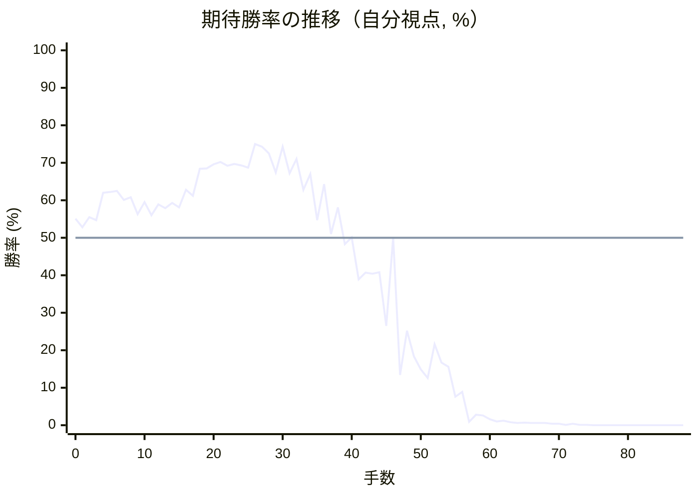

# 解析レポート t36brtw2tnls

[README に戻る](../../../README.md)　/　棋譜: [CSA](../../../data/csa/shogi5/t36brtw2tnls.csa)　/　解析の見方: [docs/mistake_analysis.md](../../../docs/mistake_analysis.md)

## 対局情報

| 項目 | 内容 |
|---|---|
| 日時 | 2026-10-28 01:10:47 |
| 持ち時間 | 5分 |
| 自分 | 先手（▲）（1760） |
| 相手 | 相手（1030） |
| 結果 | 負け（投了, 88手） |

## 解析環境

| 項目 | 内容 |
|---|---|
| エンジン | YaneuraOu NNUE 9.00git 64AVX2（V9.00/YANEURAOU_ENGINE_NNUE/AVX2） |
| 評価関数 | **水匠5**（`suisho5`） |
| nn.bin SHA-256 | `768068f0d534a0603a5d38bcd143de6bbca820d5f1c95a14d40863e5b7892d76` |
| 第1パス | movetime=150ms, MultiPV 1 |
| 第2パス | movetime=2000ms, MultiPV 3 |
| Threads / Hash | 8 / 512MB |
| 判定基準 | 疑問手 ≥5pt, 悪手 ≥10pt, 大悪手 ≥20pt（期待勝率 W(E)=1/(1+exp(-E/600))） |
| 解析日時 | 2026-11-03T04:25:32+09:00（解析バージョン 1, 61秒） |

## サマリー

| 自分の手数 | 深掘りした手 | 詰み逃し | 大悪手 | 悪手 | 疑問手 |
|--:|--:|--:|--:|--:|--:|
| 44 | 12 | 0 | 3 | 3 | 3 |

## 期待勝率の推移



<details><summary>1手ごとの数値（第1パス）</summary>

| 手数 | 指し手 | 評価値 | 勝率 | 低下 | 判定 |
|--:|---|--:|--:|--:|---|
| 1 | ▲７六歩(77) | +68 | 52.8% | +2.3pt |  |
| 2 | △３四歩(33) | +132 | 55.5% |  |  |
| 3 | ▲２六歩(27) | +112 | 54.7% | +0.8pt |  |
| 4 | △３五歩(34) | +294 | 62.0% |  |  |
| 5 | ▲２五歩(26) | +300 | 62.2% | -0.2pt |  |
| 6 | △３二飛(82) | +307 | 62.5% |  |  |
| 7 | ▲４八銀(39) | +247 | 60.1% | +2.4pt |  |
| 8 | △６二玉(51) | +264 | 60.8% |  |  |
| 9 | ▲４六歩(47) | +153 | 56.3% | +4.5pt |  |
| 10 | △３四飛(32) | +230 | 59.5% |  |  |
| 11 | ▲４七銀(48) | +144 | 56.0% | +3.5pt |  |
| 12 | △４四歩(43) | +215 | 58.9% |  |  |
| 13 | ▲６八玉(59) | +190 | 57.9% | +1.0pt |  |
| 14 | △７二玉(62) | +225 | 59.3% |  |  |
| 15 | ▲７八玉(68) | +195 | 58.1% | +1.2pt |  |
| 16 | △６二銀(71) | +314 | 62.8% |  |  |
| 17 | ▲９六歩(97) | +273 | 61.2% | +1.6pt |  |
| 18 | △７一金(61) | +462 | 68.4% |  |  |
| 19 | ▲９五歩(96) | +466 | 68.5% | -0.1pt |  |
| 20 | △５一金(41) | +497 | 69.6% |  |  |
| 21 | ▲８六歩(87) | +514 | 70.2% | -0.6pt |  |
| 22 | △４二銀(31) | +485 | 69.2% |  |  |
| 23 | ▲８七玉(78) | +501 | 69.7% | -0.6pt |  |
| 24 | △４三銀(42) | +488 | 69.3% |  |  |
| 25 | ▲７八銀(79) | +473 | 68.7% | +0.5pt |  |
| 26 | △６四歩(63) | +660 | 75.0% |  |  |
| 27 | ▲１六歩(17) | +637 | 74.3% | +0.7pt |  |
| 28 | △５四銀(43) | +582 | 72.5% |  |  |
| 29 | ▲５六銀(47) | +437 | 67.4% | +5.1pt |  |
| 30 | △３三桂(21) | +637 | 74.3% |  |  |
| 31 | ▲７七角(88) | +430 | 67.2% | +7.1pt |  |
| 32 | △１四歩(13) | +536 | 71.0% |  |  |
| 33 | ▲８五歩(86) | +313 | 62.8% | +8.2pt | [疑問手](#ply-33) |
| 34 | △１三角(22) | +424 | 67.0% |  |  |
| 35 | ▲４七銀(56) | +114 | 54.7% | +12.2pt | [悪手](#ply-35) |
| 36 | △１二香(11) | +354 | 64.3% |  |  |
| 37 | ▲８六角(77) | +25 | 51.0% | +13.3pt | [悪手](#ply-37) |
| 38 | △６三銀(54) | +195 | 58.1% |  |  |
| 39 | ▲７七桂(89) | -40 | 48.3% | +9.7pt | [疑問手](#ply-39) |
| 40 | △４五歩(44) | +3 | 50.1% |  |  |
| 41 | ▲同歩(46) | -270 | 38.9% | +11.2pt | [大悪手](#ply-41) |
| 42 | △３六歩(35) | -226 | 40.7% |  |  |
| 43 | ▲同銀(47) | -234 | 40.4% | +0.3pt |  |
| 44 | △５七角成(13) | -224 | 40.8% |  |  |
| 45 | ▲２四歩(25) | -611 | 26.5% | +14.2pt | [大悪手](#ply-45) |
| 46 | △同歩(23) | +3 | 50.1% |  |  |
| 47 | ▲２三歩打 | -1120 | 13.4% | +36.7pt | [大悪手](#ply-47) |
| 48 | △２五桂(33) | -652 | 25.2% |  |  |
| 49 | ▲同銀(36) | -893 | 18.4% | +6.8pt | [疑問手](#ply-49) |
| 50 | △同歩(24) | -1046 | 14.9% |  |  |
| 51 | ▲２二歩成(23) | -1162 | 12.6% | +2.3pt |  |
| 52 | △８四歩(83) | -773 | 21.6% |  |  |
| 53 | ▲同歩(85) | -966 | 16.7% | +5.0pt |  |
| 54 | △８五歩打 | -1014 | 15.6% |  |  |
| 55 | ▲同桂(77) | -1495 | 7.6% | +7.9pt | [悪手](#ply-55) |
| 56 | △８四馬(57) | -1394 | 8.9% |  |  |
| 57 | ▲９三桂成(85) | -2804 | 0.9% | +8.0pt |  |
| 58 | △同香(91) | -2121 | 2.8% |  |  |
| 59 | ▲７五角(86) | -2185 | 2.6% | +0.3pt |  |
| 60 | △８六歩打 | -2456 | 1.6% |  |  |
| 61 | ▲７七玉(87) | -2737 | 1.0% | +0.6pt |  |
| 62 | △６五桂打 | -2654 | 1.2% |  |  |
| 63 | ▲８六玉(77) | -2918 | 0.8% | +0.4pt |  |
| 64 | △８五歩打 | -3022 | 0.6% |  |  |
| 65 | ▲８七玉(86) | -2975 | 0.7% | -0.1pt |  |
| 66 | △８六銀打 | -3108 | 0.6% |  |  |
| 67 | ▲同角(75) | -3084 | 0.6% | -0.0pt |  |
| 68 | △同歩(85) | -3094 | 0.6% |  |  |
| 69 | ▲同玉(87) | -3311 | 0.4% | +0.2pt |  |
| 70 | △７四銀(63) | -3246 | 0.4% |  |  |
| 71 | ▲５八金(49) | -4435 | 0.1% | +0.4pt |  |
| 72 | △８五銀(74) | -3350 | 0.4% |  |  |
| 73 | ▲８七玉(86) | -4453 | 0.1% | +0.3pt |  |
| 74 | △９五香(93) | -4282 | 0.1% |  |  |
| 75 | ▲９八歩打 | -5427 | 0.0% | +0.1pt |  |
| 76 | △８六歩打 | -5364 | 0.0% |  |  |
| 77 | ▲８八玉(87) | -5446 | 0.0% | +0.0pt |  |
| 78 | △７六銀(85) | -5744 | 0.0% |  |  |
| 79 | ▲６六銀打 | #-7 | 0.0% | +0.0pt |  |
| 80 | △８七歩成(86) | -6094 | 0.0% |  |  |
| 81 | ▲同銀(78) | #-5 | 0.0% | +0.0pt |  |
| 82 | △６六馬(84) | #-4 | 0.0% |  |  |
| 83 | ▲同歩(67) | #-3 | 0.0% | +0.0pt |  |
| 84 | △７七桂成(65) | #-2 | 0.0% |  |  |
| 85 | ▲７九玉(88) | #-1 | 0.0% | +0.0pt |  |
| 86 | △３五角打 | -5033 | 0.0% |  |  |
| 87 | ▲５七歩打 | #-1 | 0.0% | +0.0pt |  |
| 88 | △８七銀成(76) | #-12 | 0.0% |  |  |

</details>

## 課題局面

<a id="ply-33"></a>
### 33手目 ▲８五歩(86) — 疑問手

| | 着手前 | 着手後 | 差 |
|---|--:|--:|--:|
| 期待勝率 | 70.0% | 63.6% | -6.3pt |
| 評価値 | +507 | +335 | |

着手前の局面:

```text
後手の持駒：なし
  ９ ８ ７ ６ ５ ４ ３ ２ １
+---------------------------+
|v香v桂v金 ・v金 ・ ・ ・v香|一
| ・ ・v玉v銀 ・ ・ ・v角 ・|二
|v歩v歩v歩 ・v歩 ・v桂v歩 ・|三
| ・ ・ ・v歩v銀v歩v飛 ・v歩|四
| 歩 ・ ・ ・ ・ ・v歩 歩 ・|五
| ・ 歩 歩 ・ 銀 歩 ・ ・ 歩|六
| ・ 玉 角 歩 歩 ・ 歩 ・ ・|七
| ・ ・ 銀 ・ ・ ・ ・ 飛 ・|八
| 香 桂 ・ 金 ・ 金 ・ 桂 香|九
+---------------------------+
先手の持駒：なし
手数＝32　△１四歩　まで
```

| | 指し手 | 評価値 | 読み筋 |
|---|---|--:|---|
| 実戦 | ▲８五歩(86) | +335 | △７四歩(73) ▲５五銀(56) |
| AI 1位 | ▲５八金(49) | +507 | ▲５八金(49) △６三銀(62) ▲３八飛(28) △６二金(51) ▲４七金(58) △１三角(22) |
| AI 2位 | ▲５八金(49) | +483 | ▲５八金(49) △６三銀(62) ▲４七金(58) △６二金(51) ▲３八飛(28) △１三角(22) |
| AI 3位 | ▲３八金(49) | +481 | ▲３八金(49) △６三銀(62) ▲４七金(38) △６二金(51) ▲３八飛(28) △１三角(22) |

SFEN: `lng1g3l/2ks3b1/ppp1p1np1/3pspr1p/P5pP1/1PP1SP2P/1KBPP1P2/2S4R1/LN1G1G1NL b - 33`

<a id="ply-35"></a>
### 35手目 ▲４七銀(56) — 悪手

| | 着手前 | 着手後 | 差 |
|---|--:|--:|--:|
| 期待勝率 | 65.2% | 54.1% | -11.1pt |
| 評価値 | +376 | +98 | |

着手前の局面:

```text
後手の持駒：なし
  ９ ８ ７ ６ ５ ４ ３ ２ １
+---------------------------+
|v香v桂v金 ・v金 ・ ・ ・v香|一
| ・ ・v玉v銀 ・ ・ ・ ・ ・|二
|v歩v歩v歩 ・v歩 ・v桂v歩v角|三
| ・ ・ ・v歩v銀v歩v飛 ・v歩|四
| 歩 歩 ・ ・ ・ ・v歩 歩 ・|五
| ・ ・ 歩 ・ 銀 歩 ・ ・ 歩|六
| ・ 玉 角 歩 歩 ・ 歩 ・ ・|七
| ・ ・ 銀 ・ ・ ・ ・ 飛 ・|八
| 香 桂 ・ 金 ・ 金 ・ 桂 香|九
+---------------------------+
先手の持駒：なし
手数＝34　△１三角　まで
```

| | 指し手 | 評価値 | 読み筋 |
|---|---|--:|---|
| 実戦 | ▲４七銀(56) | +98 | △７四歩(73) ▲５八金(49) △７三桂(81) ▲６六歩(67) △８二玉(72) ▲６八角(77) |
| AI 1位 | ▲５八金(49) | +376 | ▲５八金(49) △３六歩(35) ▲同歩(37) △４六角(13) ▲１八飛(28) △３六飛(34) |
| AI 2位 | ▲５五銀(56) | +358 | ▲５五銀(56) △同銀(54) ▲同角(77) △３六歩(35) ▲同歩(37) △同飛(34) |
| AI 3位 | ▲２四歩(25) | +347 | ▲２四歩(25) △同角(13) ▲５五銀(56) △同銀(54) ▲同角(77) △３六歩(35) |

SFEN: `lng1g3l/2ks5/ppp1p1npb/3pspr1p/PP4pP1/2P1SP2P/1KBPP1P2/2S4R1/LN1G1G1NL b - 35`

<a id="ply-37"></a>
### 37手目 ▲８六角(77) — 悪手

| | 着手前 | 着手後 | 差 |
|---|--:|--:|--:|
| 期待勝率 | 63.1% | 48.0% | -15.1pt |
| 評価値 | +321 | -48 | |

着手前の局面:

```text
後手の持駒：なし
  ９ ８ ７ ６ ５ ４ ３ ２ １
+---------------------------+
|v香v桂v金 ・v金 ・ ・ ・ ・|一
| ・ ・v玉v銀 ・ ・ ・ ・v香|二
|v歩v歩v歩 ・v歩 ・v桂v歩v角|三
| ・ ・ ・v歩v銀v歩v飛 ・v歩|四
| 歩 歩 ・ ・ ・ ・v歩 歩 ・|五
| ・ ・ 歩 ・ ・ 歩 ・ ・ 歩|六
| ・ 玉 角 歩 歩 銀 歩 ・ ・|七
| ・ ・ 銀 ・ ・ ・ ・ 飛 ・|八
| 香 桂 ・ 金 ・ 金 ・ 桂 香|九
+---------------------------+
先手の持駒：なし
手数＝36　△１二香　まで
```

| | 指し手 | 評価値 | 読み筋 |
|---|---|--:|---|
| 実戦 | ▲８六角(77) | -48 | △４五歩(44) ▲６四角(86) △４六歩(45) ▲同角(64) △４五歩打 ▲６四角(46) |
| AI 1位 | ▲５八金(49) | +321 | ▲５八金(49) △７四歩(73) ▲１八飛(28) △２二角(13) ▲３八飛(18) △１三角(22) |
| AI 2位 | ▲１八飛(28) | +310 | ▲１八飛(28) △２五桂(33) ▲２八飛(18) △２四歩(23) ▲４八金(49) △２二角(13) |
| AI 3位 | ▲２四歩(25) | +263 | ▲２四歩(25) △同角(13) ▲５六銀(47) △３六歩(35) ▲４八金(49) △３五飛(34) |

SFEN: `lng1g4/2ks4l/ppp1p1npb/3pspr1p/PP4pP1/2P2P2P/1KBPPSP2/2S4R1/LN1G1G1NL b - 37`

<a id="ply-39"></a>
### 39手目 ▲７七桂(89) — 疑問手

| | 着手前 | 着手後 | 差 |
|---|--:|--:|--:|
| 期待勝率 | 58.9% | 53.0% | -5.9pt |
| 評価値 | +216 | +71 | |

着手前の局面:

```text
後手の持駒：なし
  ９ ８ ７ ６ ５ ４ ３ ２ １
+---------------------------+
|v香v桂v金 ・v金 ・ ・ ・ ・|一
| ・ ・v玉v銀 ・ ・ ・ ・v香|二
|v歩v歩v歩v銀v歩 ・v桂v歩v角|三
| ・ ・ ・v歩 ・v歩v飛 ・v歩|四
| 歩 歩 ・ ・ ・ ・v歩 歩 ・|五
| ・ 角 歩 ・ ・ 歩 ・ ・ 歩|六
| ・ 玉 ・ 歩 歩 銀 歩 ・ ・|七
| ・ ・ 銀 ・ ・ ・ ・ 飛 ・|八
| 香 桂 ・ 金 ・ 金 ・ 桂 香|九
+---------------------------+
先手の持駒：なし
手数＝38　△６三銀引　まで
```

| | 指し手 | 評価値 | 読み筋 |
|---|---|--:|---|
| 実戦 | ▲７七桂(89) | +71 | △４五歩(44) ▲５八金(49) △４六歩(45) ▲５六銀(47) △３六歩(35) ▲同歩(37) |
| AI 1位 | ▲５八金(49) | +216 | ▲５八金(49) △７四歩(73) ▲６六歩(67) △５二金(51) ▲７七桂(89) △８二玉(72) |
| AI 2位 | ▲２六飛(28) | +198 | ▲２六飛(28) △７四歩(73) ▲６六歩(67) △７三銀(62) ▲７七桂(89) △５二金(51) |
| AI 3位 | ▲２四歩(25) | +167 | ▲２四歩(25) △同歩(23) ▲１五歩(16) △３一角(13) ▲１四歩(15) △２五歩(24) |

SFEN: `lng1g4/2ks4l/pppsp1npb/3p1pr1p/PP4pP1/1BP2P2P/1K1PPSP2/2S4R1/LN1G1G1NL b - 39`

<a id="ply-41"></a>
### 41手目 ▲同歩(46) — 大悪手

| | 着手前 | 着手後 | 差 |
|---|--:|--:|--:|
| 期待勝率 | 54.7% | 31.0% | -23.7pt |
| 評価値 | +112 | -480 | |

着手前の局面:

```text
後手の持駒：なし
  ９ ８ ７ ６ ５ ４ ３ ２ １
+---------------------------+
|v香v桂v金 ・v金 ・ ・ ・ ・|一
| ・ ・v玉v銀 ・ ・ ・ ・v香|二
|v歩v歩v歩v銀v歩 ・v桂v歩v角|三
| ・ ・ ・v歩 ・ ・v飛 ・v歩|四
| 歩 歩 ・ ・ ・v歩v歩 歩 ・|五
| ・ 角 歩 ・ ・ 歩 ・ ・ 歩|六
| ・ 玉 桂 歩 歩 銀 歩 ・ ・|七
| ・ ・ 銀 ・ ・ ・ ・ 飛 ・|八
| 香 ・ ・ 金 ・ 金 ・ 桂 香|九
+---------------------------+
先手の持駒：なし
手数＝40　△４五歩　まで
```

| | 指し手 | 評価値 | 読み筋 |
|---|---|--:|---|
| 実戦 | ▲同歩(46) | -480 | △同桂(33) ▲４八金(49) △３六歩(35) ▲同銀(47) △５七桂成(45) ▲４五銀(36) |
| AI 1位 | ▲５八金(49) | +112 | ▲５八金(49) △４六歩(45) ▲５六銀(47) △３六歩(35) ▲同歩(37) △同飛(34) |
| AI 2位 | ▲４八金(49) | +16 | ▲４八金(49) △４六歩(45) ▲５六銀(47) △３六歩(35) ▲同歩(37) △同飛(34) |
| AI 3位 | ▲３八金(49) | -54 | ▲３八金(49) △７四歩(73) ▲６六歩(67) △７三銀(62) ▲２四歩(25) △同角(13) |

SFEN: `lng1g4/2ks4l/pppsp1npb/3p2r1p/PP3ppP1/1BP2P2P/1KNPPSP2/2S4R1/L2G1G1NL b - 41`

<a id="ply-45"></a>
### 45手目 ▲２四歩(25) — 大悪手

| | 着手前 | 着手後 | 差 |
|---|--:|--:|--:|
| 期待勝率 | 45.6% | 25.5% | -20.1pt |
| 評価値 | -105 | -643 | |

着手前の局面:

```text
後手の持駒：歩
  ９ ８ ７ ６ ５ ４ ３ ２ １
+---------------------------+
|v香v桂v金 ・v金 ・ ・ ・ ・|一
| ・ ・v玉v銀 ・ ・ ・ ・v香|二
|v歩v歩v歩v銀v歩 ・v桂v歩 ・|三
| ・ ・ ・v歩 ・ ・v飛 ・v歩|四
| 歩 歩 ・ ・ ・ 歩 ・ 歩 ・|五
| ・ 角 歩 ・ ・ ・ 銀 ・ 歩|六
| ・ 玉 桂 歩v馬 ・ 歩 ・ ・|七
| ・ ・ 銀 ・ ・ ・ ・ 飛 ・|八
| 香 ・ ・ 金 ・ 金 ・ 桂 香|九
+---------------------------+
先手の持駒：歩二
手数＝44　△５七角成　まで
```

| | 指し手 | 評価値 | 読み筋 |
|---|---|--:|---|
| 実戦 | ▲２四歩(25) | -643 | △同飛(34) ▲同飛(28) △同歩(23) ▲５九飛打 △４六馬(57) ▲４四歩(45) |
| AI 1位 | ▲４八金(49) | -105 | ▲４八金(49) △１三馬(57) ▲５八金(48) △７四歩(73) ▲４八飛(28) △５四飛(34) |
| AI 2位 | ▲５八金(69) | -361 | ▲５八金(69) △７九馬(57) ▲９七角(86) △１三馬(79) ▲４八飛(28) △５二金(51) |
| AI 3位 | ▲５八金(69) | -375 | ▲５八金(69) △１三馬(57) ▲４八飛(28) △５二金(51) ▲７五角(86) △７四歩(73) |

SFEN: `lng1g4/2ks4l/pppsp1np1/3p2r1p/PP3P1P1/1BP3S1P/1KNP+b1P2/2S4R1/L2G1G1NL b 2Pp 45`

<a id="ply-47"></a>
### 47手目 ▲２三歩打 — 大悪手

| | 着手前 | 着手後 | 差 |
|---|--:|--:|--:|
| 期待勝率 | 51.9% | 8.4% | -43.5pt |
| 評価値 | +46 | -1430 | |

着手前の局面:

```text
後手の持駒：歩二
  ９ ８ ７ ６ ５ ４ ３ ２ １
+---------------------------+
|v香v桂v金 ・v金 ・ ・ ・ ・|一
| ・ ・v玉v銀 ・ ・ ・ ・v香|二
|v歩v歩v歩v銀v歩 ・v桂 ・ ・|三
| ・ ・ ・v歩 ・ ・v飛v歩v歩|四
| 歩 歩 ・ ・ ・ 歩 ・ ・ ・|五
| ・ 角 歩 ・ ・ ・ 銀 ・ 歩|六
| ・ 玉 桂 歩v馬 ・ 歩 ・ ・|七
| ・ ・ 銀 ・ ・ ・ ・ 飛 ・|八
| 香 ・ ・ 金 ・ 金 ・ 桂 香|九
+---------------------------+
先手の持駒：歩二
手数＝46　△２四同歩　まで
```

| | 指し手 | 評価値 | 読み筋 |
|---|---|--:|---|
| 実戦 | ▲２三歩打 | -1430 | △３五歩打 ▲４八金(49) △同馬(57) ▲同飛(28) △３六歩(35) ▲４六飛(48) |
| AI 1位 | ▲４八金(49) | +46 | ▲４八金(49) △５六馬(57) ▲４七金(48) △７四馬(56) ▲７五歩(76) △３六飛(34) |
| AI 2位 | ▲５二歩打 | -348 | ▲５二歩打 △同金(51) ▲４八金(49) △５六馬(57) ▲４七金(48) △５五馬(56) |
| AI 3位 | ▲５八金(69) | -477 | ▲５八金(69) △５六馬(57) ▲４七金(58) △５五馬(56) ▲５八飛(28) △５四馬(55) |

SFEN: `lng1g4/2ks4l/pppsp1n2/3p2rpp/PP3P3/1BP3S1P/1KNP+b1P2/2S4R1/L2G1G1NL b 2P2p 47`

<a id="ply-49"></a>
### 49手目 ▲同銀(36) — 疑問手

| | 着手前 | 着手後 | 差 |
|---|--:|--:|--:|
| 期待勝率 | 21.1% | 12.5% | -8.5pt |
| 評価値 | -793 | -1167 | |

着手前の局面:

```text
後手の持駒：歩二
  ９ ８ ７ ６ ５ ４ ３ ２ １
+---------------------------+
|v香v桂v金 ・v金 ・ ・ ・ ・|一
| ・ ・v玉v銀 ・ ・ ・ ・v香|二
|v歩v歩v歩v銀v歩 ・ ・ 歩 ・|三
| ・ ・ ・v歩 ・ ・v飛v歩v歩|四
| 歩 歩 ・ ・ ・ 歩 ・v桂 ・|五
| ・ 角 歩 ・ ・ ・ 銀 ・ 歩|六
| ・ 玉 桂 歩v馬 ・ 歩 ・ ・|七
| ・ ・ 銀 ・ ・ ・ ・ 飛 ・|八
| 香 ・ ・ 金 ・ 金 ・ 桂 香|九
+---------------------------+
先手の持駒：歩
手数＝48　△２五桂　まで
```

| | 指し手 | 評価値 | 読み筋 |
|---|---|--:|---|
| 実戦 | ▲同銀(36) | -1167 | △同歩(24) ▲２二歩成(23) △３六歩打 ▲同歩(37) △４六馬(57) ▲２五飛(28) |
| AI 1位 | ▲５八金(49) | -793 | ▲５八金(49) △３七桂成(25) ▲同桂(29) △４六馬(57) ▲３五歩打 △３七馬(46) |
| AI 2位 | ▲３八金(49) | -880 | ▲３八金(49) △４六歩打 ▲４八金(38) △同馬(57) ▲同飛(28) △３七桂成(25) |
| AI 3位 | ▲３八金(49) | -863 | ▲３八金(49) △４六歩打 ▲４八金(38) △同馬(57) ▲同飛(28) △３七桂成(25) |

SFEN: `lng1g4/2ks4l/pppsp2P1/3p2rpp/PP3P1n1/1BP3S1P/1KNP+b1P2/2S4R1/L2G1G1NL b P2p 49`

<a id="ply-55"></a>
### 55手目 ▲同桂(77) — 悪手

| | 着手前 | 着手後 | 差 |
|---|--:|--:|--:|
| 期待勝率 | 15.2% | 5.1% | -10.1pt |
| 評価値 | -1032 | -1760 | |

着手前の局面:

```text
後手の持駒：銀　歩
  ９ ８ ７ ６ ５ ４ ３ ２ １
+---------------------------+
|v香v桂v金 ・v金 ・ ・ ・ ・|一
| ・ ・v玉v銀 ・ ・ ・ とv香|二
|v歩 ・v歩v銀v歩 ・ ・ ・ ・|三
| ・ 歩 ・v歩 ・ ・v飛 ・v歩|四
| 歩v歩 ・ ・ ・ 歩 ・v歩 ・|五
| ・ 角 歩 ・ ・ ・ ・ ・ 歩|六
| ・ 玉 桂 歩v馬 ・ 歩 ・ ・|七
| ・ ・ 銀 ・ ・ ・ ・ 飛 ・|八
| 香 ・ ・ 金 ・ 金 ・ 桂 香|九
+---------------------------+
先手の持駒：桂　歩二
手数＝54　△８五歩　まで
```

| | 指し手 | 評価値 | 読み筋 |
|---|---|--:|---|
| 実戦 | ▲同桂(77) | -1760 | △８四馬(57) ▲６八角(86) △８六歩打 ▲同玉(87) △７四銀(63) ▲７七玉(86) |
| AI 1位 | ▲７五角(86) | -1032 | ▲７五角(86) △８六銀打 ▲同角(75) △同歩(85) ▲８八玉(87) △７四銀(63) |
| AI 2位 | ▲８三歩成(84) | -1122 | ▲８三歩成(84) △同玉(72) ▲７五角(86) △８六銀打 ▲同角(75) △同歩(85) |
| AI 3位 | ▲９七角(86) | -1414 | ▲９七角(86) △８四馬(57) ▲１二と(22) △９四歩(93) ▲７九角(97) △９五歩(94) |

SFEN: `lng1g4/2ks3+Pl/p1psp4/1P1p2r1p/Pp3P1p1/1BP5P/1KNP+b1P2/2S4R1/L2G1G1NL b N2Psp 55`

