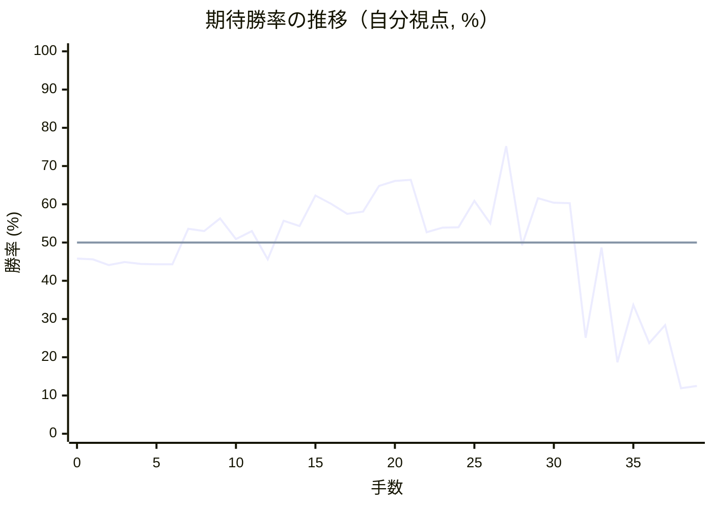

# 解析レポート ti2v7qds1qrm

[README に戻る](../../../README.md)　/　棋譜: [CSA](../../../data/csa/shogi5/ti2v7qds1qrm.csa)　/　解析の見方: [docs/mistake_analysis.md](../../../docs/mistake_analysis.md)

## 対局情報

| 項目 | 内容 |
|---|---|
| 日時 | 2026-11-07 12:54:46 |
| 持ち時間 | 5分 |
| 自分 | 後手（△）（1706） |
| 相手 | 相手（1627） |
| 結果 | 負け（投了, 39手） |

## 解析環境

| 項目 | 内容 |
|---|---|
| エンジン | YaneuraOu NNUE 9.00git 64AVX2（V9.00/YANEURAOU_ENGINE_NNUE/AVX2） |
| 評価関数 | **水匠5**（`suisho5`） |
| nn.bin SHA-256 | `768068f0d534a0603a5d38bcd143de6bbca820d5f1c95a14d40863e5b7892d76` |
| 第1パス | movetime=150ms, MultiPV 1 |
| 第2パス | movetime=2000ms, MultiPV 3 |
| Threads / Hash | 8 / 512MB |
| 判定基準 | 疑問手 ≥5pt, 悪手 ≥10pt, 大悪手 ≥20pt（期待勝率 W(E)=1/(1+exp(-E/600))） |
| 解析日時 | 2026-11-11T20:22:48+09:00（解析バージョン 1, 38秒） |

## サマリー

| 自分の手数 | 深掘りした手 | 詰み逃し | 大悪手 | 悪手 | 疑問手 |
|--:|--:|--:|--:|--:|--:|
| 19 | 8 | 0 | 2 | 3 | 2 |

## 期待勝率の推移



<details><summary>1手ごとの数値（第1パス）</summary>

| 手数 | 指し手 | 評価値 | 勝率 | 低下 | 判定 |
|--:|---|--:|--:|--:|---|
| 1 | ▲７六歩(77) | -107 | 45.6% |  |  |
| 2 | △３四歩(33) | -143 | 44.1% | +1.5pt |  |
| 3 | ▲２六歩(27) | -122 | 44.9% |  |  |
| 4 | △８四歩(83) | -136 | 44.4% | +0.6pt |  |
| 5 | ▲７八金(69) | -137 | 44.3% |  |  |
| 6 | △８五歩(84) | -137 | 44.3% | +0.0pt |  |
| 7 | ▲９六歩(97) | +86 | 53.6% |  |  |
| 8 | △３二金(41) | +71 | 53.0% | +0.6pt |  |
| 9 | ▲１六歩(17) | +151 | 56.3% |  |  |
| 10 | △１四歩(13) | +22 | 50.9% | +5.3pt |  |
| 11 | ▲２五歩(26) | +71 | 53.0% |  |  |
| 12 | △９四歩(93) | -105 | 45.6% | +7.3pt | [疑問手](#ply-12) |
| 13 | ▲６九玉(59) | +138 | 55.7% |  |  |
| 14 | △５二玉(51) | +103 | 54.3% | +1.4pt |  |
| 15 | ▲６六歩(67) | +302 | 62.3% |  |  |
| 16 | △８六歩(85) | +247 | 60.1% | +2.2pt |  |
| 17 | ▲同歩(87) | +181 | 57.5% |  |  |
| 18 | △同飛(82) | +196 | 58.1% | -0.6pt |  |
| 19 | ▲２四歩(25) | +366 | 64.8% |  |  |
| 20 | △同歩(23) | +400 | 66.1% | -1.3pt |  |
| 21 | ▲同飛(28) | +408 | 66.4% |  |  |
| 22 | △２三歩打 | +64 | 52.7% | +13.7pt | [悪手](#ply-22) |
| 23 | ▲３四飛(24) | +93 | 53.9% |  |  |
| 24 | △４四角(22) | +95 | 54.0% | -0.1pt |  |
| 25 | ▲３八金(49) | +266 | 60.9% |  |  |
| 26 | △３五歩打 | +120 | 55.0% | +5.9pt | [悪手](#ply-26) |
| 27 | ▲６五歩(66) | +667 | 75.2% |  |  |
| 28 | △３三金(32) | -18 | 49.3% | +26.0pt | [疑問手](#ply-28) |
| 29 | ▲４四飛(34) | +284 | 61.6% |  |  |
| 30 | △同歩(43) | +254 | 60.4% | +1.2pt |  |
| 31 | ▲５八玉(69) | +251 | 60.3% |  |  |
| 32 | △７六飛(86) | -657 | 25.1% | +35.2pt | [大悪手](#ply-32) |
| 33 | ▲６四歩(65) | -31 | 48.7% |  |  |
| 34 | △７二銀(71) | -880 | 18.7% | +30.0pt | [大悪手](#ply-34) |
| 35 | ▲６三歩成(64) | -405 | 33.7% |  |  |
| 36 | △同銀(72) | -701 | 23.7% | +10.0pt |  |
| 37 | ▲８七角打 | -555 | 28.4% |  |  |
| 38 | △２六飛(76) | -1201 | 11.9% | +16.5pt | [悪手](#ply-38) |
| 39 | ▲２七歩打 | -1166 | 12.5% |  |  |

</details>

## 課題局面

<a id="ply-12"></a>
### 12手目 △９四歩(93) — 疑問手

| | 着手前 | 着手後 | 差 |
|---|--:|--:|--:|
| 期待勝率 | 53.8% | 46.0% | -7.8pt |
| 評価値 | +92 | -96 | |

着手前の局面:

```text
後手の持駒：なし
  ９ ８ ７ ６ ５ ４ ３ ２ １
+---------------------------+
|v香v桂v銀v金v玉 ・v銀v桂v香|一
| ・v飛 ・ ・ ・ ・v金v角 ・|二
|v歩 ・v歩v歩v歩v歩 ・v歩 ・|三
| ・ ・ ・ ・ ・ ・v歩 ・v歩|四
| ・v歩 ・ ・ ・ ・ ・ 歩 ・|五
| 歩 ・ 歩 ・ ・ ・ ・ ・ 歩|六
| ・ 歩 ・ 歩 歩 歩 歩 ・ ・|七
| ・ 角 金 ・ ・ ・ ・ 飛 ・|八
| 香 桂 銀 ・ 玉 金 銀 桂 香|九
+---------------------------+
先手の持駒：なし
後手番
手数＝11　▲２五歩　まで
```

| | 指し手 | 評価値 | 読み筋 |
|---|---|--:|---|
| 実戦 | △９四歩(93) | -96 | ▲２四歩(25) △同歩(23) ▲同飛(28) △８六歩(85) ▲同歩(87) △同飛(82) |
| AI 1位 | △８六歩(85) | +92 | △８六歩(85) ▲同歩(87) △同飛(82) ▲２四歩(25) △同歩(23) ▲同飛(28) |
| AI 2位 | △５二玉(51) | -2 | △５二玉(51) ▲２四歩(25) △同歩(23) ▲同飛(28) △８六歩(85) ▲同歩(87) |
| AI 3位 | △７二銀(71) | -46 | △７二銀(71) ▲２四歩(25) △同歩(23) ▲同飛(28) △８六歩(85) ▲同歩(87) |

SFEN: `lnsgk1snl/1r4gb1/p1pppp1p1/6p1p/1p5P1/P1P5P/1P1PPPP2/1BG4R1/LNS1KGSNL w - 12`

<a id="ply-22"></a>
### 22手目 △２三歩打 — 悪手

| | 着手前 | 着手後 | 差 |
|---|--:|--:|--:|
| 期待勝率 | 65.2% | 51.6% | -13.6pt |
| 評価値 | +376 | +38 | |

着手前の局面:

```text
後手の持駒：歩二
  ９ ８ ７ ６ ５ ４ ３ ２ １
+---------------------------+
|v香v桂v銀v金 ・ ・v銀v桂v香|一
| ・ ・ ・ ・v玉 ・v金v角 ・|二
| ・ ・v歩v歩v歩v歩 ・ ・ ・|三
|v歩 ・ ・ ・ ・ ・v歩 飛v歩|四
| ・ ・ ・ ・ ・ ・ ・ ・ ・|五
| 歩v飛 歩 歩 ・ ・ ・ ・ 歩|六
| ・ ・ ・ ・ 歩 歩 歩 ・ ・|七
| ・ 角 金 ・ ・ ・ ・ ・ ・|八
| 香 桂 銀 玉 ・ 金 銀 桂 香|九
+---------------------------+
先手の持駒：歩二
後手番
手数＝21　▲２四同飛　まで
```

| | 指し手 | 評価値 | 読み筋 |
|---|---|--:|---|
| 実戦 | △２三歩打 | +38 | ▲３四飛(24) △４四角(22) ▲３八銀(39) △３三桂(21) ▲５八玉(69) △７二銀(71) |
| AI 1位 | △９五歩(94) | +376 | △９五歩(94) ▲同歩(96) △９七歩打 ▲８七歩打 △７六飛(86) ▲２五飛(24) |
| AI 2位 | △７二銀(71) | +292 | △７二銀(71) ▲２八飛(24) △７六飛(86) ▲４八銀(39) △７五飛(76) ▲５九金(49) |
| AI 3位 | △７六飛(86) | +277 | △７六飛(86) ▲２八飛(24) △７五飛(76) ▲６八銀(79) △７二銀(71) ▲６七銀(68) |

SFEN: `lnsg2snl/4k1gb1/2pppp3/p5pRp/9/PrPP4P/4PPP2/1BG6/LNSK1GSNL w 2P2p 22`

<a id="ply-26"></a>
### 26手目 △３五歩打 — 悪手

| | 着手前 | 着手後 | 差 |
|---|--:|--:|--:|
| 期待勝率 | 60.3% | 49.9% | -10.4pt |
| 評価値 | +250 | -3 | |

着手前の局面:

```text
後手の持駒：歩
  ９ ８ ７ ６ ５ ４ ３ ２ １
+---------------------------+
|v香v桂v銀v金 ・ ・v銀v桂v香|一
| ・ ・ ・ ・v玉 ・v金 ・ ・|二
| ・ ・v歩v歩v歩v歩 ・v歩 ・|三
|v歩 ・ ・ ・ ・v角 飛 ・v歩|四
| ・ ・ ・ ・ ・ ・ ・ ・ ・|五
| 歩v飛 歩 歩 ・ ・ ・ ・ 歩|六
| ・ ・ ・ ・ 歩 歩 歩 ・ ・|七
| ・ 角 金 ・ ・ ・ 金 ・ ・|八
| 香 桂 銀 玉 ・ ・ 銀 桂 香|九
+---------------------------+
先手の持駒：歩三
後手番
手数＝25　▲３八金　まで
```

| | 指し手 | 評価値 | 読み筋 |
|---|---|--:|---|
| 実戦 | △３五歩打 | -3 | ▲２四歩打 △３三桂(21) ▲８七歩打 △８五飛(86) ▲６八銀(79) △２二銀(31) |
| AI 1位 | △８五飛(86) | +250 | △８五飛(86) ▲８七歩打 △４一玉(52) ▲４六歩(47) △７二銀(71) ▲４八銀(39) |
| AI 2位 | △３三桂(21) | +253 | △３三桂(21) ▲６八銀(79) △４二銀(31) ▲４八銀(39) △７二銀(71) ▲５八玉(69) |
| AI 3位 | △４一玉(52) | +225 | △４一玉(52) ▲５八玉(69) △８五飛(86) ▲４六歩(47) △４二銀(31) ▲７七桂(89) |

SFEN: `lnsg2snl/4k1g2/2pppp1p1/p4bR1p/9/PrPP4P/4PPP2/1BG3G2/LNSK2SNL w 3Pp 26`

<a id="ply-28"></a>
### 28手目 △３三金(32) — 疑問手

| | 着手前 | 着手後 | 差 |
|---|--:|--:|--:|
| 期待勝率 | 69.1% | 60.7% | -8.3pt |
| 評価値 | +482 | +262 | |

着手前の局面:

```text
後手の持駒：なし
  ９ ８ ７ ６ ５ ４ ３ ２ １
+---------------------------+
|v香v桂v銀v金 ・ ・v銀v桂v香|一
| ・ ・ ・ ・v玉 ・v金 ・ ・|二
| ・ ・v歩v歩v歩v歩 ・v歩 ・|三
|v歩 ・ ・ ・ ・v角 飛 ・v歩|四
| ・ ・ ・ 歩 ・ ・v歩 ・ ・|五
| 歩v飛 歩 ・ ・ ・ ・ ・ 歩|六
| ・ ・ ・ ・ 歩 歩 歩 ・ ・|七
| ・ 角 金 ・ ・ ・ 金 ・ ・|八
| 香 桂 銀 玉 ・ ・ 銀 桂 香|九
+---------------------------+
先手の持駒：歩三
後手番
手数＝27　▲６五歩　まで
```

| | 指し手 | 評価値 | 読み筋 |
|---|---|--:|---|
| 実戦 | △３三金(32) | +262 | ▲４四飛(34) △同歩(43) ▲５八玉(69) △７二銀(71) ▲６八銀(79) △７六飛(86) |
| AI 1位 | △８八角成(44) | +482 | △８八角成(44) ▲同銀(79) △３三金(32) ▲７七角打 △８八飛成(86) ▲同角(77) |
| AI 2位 | △３三角(44) | +115 | △３三角(44) ▲６四歩(65) △７二銀(71) ▲８七歩打 △８二飛(86) ▲３五飛(34) |
| AI 3位 | △３三金(32) | +78 | △３三金(32) ▲４四角(88) △３四金(33) ▲８七歩打 △同飛成(86) ▲５三角成(44) |

SFEN: `lnsg2snl/4k1g2/2pppp1p1/p4bR1p/3P2p2/PrP5P/4PPP2/1BG3G2/LNSK2SNL w 3P 28`

<a id="ply-32"></a>
### 32手目 △７六飛(86) — 大悪手

| | 着手前 | 着手後 | 差 |
|---|--:|--:|--:|
| 期待勝率 | 61.5% | 37.0% | -24.5pt |
| 評価値 | +281 | -320 | |

着手前の局面:

```text
後手の持駒：飛
  ９ ８ ７ ６ ５ ４ ３ ２ １
+---------------------------+
|v香v桂v銀v金 ・ ・v銀v桂v香|一
| ・ ・ ・ ・v玉 ・ ・ ・ ・|二
| ・ ・v歩v歩v歩 ・v金v歩 ・|三
|v歩 ・ ・ ・ ・v歩 ・ ・v歩|四
| ・ ・ ・ 歩 ・ ・v歩 ・ ・|五
| 歩v飛 歩 ・ ・ ・ ・ ・ 歩|六
| ・ ・ ・ ・ 歩 歩 歩 ・ ・|七
| ・ 角 金 ・ 玉 ・ 金 ・ ・|八
| 香 桂 銀 ・ ・ ・ 銀 桂 香|九
+---------------------------+
先手の持駒：角　歩三
後手番
手数＝31　▲５八玉　まで
```

| | 指し手 | 評価値 | 読み筋 |
|---|---|--:|---|
| 実戦 | △７六飛(86) | -320 | ▲２二歩打 △７四飛打 ▲８七角打 △２六飛(76) ▲２八金(38) △２二銀(31) |
| AI 1位 | △７二銀(71) | +281 | △７二銀(71) ▲６八銀(79) △９五歩(94) ▲同歩(96) △同香(91) ▲９八歩打 |
| AI 2位 | △４二玉(52) | +201 | △４二玉(52) ▲３六歩(37) △７六飛(86) ▲２二歩打 △同銀(31) ▲９八角打 |
| AI 3位 | △６二銀(71) | +196 | △６二銀(71) ▲６八銀(79) △７六飛(86) ▲６七銀(68) △８六飛(76) ▲８七歩打 |

SFEN: `lnsg2snl/4k4/2ppp1gp1/p4p2p/3P2p2/PrP5P/4PPP2/1BG1K1G2/LNS3SNL w B3Pr 32`

<a id="ply-34"></a>
### 34手目 △７二銀(71) — 大悪手

| | 着手前 | 着手後 | 差 |
|---|--:|--:|--:|
| 期待勝率 | 48.7% | 15.5% | -33.2pt |
| 評価値 | -31 | -1017 | |

着手前の局面:

```text
後手の持駒：飛　歩
  ９ ８ ７ ６ ５ ４ ３ ２ １
+---------------------------+
|v香v桂v銀v金 ・ ・v銀v桂v香|一
| ・ ・ ・ ・v玉 ・ ・ ・ ・|二
| ・ ・v歩v歩v歩 ・v金v歩 ・|三
|v歩 ・ ・ 歩 ・v歩 ・ ・v歩|四
| ・ ・ ・ ・ ・ ・v歩 ・ ・|五
| 歩 ・v飛 ・ ・ ・ ・ ・ 歩|六
| ・ ・ ・ ・ 歩 歩 歩 ・ ・|七
| ・ 角 金 ・ 玉 ・ 金 ・ ・|八
| 香 桂 銀 ・ ・ ・ 銀 桂 香|九
+---------------------------+
先手の持駒：角　歩三
後手番
手数＝33　▲６四歩　まで
```

| | 指し手 | 評価値 | 読み筋 |
|---|---|--:|---|
| 実戦 | △７二銀(71) | -1017 | ▲９八角打 △８七歩打 ▲同角(98) △８六飛打 ▲７六角(87) △同飛(86) |
| AI 1位 | △２六飛(76) | -31 | △２六飛(76) ▲６三歩成(64) △同玉(52) ▲６四歩打 △同玉(63) ▲２七歩打 |
| AI 2位 | △８二飛打 | -542 | △８二飛打 ▲８三歩打 △同飛(82) ▲７七金(78) △同飛成(76) ▲同桂(89) |
| AI 3位 | △同歩(63) | -547 | △同歩(63) ▲９八角打 △７八飛成(76) ▲同銀(79) △３二金(33) ▲８三飛打 |

SFEN: `lnsg2snl/4k4/2ppp1gp1/p2P1p2p/6p2/P1r5P/4PPP2/1BG1K1G2/LNS3SNL w B3Prp 34`

<a id="ply-38"></a>
### 38手目 △２六飛(76) — 悪手

| | 着手前 | 着手後 | 差 |
|---|--:|--:|--:|
| 期待勝率 | 24.4% | 10.6% | -13.8pt |
| 評価値 | -680 | -1280 | |

着手前の局面:

```text
後手の持駒：飛　歩二
  ９ ８ ７ ６ ５ ４ ３ ２ １
+---------------------------+
|v香v桂 ・v金 ・ ・v銀v桂v香|一
| ・ ・ ・ ・v玉 ・ ・ ・ ・|二
| ・ ・v歩v銀v歩 ・v金v歩 ・|三
|v歩 ・ ・ ・ ・v歩 ・ ・v歩|四
| ・ ・ ・ ・ ・ ・v歩 ・ ・|五
| 歩 ・v飛 ・ ・ ・ ・ ・ 歩|六
| ・ 角 ・ ・ 歩 歩 歩 ・ ・|七
| ・ 角 金 ・ 玉 ・ 金 ・ ・|八
| 香 桂 銀 ・ ・ ・ 銀 桂 香|九
+---------------------------+
先手の持駒：歩四
後手番
手数＝37　▲８七角　まで
```

| | 指し手 | 評価値 | 読み筋 |
|---|---|--:|---|
| 実戦 | △２六飛(76) | -1280 | ▲２七歩打 △８六飛(26) ▲２一角成(87) △４二玉(52) ▲１一馬(21) △８二飛(86) |
| AI 1位 | △７八飛成(76) | -680 | △７八飛成(76) ▲同銀(79) △８二飛打 ▲６四歩打 △７四銀(63) ▲８六歩打 |
| AI 2位 | △８六飛打 | -636 | △８六飛打 ▲７六角(87) △同飛(86) ▲８四飛打 △７二銀(63) ▲８二飛成(84) |
| AI 3位 | △２六飛打 | -685 | △２六飛打 ▲７六角(87) △同飛(26) ▲８四飛打 △７二銀(63) ▲８二飛成(84) |

SFEN: `ln1g2snl/4k4/2psp1gp1/p4p2p/6p2/P1r5P/1B2PPP2/1BG1K1G2/LNS3SNL w 4Pr2p 38`

