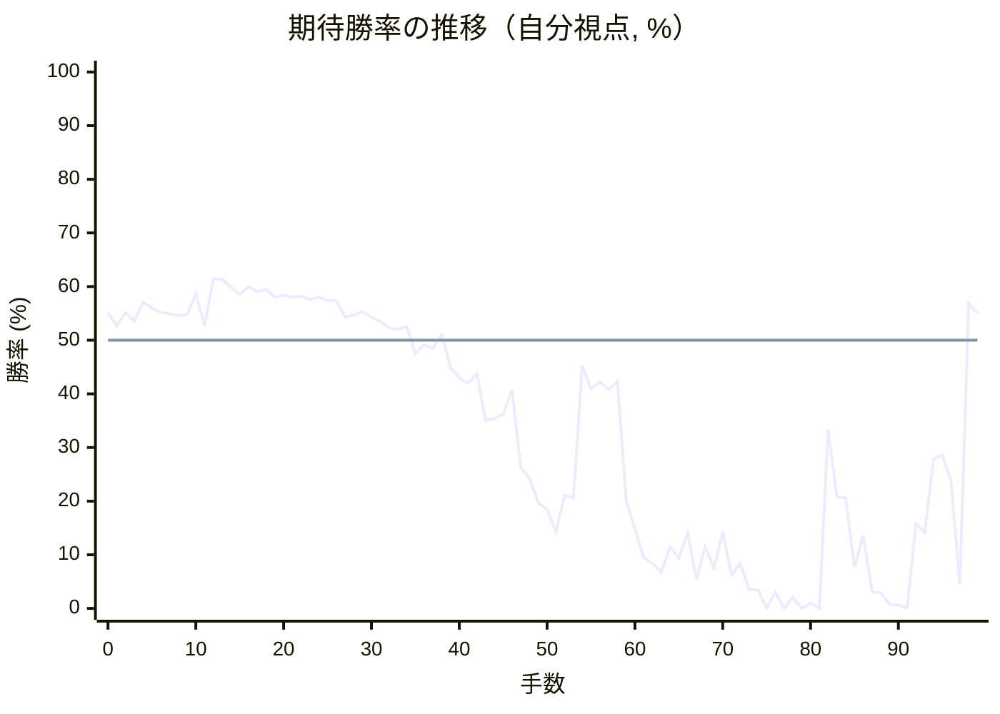
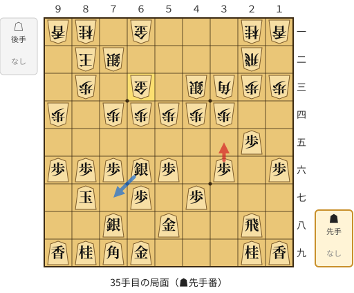
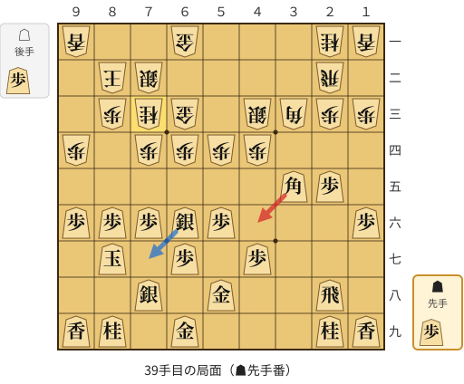
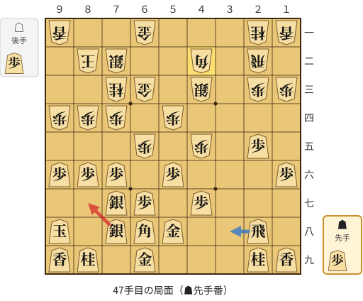
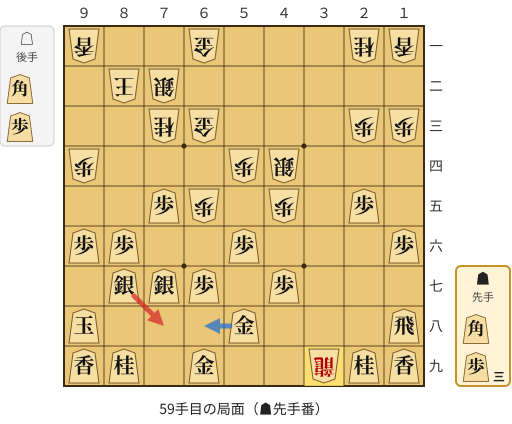
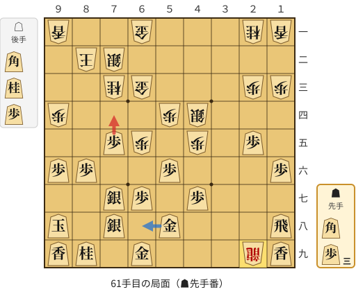
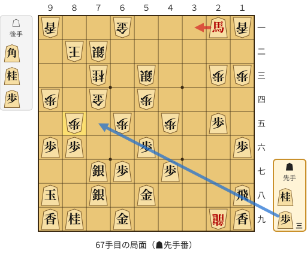
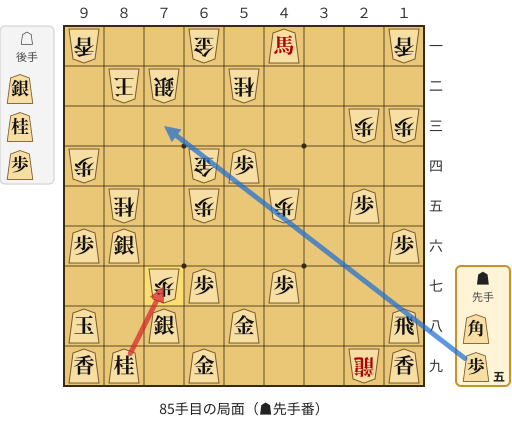
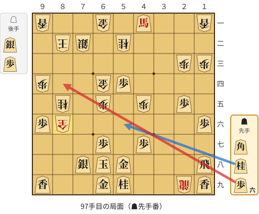

# 解析レポート ts75kqlqwyjy

[README に戻る](../../../README.md)　/　棋譜: [CSA](../../../data/csa/shogi5/ts75kqlqwyjy.csa)　/　解析の見方: [docs/mistake_analysis.md](../../../docs/mistake_analysis.md)

## 対局情報

| 項目 | 内容 |
|---|---|
| 日時 | 2026-11-11 07:41:29 |
| 持ち時間 | 5分 |
| 自分 | 先手（▲）（1655） |
| 相手 | 相手（1656） |
| 結果 | 勝ち（時間切れ, 99手） |

## 解析環境

| 項目 | 内容 |
|---|---|
| エンジン | YaneuraOu NNUE 9.00git 64AVX2（V9.00/YANEURAOU_ENGINE_NNUE/AVX2） |
| 評価関数 | **水匠5**（`suisho5`） |
| nn.bin SHA-256 | `768068f0d534a0603a5d38bcd143de6bbca820d5f1c95a14d40863e5b7892d76` |
| 第1パス | movetime=150ms, MultiPV 1 |
| 第2パス | movetime=2000ms, MultiPV 3 |
| Threads / Hash | 8 / 512MB |
| 判定基準 | 疑問手 ≥5pt, 悪手 ≥10pt, 大悪手 ≥20pt（期待勝率 W(E)=1/(1+exp(-E/600))） |
| 解析日時 | 2026-11-14T10:39:19+09:00（解析バージョン 1, 59秒） |

## サマリー

| 自分の手数 | 深掘りした手 | 詰み逃し | 大悪手 | 悪手 | 疑問手 |
|--:|--:|--:|--:|--:|--:|
| 50 | 11 | 0 | 1 | 3 | 4 |

## 期待勝率の推移



<details><summary>1手ごとの数値（第1パス）</summary>

| 手数 | 指し手 | 評価値 | 勝率 | 低下 | 判定 |
|--:|---|--:|--:|--:|---|
| 1 | ▲７六歩(77) | +65 | 52.7% | +2.4pt |  |
| 2 | △３四歩(33) | +124 | 55.1% |  |  |
| 3 | ▲２六歩(27) | +87 | 53.6% | +1.5pt |  |
| 4 | △４四歩(43) | +172 | 57.1% |  |  |
| 5 | ▲２五歩(26) | +145 | 56.0% | +1.1pt |  |
| 6 | △３三角(22) | +126 | 55.2% |  |  |
| 7 | ▲４八銀(39) | +117 | 54.9% | +0.4pt |  |
| 8 | △３二銀(31) | +111 | 54.6% |  |  |
| 9 | ▲６八玉(59) | +116 | 54.8% | -0.2pt |  |
| 10 | △９四歩(93) | +211 | 58.7% |  |  |
| 11 | ▲９六歩(97) | +66 | 52.7% | +6.0pt |  |
| 12 | △４二飛(82) | +278 | 61.4% |  |  |
| 13 | ▲５六歩(57) | +278 | 61.4% | +0.0pt |  |
| 14 | △６二玉(51) | +241 | 59.9% |  |  |
| 15 | ▲７八玉(68) | +207 | 58.5% | +1.4pt |  |
| 16 | △７二玉(62) | +244 | 60.0% |  |  |
| 17 | ▲８六歩(87) | +220 | 59.1% | +1.0pt |  |
| 18 | △８二玉(72) | +231 | 59.5% |  |  |
| 19 | ▲８七玉(78) | +194 | 58.0% | +1.5pt |  |
| 20 | △７二銀(71) | +203 | 58.4% |  |  |
| 21 | ▲７八銀(79) | +194 | 58.0% | +0.4pt |  |
| 22 | △５二金(41) | +198 | 58.2% |  |  |
| 23 | ▲５七銀(48) | +184 | 57.6% | +0.6pt |  |
| 24 | △４三銀(32) | +194 | 58.0% |  |  |
| 25 | ▲６六銀(57) | +178 | 57.4% | +0.7pt |  |
| 26 | △５四歩(53) | +180 | 57.4% |  |  |
| 27 | ▲１六歩(17) | +104 | 54.3% | +3.1pt |  |
| 28 | △６四歩(63) | +113 | 54.7% |  |  |
| 29 | ▲３六歩(37) | +128 | 55.3% | -0.6pt |  |
| 30 | △７四歩(73) | +103 | 54.3% |  |  |
| 31 | ▲７九角(88) | +83 | 53.5% | +0.8pt |  |
| 32 | △２二飛(42) | +55 | 52.3% |  |  |
| 33 | ▲５八金(49) | +48 | 52.0% | +0.3pt |  |
| 34 | △６三金(52) | +63 | 52.6% |  |  |
| 35 | ▲３五歩(36) | -58 | 47.6% | +5.0pt | [疑問手](#ply-35) |
| 36 | △同歩(34) | -20 | 49.2% |  |  |
| 37 | ▲同角(79) | -35 | 48.5% | +0.6pt |  |
| 38 | △７三桂(81) | +23 | 51.0% |  |  |
| 39 | ▲４六角(35) | -124 | 44.9% | +6.1pt | [疑問手](#ply-39) |
| 40 | △４五歩(44) | -170 | 43.0% |  |  |
| 41 | ▲６八角(46) | -194 | 42.0% | +1.0pt |  |
| 42 | △８四歩(83) | -153 | 43.7% |  |  |
| 43 | ▲９八玉(87) | -371 | 35.0% | +8.6pt |  |
| 44 | △６五歩(64) | -362 | 35.4% |  |  |
| 45 | ▲７七銀(66) | -340 | 36.2% | -0.8pt |  |
| 46 | △４二角(33) | -225 | 40.7% |  |  |
| 47 | ▲８七銀(78) | -618 | 26.3% | +14.4pt | [悪手](#ply-47) |
| 48 | △６四角(42) | -684 | 24.2% |  |  |
| 49 | ▲１八飛(28) | -844 | 19.7% | +4.6pt |  |
| 50 | △３二飛(22) | -890 | 18.5% |  |  |
| 51 | ▲５七角(68) | -1074 | 14.3% | +4.2pt |  |
| 52 | △４四銀(43) | -792 | 21.1% |  |  |
| 53 | ▲８四角(57) | -811 | 20.6% | +0.5pt |  |
| 54 | △７五歩(74) | -114 | 45.3% |  |  |
| 55 | ▲同角(84) | -222 | 40.9% | +4.4pt |  |
| 56 | △同角(64) | -187 | 42.3% |  |  |
| 57 | ▲同歩(76) | -224 | 40.8% | +1.5pt |  |
| 58 | △３九飛成(32) | -187 | 42.3% |  |  |
| 59 | ▲７八銀(87) | -823 | 20.2% | +22.0pt | [大悪手](#ply-59) |
| 60 | △２九龍(39) | -1052 | 14.8% |  |  |
| 61 | ▲７四歩(75) | -1351 | 9.5% | +5.2pt | [疑問手](#ply-61) |
| 62 | △同金(63) | -1434 | 8.4% |  |  |
| 63 | ▲４三角打 | -1572 | 6.8% | +1.6pt |  |
| 64 | △５三銀(44) | -1230 | 11.4% |  |  |
| 65 | ▲２一角成(43) | -1358 | 9.4% | +2.0pt |  |
| 66 | △８五歩打 | -1091 | 14.0% |  |  |
| 67 | ▲３一馬(21) | -1718 | 5.4% | +8.6pt | [疑問手](#ply-67) |
| 68 | △６四角打 | -1223 | 11.5% |  |  |
| 69 | ▲４一馬(31) | -1511 | 7.5% | +4.1pt |  |
| 70 | △５二桂打 | -1077 | 14.2% |  |  |
| 71 | ▲７六桂打 | -1616 | 6.3% | +7.9pt |  |
| 72 | △７五角(64) | -1434 | 8.4% |  |  |
| 73 | ▲５五歩(56) | -1996 | 3.5% | +4.9pt |  |
| 74 | △８六歩(85) | -1998 | 3.5% |  |  |
| 75 | ▲５四歩(55) | -5604 | 0.0% | +3.4pt |  |
| 76 | △６四銀(53) | -2094 | 3.0% |  |  |
| 77 | ▲同桂(76) | -4727 | 0.0% | +2.9pt |  |
| 78 | △同角(75) | -2298 | 2.1% |  |  |
| 79 | ▲５三銀打 | #-21 | 0.0% | +2.1pt |  |
| 80 | △８五桂(73) | -2781 | 1.0% |  |  |
| 81 | ▲６四銀成(53) | -6124 | 0.0% | +1.0pt |  |
| 82 | △同金(74) | -417 | 33.3% |  |  |
| 83 | ▲８六銀(77) | -802 | 20.8% | +12.5pt |  |
| 84 | △７七歩打 | -811 | 20.6% |  |  |
| 85 | ▲同桂(89) | -1491 | 7.7% | +12.9pt | [悪手](#ply-85) |
| 86 | △同桂成(85) | -1108 | 13.6% |  |  |
| 87 | ▲同銀(86) | -2058 | 3.1% | +10.5pt |  |
| 88 | △８五桂打 | -2108 | 2.9% |  |  |
| 89 | ▲５九桂打 | -2894 | 0.8% | +2.1pt |  |
| 90 | △９七銀打 | -3070 | 0.6% |  |  |
| 91 | ▲８七玉(98) | -4531 | 0.1% | +0.5pt |  |
| 92 | △７七桂成(85) | -1004 | 15.8% |  |  |
| 93 | ▲同玉(87) | -1082 | 14.1% | +1.7pt |  |
| 94 | △８五桂打 | -571 | 27.9% |  |  |
| 95 | ▲６八玉(77) | -550 | 28.6% | -0.7pt |  |
| 96 | △８六銀成(97) | -703 | 23.7% |  |  |
| 97 | ▲８四歩打 | -1850 | 4.4% | +19.3pt | [悪手](#ply-97) |
| 98 | △７七歩打 | +166 | 56.9% |  |  |
| 99 | ▲８九銀(78) | +121 | 55.0% | +1.8pt |  |

</details>

## 課題局面

<a id="ply-35"></a>
### 35手目 ▲３五歩(36) — 疑問手

| | 着手前 | 着手後 | 差 |
|---|--:|--:|--:|
| 期待勝率 | 53.2% | 45.3% | -7.8pt |
| 評価値 | +76 | -112 | |

着手前の局面:



🔴 実戦 ▲３五歩(36)　🔵 AI推奨 ▲７七銀(66)　🟨 直前の相手の指し手

<details><summary>テキストの盤面図（BOD・将棋ソフトに貼り付け可）</summary>

```text
後手の持駒：なし
  ９ ８ ７ ６ ５ ４ ３ ２ １
+---------------------------+
|v香v桂 ・v金 ・ ・ ・v桂v香|一
| ・v玉v銀 ・ ・ ・ ・v飛 ・|二
| ・v歩 ・v金 ・v銀v角v歩v歩|三
|v歩 ・v歩v歩v歩v歩v歩 ・ ・|四
| ・ ・ ・ ・ ・ ・ ・ 歩 ・|五
| 歩 歩 歩 銀 歩 ・ 歩 ・ 歩|六
| ・ 玉 ・ 歩 ・ 歩 ・ ・ ・|七
| ・ ・ 銀 ・ 金 ・ ・ 飛 ・|八
| 香 桂 角 金 ・ ・ ・ 桂 香|九
+---------------------------+
先手の持駒：なし
手数＝34　△６三金　まで
```

</details>

| | 指し手 | 評価値 | 読み筋 |
|---|---|--:|---|
| 実戦 | ▲３五歩(36) | -112 | △同歩(34) ▲同角(79) △４五歩(44) ▲３八飛(28) △３二飛(22) ▲３七飛(38) |
| AI 1位 | ▲７七銀(66) | +76 | ▲７七銀(66) △６五歩(64) ▲６六歩(67) △同歩(65) ▲同銀(77) △４五歩(44) |
| AI 2位 | ▲３七桂(29) | +41 | ▲３七桂(29) △７三桂(81) ▲７七桂(89) △８四歩(83) ▲８八玉(87) △６二金(61) |
| AI 3位 | ▲７七桂(89) | -2 | ▲７七桂(89) △４五歩(44) ▲３七桂(29) △４四銀(43) ▲４六歩(47) △同歩(45) |

SFEN: `ln1g3nl/1ks4r1/1p1g1sbpp/p1ppppp2/7P1/PPPSP1P1P/1K1P1P3/2S1G2R1/LNBG3NL b - 35`

<a id="ply-39"></a>
### 39手目 ▲４六角(35) — 疑問手

| | 着手前 | 着手後 | 差 |
|---|--:|--:|--:|
| 期待勝率 | 48.4% | 42.8% | -5.6pt |
| 評価値 | -38 | -174 | |

着手前の局面:



🔴 実戦 ▲４六角(35)　🔵 AI推奨 ▲７七銀(66)　🟨 直前の相手の指し手

<details><summary>テキストの盤面図（BOD・将棋ソフトに貼り付け可）</summary>

```text
後手の持駒：歩
  ９ ８ ７ ６ ５ ４ ３ ２ １
+---------------------------+
|v香 ・ ・v金 ・ ・ ・v桂v香|一
| ・v玉v銀 ・ ・ ・ ・v飛 ・|二
| ・v歩v桂v金 ・v銀v角v歩v歩|三
|v歩 ・v歩v歩v歩v歩 ・ ・ ・|四
| ・ ・ ・ ・ ・ ・ 角 歩 ・|五
| 歩 歩 歩 銀 歩 ・ ・ ・ 歩|六
| ・ 玉 ・ 歩 ・ 歩 ・ ・ ・|七
| ・ ・ 銀 ・ 金 ・ ・ 飛 ・|八
| 香 桂 ・ 金 ・ ・ ・ 桂 香|九
+---------------------------+
先手の持駒：歩
手数＝38　△７三桂　まで
```

</details>

| | 指し手 | 評価値 | 読み筋 |
|---|---|--:|---|
| 実戦 | ▲４六角(35) | -174 | △４五歩(44) ▲６八角(46) △８四歩(83) ▲３八飛(28) △３二飛(22) ▲３五飛(38) |
| AI 1位 | ▲７七銀(66) | -38 | ▲７七銀(66) △４二角(33) ▲３八飛(28) △３二飛(22) ▲３七飛(38) △５三角(42) |
| AI 2位 | ▲７七銀(66) | -52 | ▲７七銀(66) △４二角(33) ▲３八飛(28) △３二飛(22) ▲６六歩(67) △８四歩(83) |
| AI 3位 | ▲２六飛(28) | -71 | ▲２六飛(28) △８四歩(83) ▲３六飛(26) △４二角(33) ▲６八角(35) △３二飛(22) |

SFEN: `l2g3nl/1ks4r1/1png1sbpp/p1pppp3/6BP1/PPPSP3P/1K1P1P3/2S1G2R1/LN1G3NL b Pp 39`

<a id="ply-47"></a>
### 47手目 ▲８七銀(78) — 悪手

| | 着手前 | 着手後 | 差 |
|---|--:|--:|--:|
| 期待勝率 | 36.7% | 22.4% | -14.3pt |
| 評価値 | -327 | -744 | |

着手前の局面:



🔴 実戦 ▲８七銀(78)　🔵 AI推奨 ▲３八飛(28)　🟨 直前の相手の指し手

<details><summary>テキストの盤面図（BOD・将棋ソフトに貼り付け可）</summary>

```text
後手の持駒：歩
  ９ ８ ７ ６ ５ ４ ３ ２ １
+---------------------------+
|v香 ・ ・v金 ・ ・ ・v桂v香|一
| ・v玉v銀 ・ ・v角 ・v飛 ・|二
| ・ ・v桂v金 ・v銀 ・v歩v歩|三
|v歩v歩v歩 ・v歩 ・ ・ ・ ・|四
| ・ ・ ・v歩 ・v歩 ・ 歩 ・|五
| 歩 歩 歩 ・ 歩 ・ ・ ・ 歩|六
| ・ ・ 銀 歩 ・ 歩 ・ ・ ・|七
| 玉 ・ 銀 角 金 ・ ・ 飛 ・|八
| 香 桂 ・ 金 ・ ・ ・ 桂 香|九
+---------------------------+
先手の持駒：歩
手数＝46　△４二角　まで
```

</details>

| | 指し手 | 評価値 | 読み筋 |
|---|---|--:|---|
| 実戦 | ▲８七銀(78) | -744 | △６四角(42) ▲３七歩打 △３六歩打 ▲５九角(68) △３二飛(22) ▲２七飛(28) |
| AI 1位 | ▲３八飛(28) | -327 | ▲３八飛(28) △６四角(42) ▲５九角(68) △３二飛(22) ▲同飛成(38) △同銀(43) |
| AI 2位 | ▲４六歩(47) | -396 | ▲４六歩(47) △３二飛(22) ▲３七歩打 △４六歩(45) ▲同角(68) △３四飛(32) |
| AI 3位 | ▲６六歩(67) | -441 | ▲６六歩(67) △３二飛(22) ▲３七歩打 △６六歩(65) ▲２四歩(25) △同歩(23) |

SFEN: `l2g3nl/1ks2b1r1/2ng1s1pp/ppp1p4/3p1p1P1/PPP1P3P/2SP1P3/K1SBG2R1/LN1G3NL b Pp 47`

<a id="ply-59"></a>
### 59手目 ▲７八銀(87) — 大悪手

| | 着手前 | 着手後 | 差 |
|---|--:|--:|--:|
| 期待勝率 | 41.9% | 13.7% | -28.1pt |
| 評価値 | -197 | -1103 | |

着手前の局面:



🔴 実戦 ▲７八銀(87)　🔵 AI推奨 ▲６八金(58)　🟨 直前の相手の指し手

<details><summary>テキストの盤面図（BOD・将棋ソフトに貼り付け可）</summary>

```text
後手の持駒：角　歩
  ９ ８ ７ ６ ５ ４ ３ ２ １
+---------------------------+
|v香 ・ ・v金 ・ ・ ・v桂v香|一
| ・v玉v銀 ・ ・ ・ ・ ・ ・|二
| ・ ・v桂v金 ・ ・ ・v歩v歩|三
|v歩 ・ ・ ・v歩v銀 ・ ・ ・|四
| ・ ・ 歩v歩 ・v歩 ・ 歩 ・|五
| 歩 歩 ・ ・ 歩 ・ ・ ・ 歩|六
| ・ 銀 銀 歩 ・ 歩 ・ ・ ・|七
| 玉 ・ ・ ・ 金 ・ ・ ・ 飛|八
| 香 桂 ・ 金 ・ ・v龍 桂 香|九
+---------------------------+
先手の持駒：角　歩三
手数＝58　△３九飛成　まで
```

</details>

| | 指し手 | 評価値 | 読み筋 |
|---|---|--:|---|
| 実戦 | ▲７八銀(87) | -1103 | △２九龍(39) ▲２二角打 △３三桂(21) ▲３四歩打 △９五歩(94) ▲３三歩成(34) |
| AI 1位 | ▲６八金(58) | -197 | ▲６八金(58) △２九龍(39) ▲２二角打 △３三桂(21) ▲１一角成(22) △６六歩(65) |
| AI 2位 | ▲７八金(69) | -482 | ▲７八金(69) △２九龍(39) ▲２二角打 △９五歩(94) ▲同歩(96) △７六歩打 |
| AI 3位 | ▲５九金(58) | -563 | ▲５九金(58) △２九龍(39) ▲４三角打 △５七桂打 ▲５八金(69) △９五歩(94) |

SFEN: `l2g3nl/1ks6/2ng3pp/p3ps3/2Pp1p1P1/PP2P3P/1SSP1P3/K3G3R/LN1G2+rNL b B3Pbp 59`

<a id="ply-61"></a>
### 61手目 ▲７四歩(75) — 疑問手

| | 着手前 | 着手後 | 差 |
|---|--:|--:|--:|
| 期待勝率 | 14.0% | 6.8% | -7.2pt |
| 評価値 | -1088 | -1572 | |

着手前の局面:



🔴 実戦 ▲７四歩(75)　🔵 AI推奨 ▲６八金(58)　🟨 直前の相手の指し手

<details><summary>テキストの盤面図（BOD・将棋ソフトに貼り付け可）</summary>

```text
後手の持駒：角　桂　歩
  ９ ８ ７ ６ ５ ４ ３ ２ １
+---------------------------+
|v香 ・ ・v金 ・ ・ ・v桂v香|一
| ・v玉v銀 ・ ・ ・ ・ ・ ・|二
| ・ ・v桂v金 ・ ・ ・v歩v歩|三
|v歩 ・ ・ ・v歩v銀 ・ ・ ・|四
| ・ ・ 歩v歩 ・v歩 ・ 歩 ・|五
| 歩 歩 ・ ・ 歩 ・ ・ ・ 歩|六
| ・ ・ 銀 歩 ・ 歩 ・ ・ ・|七
| 玉 ・ 銀 ・ 金 ・ ・ ・ 飛|八
| 香 桂 ・ 金 ・ ・ ・v龍 香|九
+---------------------------+
先手の持駒：角　歩三
手数＝60　△２九龍　まで
```

</details>

| | 指し手 | 評価値 | 読み筋 |
|---|---|--:|---|
| 実戦 | ▲７四歩(75) | -1572 | △同金(63) ▲７六歩打 △９五歩(94) ▲同歩(96) △９六歩打 ▲２二角打 |
| AI 1位 | ▲６八金(58) | -1088 | ▲６八金(58) △８四桂打 ▲８七銀(78) △９五歩(94) ▲同歩(96) △７一玉(82) |
| AI 2位 | ▲４一角打 | -1175 | ▲４一角打 △９五歩(94) ▲７四歩(75) △９六歩(95) ▲９三歩打 △８五歩打 |
| AI 3位 | ▲２二角打 | -1218 | ▲２二角打 △３三桂(21) ▲６八金(58) △８四桂打 ▲１一角成(22) △７六歩打 |

SFEN: `l2g3nl/1ks6/2ng3pp/p3ps3/2Pp1p1P1/PP2P3P/2SP1P3/K1S1G3R/LN1G3+rL b B3Pbnp 61`

<a id="ply-67"></a>
### 67手目 ▲３一馬(21) — 疑問手

| | 着手前 | 着手後 | 差 |
|---|--:|--:|--:|
| 期待勝率 | 9.5% | 3.1% | -6.4pt |
| 評価値 | -1355 | -2070 | |

着手前の局面:



🔴 実戦 ▲３一馬(21)　🔵 AI推奨 ▲７五歩打　🟨 直前の相手の指し手

<details><summary>テキストの盤面図（BOD・将棋ソフトに貼り付け可）</summary>

```text
後手の持駒：角　桂　歩
  ９ ８ ７ ６ ５ ４ ３ ２ １
+---------------------------+
|v香 ・ ・v金 ・ ・ ・ 馬v香|一
| ・v玉v銀 ・ ・ ・ ・ ・ ・|二
| ・ ・v桂 ・v銀 ・ ・v歩v歩|三
|v歩 ・v金 ・v歩 ・ ・ ・ ・|四
| ・v歩 ・v歩 ・v歩 ・ 歩 ・|五
| 歩 歩 ・ ・ 歩 ・ ・ ・ 歩|六
| ・ ・ 銀 歩 ・ 歩 ・ ・ ・|七
| 玉 ・ 銀 ・ 金 ・ ・ ・ 飛|八
| 香 桂 ・ 金 ・ ・ ・v龍 香|九
+---------------------------+
先手の持駒：桂　歩三
手数＝66　△８五歩　まで
```

</details>

| | 指し手 | 評価値 | 読み筋 |
|---|---|--:|---|
| 実戦 | ▲３一馬(21) | -2070 | △８六歩(85) ▲８八歩打 △６四銀(53) ▲６八金(58) △７五歩打 ▲７六歩打 |
| AI 1位 | ▲７五歩打 | -1355 | ▲７五歩打 △同金(74) ▲７六歩打 △８六金(75) ▲５九金(58) △７四歩打 |
| AI 2位 | ▲１一馬(21) | -1382 | ▲１一馬(21) △８六歩(85) ▲６八金(58) △７六歩打 ▲８六銀(77) △８五歩打 |
| AI 3位 | ▲５九金(58) | -1431 | ▲５九金(58) △８六歩(85) ▲７五歩打 △８四金(74) ▲４三馬(21) △７六歩打 |

SFEN: `l2g3+Bl/1ks6/2n1s2pp/p1g1p4/1p1p1p1P1/PP2P3P/2SP1P3/K1S1G3R/LN1G3+rL b N3Pbnp 67`

<a id="ply-85"></a>
### 85手目 ▲同桂(89) — 悪手

| | 着手前 | 着手後 | 差 |
|---|--:|--:|--:|
| 期待勝率 | 13.5% | 2.0% | -11.5pt |
| 評価値 | -1115 | -2328 | |

着手前の局面:



🔴 実戦 ▲同桂(89)　🔵 AI推奨 ▲７三歩打　🟨 直前の相手の指し手

<details><summary>テキストの盤面図（BOD・将棋ソフトに貼り付け可）</summary>

```text
後手の持駒：銀　桂　歩
  ９ ８ ７ ６ ５ ４ ３ ２ １
+---------------------------+
|v香 ・ ・v金 ・ 馬 ・ ・v香|一
| ・v玉v銀 ・v桂 ・ ・ ・ ・|二
| ・ ・ ・ ・ ・ ・ ・v歩v歩|三
|v歩 ・ ・v金 歩 ・ ・ ・ ・|四
| ・v桂 ・v歩 ・v歩 ・ 歩 ・|五
| 歩 銀 ・ ・ ・ ・ ・ ・ 歩|六
| ・ ・v歩 歩 ・ 歩 ・ ・ ・|七
| 玉 ・ 銀 ・ 金 ・ ・ ・ 飛|八
| 香 桂 ・ 金 ・ ・ ・v龍 香|九
+---------------------------+
先手の持駒：角　歩五
手数＝84　△７七歩　まで
```

</details>

| | 指し手 | 評価値 | 読み筋 |
|---|---|--:|---|
| 実戦 | ▲同桂(89) | -2328 | △同桂成(85) ▲８三歩打 △同銀(72) ▲８四歩打 △同銀(83) ▲８三歩打 |
| AI 1位 | ▲７三歩打 | -1115 | ▲７三歩打 △７八歩成(77) ▲７二歩成(73) △同金(61) ▲８三歩打 △同金(72) |
| AI 2位 | ▲４二馬(41) | -1177 | ▲４二馬(41) △７八歩成(77) ▲８五銀(86) △７五銀打 ▲７四桂打 △９二玉(82) |
| AI 3位 | ▲８三歩打 | -1386 | ▲８三歩打 △同銀(72) ▲７四歩打 △７八歩成(77) ▲同金(69) △７六銀打 |

SFEN: `l2g1+B2l/1ks1n4/7pp/p2gP4/1n1p1p1P1/PS6P/2pP1P3/K1S1G3R/LN1G3+rL b B5Psnp 85`

<a id="ply-97"></a>
### 97手目 ▲８四歩打 — 悪手

| | 着手前 | 着手後 | 差 |
|---|--:|--:|--:|
| 期待勝率 | 19.5% | 0.4% | -19.0pt |
| 評価値 | -852 | -3275 | |

着手前の局面:



🔴 実戦 ▲８四歩打　🔵 AI推奨 ▲５六桂打　🟨 直前の相手の指し手

<details><summary>テキストの盤面図（BOD・将棋ソフトに貼り付け可）</summary>

```text
後手の持駒：銀　歩
  ９ ８ ７ ６ ５ ４ ３ ２ １
+---------------------------+
|v香 ・ ・v金 ・ 馬 ・ ・v香|一
| ・v玉v銀 ・v桂 ・ ・ ・ ・|二
| ・ ・ ・ ・ ・ ・ ・v歩v歩|三
|v歩 ・ ・v金 歩 ・ ・ ・ ・|四
| ・v桂 ・v歩 ・v歩 ・ 歩 ・|五
| 歩v全 ・ ・ ・ ・ ・ ・ 歩|六
| ・ ・ ・ 歩 ・ 歩 ・ ・ ・|七
| ・ ・ 銀 玉 金 ・ ・ ・ 飛|八
| 香 ・ ・ 金 桂 ・ ・v龍 香|九
+---------------------------+
先手の持駒：角　桂　歩六
手数＝96　△８六銀成　まで
```

</details>

| | 指し手 | 評価値 | 読み筋 |
|---|---|--:|---|
| 実戦 | ▲８四歩打 | -3275 | △７七銀打 ▲同銀(78) △同桂成(85) ▲５七玉(68) △５六歩打 ▲同玉(57) |
| AI 1位 | ▲５六桂打 | -852 | ▲５六桂打 △５四金(64) ▲８三歩打 △同玉(82) ▲８四歩打 △同玉(83) |
| AI 2位 | ▲８三歩打 | -954 | ▲８三歩打 △同銀(72) ▲５六桂打 △７七歩打 ▲８九銀(78) △５五金(64) |
| AI 3位 | ▲８三歩打 | -972 | ▲８三歩打 △同銀(72) ▲５六桂打 △７七歩打 ▲８九銀(78) △５五金(64) |

SFEN: `l2g1+B2l/1ks1n4/7pp/p2gP4/1n1p1p1P1/P+s6P/3P1P3/2SKG3R/L2GN2+rL b BN6Psp 97`

