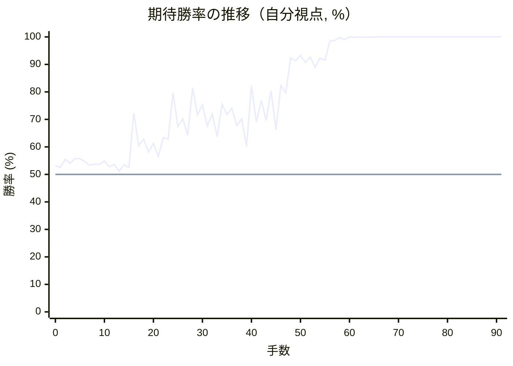
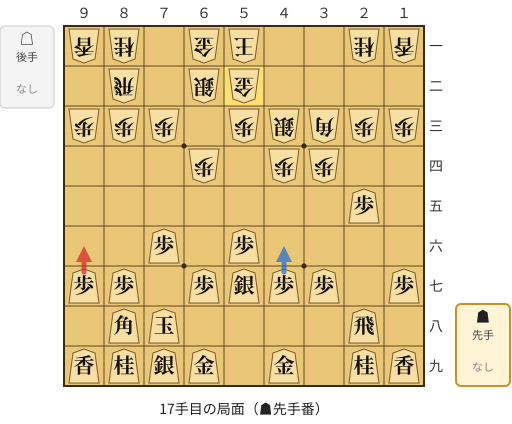
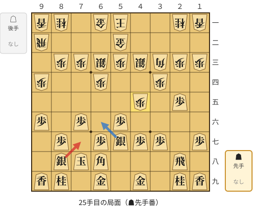
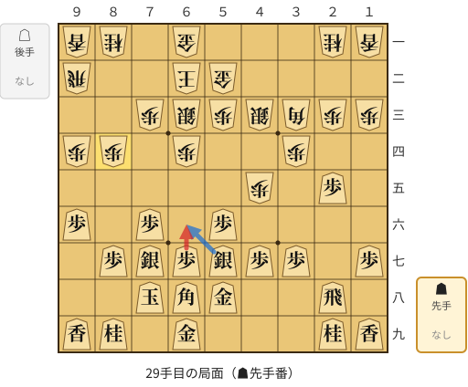
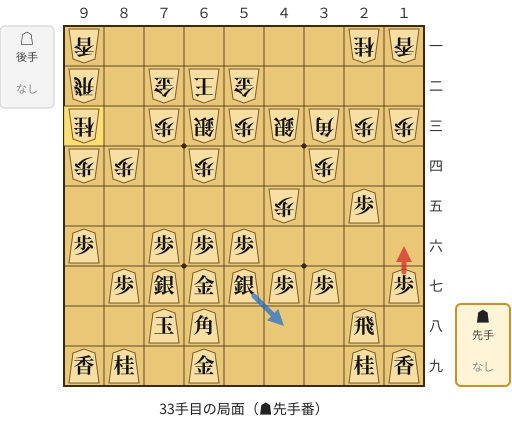
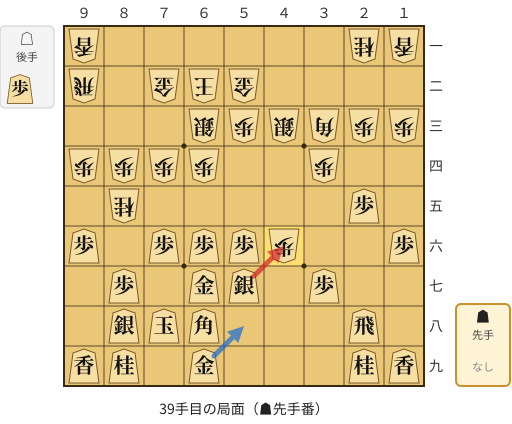
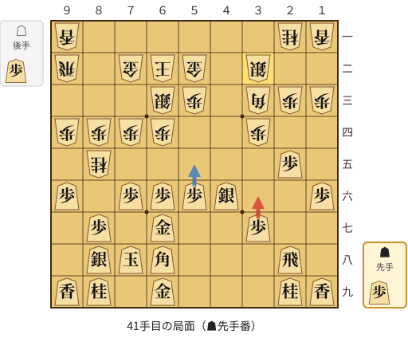
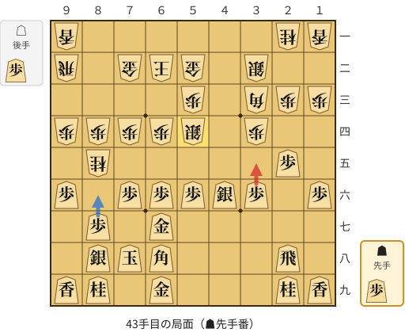
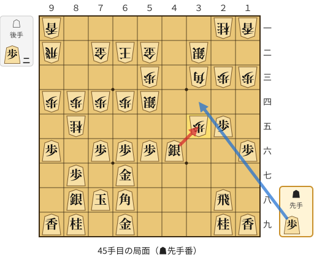

# 解析レポート u5257tm4vzef

[README に戻る](../../../README.md)　/　棋譜: [CSA](../../../data/csa/shogi5/u5257tm4vzef.csa)　/　解析の見方: [docs/mistake_analysis.md](../../../docs/mistake_analysis.md)

## 対局情報

| 項目 | 内容 |
|---|---|
| 日時 | 2026-11-17 02:33:05 |
| 持ち時間 | 5分 |
| 自分 | 先手（▲）（1674） |
| 相手 | 相手（1527） |
| 結果 | 勝ち（投了, 91手） |

## 解析環境

| 項目 | 内容 |
|---|---|
| エンジン | YaneuraOu NNUE 9.00git 64AVX2（V9.00/YANEURAOU_ENGINE_NNUE/AVX2） |
| 評価関数 | **水匠5**（`suisho5`） |
| nn.bin SHA-256 | `768068f0d534a0603a5d38bcd143de6bbca820d5f1c95a14d40863e5b7892d76` |
| 第1パス | movetime=150ms, MultiPV 1 |
| 第2パス | movetime=2000ms, MultiPV 3 |
| Threads / Hash | 8 / 512MB |
| 判定基準 | 疑問手 ≥5pt, 悪手 ≥10pt, 大悪手 ≥20pt（期待勝率 W(E)=1/(1+exp(-E/600))） |
| 解析日時 | 2026-11-20T20:17:25+09:00（解析バージョン 1, 62秒） |

## サマリー

| 自分の手数 | 深掘りした手 | 詰み逃し | 大悪手 | 悪手 | 疑問手 |
|--:|--:|--:|--:|--:|--:|
| 46 | 12 | 0 | 0 | 6 | 2 |

## 期待勝率の推移



<details><summary>1手ごとの数値（第1パス）</summary>

| 手数 | 指し手 | 評価値 | 勝率 | 低下 | 判定 |
|--:|---|--:|--:|--:|---|
| 1 | ▲７六歩(77) | +61 | 52.5% | +0.7pt |  |
| 2 | △３四歩(33) | +132 | 55.5% |  |  |
| 3 | ▲２六歩(27) | +95 | 54.0% | +1.5pt |  |
| 4 | △４四歩(43) | +141 | 55.8% |  |  |
| 5 | ▲２五歩(26) | +137 | 55.7% | +0.2pt |  |
| 6 | △３三角(22) | +113 | 54.7% |  |  |
| 7 | ▲４八銀(39) | +80 | 53.3% | +1.4pt |  |
| 8 | △３二銀(31) | +91 | 53.8% |  |  |
| 9 | ▲６八玉(59) | +86 | 53.6% | +0.2pt |  |
| 10 | △４三銀(32) | +118 | 54.9% |  |  |
| 11 | ▲７八玉(68) | +67 | 52.8% | +2.1pt |  |
| 12 | △６二銀(71) | +86 | 53.6% |  |  |
| 13 | ▲５六歩(57) | +30 | 51.2% | +2.3pt |  |
| 14 | △６四歩(63) | +84 | 53.5% |  |  |
| 15 | ▲５七銀(48) | +60 | 52.5% | +1.0pt |  |
| 16 | △５二金(41) | +576 | 72.3% |  |  |
| 17 | ▲９六歩(97) | +257 | 60.5% | +11.8pt | [疑問手](#ply-17) |
| 18 | △６三銀(62) | +313 | 62.8% |  |  |
| 19 | ▲７七角(88) | +197 | 58.1% | +4.6pt |  |
| 20 | △９四歩(93) | +277 | 61.3% |  |  |
| 21 | ▲８八銀(79) | +160 | 56.6% | +4.7pt |  |
| 22 | △９二飛(82) | +330 | 63.4% |  |  |
| 23 | ▲６八角(77) | +315 | 62.8% | +0.6pt |  |
| 24 | △４五歩(44) | +820 | 79.7% |  |  |
| 25 | ▲７七銀(88) | +437 | 67.4% | +12.2pt | [悪手](#ply-25) |
| 26 | △６二玉(51) | +511 | 70.1% |  |  |
| 27 | ▲５八金(49) | +350 | 64.2% | +5.9pt |  |
| 28 | △８四歩(83) | +891 | 81.5% |  |  |
| 29 | ▲６六歩(67) | +558 | 71.7% | +9.8pt | [悪手](#ply-29) |
| 30 | △７二金(61) | +668 | 75.3% |  |  |
| 31 | ▲６七金(58) | +442 | 67.6% | +7.6pt |  |
| 32 | △９三桂(81) | +568 | 72.0% |  |  |
| 33 | ▲１六歩(17) | +338 | 63.7% | +8.3pt | [疑問手](#ply-33) |
| 34 | △８五桂(93) | +676 | 75.5% |  |  |
| 35 | ▲８八銀(77) | +560 | 71.8% | +3.7pt |  |
| 36 | △７四歩(73) | +627 | 74.0% |  |  |
| 37 | ▲４六歩(47) | +447 | 67.8% | +6.2pt |  |
| 38 | △同歩(45) | +515 | 70.2% |  |  |
| 39 | ▲同銀(57) | +246 | 60.1% | +10.1pt | [悪手](#ply-39) |
| 40 | △３二銀(43) | +917 | 82.2% |  |  |
| 41 | ▲３六歩(37) | +481 | 69.0% | +13.1pt | [悪手](#ply-41) |
| 42 | △５四銀(63) | +721 | 76.9% |  |  |
| 43 | ▲３五歩(36) | +496 | 69.6% | +7.3pt | [悪手](#ply-43) |
| 44 | △同歩(34) | +846 | 80.4% |  |  |
| 45 | ▲同銀(46) | +404 | 66.2% | +14.2pt | [悪手](#ply-45) |
| 46 | △４三銀(32) | +923 | 82.3% |  |  |
| 47 | ▲３四歩打 | +821 | 79.7% | +2.6pt |  |
| 48 | △５一角(33) | +1498 | 92.4% |  |  |
| 49 | ▲４四歩打 | +1407 | 91.3% | +1.1pt |  |
| 50 | △３二銀(43) | +1583 | 93.3% |  |  |
| 51 | ▲２四歩(25) | +1367 | 90.7% | +2.6pt |  |
| 52 | △同歩(23) | +1521 | 92.7% |  |  |
| 53 | ▲同銀(35) | +1246 | 88.9% | +3.8pt |  |
| 54 | △７一玉(62) | +1491 | 92.3% |  |  |
| 55 | ▲３五銀(24) | +1425 | 91.5% | +0.8pt |  |
| 56 | △４二角(51) | +2518 | 98.5% |  |  |
| 57 | ▲２二飛成(28) | +2600 | 98.7% | -0.2pt |  |
| 58 | △７五歩(74) | +3703 | 99.8% |  |  |
| 59 | ▲８六歩(87) | +2731 | 99.0% | +0.8pt |  |
| 60 | △８二玉(71) | +4726 | 100.0% |  |  |
| 61 | ▲８五歩(86) | +3717 | 99.8% | +0.2pt |  |
| 62 | △７六歩(75) | +5132 | 100.0% |  |  |
| 63 | ▲８四歩(85) | +3831 | 99.8% | +0.1pt |  |
| 64 | △８六歩打 | +5352 | 100.0% |  |  |
| 65 | ▲同角(68) | +3953 | 99.9% | +0.1pt |  |
| 66 | △８一玉(82) | +5236 | 100.0% |  |  |
| 67 | ▲３二龍(22) | +5564 | 100.0% | -0.0pt |  |
| 68 | △３一歩打 | +5512 | 100.0% |  |  |
| 69 | ▲２一龍(32) | +5756 | 100.0% | -0.0pt |  |
| 70 | △８五歩打 | +5944 | 100.0% |  |  |
| 71 | ▲５九角(86) | +5818 | 100.0% | +0.0pt |  |
| 72 | △６五歩(64) | +5896 | 100.0% |  |  |
| 73 | ▲７六金(67) | +5510 | 100.0% | +0.0pt |  |
| 74 | △６二金(52) | +5794 | 100.0% |  |  |
| 75 | ▲３三歩成(34) | +6010 | 100.0% | -0.0pt |  |
| 76 | △５一角(42) | +6438 | 100.0% |  |  |
| 77 | ▲３一龍(21) | +6477 | 100.0% | -0.0pt |  |
| 78 | △６一金(62) | +6527 | 100.0% |  |  |
| 79 | ▲４二と(33) | +6457 | 100.0% | +0.0pt |  |
| 80 | △同角(51) | +7598 | 100.0% |  |  |
| 81 | ▲６一龍(31) | +7640 | 100.0% | -0.0pt |  |
| 82 | △７一歩打 | +8064 | 100.0% |  |  |
| 83 | ▲８三銀打 | #+10 | 100.0% | -0.0pt |  |
| 84 | △３三角(42) | #+5 | 100.0% |  |  |
| 85 | ▲９二銀成(83) | #+10 | 100.0% | +0.0pt |  |
| 86 | △同香(91) | #+9 | 100.0% |  |  |
| 87 | ▲７五桂打 | +6417 | 100.0% | +0.0pt |  |
| 88 | △６六歩(65) | #+9 | 100.0% |  |  |
| 89 | ▲同金(76) | #+12 | 100.0% | +0.0pt |  |
| 90 | △１四歩(13) | #+9 | 100.0% |  |  |
| 91 | ▲８三歩成(84) | #+8 | 100.0% | +0.0pt |  |

</details>

## 課題局面

<a id="ply-17"></a>
### 17手目 ▲９六歩(97) — 疑問手

| | 着手前 | 着手後 | 差 |
|---|--:|--:|--:|
| 期待勝率 | 69.4% | 63.3% | -6.2pt |
| 評価値 | +492 | +326 | |

着手前の局面:



🔴 実戦 ▲９六歩(97)　🔵 AI推奨 ▲４六歩(47)　🟨 直前の相手の指し手

<details><summary>テキストの盤面図（BOD・将棋ソフトに貼り付け可）</summary>

```text
後手の持駒：なし
  ９ ８ ７ ６ ５ ４ ３ ２ １
+---------------------------+
|v香v桂 ・v金v玉 ・ ・v桂v香|一
| ・v飛 ・v銀v金 ・ ・ ・ ・|二
|v歩v歩v歩 ・v歩v銀v角v歩v歩|三
| ・ ・ ・v歩 ・v歩v歩 ・ ・|四
| ・ ・ ・ ・ ・ ・ ・ 歩 ・|五
| ・ ・ 歩 ・ 歩 ・ ・ ・ ・|六
| 歩 歩 ・ 歩 銀 歩 歩 ・ 歩|七
| ・ 角 玉 ・ ・ ・ ・ 飛 ・|八
| 香 桂 銀 金 ・ 金 ・ 桂 香|九
+---------------------------+
先手の持駒：なし
手数＝16　△５二金左　まで
```

</details>

| | 指し手 | 評価値 | 読み筋 |
|---|---|--:|---|
| 実戦 | ▲９六歩(97) | +326 | △６三銀(62) ▲５八金(49) △８四歩(83) ▲３六歩(37) △５四銀(63) ▲７七角(88) |
| AI 1位 | ▲４六歩(47) | +492 | ▲４六歩(47) △４二金(52) ▲４五歩(46) △３二金(42) ▲４四歩(45) △同角(33) |
| AI 2位 | ▲５八金(49) | +414 | ▲５八金(49) △６三銀(62) ▲３六歩(37) △７四歩(73) ▲４六歩(47) △７五歩(74) |
| AI 3位 | ▲３六歩(37) | +382 | ▲３六歩(37) △６三銀(62) ▲３五歩(36) △同歩(34) ▲４六銀(57) △３四銀(43) |

SFEN: `ln1gk2nl/1r1sg4/ppp1psbpp/3p1pp2/7P1/2P1P4/PP1PSPP1P/1BK4R1/LNSG1G1NL b - 17`

<a id="ply-25"></a>
### 25手目 ▲７七銀(88) — 悪手

| | 着手前 | 着手後 | 差 |
|---|--:|--:|--:|
| 期待勝率 | 79.1% | 67.6% | -11.4pt |
| 評価値 | +797 | +442 | |

着手前の局面:



🔴 実戦 ▲７七銀(88)　🔵 AI推奨 ▲６六銀(57)　🟨 直前の相手の指し手

<details><summary>テキストの盤面図（BOD・将棋ソフトに貼り付け可）</summary>

```text
後手の持駒：なし
  ９ ８ ７ ６ ５ ４ ３ ２ １
+---------------------------+
|v香v桂 ・v金v玉 ・ ・v桂v香|一
|v飛 ・ ・ ・v金 ・ ・ ・ ・|二
| ・v歩v歩v銀v歩v銀v角v歩v歩|三
|v歩 ・ ・v歩 ・ ・v歩 ・ ・|四
| ・ ・ ・ ・ ・v歩 ・ 歩 ・|五
| 歩 ・ 歩 ・ 歩 ・ ・ ・ ・|六
| ・ 歩 ・ 歩 銀 歩 歩 ・ 歩|七
| ・ 銀 玉 角 ・ ・ ・ 飛 ・|八
| 香 桂 ・ 金 ・ 金 ・ 桂 香|九
+---------------------------+
先手の持駒：なし
手数＝24　△４五歩　まで
```

</details>

| | 指し手 | 評価値 | 読み筋 |
|---|---|--:|---|
| 実戦 | ▲７七銀(88) | +442 | △４二金(52) ▲６六銀(57) △３二金(42) ▲３六歩(37) △５四銀(63) ▲３七桂(29) |
| AI 1位 | ▲６六銀(57) | +797 | ▲６六銀(57) △３二銀(43) ▲２四歩(25) △同歩(23) ▲同角(68) △同角(33) |
| AI 2位 | ▲２四歩(25) | +791 | ▲２四歩(25) △同歩(23) ▲６六銀(57) △３二銀(43) ▲２四角(68) △同角(33) |
| AI 3位 | ▲３六歩(37) | +728 | ▲３六歩(37) △４二金(52) ▲３七桂(29) △５四銀(63) ▲４六歩(47) △同歩(45) |

SFEN: `ln1gk2nl/r3g4/1ppspsbpp/p2p2p2/5p1P1/P1P1P4/1P1PSPP1P/1SKB3R1/LN1G1G1NL b - 25`

<a id="ply-29"></a>
### 29手目 ▲６六歩(67) — 悪手

| | 着手前 | 着手後 | 差 |
|---|--:|--:|--:|
| 期待勝率 | 85.9% | 72.0% | -13.9pt |
| 評価値 | +1084 | +568 | |

着手前の局面:



🔴 実戦 ▲６六歩(67)　🔵 AI推奨 ▲６六銀(57)　🟨 直前の相手の指し手

<details><summary>テキストの盤面図（BOD・将棋ソフトに貼り付け可）</summary>

```text
後手の持駒：なし
  ９ ８ ７ ６ ５ ４ ３ ２ １
+---------------------------+
|v香v桂 ・v金 ・ ・ ・v桂v香|一
|v飛 ・ ・v玉v金 ・ ・ ・ ・|二
| ・ ・v歩v銀v歩v銀v角v歩v歩|三
|v歩v歩 ・v歩 ・ ・v歩 ・ ・|四
| ・ ・ ・ ・ ・v歩 ・ 歩 ・|五
| 歩 ・ 歩 ・ 歩 ・ ・ ・ ・|六
| ・ 歩 銀 歩 銀 歩 歩 ・ 歩|七
| ・ ・ 玉 角 金 ・ ・ 飛 ・|八
| 香 桂 ・ 金 ・ ・ ・ 桂 香|九
+---------------------------+
先手の持駒：なし
手数＝28　△８四歩　まで
```

</details>

| | 指し手 | 評価値 | 読み筋 |
|---|---|--:|---|
| 実戦 | ▲６六歩(67) | +568 | △７一玉(62) ▲４六歩(47) △６二飛(92) ▲４五歩(46) △７四銀(63) ▲７五歩(76) |
| AI 1位 | ▲６六銀(57) | +1084 | ▲６六銀(57) △５四歩(53) ▲２四歩(25) △同歩(23) ▲同角(68) △４四角(33) |
| AI 2位 | ▲４八銀(57) | +1083 | ▲４八銀(57) △６五歩(64) ▲２四歩(25) △同歩(23) ▲同角(68) △４四角(33) |
| AI 3位 | ▲２四歩(25) | +950 | ▲２四歩(25) △同角(33) ▲４八銀(57) △３五歩(34) ▲３六歩(37) △４二金(52) |

SFEN: `ln1g3nl/r2kg4/2pspsbpp/pp1p2p2/5p1P1/P1P1P4/1PSPSPP1P/2KBG2R1/LN1G3NL b - 29`

<a id="ply-33"></a>
### 33手目 ▲１六歩(17) — 疑問手

| | 着手前 | 着手後 | 差 |
|---|--:|--:|--:|
| 期待勝率 | 71.9% | 66.7% | -5.3pt |
| 評価値 | +565 | +416 | |

着手前の局面:



🔴 実戦 ▲１六歩(17)　🔵 AI推奨 ▲４八銀(57)　🟨 直前の相手の指し手

<details><summary>テキストの盤面図（BOD・将棋ソフトに貼り付け可）</summary>

```text
後手の持駒：なし
  ９ ８ ７ ６ ５ ４ ３ ２ １
+---------------------------+
|v香 ・ ・ ・ ・ ・ ・v桂v香|一
|v飛 ・v金v玉v金 ・ ・ ・ ・|二
|v桂 ・v歩v銀v歩v銀v角v歩v歩|三
|v歩v歩 ・v歩 ・ ・v歩 ・ ・|四
| ・ ・ ・ ・ ・v歩 ・ 歩 ・|五
| 歩 ・ 歩 歩 歩 ・ ・ ・ ・|六
| ・ 歩 銀 金 銀 歩 歩 ・ 歩|七
| ・ ・ 玉 角 ・ ・ ・ 飛 ・|八
| 香 桂 ・ 金 ・ ・ ・ 桂 香|九
+---------------------------+
先手の持駒：なし
手数＝32　△９三桂　まで
```

</details>

| | 指し手 | 評価値 | 読み筋 |
|---|---|--:|---|
| 実戦 | ▲１六歩(17) | +416 | △８二飛(92) ▲３六歩(37) △８一飛(82) ▲５九角(68) △１四歩(13) ▲２六角(59) |
| AI 1位 | ▲４八銀(57) | +565 | ▲４八銀(57) △８二飛(92) ▲２四歩(25) △同歩(23) ▲同角(68) △４四角(33) |
| AI 2位 | ▲２四歩(25) | +552 | ▲２四歩(25) △同歩(23) ▲４八銀(57) △８二飛(92) ▲２四角(68) △４四角(33) |
| AI 3位 | ▲３六歩(37) | +523 | ▲３六歩(37) △８二飛(92) ▲１六歩(17) △８一飛(82) ▲５九角(68) △３一飛(81) |

SFEN: `l6nl/r1gkg4/n1pspsbpp/pp1p2p2/5p1P1/P1PPP4/1PSGSPP1P/2KB3R1/LN1G3NL b - 33`

<a id="ply-39"></a>
### 39手目 ▲同銀(57) — 悪手

| | 着手前 | 着手後 | 差 |
|---|--:|--:|--:|
| 期待勝率 | 70.9% | 58.1% | -12.8pt |
| 評価値 | +533 | +196 | |

着手前の局面:



🔴 実戦 ▲同銀(57)　🔵 AI推奨 ▲５八金(69)　🟨 直前の相手の指し手

<details><summary>テキストの盤面図（BOD・将棋ソフトに貼り付け可）</summary>

```text
後手の持駒：歩
  ９ ８ ７ ６ ５ ４ ３ ２ １
+---------------------------+
|v香 ・ ・ ・ ・ ・ ・v桂v香|一
|v飛 ・v金v玉v金 ・ ・ ・ ・|二
| ・ ・ ・v銀v歩v銀v角v歩v歩|三
|v歩v歩v歩v歩 ・ ・v歩 ・ ・|四
| ・v桂 ・ ・ ・ ・ ・ 歩 ・|五
| 歩 ・ 歩 歩 歩v歩 ・ ・ 歩|六
| ・ 歩 ・ 金 銀 ・ 歩 ・ ・|七
| ・ 銀 玉 角 ・ ・ ・ 飛 ・|八
| 香 桂 ・ 金 ・ ・ ・ 桂 香|九
+---------------------------+
先手の持駒：なし
手数＝38　△４六同歩　まで
```

</details>

| | 指し手 | 評価値 | 読み筋 |
|---|---|--:|---|
| 実戦 | ▲同銀(57) | +196 | △６五歩(64) ▲同歩(66) △６六歩打 ▲５七金(67) △５四銀(43) ▲８六歩(87) |
| AI 1位 | ▲５八金(69) | +533 | ▲５八金(69) △９五歩(94) ▲同歩(96) △９七歩打 ▲同桂(89) △９五飛(92) |
| AI 2位 | ▲４八飛(28) | +480 | ▲４八飛(28) △９五歩(94) ▲同歩(96) △９七歩打 ▲同桂(89) △９五飛(92) |
| AI 3位 | ▲同銀(57) | +208 | ▲同銀(57) △６五歩(64) ▲同歩(66) △６六歩打 ▲５七金(67) △５四銀(43) |

SFEN: `l6nl/r1gkg4/3spsbpp/pppp2p2/1n5P1/P1PPPp2P/1P1GS1P2/1SKB3R1/LN1G3NL b p 39`

<a id="ply-41"></a>
### 41手目 ▲３六歩(37) — 悪手

| | 着手前 | 着手後 | 差 |
|---|--:|--:|--:|
| 期待勝率 | 85.3% | 72.2% | -13.1pt |
| 評価値 | +1053 | +572 | |

着手前の局面:



🔴 実戦 ▲３六歩(37)　🔵 AI推奨 ▲５五歩(56)　🟨 直前の相手の指し手

<details><summary>テキストの盤面図（BOD・将棋ソフトに貼り付け可）</summary>

```text
後手の持駒：歩
  ９ ８ ７ ６ ５ ４ ３ ２ １
+---------------------------+
|v香 ・ ・ ・ ・ ・ ・v桂v香|一
|v飛 ・v金v玉v金 ・v銀 ・ ・|二
| ・ ・ ・v銀v歩 ・v角v歩v歩|三
|v歩v歩v歩v歩 ・ ・v歩 ・ ・|四
| ・v桂 ・ ・ ・ ・ ・ 歩 ・|五
| 歩 ・ 歩 歩 歩 銀 ・ ・ 歩|六
| ・ 歩 ・ 金 ・ ・ 歩 ・ ・|七
| ・ 銀 玉 角 ・ ・ ・ 飛 ・|八
| 香 桂 ・ 金 ・ ・ ・ 桂 香|九
+---------------------------+
先手の持駒：歩
手数＝40　△３二銀　まで
```

</details>

| | 指し手 | 評価値 | 読み筋 |
|---|---|--:|---|
| 実戦 | ▲３六歩(37) | +572 | △６五歩(64) ▲５七角(68) △９五歩(94) ▲８六歩(87) △６六歩(65) ▲同金(67) |
| AI 1位 | ▲５五歩(56) | +1053 | ▲５五歩(56) △８二飛(92) ▲８六歩(87) △８一飛(82) ▲８五歩(86) △同歩(84) |
| AI 2位 | ▲８六歩(87) | +981 | ▲８六歩(87) △８二飛(92) ▲８五歩(86) △同歩(84) ▲８七歩打 △８一飛(82) |
| AI 3位 | ▲２四歩(25) | +946 | ▲２四歩(25) △同歩(23) ▲８六歩(87) △８二飛(92) ▲８五歩(86) △同歩(84) |

SFEN: `l6nl/r1gkg1s2/3sp1bpp/pppp2p2/1n5P1/P1PPPS2P/1P1G2P2/1SKB3R1/LN1G3NL b Pp 41`

<a id="ply-43"></a>
### 43手目 ▲３五歩(36) — 悪手

| | 着手前 | 着手後 | 差 |
|---|--:|--:|--:|
| 期待勝率 | 82.8% | 71.4% | -11.4pt |
| 評価値 | +944 | +550 | |

着手前の局面:



🔴 実戦 ▲３五歩(36)　🔵 AI推奨 ▲８六歩(87)　🟨 直前の相手の指し手

<details><summary>テキストの盤面図（BOD・将棋ソフトに貼り付け可）</summary>

```text
後手の持駒：歩
  ９ ８ ７ ６ ５ ４ ３ ２ １
+---------------------------+
|v香 ・ ・ ・ ・ ・ ・v桂v香|一
|v飛 ・v金v玉v金 ・v銀 ・ ・|二
| ・ ・ ・ ・v歩 ・v角v歩v歩|三
|v歩v歩v歩v歩v銀 ・v歩 ・ ・|四
| ・v桂 ・ ・ ・ ・ ・ 歩 ・|五
| 歩 ・ 歩 歩 歩 銀 歩 ・ 歩|六
| ・ 歩 ・ 金 ・ ・ ・ ・ ・|七
| ・ 銀 玉 角 ・ ・ ・ 飛 ・|八
| 香 桂 ・ 金 ・ ・ ・ 桂 香|九
+---------------------------+
先手の持駒：歩
手数＝42　△５四銀　まで
```

</details>

| | 指し手 | 評価値 | 読み筋 |
|---|---|--:|---|
| 実戦 | ▲３五歩(36) | +550 | △６五歩(64) ▲５七角(68) △６六歩(65) ▲同金(67) △６五歩打 ▲６七金(66) |
| AI 1位 | ▲８六歩(87) | +944 | ▲８六歩(87) △８二飛(92) ▲８五歩(86) △同歩(84) ▲８七歩打 △６五歩(64) |
| AI 2位 | ▲５七銀(46) | +825 | ▲５七銀(46) △９五歩(94) ▲同歩(96) △９七歩打 ▲同桂(89) △同桂成(85) |
| AI 3位 | ▲２四歩(25) | +718 | ▲２四歩(25) △同歩(23) ▲８六歩(87) △６五歩(64) ▲５七銀(46) △６六歩(65) |

SFEN: `l6nl/r1gkg1s2/4p1bpp/pppps1p2/1n5P1/P1PPPSP1P/1P1G5/1SKB3R1/LN1G3NL b Pp 43`

<a id="ply-45"></a>
### 45手目 ▲同銀(46) — 悪手

| | 着手前 | 着手後 | 差 |
|---|--:|--:|--:|
| 期待勝率 | 86.2% | 67.6% | -18.5pt |
| 評価値 | +1097 | +442 | |

着手前の局面:



🔴 実戦 ▲同銀(46)　🔵 AI推奨 ▲３四歩打　🟨 直前の相手の指し手

<details><summary>テキストの盤面図（BOD・将棋ソフトに貼り付け可）</summary>

```text
後手の持駒：歩二
  ９ ８ ７ ６ ５ ４ ３ ２ １
+---------------------------+
|v香 ・ ・ ・ ・ ・ ・v桂v香|一
|v飛 ・v金v玉v金 ・v銀 ・ ・|二
| ・ ・ ・ ・v歩 ・v角v歩v歩|三
|v歩v歩v歩v歩v銀 ・ ・ ・ ・|四
| ・v桂 ・ ・ ・ ・v歩 歩 ・|五
| 歩 ・ 歩 歩 歩 銀 ・ ・ 歩|六
| ・ 歩 ・ 金 ・ ・ ・ ・ ・|七
| ・ 銀 玉 角 ・ ・ ・ 飛 ・|八
| 香 桂 ・ 金 ・ ・ ・ 桂 香|九
+---------------------------+
先手の持駒：歩
手数＝44　△３五同歩　まで
```

</details>

| | 指し手 | 評価値 | 読み筋 |
|---|---|--:|---|
| 実戦 | ▲同銀(46) | +442 | △６五歩(64) ▲５七金(67) △３六歩打 ▲８六歩(87) △３七歩成(36) ▲２六飛(28) |
| AI 1位 | ▲３四歩打 | +1097 | ▲３四歩打 △２二角(33) ▲２四歩(25) △同歩(23) ▲８六歩(87) △９五歩(94) |
| AI 2位 | ▲２四歩(25) | +1055 | ▲２四歩(25) △同歩(23) ▲３四歩打 △２二角(33) ▲８六歩(87) △６五歩(64) |
| AI 3位 | ▲８六歩(87) | +1045 | ▲８六歩(87) △６五歩(64) ▲５七角(68) △９五歩(94) ▲８五歩(86) △９六歩(95) |

SFEN: `l6nl/r1gkg1s2/4p1bpp/pppps4/1n4pP1/P1PPPS2P/1P1G5/1SKB3R1/LN1G3NL b P2p 45`

