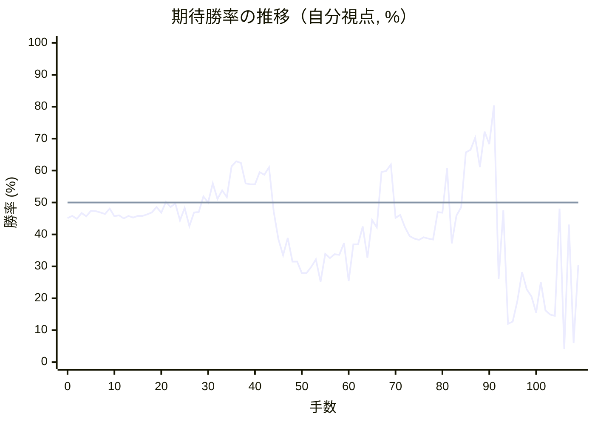

# 解析レポート uc4x6ix8t85a

[README に戻る](../../../README.md)　/　棋譜: [CSA](../../../data/csa/shogi5/uc4x6ix8t85a.csa)　/　解析の見方: [docs/mistake_analysis.md](../../../docs/mistake_analysis.md)

## 対局情報

| 項目 | 内容 |
|---|---|
| 日時 | 2026-10-29 21:45:55 |
| 持ち時間 | 5分 |
| 自分 | 後手（△）（1730） |
| 相手 | 相手（1726） |
| 結果 | 負け（時間切れ, 109手） |

## 解析環境

| 項目 | 内容 |
|---|---|
| エンジン | YaneuraOu NNUE 9.00git 64AVX2（V9.00/YANEURAOU_ENGINE_NNUE/AVX2） |
| 評価関数 | **水匠5**（`suisho5`） |
| nn.bin SHA-256 | `768068f0d534a0603a5d38bcd143de6bbca820d5f1c95a14d40863e5b7892d76` |
| 第1パス | movetime=150ms, MultiPV 1 |
| 第2パス | movetime=2000ms, MultiPV 3 |
| Threads / Hash | 8 / 512MB |
| 判定基準 | 疑問手 ≥5pt, 悪手 ≥10pt, 大悪手 ≥20pt（期待勝率 W(E)=1/(1+exp(-E/600))） |
| 解析日時 | 2026-11-03T04:14:42+09:00（解析バージョン 1, 89秒） |

## サマリー

| 自分の手数 | 深掘りした手 | 詰み逃し | 大悪手 | 悪手 | 疑問手 |
|--:|--:|--:|--:|--:|--:|
| 54 | 18 | 0 | 7 | 2 | 5 |

## 期待勝率の推移



<details><summary>1手ごとの数値（第1パス）</summary>

| 手数 | 指し手 | 評価値 | 勝率 | 低下 | 判定 |
|--:|---|--:|--:|--:|---|
| 1 | ▲２六歩(27) | -100 | 45.8% |  |  |
| 2 | △８四歩(83) | -122 | 44.9% | +0.9pt |  |
| 3 | ▲２五歩(26) | -80 | 46.7% |  |  |
| 4 | △８五歩(84) | -104 | 45.7% | +1.0pt |  |
| 5 | ▲７八金(69) | -62 | 47.4% |  |  |
| 6 | △３二金(41) | -65 | 47.3% | +0.1pt |  |
| 7 | ▲９六歩(97) | -74 | 46.9% |  |  |
| 8 | △５二玉(51) | -86 | 46.4% | +0.5pt |  |
| 9 | ▲５八金(49) | -46 | 48.1% |  |  |
| 10 | △８六歩(85) | -104 | 45.7% | +2.4pt |  |
| 11 | ▲同歩(87) | -95 | 46.0% |  |  |
| 12 | △同飛(82) | -121 | 45.0% | +1.1pt |  |
| 13 | ▲８七歩打 | -101 | 45.8% |  |  |
| 14 | △８四飛(86) | -114 | 45.3% | +0.5pt |  |
| 15 | ▲６八銀(79) | -100 | 45.8% |  |  |
| 16 | △９四歩(93) | -102 | 45.8% | +0.1pt |  |
| 17 | ▲７六歩(77) | -90 | 46.3% |  |  |
| 18 | △７二銀(71) | -75 | 46.9% | -0.6pt |  |
| 19 | ▲６六歩(67) | -33 | 48.6% |  |  |
| 20 | △１四歩(13) | -76 | 46.8% | +1.8pt |  |
| 21 | ▲１六歩(17) | +5 | 50.2% |  |  |
| 22 | △３四歩(33) | -34 | 48.6% | +1.6pt |  |
| 23 | ▲３八銀(39) | -8 | 49.7% |  |  |
| 24 | △３三角(22) | -135 | 44.4% | +5.3pt | [疑問手](#ply-24) |
| 25 | ▲４六歩(47) | -42 | 48.3% |  |  |
| 26 | △２二銀(31) | -180 | 42.6% | +5.7pt |  |
| 27 | ▲４七金(58) | -75 | 46.9% |  |  |
| 28 | △６四歩(63) | -73 | 47.0% | -0.1pt |  |
| 29 | ▲５八玉(59) | +46 | 51.9% |  |  |
| 30 | △６三銀(72) | +0 | 50.0% | +1.9pt |  |
| 31 | ▲４五歩(46) | +144 | 56.0% |  |  |
| 32 | △７四歩(73) | +26 | 51.1% | +4.9pt |  |
| 33 | ▲４六金(47) | +91 | 53.8% |  |  |
| 34 | △５四銀(63) | +42 | 51.7% | +2.0pt |  |
| 35 | ▲５六歩(57) | +276 | 61.3% |  |  |
| 36 | △７三桂(81) | +316 | 62.9% | -1.6pt |  |
| 37 | ▲４七銀(38) | +303 | 62.4% |  |  |
| 38 | △７二金(61) | +144 | 56.0% | +6.4pt | [疑問手](#ply-38) |
| 39 | ▲３六歩(37) | +137 | 55.7% |  |  |
| 40 | △６五歩(64) | +138 | 55.7% | -0.0pt |  |
| 41 | ▲６七銀(68) | +230 | 59.5% |  |  |
| 42 | △６六歩(65) | +211 | 58.7% | +0.8pt |  |
| 43 | ▲同銀(67) | +268 | 61.0% |  |  |
| 44 | △６五歩打 | -68 | 47.2% | +13.8pt | [大悪手](#ply-44) |
| 45 | ▲５五銀(66) | -281 | 38.5% |  |  |
| 46 | △同銀(54) | -412 | 33.5% | +5.0pt | [疑問手](#ply-46) |
| 47 | ▲同歩(56) | -270 | 38.9% |  |  |
| 48 | △８六歩打 | -466 | 31.5% | +7.4pt | [疑問手](#ply-48) |
| 49 | ▲同歩(87) | -467 | 31.5% |  |  |
| 50 | △同飛(84) | -571 | 27.9% | +3.6pt |  |
| 51 | ▲８七歩打 | -571 | 27.9% |  |  |
| 52 | △８一飛(86) | -514 | 29.8% | -1.9pt |  |
| 53 | ▲５六銀(47) | -447 | 32.2% |  |  |
| 54 | △６一飛(81) | -654 | 25.2% | +7.0pt |  |
| 55 | ▲６七歩打 | -401 | 33.9% |  |  |
| 56 | △８一飛(61) | -437 | 32.6% | +1.3pt |  |
| 57 | ▲４七玉(58) | -403 | 33.8% |  |  |
| 58 | △８五銀打 | -410 | 33.6% | +0.3pt |  |
| 59 | ▲７七銀打 | -311 | 37.3% |  |  |
| 60 | △９五歩(94) | -646 | 25.4% | +11.9pt | [疑問手](#ply-60) |
| 61 | ▲７九角(88) | -321 | 36.9% |  |  |
| 62 | △９六歩(95) | -321 | 36.9% | +0.0pt |  |
| 63 | ▲５七角(79) | -181 | 42.5% |  |  |
| 64 | △９七歩成(96) | -433 | 32.7% | +9.8pt | [悪手](#ply-64) |
| 65 | ▲同香(99) | -132 | 44.5% |  |  |
| 66 | △９六歩打 | -188 | 42.2% | +2.3pt |  |
| 67 | ▲９八歩打 | +230 | 59.5% |  |  |
| 68 | △９七歩成(96) | +242 | 59.9% | -0.5pt |  |
| 69 | ▲同歩(98) | +290 | 61.9% |  |  |
| 70 | △８六歩打 | -116 | 45.2% | +16.7pt | [大悪手](#ply-70) |
| 71 | ▲同歩(87) | -94 | 46.1% |  |  |
| 72 | △同銀(85) | -186 | 42.3% | +3.8pt |  |
| 73 | ▲同銀(77) | -255 | 39.5% |  |  |
| 74 | △同飛(81) | -277 | 38.7% | +0.9pt |  |
| 75 | ▲８七歩打 | -287 | 38.3% |  |  |
| 76 | △８一飛(86) | -265 | 39.1% | -0.9pt |  |
| 77 | ▲３五歩(36) | -275 | 38.7% |  |  |
| 78 | △同歩(34) | -283 | 38.4% | +0.3pt |  |
| 79 | ▲同金(46) | -71 | 47.0% |  |  |
| 80 | △４二角(33) | -78 | 46.8% | +0.3pt |  |
| 81 | ▲３七桂(29) | +261 | 60.7% |  |  |
| 82 | △９八歩打 | -313 | 37.2% | +23.5pt | [大悪手](#ply-82) |
| 83 | ▲４四歩(45) | -98 | 45.9% |  |  |
| 84 | △同歩(43) | -37 | 48.5% | -2.5pt |  |
| 85 | ▲同金(35) | +391 | 65.7% |  |  |
| 86 | △４三歩打 | +411 | 66.5% | -0.7pt |  |
| 87 | ▲３四金(44) | +517 | 70.3% |  |  |
| 88 | △９九歩成(98) | +271 | 61.1% | +9.2pt |  |
| 89 | ▲５四歩(55) | +572 | 72.2% |  |  |
| 90 | △同歩(53) | +461 | 68.3% | +3.9pt |  |
| 91 | ▲４五桂(37) | +847 | 80.4% |  |  |
| 92 | △６三金(72) | -624 | 26.1% | +54.3pt | [大悪手](#ply-92) |
| 93 | ▲５三歩打 | -58 | 47.6% |  |  |
| 94 | △同金(63) | -1196 | 12.0% | +35.6pt | [大悪手](#ply-94) |
| 95 | ▲同桂成(45) | -1157 | 12.7% |  |  |
| 96 | △同角(42) | -864 | 19.2% | -6.5pt |  |
| 97 | ▲５五歩打 | -561 | 28.2% |  |  |
| 98 | △６四角(53) | -732 | 22.8% | +5.4pt | [悪手](#ply-98) |
| 99 | ▲７二銀打 | -808 | 20.6% |  |  |
| 100 | △５五歩(54) | -1018 | 15.5% | +5.2pt |  |
| 101 | ▲６三金打 | -657 | 25.1% |  |  |
| 102 | △４一玉(52) | -986 | 16.2% | +8.9pt |  |
| 103 | ▲６四金(63) | -1046 | 14.9% |  |  |
| 104 | △５六歩(55) | -1064 | 14.5% | +0.4pt |  |
| 105 | ▲同玉(47) | -46 | 48.1% |  |  |
| 106 | △５一飛(81) | -1893 | 4.1% | +44.0pt | [大悪手](#ply-106) |
| 107 | ▲５三歩打 | -166 | 43.1% |  |  |
| 108 | △４四銀打 | -1656 | 6.0% | +37.2pt | [大悪手](#ply-108) |
| 109 | ▲６三角打 | -498 | 30.4% |  |  |

</details>

## 課題局面

<a id="ply-24"></a>
### 24手目 △３三角(22) — 疑問手

| | 着手前 | 着手後 | 差 |
|---|--:|--:|--:|
| 期待勝率 | 50.6% | 43.4% | -7.3pt |
| 評価値 | +15 | -160 | |

着手前の局面:

```text
後手の持駒：歩
  ９ ８ ７ ６ ５ ４ ３ ２ １
+---------------------------+
|v香v桂 ・v金 ・ ・v銀v桂v香|一
| ・ ・v銀 ・v玉 ・v金v角 ・|二
| ・ ・v歩v歩v歩v歩 ・v歩 ・|三
|v歩v飛 ・ ・ ・ ・v歩 ・v歩|四
| ・ ・ ・ ・ ・ ・ ・ 歩 ・|五
| 歩 ・ 歩 歩 ・ ・ ・ ・ 歩|六
| ・ 歩 ・ ・ 歩 歩 歩 ・ ・|七
| ・ 角 金 銀 金 ・ 銀 飛 ・|八
| 香 桂 ・ ・ 玉 ・ ・ 桂 香|九
+---------------------------+
先手の持駒：なし
後手番
手数＝23　▲３八銀　まで
```

| | 指し手 | 評価値 | 読み筋 |
|---|---|--:|---|
| 実戦 | △３三角(22) | -160 | ▲６七銀(68) △９五歩(94) ▲同歩(96) △同香(91) ▲９七歩打 △９四飛(84) |
| AI 1位 | △９五歩(94) | +15 | △９五歩(94) ▲同歩(96) △同香(91) ▲９七歩打 △９三桂(81) ▲４六歩(47) |
| AI 2位 | △６二金(61) | -58 | △６二金(61) ▲４六歩(47) △６四歩(63) ▲２四歩(25) △同歩(23) ▲同飛(28) |
| AI 3位 | △７四歩(73) | -65 | △７四歩(73) ▲４六歩(47) △６二金(61) ▲２四歩(25) △同歩(23) ▲同飛(28) |

SFEN: `ln1g2snl/2s1k1gb1/2pppp1p1/pr4p1p/7P1/P1PP4P/1P2PPP2/1BGSG1SR1/LN2K2NL w p 24`

<a id="ply-38"></a>
### 38手目 △７二金(61) — 疑問手

| | 着手前 | 着手後 | 差 |
|---|--:|--:|--:|
| 期待勝率 | 60.1% | 52.3% | -7.8pt |
| 評価値 | +246 | +55 | |

着手前の局面:

```text
後手の持駒：歩
  ９ ８ ７ ６ ５ ４ ３ ２ １
+---------------------------+
|v香 ・ ・v金 ・ ・ ・v桂v香|一
| ・ ・ ・ ・v玉 ・v金v銀 ・|二
| ・ ・v桂 ・v歩v歩v角v歩 ・|三
|v歩v飛v歩v歩v銀 ・v歩 ・v歩|四
| ・ ・ ・ ・ ・ 歩 ・ 歩 ・|五
| 歩 ・ 歩 歩 歩 金 ・ ・ 歩|六
| ・ 歩 ・ ・ ・ 銀 歩 ・ ・|七
| ・ 角 金 銀 玉 ・ ・ 飛 ・|八
| 香 桂 ・ ・ ・ ・ ・ 桂 香|九
+---------------------------+
先手の持駒：なし
後手番
手数＝37　▲４七銀　まで
```

| | 指し手 | 評価値 | 読み筋 |
|---|---|--:|---|
| 実戦 | △７二金(61) | +55 | ▲６九玉(58) △６五歩(64) ▲４四歩(45) △同角(33) ▲５五歩(56) △同銀(54) |
| AI 1位 | △６五歩(64) | +246 | △６五歩(64) ▲７七銀(68) △６六歩(65) ▲５五歩(56) △同銀(54) ▲同金(46) |
| AI 2位 | △６二金(61) | +244 | △６二金(61) ▲６九玉(58) △６五歩(64) ▲４四歩(45) △同角(33) ▲５五歩(56) |
| AI 3位 | △８六歩打 | +208 | △８六歩打 ▲同歩(87) △同飛(84) ▲８七歩打 △８一飛(86) ▲６七銀(68) |

SFEN: `l2g3nl/4k1gs1/2n1ppbp1/prpps1p1p/5P1P1/P1PPPG2P/1P3SP2/1BGSK2R1/LN5NL w p 38`

<a id="ply-44"></a>
### 44手目 △６五歩打 — 大悪手

| | 着手前 | 着手後 | 差 |
|---|--:|--:|--:|
| 期待勝率 | 58.7% | 37.7% | -21.1pt |
| 評価値 | +212 | -302 | |

着手前の局面:

```text
後手の持駒：歩二
  ９ ８ ７ ６ ５ ４ ３ ２ １
+---------------------------+
|v香 ・ ・ ・ ・ ・ ・v桂v香|一
| ・ ・v金 ・v玉 ・v金v銀 ・|二
| ・ ・v桂 ・v歩v歩v角v歩 ・|三
|v歩v飛v歩 ・v銀 ・v歩 ・v歩|四
| ・ ・ ・ ・ ・ 歩 ・ 歩 ・|五
| 歩 ・ 歩 銀 歩 金 歩 ・ 歩|六
| ・ 歩 ・ ・ ・ 銀 ・ ・ ・|七
| ・ 角 金 ・ 玉 ・ ・ 飛 ・|八
| 香 桂 ・ ・ ・ ・ ・ 桂 香|九
+---------------------------+
先手の持駒：歩
後手番
手数＝43　▲６六同銀　まで
```

| | 指し手 | 評価値 | 読み筋 |
|---|---|--:|---|
| 実戦 | △６五歩打 | -302 | ▲５五銀(66) △同銀(54) ▲同歩(56) △８五銀打 ▲７七銀打 △７五歩(74) |
| AI 1位 | △８六歩打 | +212 | △８六歩打 ▲同歩(87) △同飛(84) ▲５五歩(56) △８八飛成(86) ▲同金(78) |
| AI 2位 | △６五銀(54) | +161 | △６五銀(54) ▲７七銀(66) △８五桂(73) ▲４四歩(45) △７七桂不成(85) ▲同桂(89) |
| AI 3位 | △６五歩打 | -213 | △６五歩打 ▲５五銀(66) △７五歩(74) ▲３七桂(29) △７六歩(75) ▲４九玉(58) |

SFEN: `l6nl/2g1k1gs1/2n1ppbp1/prp1s1p1p/5P1P1/P1PSPGP1P/1P3S3/1BG1K2R1/LN5NL w P2p 44`

<a id="ply-46"></a>
### 46手目 △同銀(54) — 疑問手

| | 着手前 | 着手後 | 差 |
|---|--:|--:|--:|
| 期待勝率 | 42.4% | 36.5% | -5.9pt |
| 評価値 | -185 | -333 | |

着手前の局面:

```text
後手の持駒：歩
  ９ ８ ７ ６ ５ ４ ３ ２ １
+---------------------------+
|v香 ・ ・ ・ ・ ・ ・v桂v香|一
| ・ ・v金 ・v玉 ・v金v銀 ・|二
| ・ ・v桂 ・v歩v歩v角v歩 ・|三
|v歩v飛v歩 ・v銀 ・v歩 ・v歩|四
| ・ ・ ・v歩 銀 歩 ・ 歩 ・|五
| 歩 ・ 歩 ・ 歩 金 歩 ・ 歩|六
| ・ 歩 ・ ・ ・ 銀 ・ ・ ・|七
| ・ 角 金 ・ 玉 ・ ・ 飛 ・|八
| 香 桂 ・ ・ ・ ・ ・ 桂 香|九
+---------------------------+
先手の持駒：歩
後手番
手数＝45　▲５五銀　まで
```

| | 指し手 | 評価値 | 読み筋 |
|---|---|--:|---|
| 実戦 | △同銀(54) | -333 | ▲同歩(56) △８五銀打 ▲７七銀打 △７五歩(74) ▲同歩(76) △４一玉(52) |
| AI 1位 | △８一飛(84) | -185 | △８一飛(84) ▲４四歩(45) △同歩(43) ▲５四銀(55) △同歩(53) ▲５五歩(56) |
| AI 2位 | △８六歩打 | -196 | △８六歩打 ▲同歩(87) △同飛(84) ▲３五歩(36) △６六歩(65) ▲８七歩打 |
| AI 3位 | △同銀(54) | -234 | △同銀(54) ▲同歩(56) △８五銀打 ▲７七銀打 △７五歩(74) ▲９七角(88) |

SFEN: `l6nl/2g1k1gs1/2n1ppbp1/prp1s1p1p/3pSP1P1/P1P1PGP1P/1P3S3/1BG1K2R1/LN5NL w Pp 46`

<a id="ply-48"></a>
### 48手目 △８六歩打 — 疑問手

| | 着手前 | 着手後 | 差 |
|---|--:|--:|--:|
| 期待勝率 | 38.0% | 29.4% | -8.6pt |
| 評価値 | -294 | -525 | |

着手前の局面:

```text
後手の持駒：銀　歩
  ９ ８ ７ ６ ５ ４ ３ ２ １
+---------------------------+
|v香 ・ ・ ・ ・ ・ ・v桂v香|一
| ・ ・v金 ・v玉 ・v金v銀 ・|二
| ・ ・v桂 ・v歩v歩v角v歩 ・|三
|v歩v飛v歩 ・ ・ ・v歩 ・v歩|四
| ・ ・ ・v歩 歩 歩 ・ 歩 ・|五
| 歩 ・ 歩 ・ ・ 金 歩 ・ 歩|六
| ・ 歩 ・ ・ ・ 銀 ・ ・ ・|七
| ・ 角 金 ・ 玉 ・ ・ 飛 ・|八
| 香 桂 ・ ・ ・ ・ ・ 桂 香|九
+---------------------------+
先手の持駒：銀　歩
後手番
手数＝47　▲５五同歩　まで
```

| | 指し手 | 評価値 | 読み筋 |
|---|---|--:|---|
| 実戦 | △８六歩打 | -525 | ▲同歩(87) △６六歩(65) ▲５六銀(47) △４一玉(52) ▲６六角(88) △８六飛(84) |
| AI 1位 | △８五銀打 | -294 | △８五銀打 ▲７七銀打 △７五歩(74) ▲同歩(76) △４一玉(52) ▲５六銀(47) |
| AI 2位 | △７五歩(74) | -303 | △７五歩(74) ▲５六金(46) △３一銀(22) ▲４六銀(47) △４二銀(31) ▲９七角(88) |
| AI 3位 | △４二角(33) | -336 | △４二角(33) ▲５六銀(47) △８五銀打 ▲７九角(88) △７六銀(85) ▲５七角(79) |

SFEN: `l6nl/2g1k1gs1/2n1ppbp1/prp3p1p/3pPP1P1/P1P2GP1P/1P3S3/1BG1K2R1/LN5NL w SPsp 48`

<a id="ply-60"></a>
### 60手目 △９五歩(94) — 疑問手

| | 着手前 | 着手後 | 差 |
|---|--:|--:|--:|
| 期待勝率 | 31.9% | 22.8% | -9.1pt |
| 評価値 | -454 | -731 | |

着手前の局面:

```text
後手の持駒：歩
  ９ ８ ７ ６ ５ ４ ３ ２ １
+---------------------------+
|v香v飛 ・ ・ ・ ・ ・v桂v香|一
| ・ ・v金 ・v玉 ・v金v銀 ・|二
| ・ ・v桂 ・v歩v歩v角v歩 ・|三
|v歩 ・v歩 ・ ・ ・v歩 ・v歩|四
| ・v銀 ・v歩 歩 歩 ・ 歩 ・|五
| 歩 ・ 歩 ・ 銀 金 歩 ・ 歩|六
| ・ 歩 銀 歩 ・ 玉 ・ ・ ・|七
| ・ 角 金 ・ ・ ・ ・ 飛 ・|八
| 香 桂 ・ ・ ・ ・ ・ 桂 香|九
+---------------------------+
先手の持駒：なし
後手番
手数＝59　▲７七銀　まで
```

| | 指し手 | 評価値 | 読み筋 |
|---|---|--:|---|
| 実戦 | △９五歩(94) | -731 | ▲同歩(96) △９六歩打 ▲３七桂(29) △９五香(91) ▲２九飛(28) △４一玉(52) |
| AI 1位 | △４二角(33) | -454 | △４二角(33) ▲７九角(88) △６三金(72) ▲６八角(79) △７五歩(74) ▲同歩(76) |
| AI 2位 | △６三金(72) | -508 | △６三金(72) ▲３七桂(29) △４二角(33) ▲２九飛(28) △３三銀(22) ▲７九角(88) |
| AI 3位 | △４一玉(52) | -512 | △４一玉(52) ▲３五歩(36) △同歩(34) ▲同金(46) △４二角(33) ▲３四歩打 |

SFEN: `lr5nl/2g1k1gs1/2n1ppbp1/p1p3p1p/1s1pPP1P1/P1P1SGP1P/1PSP1K3/1BG4R1/LN5NL w p 60`

<a id="ply-64"></a>
### 64手目 △９七歩成(96) — 悪手

| | 着手前 | 着手後 | 差 |
|---|--:|--:|--:|
| 期待勝率 | 39.1% | 27.8% | -11.3pt |
| 評価値 | -265 | -572 | |

着手前の局面:

```text
後手の持駒：歩二
  ９ ８ ７ ６ ５ ４ ３ ２ １
+---------------------------+
|v香v飛 ・ ・ ・ ・ ・v桂v香|一
| ・ ・v金 ・v玉 ・v金v銀 ・|二
| ・ ・v桂 ・v歩v歩v角v歩 ・|三
| ・ ・v歩 ・ ・ ・v歩 ・v歩|四
| ・v銀 ・v歩 歩 歩 ・ 歩 ・|五
|v歩 ・ 歩 ・ 銀 金 歩 ・ 歩|六
| ・ 歩 銀 歩 角 玉 ・ ・ ・|七
| ・ ・ 金 ・ ・ ・ ・ 飛 ・|八
| 香 桂 ・ ・ ・ ・ ・ 桂 香|九
+---------------------------+
先手の持駒：なし
後手番
手数＝63　▲５七角　まで
```

| | 指し手 | 評価値 | 読み筋 |
|---|---|--:|---|
| 実戦 | △９七歩成(96) | -572 | ▲同桂(89) △同香不成(91) ▲同香(99) △９六歩打 ▲８六歩(87) △９七歩成(96) |
| AI 1位 | △４二角(33) | -265 | △４二角(33) ▲３五歩(36) △同歩(34) ▲同金(46) △８六歩打 ▲同歩(87) |
| AI 2位 | △６三金(72) | -272 | △６三金(72) ▲３五歩(36) △同歩(34) ▲同金(46) △４二角(33) ▲６六歩(67) |
| AI 3位 | △６三金(72) | -254 | △６三金(72) ▲３七桂(29) △４二角(33) ▲３五歩(36) △同歩(34) ▲同金(46) |

SFEN: `lr5nl/2g1k1gs1/2n1ppbp1/2p3p1p/1s1pPP1P1/p1P1SGP1P/1PSPBK3/2G4R1/LN5NL w 2p 64`

<a id="ply-70"></a>
### 70手目 △８六歩打 — 大悪手

| | 着手前 | 着手後 | 差 |
|---|--:|--:|--:|
| 期待勝率 | 59.9% | 39.2% | -20.7pt |
| 評価値 | +241 | -264 | |

着手前の局面:

```text
後手の持駒：香　歩
  ９ ８ ７ ６ ５ ４ ３ ２ １
+---------------------------+
|v香v飛 ・ ・ ・ ・ ・v桂v香|一
| ・ ・v金 ・v玉 ・v金v銀 ・|二
| ・ ・v桂 ・v歩v歩v角v歩 ・|三
| ・ ・v歩 ・ ・ ・v歩 ・v歩|四
| ・v銀 ・v歩 歩 歩 ・ 歩 ・|五
| ・ ・ 歩 ・ 銀 金 歩 ・ 歩|六
| 歩 歩 銀 歩 角 玉 ・ ・ ・|七
| ・ ・ 金 ・ ・ ・ ・ 飛 ・|八
| ・ 桂 ・ ・ ・ ・ ・ 桂 香|九
+---------------------------+
先手の持駒：歩
後手番
手数＝69　▲９七同歩　まで
```

| | 指し手 | 評価値 | 読み筋 |
|---|---|--:|---|
| 実戦 | △８六歩打 | -264 | ▲同歩(87) △同銀(85) ▲同銀(77) △同飛(81) ▲８七歩打 △８一飛(86) |
| AI 1位 | △９八歩打 | +241 | △９八歩打 ▲８六歩(87) △同銀(85) ▲同銀(77) △同飛(81) ▲８七歩打 |
| AI 2位 | △４二角(33) | +230 | △４二角(33) ▲８六歩(87) △同銀(85) ▲同銀(77) △同飛(81) ▲８七歩打 |
| AI 3位 | △５一角(33) | +226 | △５一角(33) ▲６八飛(28) △９八歩打 ▲６六歩(67) △９九歩成(98) ▲８六歩(87) |

SFEN: `lr5nl/2g1k1gs1/2n1ppbp1/2p3p1p/1s1pPP1P1/2P1SGP1P/PPSPBK3/2G4R1/1N5NL w Plp 70`

<a id="ply-82"></a>
### 82手目 △９八歩打 — 大悪手

| | 着手前 | 着手後 | 差 |
|---|--:|--:|--:|
| 期待勝率 | 65.6% | 34.4% | -31.3pt |
| 評価値 | +388 | -388 | |

着手前の局面:

```text
後手の持駒：銀　香　歩二
  ９ ８ ７ ６ ５ ４ ３ ２ １
+---------------------------+
|v香v飛 ・ ・ ・ ・ ・v桂v香|一
| ・ ・v金 ・v玉v角v金v銀 ・|二
| ・ ・v桂 ・v歩v歩 ・v歩 ・|三
| ・ ・v歩 ・ ・ ・ ・ ・v歩|四
| ・ ・ ・v歩 歩 歩 金 歩 ・|五
| ・ ・ 歩 ・ 銀 ・ ・ ・ 歩|六
| 歩 歩 ・ 歩 角 玉 桂 ・ ・|七
| ・ ・ 金 ・ ・ ・ ・ 飛 ・|八
| ・ 桂 ・ ・ ・ ・ ・ ・ 香|九
+---------------------------+
先手の持駒：銀　歩二
後手番
手数＝81　▲３七桂　まで
```

| | 指し手 | 評価値 | 読み筋 |
|---|---|--:|---|
| 実戦 | △９八歩打 | -388 | ▲３四歩打 △６三銀打 ▲７七桂(89) △９七香成(91) ▲９二銀打 △６一飛(81) |
| AI 1位 | △８六歩打 | +388 | △８六歩打 ▲７五歩(76) △３四歩打 ▲同金(35) △８七歩成(86) ▲８二歩打 |
| AI 2位 | △３四歩打 | +364 | △３四歩打 ▲同金(35) △８六歩打 ▲７七桂(89) △８七歩成(86) ▲８二歩打 |
| AI 3位 | △１五歩(14) | +60 | △１五歩(14) ▲７五歩(76) △３四歩打 ▲同金(35) △３六歩打 ▲同玉(47) |

SFEN: `lr5nl/2g1kbgs1/2n1pp1p1/2p5p/3pPPGP1/2P1S3P/PP1PBKN2/2G4R1/1N6L w S2Psl2p 82`

<a id="ply-92"></a>
### 92手目 △６三金(72) — 大悪手

| | 着手前 | 着手後 | 差 |
|---|--:|--:|--:|
| 期待勝率 | 86.1% | 21.9% | -64.2pt |
| 評価値 | +1094 | -763 | |

着手前の局面:

```text
後手の持駒：銀　香　歩二
  ９ ８ ７ ６ ５ ４ ３ ２ １
+---------------------------+
|v香v飛 ・ ・ ・ ・ ・v桂v香|一
| ・ ・v金 ・v玉v角v金v銀 ・|二
| ・ ・v桂 ・ ・v歩 ・v歩 ・|三
| ・ ・v歩 ・v歩 ・ 金 ・v歩|四
| ・ ・ ・v歩 ・ 桂 ・ 歩 ・|五
| ・ ・ 歩 ・ 銀 ・ ・ ・ 歩|六
| 歩 歩 ・ 歩 角 玉 ・ ・ ・|七
| ・ ・ 金 ・ ・ ・ ・ 飛 ・|八
|vと 桂 ・ ・ ・ ・ ・ ・ 香|九
+---------------------------+
先手の持駒：銀　歩三
後手番
手数＝91　▲４五桂　まで
```

| | 指し手 | 評価値 | 読み筋 |
|---|---|--:|---|
| 実戦 | △６三金(72) | -763 | ▲７二銀打 △８二飛(81) ▲５三歩打 △６二玉(52) ▲６三銀成(72) △同玉(62) |
| AI 1位 | △３三香打 | +1094 | △３三香打 ▲５三歩打 △６二玉(52) ▲３五金(34) △３四歩打 ▲３六金(35) |
| AI 2位 | △６四角(42) | +986 | △６四角(42) ▲５五歩打 △３三銀(22) ▲５三銀打 △同角(64) ▲同桂成(45) |
| AI 3位 | △３三銀(22) | +832 | △３三銀(22) ▲５三歩打 △６二玉(52) ▲３三桂成(45) △同桂(21) ▲６四銀打 |

SFEN: `lr5nl/2g1kbgs1/2n2p1p1/2p1p1G1p/3p1N1P1/2P1S3P/PP1PBK3/2G4R1/+pN6L w S3Psl2p 92`

<a id="ply-94"></a>
### 94手目 △同金(63) — 大悪手

| | 着手前 | 着手後 | 差 |
|---|--:|--:|--:|
| 期待勝率 | 34.9% | 9.6% | -25.3pt |
| 評価値 | -373 | -1345 | |

着手前の局面:

```text
後手の持駒：銀　香　歩二
  ９ ８ ７ ６ ５ ４ ３ ２ １
+---------------------------+
|v香v飛 ・ ・ ・ ・ ・v桂v香|一
| ・ ・ ・ ・v玉v角v金v銀 ・|二
| ・ ・v桂v金 歩v歩 ・v歩 ・|三
| ・ ・v歩 ・v歩 ・ 金 ・v歩|四
| ・ ・ ・v歩 ・ 桂 ・ 歩 ・|五
| ・ ・ 歩 ・ 銀 ・ ・ ・ 歩|六
| 歩 歩 ・ 歩 角 玉 ・ ・ ・|七
| ・ ・ 金 ・ ・ ・ ・ 飛 ・|八
|vと 桂 ・ ・ ・ ・ ・ ・ 香|九
+---------------------------+
先手の持駒：銀　歩二
後手番
手数＝93　▲５三歩　まで
```

| | 指し手 | 評価値 | 読み筋 |
|---|---|--:|---|
| 実戦 | △同金(63) | -1345 | ▲７二銀打 △５一飛(81) ▲５三桂成(45) △同角(42) ▲６三金打 △４二玉(52) |
| AI 1位 | △６二玉(52) | -373 | △６二玉(52) ▲５二歩成(53) △同玉(62) ▲７二銀打 △８二飛(81) ▲５三歩打 |
| AI 2位 | △同金(63) | -1105 | △同金(63) ▲７二銀打 △５一飛(81) ▲５三桂成(45) △同角(42) ▲６三金打 |
| AI 3位 | △同角(42) | -1133 | △同角(42) ▲７二銀打 △３三銀(22) ▲５三桂成(45) △同金(63) ▲３三金(34) |

SFEN: `lr5nl/4kbgs1/2ngPp1p1/2p1p1G1p/3p1N1P1/2P1S3P/PP1PBK3/2G4R1/+pN6L w S2Psl2p 94`

<a id="ply-98"></a>
### 98手目 △６四角(53) — 悪手

| | 着手前 | 着手後 | 差 |
|---|--:|--:|--:|
| 期待勝率 | 22.6% | 9.1% | -13.5pt |
| 評価値 | -738 | -1380 | |

着手前の局面:

```text
後手の持駒：銀　桂　香　歩三
  ９ ８ ７ ６ ５ ４ ３ ２ １
+---------------------------+
|v香v飛 ・ ・ ・ ・ ・v桂v香|一
| ・ ・ ・ ・v玉 ・v金v銀 ・|二
| ・ ・v桂 ・v角v歩 ・v歩 ・|三
| ・ ・v歩 ・v歩 ・ 金 ・v歩|四
| ・ ・ ・v歩 歩 ・ ・ 歩 ・|五
| ・ ・ 歩 ・ 銀 ・ ・ ・ 歩|六
| 歩 歩 ・ 歩 角 玉 ・ ・ ・|七
| ・ ・ 金 ・ ・ ・ ・ 飛 ・|八
|vと 桂 ・ ・ ・ ・ ・ ・ 香|九
+---------------------------+
先手の持駒：金　銀　歩
後手番
手数＝97　▲５五歩　まで
```

| | 指し手 | 評価値 | 読み筋 |
|---|---|--:|---|
| 実戦 | △６四角(53) | -1380 | ▲７二銀打 △８五飛(81) ▲６三金打 △４一玉(52) ▲６四金(63) △３三銀(22) |
| AI 1位 | △同歩(54) | -738 | △同歩(54) ▲同銀(56) △３三銀(22) ▲５四歩打 △４五香打 ▲４六歩打 |
| AI 2位 | △４四香打 | -803 | △４四香打 ▲４五歩打 △５五歩(54) ▲４四歩(45) △５六歩(55) ▲４六角(57) |
| AI 3位 | △３三銀(22) | -1028 | △３三銀(22) ▲５四歩(55) △６四角(53) ▲５三銀打 △４一玉(52) ▲６四銀不成(53) |

SFEN: `lr5nl/4k1gs1/2n1bp1p1/2p1p1G1p/3pP2P1/2P1S3P/PP1PBK3/2G4R1/+pN6L w GSPsnl3p 98`

<a id="ply-106"></a>
### 106手目 △５一飛(81) — 大悪手

| | 着手前 | 着手後 | 差 |
|---|--:|--:|--:|
| 期待勝率 | 50.8% | 2.2% | -48.6pt |
| 評価値 | +20 | -2281 | |

着手前の局面:

```text
後手の持駒：銀二　桂　香　歩四
  ９ ８ ７ ６ ５ ４ ３ ２ １
+---------------------------+
|v香v飛 ・ ・ ・v玉 ・v桂v香|一
| ・ ・ 銀 ・ ・ ・v金v銀 ・|二
| ・ ・v桂 ・ ・v歩 ・v歩 ・|三
| ・ ・v歩 金 ・ ・ 金 ・v歩|四
| ・ ・ ・v歩 ・ ・ ・ 歩 ・|五
| ・ ・ 歩 ・ 玉 ・ ・ ・ 歩|六
| 歩 歩 ・ 歩 角 ・ ・ ・ ・|七
| ・ ・ 金 ・ ・ ・ ・ 飛 ・|八
|vと 桂 ・ ・ ・ ・ ・ ・ 香|九
+---------------------------+
先手の持駒：角　歩二
後手番
手数＝105　▲５六同玉　まで
```

| | 指し手 | 評価値 | 読み筋 |
|---|---|--:|---|
| 実戦 | △５一飛(81) | -2281 | ▲５二歩打 △同飛(51) ▲５三歩打 △７二飛(52) ▲６三角打 △３一玉(41) |
| AI 1位 | △３三銀(22) | +20 | △３三銀(22) ▲８一銀成(72) △３四銀(33) ▲８四角(57) △５五歩打 ▲５七玉(56) |
| AI 2位 | △５五歩打 | -437 | △５五歩打 ▲同玉(56) △３三銀(22) ▲８一銀成(72) △４四銀打 ▲５四玉(55) |
| AI 3位 | △３三桂(21) | -707 | △３三桂(21) ▲８一銀不成(72) △４五銀打 ▲４七玉(56) △５六銀打 ▲３八玉(47) |

SFEN: `lr3k1nl/2S3gs1/2n2p1p1/2pG2G1p/3p3P1/2P1K3P/PP1PB4/2G4R1/+pN6L w B2P2snl4p 106`

<a id="ply-108"></a>
### 108手目 △４四銀打 — 大悪手

| | 着手前 | 着手後 | 差 |
|---|--:|--:|--:|
| 期待勝率 | 30.0% | 2.9% | -27.2pt |
| 評価値 | -508 | -2117 | |

着手前の局面:

```text
後手の持駒：銀二　桂　香　歩四
  ９ ８ ７ ６ ５ ４ ３ ２ １
+---------------------------+
|v香 ・ ・ ・v飛v玉 ・v桂v香|一
| ・ ・ 銀 ・ ・ ・v金v銀 ・|二
| ・ ・v桂 ・ 歩v歩 ・v歩 ・|三
| ・ ・v歩 金 ・ ・ 金 ・v歩|四
| ・ ・ ・v歩 ・ ・ ・ 歩 ・|五
| ・ ・ 歩 ・ 玉 ・ ・ ・ 歩|六
| 歩 歩 ・ 歩 角 ・ ・ ・ ・|七
| ・ ・ 金 ・ ・ ・ ・ 飛 ・|八
|vと 桂 ・ ・ ・ ・ ・ ・ 香|九
+---------------------------+
先手の持駒：角　歩
後手番
手数＝107　▲５三歩　まで
```

| | 指し手 | 評価値 | 読み筋 |
|---|---|--:|---|
| 実戦 | △４四銀打 | -2117 | ▲同金(34) △同歩(43) ▲８四角(57) △６二金打 ▲５二銀打 △同金(62) |
| AI 1位 | △３三銀(22) | -508 | △３三銀(22) ▲６二角打 △３四銀(33) ▲７三角成(62) △４五銀打 ▲６五玉(56) |
| AI 2位 | △６二銀打 | -822 | △６二銀打 ▲６三銀不成(72) △同銀(62) ▲同金(64) △３三銀(22) ▲５二歩成(53) |
| AI 3位 | △３三桂(21) | -878 | △３三桂(21) ▲４六歩打 △６二銀打 ▲６三銀成(72) △同銀(62) ▲同金(64) |

SFEN: `l3rk1nl/2S3gs1/2n1Pp1p1/2pG2G1p/3p3P1/2P1K3P/PP1PB4/2G4R1/+pN6L w BP2snl4p 108`

