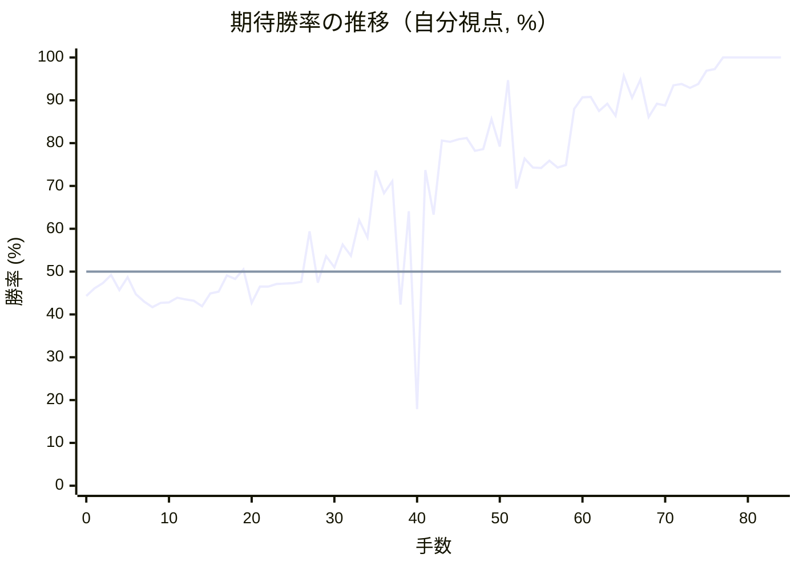
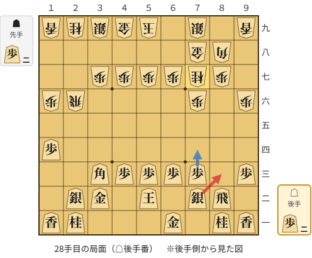
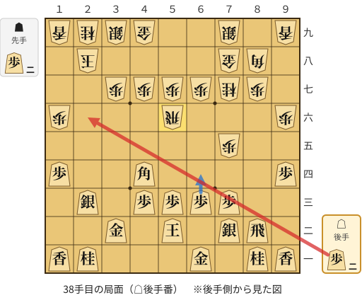
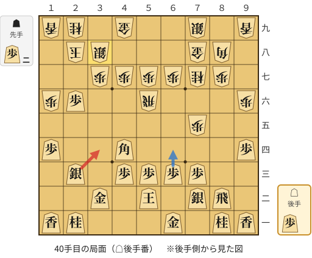
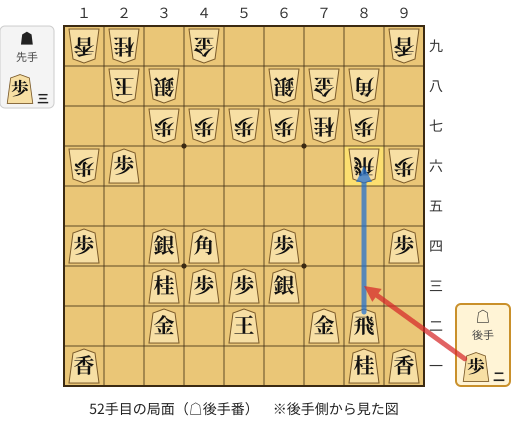
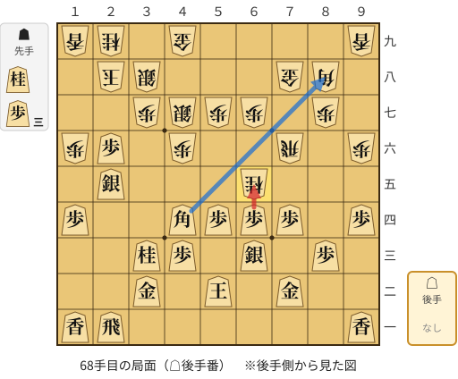

# 解析レポート uhbyjztnz6sg

[README に戻る](../../../README.md)　/　棋譜: [CSA](../../../data/csa/shogi5/uhbyjztnz6sg.csa)　/　解析の見方: [docs/mistake_analysis.md](../../../docs/mistake_analysis.md)

## 対局情報

| 項目 | 内容 |
|---|---|
| 日時 | 2026-11-19 02:18:54 |
| 持ち時間 | 5分 |
| 自分 | 後手（△）（1683） |
| 相手 | 相手（1665） |
| 結果 | 勝ち（詰み, 84手） |

## 解析環境

| 項目 | 内容 |
|---|---|
| エンジン | YaneuraOu NNUE 9.00git 64AVX2（V9.00/YANEURAOU_ENGINE_NNUE/AVX2） |
| 評価関数 | **水匠5**（`suisho5`） |
| nn.bin SHA-256 | `768068f0d534a0603a5d38bcd143de6bbca820d5f1c95a14d40863e5b7892d76` |
| 第1パス | movetime=150ms, MultiPV 1 |
| 第2パス | movetime=2000ms, MultiPV 3 |
| Threads / Hash | 8 / 512MB |
| 判定基準 | 疑問手 ≥5pt, 悪手 ≥10pt, 大悪手 ≥20pt（期待勝率 W(E)=1/(1+exp(-E/600))） |
| 解析日時 | 2026-11-20T20:08:05+09:00（解析バージョン 1, 48秒） |

## サマリー

| 自分の手数 | 深掘りした手 | 詰み逃し | 大悪手 | 悪手 | 疑問手 |
|--:|--:|--:|--:|--:|--:|
| 42 | 9 | 0 | 3 | 1 | 1 |

## 期待勝率の推移



<details><summary>1手ごとの数値（第1パス）</summary>

| 手数 | 指し手 | 評価値 | 勝率 | 低下 | 判定 |
|--:|---|--:|--:|--:|---|
| 1 | ▲２六歩(27) | -94 | 46.1% |  |  |
| 2 | △８四歩(83) | -66 | 47.3% | -1.2pt |  |
| 3 | ▲２五歩(26) | -20 | 49.2% |  |  |
| 4 | △８五歩(84) | -104 | 45.7% | +3.5pt |  |
| 5 | ▲７六歩(77) | -32 | 48.7% |  |  |
| 6 | △３四歩(33) | -128 | 44.7% | +4.0pt |  |
| 7 | ▲７八金(69) | -168 | 43.0% |  |  |
| 8 | △３二金(41) | -202 | 41.7% | +1.4pt |  |
| 9 | ▲２四歩(25) | -176 | 42.7% |  |  |
| 10 | △同歩(23) | -175 | 42.8% | -0.0pt |  |
| 11 | ▲同飛(28) | -148 | 43.9% |  |  |
| 12 | △８六歩(85) | -157 | 43.5% | +0.4pt |  |
| 13 | ▲同歩(87) | -165 | 43.2% |  |  |
| 14 | △同飛(82) | -197 | 41.9% | +1.3pt |  |
| 15 | ▲３四飛(24) | -122 | 44.9% |  |  |
| 16 | △３三角(22) | -114 | 45.3% | -0.3pt |  |
| 17 | ▲３六飛(34) | -21 | 49.1% |  |  |
| 18 | △２二銀(31) | -40 | 48.3% | +0.8pt |  |
| 19 | ▲８七歩打 | +13 | 50.5% |  |  |
| 20 | △８二飛(86) | -177 | 42.7% | +7.9pt |  |
| 21 | ▲２六飛(36) | -83 | 46.5% |  |  |
| 22 | △５二玉(51) | -83 | 46.5% | +0.0pt |  |
| 23 | ▲１六歩(17) | -70 | 47.1% |  |  |
| 24 | △１四歩(13) | -68 | 47.2% | -0.1pt |  |
| 25 | ▲９六歩(97) | -66 | 47.3% |  |  |
| 26 | △７二銀(71) | -58 | 47.6% | -0.3pt |  |
| 27 | ▲７七桂(89) | +228 | 59.4% |  |  |
| 28 | △８三銀(72) | -62 | 47.4% | +12.0pt | [悪手](#ply-28) |
| 29 | ▲７五歩(76) | +86 | 53.6% |  |  |
| 30 | △９四歩(93) | +24 | 51.0% | +2.6pt |  |
| 31 | ▲４八玉(59) | +151 | 56.3% |  |  |
| 32 | △７二銀(83) | +88 | 53.7% | +2.6pt |  |
| 33 | ▲３八玉(48) | +295 | 62.0% |  |  |
| 34 | △２三銀(22) | +194 | 58.0% | +4.0pt |  |
| 35 | ▲２八玉(38) | +614 | 73.6% |  |  |
| 36 | △４四角(33) | +460 | 68.3% | +5.3pt |  |
| 37 | ▲５六飛(26) | +540 | 71.1% |  |  |
| 38 | △２六歩打 | -186 | 42.3% | +28.8pt | [大悪手](#ply-38) |
| 39 | ▲３八銀(39) | +348 | 64.1% |  |  |
| 40 | △３四銀(23) | -912 | 17.9% | +46.2pt | [大悪手](#ply-40) |
| 41 | ▲７六飛(56) | +617 | 73.7% |  |  |
| 42 | △６四歩(63) | +328 | 63.3% | +10.3pt |  |
| 43 | ▲７四歩(75) | +854 | 80.6% |  |  |
| 44 | △同歩(73) | +844 | 80.3% | +0.3pt |  |
| 45 | ▲同飛(76) | +866 | 80.9% |  |  |
| 46 | △６三銀(72) | +877 | 81.2% | -0.3pt |  |
| 47 | ▲７六飛(74) | +767 | 78.2% |  |  |
| 48 | △３三桂(21) | +780 | 78.6% | -0.4pt |  |
| 49 | ▲６八銀(79) | +1068 | 85.6% |  |  |
| 50 | △７二金(61) | +804 | 79.2% | +6.3pt |  |
| 51 | ▲８六飛(76) | +1724 | 94.7% |  |  |
| 52 | △８三歩打 | +492 | 69.4% | +25.2pt | [大悪手](#ply-52) |
| 53 | ▲７六飛(86) | +706 | 76.4% |  |  |
| 54 | △７四歩打 | +636 | 74.3% | +2.2pt |  |
| 55 | ▲５九銀(68) | +635 | 74.2% |  |  |
| 56 | △７三桂(81) | +688 | 75.9% | -1.7pt |  |
| 57 | ▲５八銀(59) | +638 | 74.3% |  |  |
| 58 | △８一飛(82) | +657 | 74.9% | -0.6pt |  |
| 59 | ▲４六歩(47) | +1198 | 88.0% |  |  |
| 60 | △２一飛(81) | +1363 | 90.7% | -2.6pt |  |
| 61 | ▲４七銀(58) | +1372 | 90.8% |  |  |
| 62 | △５四歩(53) | +1165 | 87.5% | +3.3pt |  |
| 63 | ▲３六銀(47) | +1268 | 89.2% |  |  |
| 64 | △２五銀(34) | +1107 | 86.4% | +2.9pt |  |
| 65 | ▲４七銀(36) | +1867 | 95.7% |  |  |
| 66 | △６五桂(73) | +1362 | 90.6% | +5.1pt |  |
| 67 | ▲同桂(77) | +1737 | 94.8% |  |  |
| 68 | △同歩(64) | +1092 | 86.1% | +8.7pt | [疑問手](#ply-68) |
| 69 | ▲４四角(88) | +1268 | 89.2% |  |  |
| 70 | △同歩(43) | +1241 | 88.8% | +0.4pt |  |
| 71 | ▲７五歩打 | +1600 | 93.5% |  |  |
| 72 | △３五桂打 | +1634 | 93.8% | -0.3pt |  |
| 73 | ▲７四歩(75) | +1546 | 92.9% |  |  |
| 74 | △２七歩成(26) | +1631 | 93.8% | -0.9pt |  |
| 75 | ▲同銀(38) | +2074 | 96.9% |  |  |
| 76 | △同桂成(35) | +2151 | 97.3% | -0.4pt |  |
| 77 | ▲同玉(28) | +6214 | 100.0% |  |  |
| 78 | △３六銀(25) | +6386 | 100.0% | -0.0pt |  |
| 79 | ▲同玉(27) | #+5 | 100.0% |  |  |
| 80 | △２七角打 | #+4 | 100.0% | +0.0pt |  |
| 81 | ▲３五玉(36) | #+3 | 100.0% |  |  |
| 82 | △２六銀打 | #+2 | 100.0% | +0.0pt |  |
| 83 | ▲４四玉(35) | #+1 | 100.0% |  |  |
| 84 | △４三金(32) | #+ | 100.0% | +0.0pt |  |

</details>

## 課題局面

<a id="ply-28"></a>
### 28手目 △８三銀(72) — 悪手

| | 着手前 | 着手後 | 差 |
|---|--:|--:|--:|
| 期待勝率 | 58.9% | 45.6% | -13.3pt |
| 評価値 | +217 | -105 | |

着手前の局面:



🔴 実戦 △８三銀(72)　🔵 AI推奨 △７四歩(73)　🟨 直前の相手の指し手

<details><summary>テキストの盤面図（BOD・将棋ソフトに貼り付け可）</summary>

```text
後手の持駒：歩二
  ９ ８ ７ ６ ５ ４ ３ ２ １
+---------------------------+
|v香v桂 ・v金 ・ ・ ・v桂v香|一
| ・v飛v銀 ・v玉 ・v金v銀 ・|二
|v歩 ・v歩v歩v歩v歩v角 ・ ・|三
| ・ ・ ・ ・ ・ ・ ・ ・v歩|四
| ・ ・ ・ ・ ・ ・ ・ ・ ・|五
| 歩 ・ 歩 ・ ・ ・ ・ 飛 歩|六
| ・ 歩 桂 歩 歩 歩 歩 ・ ・|七
| ・ 角 金 ・ ・ ・ ・ ・ ・|八
| 香 ・ 銀 ・ 玉 金 銀 桂 香|九
+---------------------------+
先手の持駒：歩二
後手番
手数＝27　▲７七桂　まで
```

</details>

| | 指し手 | 評価値 | 読み筋 |
|---|---|--:|---|
| 実戦 | △８三銀(72) | -105 | ▲３六歩(37) △７四歩(73) ▲３八銀(39) △４四角(33) ▲３五歩(36) △７二銀(83) |
| AI 1位 | △７四歩(73) | +217 | △７四歩(73) ▲５八玉(59) △６四歩(63) ▲３六歩(37) △７五歩(74) ▲３五歩(36) |
| AI 2位 | △８四飛(82) | +192 | △８四飛(82) ▲５八玉(59) △５四飛(84) ▲４八銀(39) △４四角(33) ▲３六飛(26) |
| AI 3位 | △６二金(61) | +190 | △６二金(61) ▲３八銀(39) △７四歩(73) ▲１七桂(29) △６四歩(63) ▲３六飛(26) |

SFEN: `ln1g3nl/1rs1k1gs1/p1ppppb2/8p/9/P1P4RP/1PNPPPP2/1BG6/L1S1KGSNL w 2P2p 28`

<a id="ply-38"></a>
### 38手目 △２六歩打 — 大悪手

| | 着手前 | 着手後 | 差 |
|---|--:|--:|--:|
| 期待勝率 | 72.4% | 39.0% | -33.4pt |
| 評価値 | +580 | -268 | |

着手前の局面:



🔴 実戦 △２六歩打　🔵 AI推奨 △６四歩(63)　🟨 直前の相手の指し手

<details><summary>テキストの盤面図（BOD・将棋ソフトに貼り付け可）</summary>

```text
後手の持駒：歩二
  ９ ８ ７ ６ ５ ４ ３ ２ １
+---------------------------+
|v香v桂 ・v金 ・ ・ ・v桂v香|一
| ・v飛v銀 ・v玉 ・v金 ・ ・|二
| ・ ・v歩v歩v歩v歩 ・v銀 ・|三
|v歩 ・ ・ ・ ・v角 ・ ・v歩|四
| ・ ・ 歩 ・ ・ ・ ・ ・ ・|五
| 歩 ・ ・ ・ 飛 ・ ・ ・ 歩|六
| ・ 歩 桂 歩 歩 歩 歩 ・ ・|七
| ・ 角 金 ・ ・ ・ ・ 玉 ・|八
| 香 ・ 銀 ・ ・ 金 銀 桂 香|九
+---------------------------+
先手の持駒：歩二
後手番
手数＝37　▲５六飛　まで
```

</details>

| | 指し手 | 評価値 | 読み筋 |
|---|---|--:|---|
| 実戦 | △２六歩打 | -268 | ▲６五桂(77) △８八角成(44) ▲５三桂成(65) △４一玉(52) ▲８八銀(79) △５二歩打 |
| AI 1位 | △６四歩(63) | +580 | △６四歩(63) ▲３八銀(39) △６三銀(72) ▲６六歩(67) △３三桂(21) ▲６五歩(66) |
| AI 2位 | △６二金(61) | +471 | △６二金(61) ▲６五桂(77) △８八角成(44) ▲同銀(79) △８四飛(82) ▲３八銀(39) |
| AI 3位 | △８四飛(82) | +293 | △８四飛(82) ▲６五桂(77) △６二金(61) ▲４四角(88) △同飛(84) ▲２六角打 |

SFEN: `ln1g3nl/1rs1k1g2/2pppp1s1/p4b2p/2P6/P3R3P/1PNPPPP2/1BG4K1/L1S2GSNL w 2P2p 38`

<a id="ply-40"></a>
### 40手目 △３四銀(23) — 大悪手

| | 着手前 | 着手後 | 差 |
|---|--:|--:|--:|
| 期待勝率 | 62.6% | 15.6% | -47.0pt |
| 評価値 | +308 | -1014 | |

着手前の局面:



🔴 実戦 △３四銀(23)　🔵 AI推奨 △６四歩(63)　🟨 直前の相手の指し手

<details><summary>テキストの盤面図（BOD・将棋ソフトに貼り付け可）</summary>

```text
後手の持駒：歩
  ９ ８ ７ ６ ５ ４ ３ ２ １
+---------------------------+
|v香v桂 ・v金 ・ ・ ・v桂v香|一
| ・v飛v銀 ・v玉 ・v金 ・ ・|二
| ・ ・v歩v歩v歩v歩 ・v銀 ・|三
|v歩 ・ ・ ・ ・v角 ・ ・v歩|四
| ・ ・ 歩 ・ ・ ・ ・ ・ ・|五
| 歩 ・ ・ ・ 飛 ・ ・v歩 歩|六
| ・ 歩 桂 歩 歩 歩 歩 ・ ・|七
| ・ 角 金 ・ ・ ・ 銀 玉 ・|八
| 香 ・ 銀 ・ ・ 金 ・ 桂 香|九
+---------------------------+
先手の持駒：歩二
後手番
手数＝39　▲３八銀　まで
```

</details>

| | 指し手 | 評価値 | 読み筋 |
|---|---|--:|---|
| 実戦 | △３四銀(23) | -1014 | ▲６五桂(77) △８八角成(44) ▲５三桂成(65) △４一玉(52) ▲８八銀(79) △４四角打 |
| AI 1位 | △６四歩(63) | +308 | △６四歩(63) ▲３九玉(28) △３三桂(21) ▲２八歩打 △６三銀(72) ▲７六飛(56) |
| AI 2位 | △６二金(61) | +202 | △６二金(61) ▲６五桂(77) △８八角成(44) ▲同銀(79) △８四飛(82) ▲２六飛(56) |
| AI 3位 | △２七歩成(26) | +90 | △２七歩成(26) ▲同銀(38) △６四歩(63) ▲３六銀(27) △３四銀(23) ▲４六歩(47) |

SFEN: `ln1g3nl/1rs1k1g2/2pppp1s1/p4b2p/2P6/P3R2pP/1PNPPPP2/1BG3SK1/L1S2G1NL w 2Pp 40`

<a id="ply-52"></a>
### 52手目 △８三歩打 — 大悪手

| | 着手前 | 着手後 | 差 |
|---|--:|--:|--:|
| 期待勝率 | 95.6% | 73.8% | -21.9pt |
| 評価値 | +1851 | +620 | |

着手前の局面:



🔴 実戦 △８三歩打　🔵 AI推奨 △同飛(82)　🟨 直前の相手の指し手

<details><summary>テキストの盤面図（BOD・将棋ソフトに貼り付け可）</summary>

```text
後手の持駒：歩二
  ９ ８ ７ ６ ５ ４ ３ ２ １
+---------------------------+
|v香v桂 ・ ・ ・ ・ ・ ・v香|一
| ・v飛v金 ・v玉 ・v金 ・ ・|二
| ・ ・ ・v銀v歩v歩v桂 ・ ・|三
|v歩 ・ ・v歩 ・v角v銀 ・v歩|四
| ・ ・ ・ ・ ・ ・ ・ ・ ・|五
| 歩 飛 ・ ・ ・ ・ ・v歩 歩|六
| ・ 歩 桂 歩 歩 歩 歩 ・ ・|七
| ・ 角 金 銀 ・ ・ 銀 玉 ・|八
| 香 ・ ・ ・ ・ 金 ・ 桂 香|九
+---------------------------+
先手の持駒：歩三
後手番
手数＝51　▲８六飛　まで
```

</details>

| | 指し手 | 評価値 | 読み筋 |
|---|---|--:|---|
| 実戦 | △８三歩打 | +620 | ▲３九玉(28) △７三桂(81) ▲７六飛(86) △７四歩打 ▲５九銀(68) △８一飛(82) |
| AI 1位 | △同飛(82) | +1851 | △同飛(82) ▲同歩(87) △３六歩打 ▲２一飛打 △３一飛打 ▲同飛成(21) |
| AI 2位 | △２七歩成(26) | +1340 | △２七歩成(26) ▲同銀(38) △８六飛(82) ▲同歩(87) △２六歩打 ▲３八銀(27) |
| AI 3位 | △２五桂(33) | +1104 | △２五桂(33) ▲８五桂(77) △８八角成(44) ▲同金(78) △３五銀(34) ▲３九玉(28) |

SFEN: `ln6l/1rg1k1g2/3sppn2/p2p1bs1p/9/PR5pP/1PNPPPP2/1BGS2SK1/L4G1NL w 3P2p 52`

<a id="ply-68"></a>
### 68手目 △同歩(64) — 疑問手

| | 着手前 | 着手後 | 差 |
|---|--:|--:|--:|
| 期待勝率 | 95.2% | 89.7% | -5.5pt |
| 評価値 | +1786 | +1296 | |

着手前の局面:



🔴 実戦 △同歩(64)　🔵 AI推奨 △８八角成(44)　🟨 直前の相手の指し手

<details><summary>テキストの盤面図（BOD・将棋ソフトに貼り付け可）</summary>

```text
後手の持駒：なし
  ９ ８ ７ ６ ５ ４ ３ ２ １
+---------------------------+
|v香 ・ ・ ・ ・ ・ ・v飛v香|一
| ・ ・v金 ・v玉 ・v金 ・ ・|二
| ・v歩 ・v銀 ・v歩v桂 ・ ・|三
|v歩 ・v歩v歩v歩v角 ・ ・v歩|四
| ・ ・ ・ 桂 ・ ・ ・v銀 ・|五
| 歩 ・ 飛 ・ ・ 歩 ・v歩 歩|六
| ・ 歩 ・ 歩 歩 銀 歩 ・ ・|七
| ・ 角 金 ・ ・ ・ 銀 玉 ・|八
| 香 ・ ・ ・ ・ 金 ・ 桂 香|九
+---------------------------+
先手の持駒：桂　歩三
後手番
手数＝67　▲６五同桂　まで
```

</details>

| | 指し手 | 評価値 | 読み筋 |
|---|---|--:|---|
| 実戦 | △同歩(64) | +1296 | ▲４四角(88) △同歩(43) ▲５六桂打 △５五角打 ▲２三歩打 △９九角成(55) |
| AI 1位 | △８八角成(44) | +1786 | △８八角成(44) ▲同金(78) △６五歩(64) ▲７三歩打 △６二金(72) ▲８六飛(76) |
| AI 2位 | △同歩(64) | +1342 | △同歩(64) ▲４四角(88) △同歩(43) ▲７三歩打 △６二金(72) ▲３五桂打 |
| AI 3位 | △２七歩成(26) | +945 | △２七歩成(26) ▲同銀(38) △８八角成(44) ▲同金(78) △６五歩(64) ▲２六歩打 |

SFEN: `l6rl/2g1k1g2/1p1s1pn2/p1pppb2p/3N3s1/P1R2P1pP/1P1PPSP2/1BG3SK1/L4G1NL w N3P 68`

