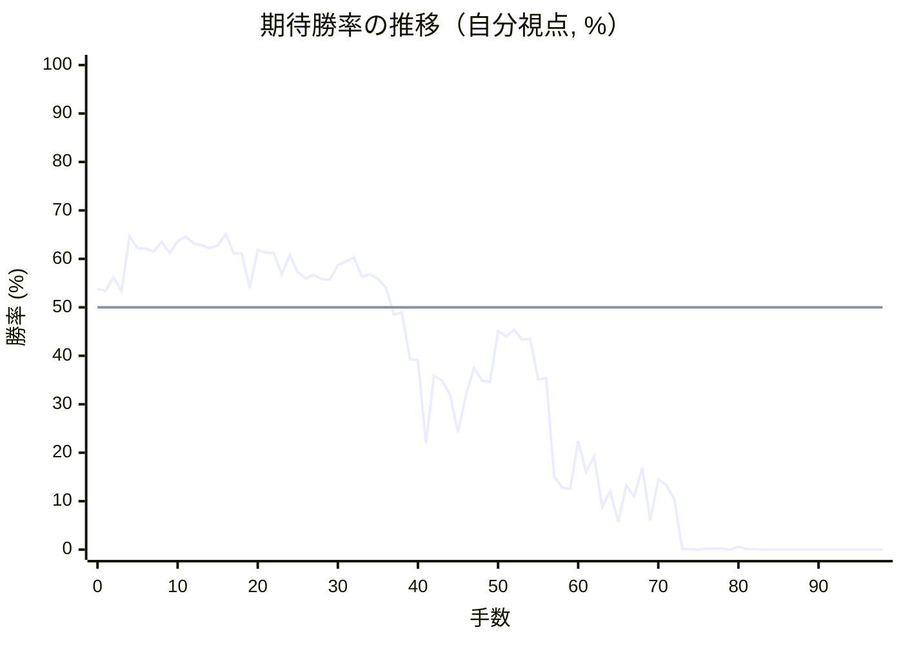

# 解析レポート v02i8a6hm91u

[README に戻る](../../../README.md)　/　棋譜: [CSA](../../../data/csa/shogi5/v02i8a6hm91u.csa)　/　解析の見方: [docs/mistake_analysis.md](../../../docs/mistake_analysis.md)

## 対局情報

| 項目 | 内容 |
|---|---|
| 日時 | 2026-10-29 03:19:44 |
| 持ち時間 | 5分 |
| 自分 | 先手（▲）（1746） |
| 相手 | 相手（1630） |
| 結果 | 負け（時間切れ, 98手） |

## 解析環境

| 項目 | 内容 |
|---|---|
| エンジン | YaneuraOu NNUE 9.00git 64AVX2（V9.00/YANEURAOU_ENGINE_NNUE/AVX2） |
| 評価関数 | **水匠5**（`suisho5`） |
| nn.bin SHA-256 | `768068f0d534a0603a5d38bcd143de6bbca820d5f1c95a14d40863e5b7892d76` |
| 第1パス | movetime=150ms, MultiPV 1 |
| 第2パス | movetime=2000ms, MultiPV 3 |
| Threads / Hash | 8 / 512MB |
| 判定基準 | 疑問手 ≥5pt, 悪手 ≥10pt, 大悪手 ≥20pt（期待勝率 W(E)=1/(1+exp(-E/600))） |
| 解析日時 | 2026-11-03T04:22:58+09:00（解析バージョン 1, 63秒） |

## サマリー

| 自分の手数 | 深掘りした手 | 詰み逃し | 大悪手 | 悪手 | 疑問手 |
|--:|--:|--:|--:|--:|--:|
| 49 | 12 | 0 | 1 | 2 | 8 |

## 期待勝率の推移



<details><summary>1手ごとの数値（第1パス）</summary>

| 手数 | 指し手 | 評価値 | 勝率 | 低下 | 判定 |
|--:|---|--:|--:|--:|---|
| 1 | ▲７六歩(77) | +81 | 53.4% | +0.4pt |  |
| 2 | △３四歩(33) | +150 | 56.2% |  |  |
| 3 | ▲２六歩(27) | +81 | 53.4% | +2.8pt |  |
| 4 | △４二飛(82) | +364 | 64.7% |  |  |
| 5 | ▲２五歩(26) | +300 | 62.2% | +2.5pt |  |
| 6 | △６二玉(51) | +297 | 62.1% |  |  |
| 7 | ▲４八銀(39) | +282 | 61.5% | +0.6pt |  |
| 8 | △７二玉(62) | +333 | 63.5% |  |  |
| 9 | ▲６八玉(59) | +274 | 61.2% | +2.3pt |  |
| 10 | △８二玉(72) | +336 | 63.6% |  |  |
| 11 | ▲７八玉(68) | +362 | 64.6% | -1.0pt |  |
| 12 | △７二銀(71) | +324 | 63.2% |  |  |
| 13 | ▲９六歩(97) | +315 | 62.8% | +0.3pt |  |
| 14 | △９四歩(93) | +298 | 62.2% |  |  |
| 15 | ▲５八金(49) | +313 | 62.8% | -0.6pt |  |
| 16 | △３五歩(34) | +374 | 65.1% |  |  |
| 17 | ▲６六歩(67) | +273 | 61.2% | +3.9pt |  |
| 18 | △３三角(22) | +272 | 61.1% |  |  |
| 19 | ▲４六歩(47) | +97 | 54.0% | +7.1pt | [疑問手](#ply-19) |
| 20 | △３二金(41) | +292 | 61.9% |  |  |
| 21 | ▲４七銀(48) | +277 | 61.3% | +0.6pt |  |
| 22 | △４四歩(43) | +273 | 61.2% |  |  |
| 23 | ▲７七角(88) | +165 | 56.8% | +4.4pt |  |
| 24 | △４五歩(44) | +263 | 60.8% |  |  |
| 25 | ▲同歩(46) | +173 | 57.2% | +3.6pt |  |
| 26 | △同飛(42) | +145 | 56.0% |  |  |
| 27 | ▲４六歩打 | +162 | 56.7% | -0.7pt |  |
| 28 | △４四飛(45) | +140 | 55.8% |  |  |
| 29 | ▲８八玉(78) | +138 | 55.7% | +0.1pt |  |
| 30 | △３四飛(44) | +211 | 58.7% |  |  |
| 31 | ▲７八銀(79) | +231 | 59.5% | -0.8pt |  |
| 32 | △４二銀(31) | +252 | 60.3% |  |  |
| 33 | ▲１六歩(17) | +152 | 56.3% | +4.0pt |  |
| 34 | △４三銀(42) | +163 | 56.8% |  |  |
| 35 | ▲６七金(58) | +143 | 55.9% | +0.8pt |  |
| 36 | △５四銀(43) | +98 | 54.1% |  |  |
| 37 | ▲８六角(77) | -37 | 48.5% | +5.6pt | [疑問手](#ply-37) |
| 38 | △４二金(32) | -26 | 48.9% |  |  |
| 39 | ▲７七桂(89) | -261 | 39.3% | +9.6pt | [悪手](#ply-39) |
| 40 | △５五銀(54) | -266 | 39.1% |  |  |
| 41 | ▲２四歩(25) | -762 | 21.9% | +17.2pt | [悪手](#ply-41) |
| 42 | △同歩(23) | -351 | 35.8% |  |  |
| 43 | ▲５六銀(47) | -374 | 34.9% | +0.9pt |  |
| 44 | △６六銀(55) | -452 | 32.0% |  |  |
| 45 | ▲６八金(67) | -685 | 24.2% | +7.8pt | [疑問手](#ply-45) |
| 46 | △３六歩(35) | -452 | 32.0% |  |  |
| 47 | ▲４五銀(56) | -307 | 37.5% | -5.5pt |  |
| 48 | △７四飛(34) | -373 | 34.9% |  |  |
| 49 | ▲３六歩(37) | -382 | 34.6% | +0.3pt |  |
| 50 | △８四歩(83) | -117 | 45.1% |  |  |
| 51 | ▲６七歩打 | -145 | 44.0% | +1.2pt |  |
| 52 | △８五歩(84) | -111 | 45.4% |  |  |
| 53 | ▲６六歩(67) | -161 | 43.3% | +2.1pt |  |
| 54 | △８六歩(85) | -156 | 43.5% |  |  |
| 55 | ▲同歩(87) | -370 | 35.1% | +8.5pt | [疑問手](#ply-55) |
| 56 | △７六飛(74) | -360 | 35.4% |  |  |
| 57 | ▲４四銀打 | -1035 | 15.1% | +20.3pt | [大悪手](#ply-57) |
| 58 | △８六飛(76) | -1152 | 12.8% |  |  |
| 59 | ▲８七歩打 | -1168 | 12.5% | +0.3pt |  |
| 60 | △６六飛(86) | -746 | 22.4% |  |  |
| 61 | ▲３三銀成(44) | -994 | 16.0% | +6.4pt |  |
| 62 | △同桂(21) | -864 | 19.2% |  |  |
| 63 | ▲２四飛(28) | -1403 | 8.8% | +10.4pt | [疑問手](#ply-63) |
| 64 | △４六飛(66) | -1187 | 12.1% |  |  |
| 65 | ▲３四銀(45) | -1686 | 5.7% | +6.5pt | [疑問手](#ply-65) |
| 66 | △４九飛成(46) | -1132 | 13.2% |  |  |
| 67 | ▲２二飛成(24) | -1254 | 11.0% | +2.2pt |  |
| 68 | △４一歩打 | -951 | 17.0% |  |  |
| 69 | ▲３三銀成(34) | -1647 | 6.0% | +11.0pt | [疑問手](#ply-69) |
| 70 | △同金(42) | -1063 | 14.5% |  |  |
| 71 | ▲同龍(22) | -1126 | 13.3% | +1.3pt |  |
| 72 | △２九龍(49) | -1291 | 10.4% |  |  |
| 73 | ▲８四桂打 | -4166 | 0.1% | +10.3pt | [疑問手](#ply-73) |
| 74 | △７六桂打 | -4445 | 0.1% |  |  |
| 75 | ▲９七玉(88) | -4712 | 0.0% | +0.0pt |  |
| 76 | △６八桂成(76) | -3675 | 0.2% |  |  |
| 77 | ▲７二桂成(84) | -3746 | 0.2% | +0.0pt |  |
| 78 | △同金(61) | -3832 | 0.2% |  |  |
| 79 | ▲６一銀打 | #-21 | 0.0% | +0.2pt |  |
| 80 | △７一金打 | -3105 | 0.6% |  |  |
| 81 | ▲７二銀成(61) | -4558 | 0.1% | +0.5pt |  |
| 82 | △同金(71) | -4270 | 0.1% |  |  |
| 83 | ▲５六角打 | -5126 | 0.0% | +0.1pt |  |
| 84 | △８八銀打 | -4778 | 0.0% |  |  |
| 85 | ▲８六玉(97) | -5650 | 0.0% | +0.0pt |  |
| 86 | △７四銀打 | -5340 | 0.0% |  |  |
| 87 | ▲７五歩打 | -7235 | 0.0% | +0.0pt |  |
| 88 | △６四角打 | -5301 | 0.0% |  |  |
| 89 | ▲６五金打 | -6197 | 0.0% | +0.0pt |  |
| 90 | △８五歩打 | #-8 | 0.0% |  |  |
| 91 | ▲同桂(77) | #-7 | 0.0% | +0.0pt |  |
| 92 | △６九龍(29) | -7647 | 0.0% |  |  |
| 93 | ▲６四金(65) | #-19 | 0.0% | +0.0pt |  |
| 94 | △７八龍(69) | -5420 | 0.0% |  |  |
| 95 | ▲７三桂成(85) | -6422 | 0.0% | +0.0pt |  |
| 96 | △同桂(81) | -7914 | 0.0% |  |  |
| 97 | ▲同金(64) | -7834 | 0.0% | -0.0pt |  |
| 98 | △同金(72) | -7368 | 0.0% |  |  |

</details>

## 課題局面

<a id="ply-19"></a>
### 19手目 ▲４六歩(47) — 疑問手

| | 着手前 | 着手後 | 差 |
|---|--:|--:|--:|
| 期待勝率 | 61.9% | 53.9% | -8.0pt |
| 評価値 | +290 | +93 | |

着手前の局面:

```text
後手の持駒：なし
  ９ ８ ７ ６ ５ ４ ３ ２ １
+---------------------------+
|v香v桂 ・v金 ・v金v銀v桂v香|一
| ・v玉v銀 ・ ・v飛 ・ ・ ・|二
| ・v歩v歩v歩v歩v歩v角v歩v歩|三
|v歩 ・ ・ ・ ・ ・ ・ ・ ・|四
| ・ ・ ・ ・ ・ ・v歩 歩 ・|五
| 歩 ・ 歩 歩 ・ ・ ・ ・ ・|六
| ・ 歩 ・ ・ 歩 歩 歩 ・ 歩|七
| ・ 角 玉 ・ 金 銀 ・ 飛 ・|八
| 香 桂 銀 金 ・ ・ ・ 桂 香|九
+---------------------------+
先手の持駒：なし
手数＝18　△３三角　まで
```

| | 指し手 | 評価値 | 読み筋 |
|---|---|--:|---|
| 実戦 | ▲４六歩(47) | +93 | △４四歩(43) ▲４七銀(48) △４五歩(44) ▲同歩(46) △同飛(42) ▲６八銀(79) |
| AI 1位 | ▲５六歩(57) | +290 | ▲５六歩(57) △２二飛(42) ▲６八銀(79) △３二銀(31) ▲５七銀(68) △２四歩(23) |
| AI 2位 | ▲６八銀(79) | +261 | ▲６八銀(79) △３二銀(31) ▲５六歩(57) △４四歩(43) ▲５七銀(48) △４三銀(32) |
| AI 3位 | ▲７七角(88) | +226 | ▲７七角(88) △２二飛(42) ▲８八玉(78) △２四歩(23) ▲同歩(25) △同飛(22) |

SFEN: `ln1g1gsnl/1ks2r3/1pppppbpp/p8/6pP1/P1PP5/1P2PPP1P/1BK1GS1R1/LNSG3NL b - 19`

<a id="ply-37"></a>
### 37手目 ▲８六角(77) — 疑問手

| | 着手前 | 着手後 | 差 |
|---|--:|--:|--:|
| 期待勝率 | 54.4% | 48.0% | -6.4pt |
| 評価値 | +107 | -47 | |

着手前の局面:

```text
後手の持駒：歩
  ９ ８ ７ ６ ５ ４ ３ ２ １
+---------------------------+
|v香v桂 ・v金 ・ ・ ・v桂v香|一
| ・v玉v銀 ・ ・ ・v金 ・ ・|二
| ・v歩v歩v歩v歩 ・v角v歩v歩|三
|v歩 ・ ・ ・v銀 ・v飛 ・ ・|四
| ・ ・ ・ ・ ・ ・v歩 歩 ・|五
| 歩 ・ 歩 歩 ・ 歩 ・ ・ 歩|六
| ・ 歩 角 金 歩 銀 歩 ・ ・|七
| ・ 玉 銀 ・ ・ ・ ・ 飛 ・|八
| 香 桂 ・ 金 ・ ・ ・ 桂 香|九
+---------------------------+
先手の持駒：なし
手数＝36　△５四銀　まで
```

| | 指し手 | 評価値 | 読み筋 |
|---|---|--:|---|
| 実戦 | ▲８六角(77) | -47 | △４二金(32) ▲７七角(86) △６四歩(63) ▲８六歩(87) △５二金(42) ▲９八玉(88) |
| AI 1位 | ▲８六歩(87) | +107 | ▲８六歩(87) △４二金(32) ▲６五歩(66) △７七角成(33) ▲同桂(89) △３二金(42) |
| AI 2位 | ▲３八飛(28) | +100 | ▲３八飛(28) △４四角(33) ▲５六金(67) △３三桂(21) ▲４五歩(46) △５五角(44) |
| AI 3位 | ▲５六金(67) | +86 | ▲５六金(67) △４三金(32) ▲６五歩(66) △４四金(43) ▲６八飛(28) △５五銀(54) |

SFEN: `ln1g3nl/1ks3g2/1pppp1bpp/p3s1r2/6pP1/P1PP1P2P/1PBGPSP2/1KS4R1/LN1G3NL b p 37`

<a id="ply-39"></a>
### 39手目 ▲７七桂(89) — 悪手

| | 着手前 | 着手後 | 差 |
|---|--:|--:|--:|
| 期待勝率 | 49.3% | 31.9% | -17.4pt |
| 評価値 | -16 | -454 | |

着手前の局面:

```text
後手の持駒：歩
  ９ ８ ７ ６ ５ ４ ３ ２ １
+---------------------------+
|v香v桂 ・v金 ・ ・ ・v桂v香|一
| ・v玉v銀 ・ ・v金 ・ ・ ・|二
| ・v歩v歩v歩v歩 ・v角v歩v歩|三
|v歩 ・ ・ ・v銀 ・v飛 ・ ・|四
| ・ ・ ・ ・ ・ ・v歩 歩 ・|五
| 歩 角 歩 歩 ・ 歩 ・ ・ 歩|六
| ・ 歩 ・ 金 歩 銀 歩 ・ ・|七
| ・ 玉 銀 ・ ・ ・ ・ 飛 ・|八
| 香 桂 ・ 金 ・ ・ ・ 桂 香|九
+---------------------------+
先手の持駒：なし
手数＝38　△４二金　まで
```

| | 指し手 | 評価値 | 読み筋 |
|---|---|--:|---|
| 実戦 | ▲７七桂(89) | -454 | △８四歩(83) ▲８九玉(88) △５二金(42) ▲５六歩(57) △４四角(33) ▲９七角(86) |
| AI 1位 | ▲７七角(86) | -16 | ▲７七角(86) △６四歩(63) ▲８六歩(87) △５二金(42) ▲９八玉(88) △６五歩(64) |
| AI 2位 | ▲７七角(86) | -35 | ▲７七角(86) △６四歩(63) ▲８六歩(87) △５二金(42) ▲５六歩(57) △７四歩(73) |
| AI 3位 | ▲９八玉(88) | -50 | ▲９八玉(88) △５二金(42) ▲７七角(86) △４四角(33) ▲８六歩(87) △３三桂(21) |

SFEN: `ln1g3nl/1ks2g3/1pppp1bpp/p3s1r2/6pP1/PBPP1P2P/1P1GPSP2/1KS4R1/LN1G3NL b p 39`

<a id="ply-41"></a>
### 41手目 ▲２四歩(25) — 悪手

| | 着手前 | 着手後 | 差 |
|---|--:|--:|--:|
| 期待勝率 | 33.6% | 14.3% | -19.3pt |
| 評価値 | -410 | -1076 | |

着手前の局面:

```text
後手の持駒：歩
  ９ ８ ７ ６ ５ ４ ３ ２ １
+---------------------------+
|v香v桂 ・v金 ・ ・ ・v桂v香|一
| ・v玉v銀 ・ ・v金 ・ ・ ・|二
| ・v歩v歩v歩v歩 ・v角v歩v歩|三
|v歩 ・ ・ ・ ・ ・v飛 ・ ・|四
| ・ ・ ・ ・v銀 ・v歩 歩 ・|五
| 歩 角 歩 歩 ・ 歩 ・ ・ 歩|六
| ・ 歩 桂 金 歩 銀 歩 ・ ・|七
| ・ 玉 銀 ・ ・ ・ ・ 飛 ・|八
| 香 ・ ・ 金 ・ ・ ・ 桂 香|九
+---------------------------+
先手の持駒：なし
手数＝40　△５五銀　まで
```

| | 指し手 | 評価値 | 読み筋 |
|---|---|--:|---|
| 実戦 | ▲２四歩(25) | -1076 | △同飛(34) ▲同飛(28) △同歩(23) ▲１七桂(29) △４九飛打 ▲５八銀(47) |
| AI 1位 | ▲６五歩(66) | -410 | ▲６五歩(66) △６六銀(55) ▲５六金(67) △８四歩(83) ▲６八飛(28) △８五歩(84) |
| AI 2位 | ▲６八金(69) | -451 | ▲６八金(69) △６六銀(55) ▲同金(67) △同角(33) ▲６七銀(78) △２二角(66) |
| AI 3位 | ▲５六銀(47) | -481 | ▲５六銀(47) △６六銀(55) ▲４五銀(56) △８四飛(34) ▲５八金(69) △５二金(42) |

SFEN: `ln1g3nl/1ks2g3/1pppp1bpp/p5r2/4s1pP1/PBPP1P2P/1PNGPSP2/1KS4R1/L2G3NL b p 41`

<a id="ply-45"></a>
### 45手目 ▲６八金(67) — 疑問手

| | 着手前 | 着手後 | 差 |
|---|--:|--:|--:|
| 期待勝率 | 30.9% | 21.1% | -9.8pt |
| 評価値 | -484 | -792 | |

着手前の局面:

```text
後手の持駒：歩三
  ９ ８ ７ ６ ５ ４ ３ ２ １
+---------------------------+
|v香v桂 ・v金 ・ ・ ・v桂v香|一
| ・v玉v銀 ・ ・v金 ・ ・ ・|二
| ・v歩v歩v歩v歩 ・v角 ・v歩|三
|v歩 ・ ・ ・ ・ ・v飛v歩 ・|四
| ・ ・ ・ ・ ・ ・v歩 ・ ・|五
| 歩 角 歩v銀 銀 歩 ・ ・ 歩|六
| ・ 歩 桂 金 歩 ・ 歩 ・ ・|七
| ・ 玉 銀 ・ ・ ・ ・ 飛 ・|八
| 香 ・ ・ 金 ・ ・ ・ 桂 香|九
+---------------------------+
先手の持駒：なし
手数＝44　△６六銀　まで
```

| | 指し手 | 評価値 | 読み筋 |
|---|---|--:|---|
| 実戦 | ▲６八金(67) | -792 | △５二金(42) ▲２六飛(28) △４八歩打 ▲６七銀(56) △同銀成(66) ▲同銀(78) |
| AI 1位 | ▲４五銀(56) | -484 | ▲４五銀(56) △８四飛(34) ▲５六金(67) △５二金(42) ▲６八金(69) △４七歩打 |
| AI 2位 | ▲５八金(69) | -522 | ▲５八金(69) △３六歩(35) ▲４五銀(56) △７七銀成(66) ▲同金(67) △３七歩成(36) |
| AI 3位 | ▲同金(67) | -622 | ▲同金(67) △同角(33) ▲４五銀(56) △８四飛(34) ▲５八金(69) △３三桂(21) |

SFEN: `ln1g3nl/1ks2g3/1pppp1b1p/p5rp1/6p2/PBPsSP2P/1PNGP1P2/1KS4R1/L2G3NL b 3p 45`

<a id="ply-55"></a>
### 55手目 ▲同歩(87) — 疑問手

| | 着手前 | 着手後 | 差 |
|---|--:|--:|--:|
| 期待勝率 | 42.4% | 37.2% | -5.1pt |
| 評価値 | -185 | -314 | |

着手前の局面:

```text
後手の持駒：角　歩三
  ９ ８ ７ ６ ５ ４ ３ ２ １
+---------------------------+
|v香v桂 ・v金 ・ ・ ・v桂v香|一
| ・v玉v銀 ・ ・v金 ・ ・ ・|二
| ・ ・v歩v歩v歩 ・v角 ・v歩|三
|v歩 ・v飛 ・ ・ ・ ・v歩 ・|四
| ・ ・ ・ ・ ・ 銀 ・ ・ ・|五
| 歩v歩 歩 歩 ・ 歩 歩 ・ 歩|六
| ・ 歩 桂 ・ 歩 ・ ・ ・ ・|七
| ・ 玉 銀 金 ・ ・ ・ 飛 ・|八
| 香 ・ ・ 金 ・ ・ ・ 桂 香|九
+---------------------------+
先手の持駒：銀
手数＝54　△８六歩　まで
```

| | 指し手 | 評価値 | 読み筋 |
|---|---|--:|---|
| 実戦 | ▲同歩(87) | -314 | △７六飛(74) ▲６七金(68) △６六飛(76) ▲同金(67) △同角(33) ▲６八金(69) |
| AI 1位 | ▲７五銀打 | -185 | ▲７五銀打 △４九角打 ▲７四銀(75) △同歩(73) ▲８六歩(87) △７六角成(49) |
| AI 2位 | ▲６七金(68) | -314 | ▲６七金(68) △８七歩成(86) ▲同銀(78) △５五角(33) ▲５六金(67) △８六歩打 |
| AI 3位 | ▲同歩(87) | -354 | ▲同歩(87) △７六飛(74) ▲６七金(68) △８六飛(76) ▲８七歩打 △８三飛(86) |

SFEN: `ln1g3nl/1ks2g3/2ppp1b1p/p1r4p1/5S3/PpPP1PP1P/1PN1P4/1KSG3R1/L2G3NL b Sb3p 55`

<a id="ply-57"></a>
### 57手目 ▲４四銀打 — 大悪手

| | 着手前 | 着手後 | 差 |
|---|--:|--:|--:|
| 期待勝率 | 36.5% | 9.2% | -27.3pt |
| 評価値 | -333 | -1377 | |

着手前の局面:

```text
後手の持駒：角　歩四
  ９ ８ ７ ６ ５ ４ ３ ２ １
+---------------------------+
|v香v桂 ・v金 ・ ・ ・v桂v香|一
| ・v玉v銀 ・ ・v金 ・ ・ ・|二
| ・ ・v歩v歩v歩 ・v角 ・v歩|三
|v歩 ・ ・ ・ ・ ・ ・v歩 ・|四
| ・ ・ ・ ・ ・ 銀 ・ ・ ・|五
| 歩 歩v飛 歩 ・ 歩 歩 ・ 歩|六
| ・ ・ 桂 ・ 歩 ・ ・ ・ ・|七
| ・ 玉 銀 金 ・ ・ ・ 飛 ・|八
| 香 ・ ・ 金 ・ ・ ・ 桂 香|九
+---------------------------+
先手の持駒：銀　歩
手数＝56　△７六飛　まで
```

| | 指し手 | 評価値 | 読み筋 |
|---|---|--:|---|
| 実戦 | ▲４四銀打 | -1377 | △８六飛(76) ▲８七歩打 △８四飛(86) ▲３三銀不成(44) △同桂(21) ▲５六銀(45) |
| AI 1位 | ▲６七金(68) | -333 | ▲６七金(68) △６六飛(76) ▲同金(67) △同角(33) ▲６八金(69) △３九角打 |
| AI 2位 | ▲６七銀(78) | -582 | ▲６七銀(78) △８六飛(76) ▲８七歩打 △８三飛(86) ▲３四銀(45) △５五角(33) |
| AI 3位 | ▲３四銀(45) | -688 | ▲３四銀(45) △５五角(33) ▲２四飛(28) △８六飛(76) ▲８七歩打 △８四飛(86) |

SFEN: `ln1g3nl/1ks2g3/2ppp1b1p/p6p1/5S3/PPrP1PP1P/2N1P4/1KSG3R1/L2G3NL b SPb4p 57`

<a id="ply-63"></a>
### 63手目 ▲２四飛(28) — 疑問手

| | 着手前 | 着手後 | 差 |
|---|--:|--:|--:|
| 期待勝率 | 14.1% | 5.5% | -8.6pt |
| 評価値 | -1084 | -1701 | |

着手前の局面:

```text
後手の持駒：角　銀　歩六
  ９ ８ ７ ６ ５ ４ ３ ２ １
+---------------------------+
|v香v桂 ・v金 ・ ・ ・ ・v香|一
| ・v玉v銀 ・ ・v金 ・ ・ ・|二
| ・ ・v歩v歩v歩 ・v桂 ・v歩|三
|v歩 ・ ・ ・ ・ ・ ・v歩 ・|四
| ・ ・ ・ ・ ・ 銀 ・ ・ ・|五
| 歩 ・ ・v飛 ・ 歩 歩 ・ 歩|六
| ・ 歩 桂 ・ 歩 ・ ・ ・ ・|七
| ・ 玉 銀 金 ・ ・ ・ 飛 ・|八
| 香 ・ ・ 金 ・ ・ ・ 桂 香|九
+---------------------------+
先手の持駒：角
手数＝62　△３三同桂　まで
```

| | 指し手 | 評価値 | 読み筋 |
|---|---|--:|---|
| 実戦 | ▲２四飛(28) | -1701 | △４五桂(33) ▲同歩(46) △３六飛(66) ▲５五角打 △３九飛成(36) ▲１一角成(55) |
| AI 1位 | ▲５五角打 | -1084 | ▲５五角打 △７六飛(66) ▲２四飛(28) △４五桂(33) ▲６七銀(78) △５四銀打 |
| AI 2位 | ▲５六銀(45) | -1265 | ▲５六銀(45) △９五歩(94) ▲６七銀(78) △９六飛(66) ▲同香(99) △同歩(95) |
| AI 3位 | ▲２四飛(28) | -1593 | ▲２四飛(28) △４五桂(33) ▲同歩(46) △３六飛(66) ▲２二飛成(24) △４一歩打 |

SFEN: `ln1g4l/1ks2g3/2ppp1n1p/p6p1/5S3/P2r1PP1P/1PN1P4/1KSG3R1/L2G3NL b Bbs6p 63`

<a id="ply-65"></a>
### 65手目 ▲３四銀(45) — 疑問手

| | 着手前 | 着手後 | 差 |
|---|--:|--:|--:|
| 期待勝率 | 10.7% | 3.5% | -7.1pt |
| 評価値 | -1276 | -1985 | |

着手前の局面:

```text
後手の持駒：角　銀　歩七
  ９ ８ ７ ６ ５ ４ ３ ２ １
+---------------------------+
|v香v桂 ・v金 ・ ・ ・ ・v香|一
| ・v玉v銀 ・ ・v金 ・ ・ ・|二
| ・ ・v歩v歩v歩 ・v桂 ・v歩|三
|v歩 ・ ・ ・ ・ ・ ・ 飛 ・|四
| ・ ・ ・ ・ ・ 銀 ・ ・ ・|五
| 歩 ・ ・ ・ ・v飛 歩 ・ 歩|六
| ・ 歩 桂 ・ 歩 ・ ・ ・ ・|七
| ・ 玉 銀 金 ・ ・ ・ ・ ・|八
| 香 ・ ・ 金 ・ ・ ・ 桂 香|九
+---------------------------+
先手の持駒：角　歩
手数＝64　△４六飛　まで
```

| | 指し手 | 評価値 | 読み筋 |
|---|---|--:|---|
| 実戦 | ▲３四銀(45) | -1985 | △９五歩(94) ▲５五角打 △９六歩(95) ▲９八歩打 △４九飛成(46) ▲３三銀不成(34) |
| AI 1位 | ▲５六銀(45) | -1276 | ▲５六銀(45) △４九飛成(46) ▲２一飛成(24) △４一歩打 ▲６七角打 △３九龍(49) |
| AI 2位 | ▲４三歩打 | -1387 | ▲４三歩打 △３二金(42) ▲２一飛成(24) △３一歩打 ▲５六銀(45) △４九飛成(46) |
| AI 3位 | ▲２一飛成(24) | -1676 | ▲２一飛成(24) △４五飛(46) ▲３四角打 △４一歩打 ▲４五角(34) △同桂(33) |

SFEN: `ln1g4l/1ks2g3/2ppp1n1p/p6R1/5S3/P4rP1P/1PN1P4/1KSG5/L2G3NL b BPbs7p 65`

<a id="ply-69"></a>
### 69手目 ▲３三銀成(34) — 疑問手

| | 着手前 | 着手後 | 差 |
|---|--:|--:|--:|
| 期待勝率 | 14.6% | 5.7% | -8.9pt |
| 評価値 | -1062 | -1687 | |

着手前の局面:

```text
後手の持駒：角　銀　歩六
  ９ ８ ７ ６ ５ ４ ３ ２ １
+---------------------------+
|v香v桂 ・v金 ・v歩 ・ ・v香|一
| ・v玉v銀 ・ ・v金 ・ 龍 ・|二
| ・ ・v歩v歩v歩 ・v桂 ・v歩|三
|v歩 ・ ・ ・ ・ ・ 銀 ・ ・|四
| ・ ・ ・ ・ ・ ・ ・ ・ ・|五
| 歩 ・ ・ ・ ・ ・ 歩 ・ 歩|六
| ・ 歩 桂 ・ 歩 ・ ・ ・ ・|七
| ・ 玉 銀 金 ・ ・ ・ ・ ・|八
| 香 ・ ・ 金 ・v龍 ・ 桂 香|九
+---------------------------+
先手の持駒：角　歩
手数＝68　△４一歩　まで
```

| | 指し手 | 評価値 | 読み筋 |
|---|---|--:|---|
| 実戦 | ▲３三銀成(34) | -1687 | △５五角打 ▲７四歩打 △３三角(55) ▲７三歩成(74) △同銀(72) ▲３三龍(22) |
| AI 1位 | ▲６七角打 | -1062 | ▲６七角打 △３八龍(49) ▲３三銀不成(34) △５五角打 ▲４四歩打 △３三金(42) |
| AI 2位 | ▲５八角打 | -1143 | ▲５八角打 △３八龍(49) ▲４四歩打 △４五桂(33) ▲同銀(34) △２八角打 |
| AI 3位 | ▲３三銀不成(34) | -1161 | ▲３三銀不成(34) △同金(42) ▲５八角打 △４三龍(49) ▲１一龍(22) △５五角打 |

SFEN: `ln1g1p2l/1ks2g1+R1/2ppp1n1p/p5S2/9/P5P1P/1PN1P4/1KSG5/L2G1+r1NL b BPbs6p 69`

<a id="ply-73"></a>
### 73手目 ▲８四桂打 — 疑問手

| | 着手前 | 着手後 | 差 |
|---|--:|--:|--:|
| 期待勝率 | 8.8% | 0.0% | -8.8pt |
| 評価値 | -1400 | -4855 | |

着手前の局面:

```text
後手の持駒：角　銀二　桂　歩六
  ９ ８ ７ ６ ５ ４ ３ ２ １
+---------------------------+
|v香v桂 ・v金 ・v歩 ・ ・v香|一
| ・v玉v銀 ・ ・ ・ ・ ・ ・|二
| ・ ・v歩v歩v歩 ・ 龍 ・v歩|三
|v歩 ・ ・ ・ ・ ・ ・ ・ ・|四
| ・ ・ ・ ・ ・ ・ ・ ・ ・|五
| 歩 ・ ・ ・ ・ ・ 歩 ・ 歩|六
| ・ 歩 桂 ・ 歩 ・ ・ ・ ・|七
| ・ 玉 銀 金 ・ ・ ・ ・ ・|八
| 香 ・ ・ 金 ・ ・ ・v龍 香|九
+---------------------------+
先手の持駒：角　金　桂　歩
手数＝72　△２九龍　まで
```

| | 指し手 | 評価値 | 読み筋 |
|---|---|--:|---|
| 実戦 | ▲８四桂打 | -4855 | △７六桂打 ▲９八玉(88) △８八銀打 ▲７五角打 △９九銀成(88) ▲９七玉(98) |
| AI 1位 | ▲７六桂打 | -1400 | ▲７六桂打 △７五銀打 ▲４三角打 △７六銀(75) ▲３二龍(33) △４二銀打 |
| AI 2位 | ▲７六歩打 | -1601 | ▲７六歩打 △９五歩(94) ▲４四龍(33) △６四桂打 ▲６五角打 △７四銀打 |
| AI 3位 | ▲６六金打 | -1691 | ▲６六金打 △９五歩(94) ▲８四桂打 △９六歩(95) ▲９八歩打 △８三銀打 |

SFEN: `ln1g1p2l/1ks6/2ppp1+R1p/p8/9/P5P1P/1PN1P4/1KSG5/L2G3+rL b BGNPb2sn6p 73`

