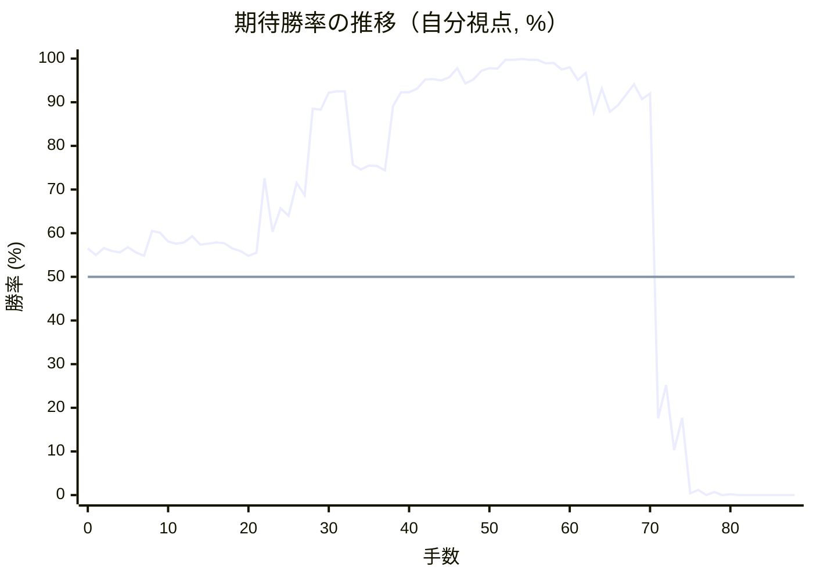
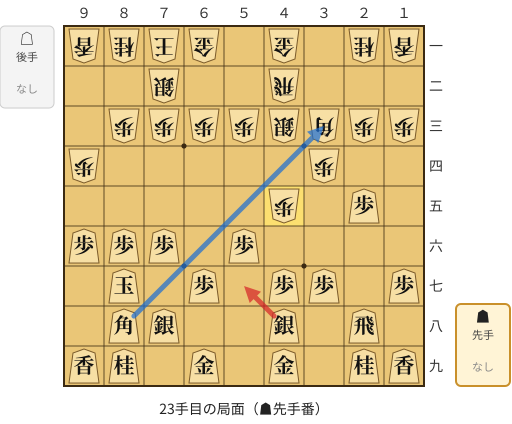
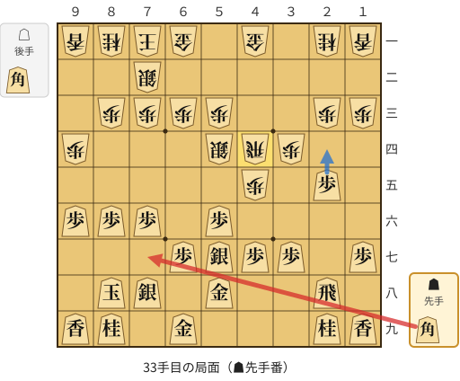
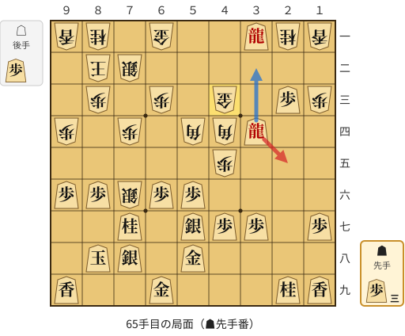
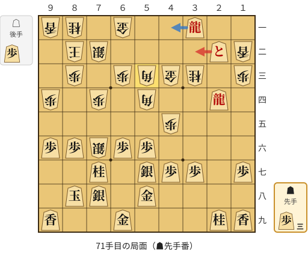
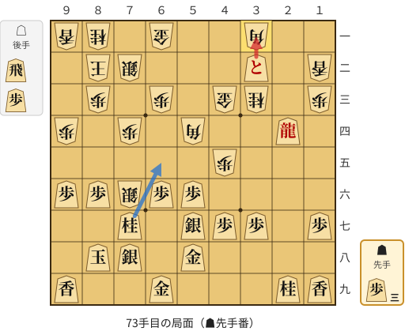
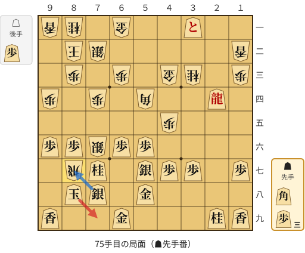

# 解析レポート v878s8ca6dcz

[README に戻る](../../../README.md)　/　棋譜: [CSA](../../../data/csa/shogi5/v878s8ca6dcz.csa)　/　解析の見方: [docs/mistake_analysis.md](../../../docs/mistake_analysis.md)

## 対局情報

| 項目 | 内容 |
|---|---|
| 日時 | 2026-11-20 02:56:04 |
| 持ち時間 | 5分 |
| 自分 | 先手（▲）（1711） |
| 相手 | 相手（1725） |
| 結果 | 負け（詰み, 88手） |

## 解析環境

| 項目 | 内容 |
|---|---|
| エンジン | YaneuraOu NNUE 9.00git 64AVX2（V9.00/YANEURAOU_ENGINE_NNUE/AVX2） |
| 評価関数 | **水匠5**（`suisho5`） |
| nn.bin SHA-256 | `768068f0d534a0603a5d38bcd143de6bbca820d5f1c95a14d40863e5b7892d76` |
| 第1パス | movetime=150ms, MultiPV 1 |
| 第2パス | movetime=2000ms, MultiPV 3 |
| Threads / Hash | 8 / 512MB |
| 判定基準 | 疑問手 ≥5pt, 悪手 ≥10pt, 大悪手 ≥20pt（期待勝率 W(E)=1/(1+exp(-E/600))） |
| 解析日時 | 2026-11-20T19:58:43+09:00（解析バージョン 1, 42秒） |

## サマリー

| 自分の手数 | 深掘りした手 | 詰み逃し | 大悪手 | 悪手 | 疑問手 |
|--:|--:|--:|--:|--:|--:|
| 44 | 7 | 0 | 2 | 2 | 2 |

## 期待勝率の推移



<details><summary>1手ごとの数値（第1パス）</summary>

| 手数 | 指し手 | 評価値 | 勝率 | 低下 | 判定 |
|--:|---|--:|--:|--:|---|
| 1 | ▲７六歩(77) | +120 | 55.0% | +1.5pt |  |
| 2 | △３四歩(33) | +160 | 56.6% |  |  |
| 3 | ▲２六歩(27) | +143 | 55.9% | +0.7pt |  |
| 4 | △４四歩(43) | +134 | 55.6% |  |  |
| 5 | ▲２五歩(26) | +164 | 56.8% | -1.2pt |  |
| 6 | △３三角(22) | +134 | 55.6% |  |  |
| 7 | ▲４八銀(39) | +115 | 54.8% | +0.8pt |  |
| 8 | △４二飛(82) | +255 | 60.5% |  |  |
| 9 | ▲６八玉(59) | +247 | 60.1% | +0.3pt |  |
| 10 | △６二玉(51) | +196 | 58.1% |  |  |
| 11 | ▲５六歩(57) | +184 | 57.6% | +0.5pt |  |
| 12 | △７二銀(71) | +190 | 57.9% |  |  |
| 13 | ▲７八玉(68) | +225 | 59.3% | -1.4pt |  |
| 14 | △７一玉(62) | +180 | 57.4% |  |  |
| 15 | ▲９六歩(97) | +183 | 57.6% | -0.1pt |  |
| 16 | △９四歩(93) | +191 | 57.9% |  |  |
| 17 | ▲８六歩(87) | +186 | 57.7% | +0.2pt |  |
| 18 | △３二銀(31) | +156 | 56.5% |  |  |
| 19 | ▲８七玉(78) | +143 | 55.9% | +0.5pt |  |
| 20 | △４三銀(32) | +116 | 54.8% |  |  |
| 21 | ▲７八銀(79) | +133 | 55.5% | -0.7pt |  |
| 22 | △４五歩(44) | +586 | 72.6% |  |  |
| 23 | ▲５七銀(48) | +250 | 60.3% | +12.4pt | [悪手](#ply-23) |
| 24 | △８八角成(33) | +390 | 65.7% |  |  |
| 25 | ▲同玉(87) | +344 | 64.0% | +1.7pt |  |
| 26 | △５四銀(43) | +553 | 71.5% |  |  |
| 27 | ▲７七角打 | +473 | 68.7% | +2.8pt |  |
| 28 | △３五角打 | +1222 | 88.5% |  |  |
| 29 | ▲５八金(49) | +1211 | 88.3% | +0.2pt |  |
| 30 | △４四角(35) | +1485 | 92.2% |  |  |
| 31 | ▲同角(77) | +1505 | 92.5% | -0.2pt |  |
| 32 | △同飛(42) | +1504 | 92.5% |  |  |
| 33 | ▲７七角打 | +682 | 75.7% | +16.8pt | [悪手](#ply-33) |
| 34 | △３三角打 | +648 | 74.6% |  |  |
| 35 | ▲４四角(77) | +675 | 75.5% | -0.8pt |  |
| 36 | △同角(33) | +673 | 75.4% |  |  |
| 37 | ▲７七桂(89) | +640 | 74.4% | +1.0pt |  |
| 38 | △５二金(41) | +1263 | 89.1% |  |  |
| 39 | ▲２四歩(25) | +1492 | 92.3% | -3.2pt |  |
| 40 | △６五銀(54) | +1492 | 92.3% |  |  |
| 41 | ▲４一飛打 | +1563 | 93.1% | -0.8pt |  |
| 42 | △４三角打 | +1794 | 95.2% |  |  |
| 43 | ▲２三歩成(24) | +1812 | 95.3% | -0.1pt |  |
| 44 | △７六銀(65) | +1766 | 95.0% |  |  |
| 45 | ▲６六歩(67) | +1860 | 95.7% | -0.7pt |  |
| 46 | △２六歩打 | +2274 | 97.8% |  |  |
| 47 | ▲３一飛成(41) | +1684 | 94.3% | +3.5pt |  |
| 48 | △７四歩(73) | +1796 | 95.2% |  |  |
| 49 | ▲３二と(23) | +2122 | 97.2% | -1.9pt |  |
| 50 | △８二玉(71) | +2276 | 97.8% |  |  |
| 51 | ▲４二と(32) | +2244 | 97.7% | +0.1pt |  |
| 52 | △２七歩成(26) | +3410 | 99.7% |  |  |
| 53 | ▲同飛(28) | +3568 | 99.7% | -0.1pt |  |
| 54 | △５四角(43) | +3982 | 99.9% |  |  |
| 55 | ▲２三飛成(27) | +3436 | 99.7% | +0.2pt |  |
| 56 | △６二金(52) | +3517 | 99.7% |  |  |
| 57 | ▲４三と(42) | +2707 | 98.9% | +0.8pt |  |
| 58 | △３五角(44) | +2772 | 99.0% |  |  |
| 59 | ▲５三と(43) | +2208 | 97.5% | +1.5pt |  |
| 60 | △同金(62) | +2343 | 98.0% |  |  |
| 61 | ▲３四龍(23) | +1778 | 95.1% | +2.9pt |  |
| 62 | △４四角(35) | +2033 | 96.7% |  |  |
| 63 | ▲２三歩打 | +1180 | 87.7% | +9.0pt |  |
| 64 | △４三金(53) | +1564 | 93.1% |  |  |
| 65 | ▲２五龍(34) | +1184 | 87.8% | +5.3pt | [疑問手](#ply-65) |
| 66 | △３三桂(21) | +1275 | 89.3% |  |  |
| 67 | ▲２四龍(25) | +1445 | 91.7% | -2.4pt |  |
| 68 | △１二香(11) | +1662 | 94.1% |  |  |
| 69 | ▲２二歩成(23) | +1367 | 90.7% | +3.4pt |  |
| 70 | △５三角(44) | +1466 | 92.0% |  |  |
| 71 | ▲３二と(22) | -927 | 17.6% | +74.4pt | [大悪手](#ply-71) |
| 72 | △３一角(53) | -653 | 25.2% |  |  |
| 73 | ▲同と(32) | -1300 | 10.3% | +14.9pt | [大悪手](#ply-73) |
| 74 | △８七飛打 | -921 | 17.7% |  |  |
| 75 | ▲７九玉(88) | -3243 | 0.4% | +17.3pt | [疑問手](#ply-75) |
| 76 | △７七銀成(76) | -2650 | 1.2% |  |  |
| 77 | ▲同銀(78) | -4736 | 0.0% | +1.2pt |  |
| 78 | △同飛成(87) | -3005 | 0.7% |  |  |
| 79 | ▲７八金(69) | -6475 | 0.0% | +0.7pt |  |
| 80 | △８七角成(54) | -3713 | 0.2% |  |  |
| 81 | ▲６八金(58) | #-7 | 0.0% | +0.2pt |  |
| 82 | △７八馬(87) | #-6 | 0.0% |  |  |
| 83 | ▲同金(68) | #-5 | 0.0% | +0.0pt |  |
| 84 | △８八金打 | #-4 | 0.0% |  |  |
| 85 | ▲６九玉(79) | #-3 | 0.0% | +0.0pt |  |
| 86 | △７八龍(77) | #-2 | 0.0% |  |  |
| 87 | ▲５九玉(69) | #-1 | 0.0% | +0.0pt |  |
| 88 | △５八金打 | #- | 0.0% |  |  |

</details>

## 課題局面

<a id="ply-23"></a>
### 23手目 ▲５七銀(48) — 悪手

| | 着手前 | 着手後 | 差 |
|---|--:|--:|--:|
| 期待勝率 | 71.8% | 58.5% | -13.3pt |
| 評価値 | +561 | +207 | |

着手前の局面:



🔴 実戦 ▲５七銀(48)　🔵 AI推奨 ▲３三角成(88)　🟨 直前の相手の指し手

<details><summary>テキストの盤面図（BOD・将棋ソフトに貼り付け可）</summary>

```text
後手の持駒：なし
  ９ ８ ７ ６ ５ ４ ３ ２ １
+---------------------------+
|v香v桂v玉v金 ・v金 ・v桂v香|一
| ・ ・v銀 ・ ・v飛 ・ ・ ・|二
| ・v歩v歩v歩v歩v銀v角v歩v歩|三
|v歩 ・ ・ ・ ・ ・v歩 ・ ・|四
| ・ ・ ・ ・ ・v歩 ・ 歩 ・|五
| 歩 歩 歩 ・ 歩 ・ ・ ・ ・|六
| ・ 玉 ・ 歩 ・ 歩 歩 ・ 歩|七
| ・ 角 銀 ・ ・ 銀 ・ 飛 ・|八
| 香 桂 ・ 金 ・ 金 ・ 桂 香|九
+---------------------------+
先手の持駒：なし
手数＝22　△４五歩　まで
```

</details>

| | 指し手 | 評価値 | 読み筋 |
|---|---|--:|---|
| 実戦 | ▲５七銀(48) | +207 | △４四銀(43) ▲３六歩(37) △８二玉(71) ▲１六歩(17) △５二金(41) ▲５八金(49) |
| AI 1位 | ▲３三角成(88) | +561 | ▲３三角成(88) △同桂(21) ▲２四歩(25) △同歩(23) ▲同飛(28) △４六歩(45) |
| AI 2位 | ▲２四歩(25) | +528 | ▲２四歩(25) △８八角成(33) ▲同玉(87) △２四歩(23) ▲６六角打 △３三角打 |
| AI 3位 | ▲５八金(49) | +233 | ▲５八金(49) △４四銀(43) ▲３六歩(37) △８二玉(71) ▲５七銀(48) △５四歩(53) |

SFEN: `lnkg1g1nl/2s2r3/1ppppsbpp/p5p2/5p1P1/PPP1P4/1K1P1PP1P/1BS2S1R1/LN1G1G1NL b - 23`

<a id="ply-33"></a>
### 33手目 ▲７七角打 — 悪手

| | 着手前 | 着手後 | 差 |
|---|--:|--:|--:|
| 期待勝率 | 92.0% | 80.8% | -11.2pt |
| 評価値 | +1467 | +864 | |

着手前の局面:



🔴 実戦 ▲７七角打　🔵 AI推奨 ▲２四歩(25)　🟨 直前の相手の指し手

<details><summary>テキストの盤面図（BOD・将棋ソフトに貼り付け可）</summary>

```text
後手の持駒：角
  ９ ８ ７ ６ ５ ４ ３ ２ １
+---------------------------+
|v香v桂v玉v金 ・v金 ・v桂v香|一
| ・ ・v銀 ・ ・ ・ ・ ・ ・|二
| ・v歩v歩v歩v歩 ・ ・v歩v歩|三
|v歩 ・ ・ ・v銀v飛v歩 ・ ・|四
| ・ ・ ・ ・ ・v歩 ・ 歩 ・|五
| 歩 歩 歩 ・ 歩 ・ ・ ・ ・|六
| ・ ・ ・ 歩 銀 歩 歩 ・ 歩|七
| ・ 玉 銀 ・ 金 ・ ・ 飛 ・|八
| 香 桂 ・ 金 ・ ・ ・ 桂 香|九
+---------------------------+
先手の持駒：角
手数＝32　△４四同飛　まで
```

</details>

| | 指し手 | 評価値 | 読み筋 |
|---|---|--:|---|
| 実戦 | ▲７七角打 | +864 | △３三角打 ▲２四歩(25) △同歩(23) ▲４四角(77) △同角(33) ▲７七桂(89) |
| AI 1位 | ▲２四歩(25) | +1467 | ▲２四歩(25) △同歩(23) ▲同飛(28) △３一金(41) ▲７七角打 △３三角打 |
| AI 2位 | ▲２二角打 | +1397 | ▲２二角打 △３三角打 ▲同角成(22) △同桂(21) ▲２四歩(25) △同歩(23) |
| AI 3位 | ▲９五歩(96) | +1000 | ▲９五歩(96) △同歩(94) ▲２四歩(25) △同歩(23) ▲同飛(28) △３一金(41) |

SFEN: `lnkg1g1nl/2s6/1pppp2pp/p3srp2/5p1P1/PPP1P4/3PSPP1P/1KS1G2R1/LN1G3NL b Bb 33`

<a id="ply-65"></a>
### 65手目 ▲２五龍(34) — 疑問手

| | 着手前 | 着手後 | 差 |
|---|--:|--:|--:|
| 期待勝率 | 93.7% | 86.1% | -7.6pt |
| 評価値 | +1622 | +1096 | |

着手前の局面:



🔴 実戦 ▲２五龍(34)　🔵 AI推奨 ▲３二龍(34)　🟨 直前の相手の指し手

<details><summary>テキストの盤面図（BOD・将棋ソフトに貼り付け可）</summary>

```text
後手の持駒：歩
  ９ ８ ７ ６ ５ ４ ３ ２ １
+---------------------------+
|v香v桂 ・v金 ・ ・ 龍v桂v香|一
| ・v玉v銀 ・ ・ ・ ・ ・ ・|二
| ・v歩 ・v歩 ・v金 ・ 歩v歩|三
|v歩 ・v歩 ・v角v角 龍 ・ ・|四
| ・ ・ ・ ・ ・v歩 ・ ・ ・|五
| 歩 歩v銀 歩 歩 ・ ・ ・ ・|六
| ・ ・ 桂 ・ 銀 歩 歩 ・ 歩|七
| ・ 玉 銀 ・ 金 ・ ・ ・ ・|八
| 香 ・ ・ 金 ・ ・ ・ 桂 香|九
+---------------------------+
先手の持駒：歩三
手数＝64　△４三金　まで
```

</details>

| | 指し手 | 評価値 | 読み筋 |
|---|---|--:|---|
| 実戦 | ▲２五龍(34) | +1096 | △９五歩(94) ▲２一龍(31) △９六歩(95) ▲９三歩打 △同香(91) ▲９八歩打 |
| AI 1位 | ▲３二龍(34) | +1622 | ▲３二龍(34) △５一歩打 ▲６八金(69) △８四歩(83) ▲４一龍(31) △５二金(61) |
| AI 2位 | ▲２五龍(34) | +1474 | ▲２五龍(34) △９五歩(94) ▲同歩(96) △３三桂(21) ▲２四龍(25) △５三角(44) |
| AI 3位 | ▲３六龍(34) | +1307 | ▲３六龍(34) △２八歩打 ▲３二龍(36) △５三金(43) ▲４一龍(32) △４三角(54) |

SFEN: `ln1g2+Rnl/1ks6/1p1p1g1Pp/p1p1bb+R2/5p3/PPsPP4/2N1SPP1P/1KS1G4/L2G3NL b 3Pp 65`

<a id="ply-71"></a>
### 71手目 ▲３二と(22) — 大悪手

| | 着手前 | 着手後 | 差 |
|---|--:|--:|--:|
| 期待勝率 | 96.6% | 35.3% | -61.3pt |
| 評価値 | +2000 | -364 | |

着手前の局面:



🔴 実戦 ▲３二と(22)　🔵 AI推奨 ▲４一龍(31)　🟨 直前の相手の指し手

<details><summary>テキストの盤面図（BOD・将棋ソフトに貼り付け可）</summary>

```text
後手の持駒：歩
  ９ ８ ７ ６ ５ ４ ３ ２ １
+---------------------------+
|v香v桂 ・v金 ・ ・ 龍 ・ ・|一
| ・v玉v銀 ・ ・ ・ ・ とv香|二
| ・v歩 ・v歩v角v金v桂 ・v歩|三
|v歩 ・v歩 ・v角 ・ ・ 龍 ・|四
| ・ ・ ・ ・ ・v歩 ・ ・ ・|五
| 歩 歩v銀 歩 歩 ・ ・ ・ ・|六
| ・ ・ 桂 ・ 銀 歩 歩 ・ 歩|七
| ・ 玉 銀 ・ 金 ・ ・ ・ ・|八
| 香 ・ ・ 金 ・ ・ ・ 桂 香|九
+---------------------------+
先手の持駒：歩三
手数＝70　△５三角　まで
```

</details>

| | 指し手 | 評価値 | 読み筋 |
|---|---|--:|---|
| 実戦 | ▲３二と(22) | -364 | △３一角(53) ▲６五桂(77) △７五角(31) ▲７七歩打 △６五銀(76) ▲同歩(66) |
| AI 1位 | ▲４一龍(31) | +2000 | ▲４一龍(31) △８六角(53) ▲６八金(69) △９五歩(94) ▲８七歩打 △６四角(86) |
| AI 2位 | ▲１一龍(31) | +1692 | ▲１一龍(31) △８六角(53) ▲６八金(69) △４六歩(45) ▲同歩(47) △９五歩(94) |
| AI 3位 | ▲２一龍(31) | +1534 | ▲２一龍(31) △８六角(53) ▲６八金(69) △３四金(43) ▲同龍(24) △７七角成(86) |

SFEN: `ln1g2+R2/1ks4+Pl/1p1pbgn1p/p1p1b2+R1/5p3/PPsPP4/2N1SPP1P/1KS1G4/L2G3NL b 3Pp 71`

<a id="ply-73"></a>
### 73手目 ▲同と(32) — 大悪手

| | 着手前 | 着手後 | 差 |
|---|--:|--:|--:|
| 期待勝率 | 31.9% | 10.4% | -21.5pt |
| 評価値 | -456 | -1293 | |

着手前の局面:



🔴 実戦 ▲同と(32)　🔵 AI推奨 ▲６五桂(77)　🟨 直前の相手の指し手

<details><summary>テキストの盤面図（BOD・将棋ソフトに貼り付け可）</summary>

```text
後手の持駒：飛　歩
  ９ ８ ７ ６ ５ ４ ３ ２ １
+---------------------------+
|v香v桂 ・v金 ・ ・v角 ・ ・|一
| ・v玉v銀 ・ ・ ・ と ・v香|二
| ・v歩 ・v歩 ・v金v桂 ・v歩|三
|v歩 ・v歩 ・v角 ・ ・ 龍 ・|四
| ・ ・ ・ ・ ・v歩 ・ ・ ・|五
| 歩 歩v銀 歩 歩 ・ ・ ・ ・|六
| ・ ・ 桂 ・ 銀 歩 歩 ・ 歩|七
| ・ 玉 銀 ・ 金 ・ ・ ・ ・|八
| 香 ・ ・ 金 ・ ・ ・ 桂 香|九
+---------------------------+
先手の持駒：歩三
手数＝72　△３一角　まで
```

</details>

| | 指し手 | 評価値 | 読み筋 |
|---|---|--:|---|
| 実戦 | ▲同と(32) | -1293 | △８七飛打 ▲同銀(78) △同銀成(76) ▲７九玉(88) △７七成銀(87) ▲６八金(69) |
| AI 1位 | ▲６五桂(77) | -456 | ▲６五桂(77) △７五角(31) ▲７七歩打 △６五銀(76) ▲同歩(66) △２五飛打 |
| AI 2位 | ▲５四龍(24) | -818 | ▲５四龍(24) △同金(43) ▲３一と(32) △４九飛打 ▲９八角打 △３九飛打 |
| AI 3位 | ▲同と(32) | -1256 | ▲同と(32) △８七飛打 ▲同銀(78) △同銀成(76) ▲７九玉(88) △７七成銀(87) |

SFEN: `ln1g2b2/1ks3+P1l/1p1p1gn1p/p1p1b2+R1/5p3/PPsPP4/2N1SPP1P/1KS1G4/L2G3NL b 3Prp 73`

<a id="ply-75"></a>
### 75手目 ▲７九玉(88) — 疑問手

| | 着手前 | 着手後 | 差 |
|---|--:|--:|--:|
| 期待勝率 | 6.8% | 0.0% | -6.8pt |
| 評価値 | -1571 | -4614 | |

着手前の局面:



🔴 実戦 ▲７九玉(88)　🔵 AI推奨 ▲同銀(78)　🟨 直前の相手の指し手

<details><summary>テキストの盤面図（BOD・将棋ソフトに貼り付け可）</summary>

```text
後手の持駒：歩
  ９ ８ ７ ６ ５ ４ ３ ２ １
+---------------------------+
|v香v桂 ・v金 ・ ・ と ・ ・|一
| ・v玉v銀 ・ ・ ・ ・ ・v香|二
| ・v歩 ・v歩 ・v金v桂 ・v歩|三
|v歩 ・v歩 ・v角 ・ ・ 龍 ・|四
| ・ ・ ・ ・ ・v歩 ・ ・ ・|五
| 歩 歩v銀 歩 歩 ・ ・ ・ ・|六
| ・v飛 桂 ・ 銀 歩 歩 ・ 歩|七
| ・ 玉 銀 ・ 金 ・ ・ ・ ・|八
| 香 ・ ・ 金 ・ ・ ・ 桂 香|九
+---------------------------+
先手の持駒：角　歩三
手数＝74　△８七飛　まで
```

</details>

| | 指し手 | 評価値 | 読み筋 |
|---|---|--:|---|
| 実戦 | ▲７九玉(88) | -4614 | △７七銀成(76) ▲６八金(69) △８八飛成(87) ▲６九玉(79) △９九龍(88) ▲７九歩打 |
| AI 1位 | ▲同銀(78) | -1571 | ▲同銀(78) △同銀成(76) ▲７九玉(88) △７七成銀(87) ▲６八金(69) △８七角成(54) |
| AI 2位 | ▲７九玉(88) | -4321 | ▲７九玉(88) △７七銀成(76) ▲５五角打 △７三桂(81) ▲６八金(69) △８八飛成(87) |
| AI 3位 | ▲９八玉(88) | 14手で詰まされる | ▲９八玉(88) △７七銀成(76) ▲５五角打 △７三桂(81) ▲同角成(55) △同銀(72) |

SFEN: `ln1g2+P2/1ks5l/1p1p1gn1p/p1p1b2+R1/5p3/PPsPP4/1rN1SPP1P/1KS1G4/L2G3NL b B3Pp 75`

