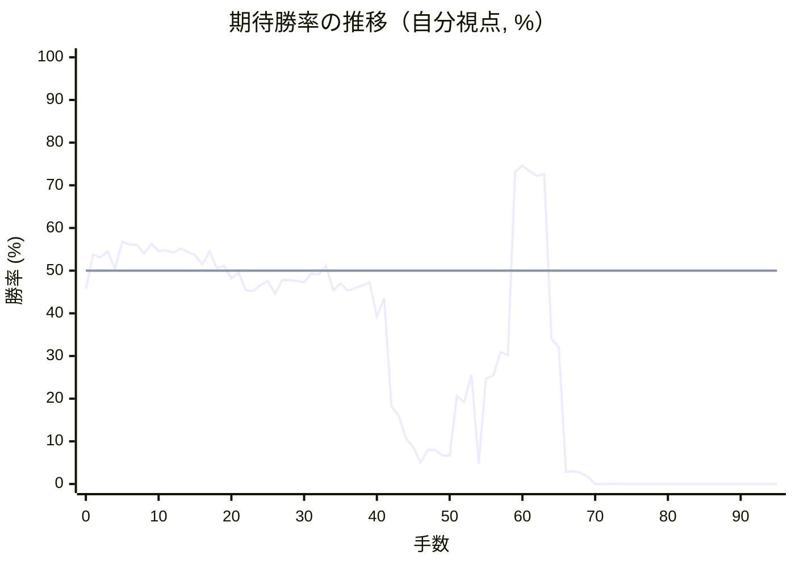

# 解析レポート vfwzjqhcsp8a

[README に戻る](../../../README.md)　/　棋譜: [CSA](../../../data/csa/shogi5/vfwzjqhcsp8a.csa)　/　解析の見方: [docs/mistake_analysis.md](../../../docs/mistake_analysis.md)

## 対局情報

| 項目 | 内容 |
|---|---|
| 日時 | 2026-11-01 07:43:32 |
| 持ち時間 | 5分 |
| 自分 | 後手（△）（1727） |
| 相手 | 相手（1775） |
| 結果 | 負け（投了, 95手） |

## 解析環境

| 項目 | 内容 |
|---|---|
| エンジン | YaneuraOu NNUE 9.00git 64AVX2（V9.00/YANEURAOU_ENGINE_NNUE/AVX2） |
| 評価関数 | **水匠5**（`suisho5`） |
| nn.bin SHA-256 | `768068f0d534a0603a5d38bcd143de6bbca820d5f1c95a14d40863e5b7892d76` |
| 第1パス | movetime=150ms, MultiPV 1 |
| 第2パス | movetime=2000ms, MultiPV 3 |
| Threads / Hash | 8 / 512MB |
| 判定基準 | 疑問手 ≥5pt, 悪手 ≥10pt, 大悪手 ≥20pt（期待勝率 W(E)=1/(1+exp(-E/600))） |
| 解析日時 | 2026-11-03T04:04:50+09:00（解析バージョン 1, 41秒） |

## サマリー

| 自分の手数 | 深掘りした手 | 詰み逃し | 大悪手 | 悪手 | 疑問手 |
|--:|--:|--:|--:|--:|--:|
| 47 | 7 | 0 | 2 | 2 | 3 |

## 期待勝率の推移



<details><summary>1手ごとの数値（第1パス）</summary>

| 手数 | 指し手 | 評価値 | 勝率 | 低下 | 判定 |
|--:|---|--:|--:|--:|---|
| 1 | ▲５六歩(57) | +91 | 53.8% |  |  |
| 2 | △８四歩(83) | +74 | 53.1% | +0.7pt |  |
| 3 | ▲７六歩(77) | +108 | 54.5% |  |  |
| 4 | △３四歩(33) | +13 | 50.5% | +3.9pt |  |
| 5 | ▲５五歩(56) | +163 | 56.8% |  |  |
| 6 | △８五歩(84) | +147 | 56.1% | +0.7pt |  |
| 7 | ▲７七角(88) | +146 | 56.1% |  |  |
| 8 | △６二銀(71) | +96 | 54.0% | +2.1pt |  |
| 9 | ▲５八飛(28) | +153 | 56.3% |  |  |
| 10 | △４二玉(51) | +111 | 54.6% | +1.7pt |  |
| 11 | ▲４八玉(59) | +115 | 54.8% |  |  |
| 12 | △３二玉(42) | +102 | 54.2% | +0.5pt |  |
| 13 | ▲３八玉(48) | +126 | 55.2% |  |  |
| 14 | △５二金(61) | +107 | 54.4% | +0.8pt |  |
| 15 | ▲６八銀(79) | +90 | 53.7% |  |  |
| 16 | △４四歩(43) | +37 | 51.5% | +2.2pt |  |
| 17 | ▲５七銀(68) | +108 | 54.5% |  |  |
| 18 | △４三金(52) | +14 | 50.6% | +3.9pt |  |
| 19 | ▲５六銀(57) | +26 | 51.1% |  |  |
| 20 | △６四歩(63) | -44 | 48.2% | +2.9pt |  |
| 21 | ▲２八玉(38) | -12 | 49.5% |  |  |
| 22 | △９四歩(93) | -110 | 45.4% | +4.1pt |  |
| 23 | ▲３八銀(39) | -115 | 45.2% |  |  |
| 24 | △７四歩(73) | -81 | 46.6% | -1.4pt |  |
| 25 | ▲４六歩(47) | -58 | 47.6% |  |  |
| 26 | △７三桂(81) | -131 | 44.6% | +3.0pt |  |
| 27 | ▲６六歩(67) | -54 | 47.8% |  |  |
| 28 | △６三銀(62) | -53 | 47.8% | -0.0pt |  |
| 29 | ▲７八飛(58) | -57 | 47.6% |  |  |
| 30 | △１四歩(13) | -65 | 47.3% | +0.3pt |  |
| 31 | ▲５八金(69) | -17 | 49.3% |  |  |
| 32 | △１五歩(14) | -22 | 49.1% | +0.2pt |  |
| 33 | ▲６八角(77) | +30 | 51.2% |  |  |
| 34 | △２四歩(23) | -111 | 45.4% | +5.9pt | [疑問手](#ply-34) |
| 35 | ▲７五歩(76) | -71 | 47.0% |  |  |
| 36 | △同歩(74) | -112 | 45.3% | +1.7pt |  |
| 37 | ▲同飛(78) | -98 | 45.9% |  |  |
| 38 | △７四歩打 | -84 | 46.5% | -0.6pt |  |
| 39 | ▲７六飛(75) | -66 | 47.3% |  |  |
| 40 | △２三玉(32) | -264 | 39.2% | +8.1pt | [疑問手](#ply-40) |
| 41 | ▲６五歩(66) | -155 | 43.6% |  |  |
| 42 | △８四飛(82) | -901 | 18.2% | +25.4pt | [大悪手](#ply-42) |
| 43 | ▲５七角(68) | -994 | 16.0% |  |  |
| 44 | △７五歩(74) | -1273 | 10.7% | +5.3pt | [疑問手](#ply-44) |
| 45 | ▲同飛(76) | -1417 | 8.6% |  |  |
| 46 | △７四飛(84) | -1767 | 5.0% | +3.6pt |  |
| 47 | ▲同飛(75) | -1465 | 8.0% |  |  |
| 48 | △同銀(63) | -1467 | 8.0% | +0.0pt |  |
| 49 | ▲７一飛打 | -1577 | 6.7% |  |  |
| 50 | △６五銀(74) | -1586 | 6.6% | +0.1pt |  |
| 51 | ▲同銀(56) | -808 | 20.6% |  |  |
| 52 | △同桂(73) | -863 | 19.2% | +1.5pt |  |
| 53 | ▲４一飛成(71) | -641 | 25.6% |  |  |
| 54 | △３二銀(31) | -1794 | 4.8% | +20.8pt | [悪手](#ply-54) |
| 55 | ▲９一龍(41) | -664 | 24.8% |  |  |
| 56 | △５七桂成(65) | -647 | 25.4% | -0.5pt |  |
| 57 | ▲同金(58) | -483 | 30.9% |  |  |
| 58 | △７九飛打 | -503 | 30.2% | +0.7pt |  |
| 59 | ▲３六桂打 | +604 | 73.2% |  |  |
| 60 | △４八銀打 | +645 | 74.6% | -1.3pt |  |
| 61 | ▲３九金打 | +607 | 73.3% |  |  |
| 62 | △５七銀不成(48) | +574 | 72.2% | +1.1pt |  |
| 63 | ▲２六香打 | +586 | 72.6% |  |  |
| 64 | △１四金打 | -394 | 34.1% | +38.5pt | [大悪手](#ply-64) |
| 65 | ▲１六歩(17) | -451 | 32.0% |  |  |
| 66 | △２五歩(24) | -2121 | 2.8% | +29.2pt | [悪手](#ply-66) |
| 67 | ▲１五歩(16) | -2092 | 3.0% |  |  |
| 68 | △２六歩(25) | -2164 | 2.6% | +0.3pt |  |
| 69 | ▲１四歩(15) | -2422 | 1.7% |  |  |
| 70 | △同香(11) | -5124 | 0.0% | +1.7pt |  |
| 71 | ▲２四金打 | -6786 | 0.0% |  |  |
| 72 | △１二玉(23) | -8102 | 0.0% | +0.0pt |  |
| 73 | ▲１三歩打 | -4354 | 0.1% |  |  |
| 74 | △同桂(21) | -5641 | 0.0% | +0.1pt |  |
| 75 | ▲１四香(19) | -5050 | 0.0% |  |  |
| 76 | △２七歩成(26) | -5781 | 0.0% | +0.0pt |  |
| 77 | ▲同銀(38) | -6040 | 0.0% |  |  |
| 78 | △７一歩打 | -6334 | 0.0% | +0.0pt |  |
| 79 | ▲８二龍(91) | -6248 | 0.0% |  |  |
| 80 | △７二香打 | #-15 | 0.0% | +0.0pt |  |
| 81 | ▲７一龍(82) | -7091 | 0.0% |  |  |
| 82 | △７八飛成(79) | -35281 | 0.0% | +0.0pt |  |
| 83 | ▲６八歩打 | -7411 | 0.0% |  |  |
| 84 | △同龍(78) | -35281 | 0.0% | +0.0pt |  |
| 85 | ▲３八金(49) | -35281 | 0.0% |  |  |
| 86 | △２六歩打 | #-9 | 0.0% | +0.0pt |  |
| 87 | ▲同銀(27) | -7612 | 0.0% |  |  |
| 88 | △４六銀不成(57) | #-9 | 0.0% | +0.0pt |  |
| 89 | ▲１三香成(14) | #-8 | 0.0% |  |  |
| 90 | △同角(22) | #-7 | 0.0% | +0.0pt |  |
| 91 | ▲同金(24) | #-6 | 0.0% |  |  |
| 92 | △同玉(12) | #-5 | 0.0% | +0.0pt |  |
| 93 | ▲１一龍(71) | #-4 | 0.0% |  |  |
| 94 | △１二歩打 | #-3 | 0.0% | +0.0pt |  |
| 95 | ▲２四銀打 | #-2 | 0.0% |  |  |

</details>

## 課題局面

<a id="ply-34"></a>
### 34手目 △２四歩(23) — 疑問手

| | 着手前 | 着手後 | 差 |
|---|--:|--:|--:|
| 期待勝率 | 50.6% | 43.4% | -7.3pt |
| 評価値 | +15 | -160 | |

着手前の局面:

```text
後手の持駒：なし
  ９ ８ ７ ６ ５ ４ ３ ２ １
+---------------------------+
|v香 ・ ・ ・ ・v金v銀v桂v香|一
| ・v飛 ・ ・ ・ ・v玉v角 ・|二
| ・ ・v桂v銀v歩v金 ・v歩 ・|三
|v歩 ・v歩v歩 ・v歩v歩 ・ ・|四
| ・v歩 ・ ・ 歩 ・ ・ ・v歩|五
| ・ ・ 歩 歩 銀 歩 ・ ・ ・|六
| 歩 歩 ・ ・ ・ ・ 歩 歩 歩|七
| ・ ・ 飛 角 金 ・ 銀 玉 ・|八
| 香 桂 ・ ・ ・ 金 ・ 桂 香|九
+---------------------------+
先手の持駒：なし
後手番
手数＝33　▲６八角　まで
```

| | 指し手 | 評価値 | 読み筋 |
|---|---|--:|---|
| 実戦 | △２四歩(23) | -160 | ▲７五歩(76) △同歩(74) ▲同飛(78) △７四歩打 ▲７六飛(75) △５四歩(53) |
| AI 1位 | △８四飛(82) | +15 | △８四飛(82) ▲４五歩(46) △同歩(44) ▲同銀(56) △４二銀(31) ▲７五歩(76) |
| AI 2位 | △４二銀(31) | -12 | △４二銀(31) ▲７五歩(76) △同歩(74) ▲同飛(78) △７四歩打 ▲７九飛(75) |
| AI 3位 | △５四歩(53) | -18 | △５四歩(53) ▲同歩(55) △４二銀(31) ▲７五歩(76) △同歩(74) ▲同飛(78) |

SFEN: `l4gsnl/1r4kb1/2nspg1p1/p1pp1pp2/1p2P3p/2PPSP3/PP4PPP/2RBG1SK1/LN3G1NL w - 34`

<a id="ply-40"></a>
### 40手目 △２三玉(32) — 疑問手

| | 着手前 | 着手後 | 差 |
|---|--:|--:|--:|
| 期待勝率 | 42.8% | 36.6% | -6.2pt |
| 評価値 | -174 | -330 | |

着手前の局面:

```text
後手の持駒：なし
  ９ ８ ７ ６ ５ ４ ３ ２ １
+---------------------------+
|v香 ・ ・ ・ ・v金v銀v桂v香|一
| ・v飛 ・ ・ ・ ・v玉v角 ・|二
| ・ ・v桂v銀v歩v金 ・ ・ ・|三
|v歩 ・v歩v歩 ・v歩v歩v歩 ・|四
| ・v歩 ・ ・ 歩 ・ ・ ・v歩|五
| ・ ・ 飛 歩 銀 歩 ・ ・ ・|六
| 歩 歩 ・ ・ ・ ・ 歩 歩 歩|七
| ・ ・ ・ 角 金 ・ 銀 玉 ・|八
| 香 桂 ・ ・ ・ 金 ・ 桂 香|九
+---------------------------+
先手の持駒：歩
後手番
手数＝39　▲７六飛　まで
```

| | 指し手 | 評価値 | 読み筋 |
|---|---|--:|---|
| 実戦 | △２三玉(32) | -330 | ▲６五歩(66) △５二金(41) ▲６四歩(65) △同銀(63) ▲７四飛(76) △６三金(52) |
| AI 1位 | △５四歩(53) | -174 | △５四歩(53) ▲同歩(55) △５二飛(82) ▲６五歩(66) △５四金(43) ▲５五歩打 |
| AI 2位 | △５二金(41) | -250 | △５二金(41) ▲７七桂(89) △５四歩(53) ▲６五歩(66) △２三玉(32) ▲５七角(68) |
| AI 3位 | △７二飛(82) | -272 | △７二飛(82) ▲６五歩(66) △同桂(73) ▲６六歩打 △７五歩(74) ▲７八飛(76) |

SFEN: `l4gsnl/1r4kb1/2nspg3/p1pp1ppp1/1p2P3p/2RPSP3/PP4PPP/3BG1SK1/LN3G1NL w P 40`

<a id="ply-42"></a>
### 42手目 △８四飛(82) — 大悪手

| | 着手前 | 着手後 | 差 |
|---|--:|--:|--:|
| 期待勝率 | 37.3% | 14.0% | -23.3pt |
| 評価値 | -311 | -1088 | |

着手前の局面:

```text
後手の持駒：なし
  ９ ８ ７ ６ ５ ４ ３ ２ １
+---------------------------+
|v香 ・ ・ ・ ・v金v銀v桂v香|一
| ・v飛 ・ ・ ・ ・ ・v角 ・|二
| ・ ・v桂v銀v歩v金 ・v玉 ・|三
|v歩 ・v歩v歩 ・v歩v歩v歩 ・|四
| ・v歩 ・ 歩 歩 ・ ・ ・v歩|五
| ・ ・ 飛 ・ 銀 歩 ・ ・ ・|六
| 歩 歩 ・ ・ ・ ・ 歩 歩 歩|七
| ・ ・ ・ 角 金 ・ 銀 玉 ・|八
| 香 桂 ・ ・ ・ 金 ・ 桂 香|九
+---------------------------+
先手の持駒：歩
後手番
手数＝41　▲６五歩　まで
```

| | 指し手 | 評価値 | 読み筋 |
|---|---|--:|---|
| 実戦 | △８四飛(82) | -1088 | ▲５七角(68) △８一飛(84) ▲６四歩(65) △同銀(63) ▲７四飛(76) △６一飛(81) |
| AI 1位 | △５二金(41) | -311 | △５二金(41) ▲６四歩(65) △同銀(63) ▲７四飛(76) △６三金(52) ▲７九飛(74) |
| AI 2位 | △同桂(73) | -474 | △同桂(73) ▲６六歩打 △７二飛(82) ▲６五歩(66) △同歩(64) ▲同銀(56) |
| AI 3位 | △同歩(64) | -836 | △同歩(64) ▲６四歩打 △５二銀(63) ▲７四飛(76) △８三飛(82) ▲７六飛(74) |

SFEN: `l4gsnl/1r5b1/2nspg1k1/p1pp1ppp1/1p1PP3p/2R1SP3/PP4PPP/3BG1SK1/LN3G1NL w P 42`

<a id="ply-44"></a>
### 44手目 △７五歩(74) — 疑問手

| | 着手前 | 着手後 | 差 |
|---|--:|--:|--:|
| 期待勝率 | 10.8% | 5.5% | -5.3pt |
| 評価値 | -1264 | -1705 | |

着手前の局面:

```text
後手の持駒：なし
  ９ ８ ７ ６ ５ ４ ３ ２ １
+---------------------------+
|v香 ・ ・ ・ ・v金v銀v桂v香|一
| ・ ・ ・ ・ ・ ・ ・v角 ・|二
| ・ ・v桂v銀v歩v金 ・v玉 ・|三
|v歩v飛v歩v歩 ・v歩v歩v歩 ・|四
| ・v歩 ・ 歩 歩 ・ ・ ・v歩|五
| ・ ・ 飛 ・ 銀 歩 ・ ・ ・|六
| 歩 歩 ・ ・ 角 ・ 歩 歩 歩|七
| ・ ・ ・ ・ 金 ・ 銀 玉 ・|八
| 香 桂 ・ ・ ・ 金 ・ 桂 香|九
+---------------------------+
先手の持駒：歩
後手番
手数＝43　▲５七角　まで
```

| | 指し手 | 評価値 | 読み筋 |
|---|---|--:|---|
| 実戦 | △７五歩(74) | -1705 | ▲同飛(76) △８三飛(84) ▲３九角(57) △６五歩(64) ▲７四歩打 △７二歩打 |
| AI 1位 | △８二飛(84) | -1264 | △８二飛(84) ▲６四歩(65) △同銀(63) ▲７四飛(76) △６二飛(82) ▲７七桂(89) |
| AI 2位 | △８三飛(84) | -1277 | △８三飛(84) ▲６四歩(65) △同銀(63) ▲７四飛(76) △６三歩打 ▲７七桂(89) |
| AI 3位 | △８一飛(84) | -1221 | △８一飛(84) ▲６四歩(65) △同銀(63) ▲７四飛(76) △６一飛(81) ▲７七桂(89) |

SFEN: `l4gsnl/7b1/2nspg1k1/prpp1ppp1/1p1PP3p/2R1SP3/PP2B1PPP/4G1SK1/LN3G1NL w P 44`

<a id="ply-54"></a>
### 54手目 △３二銀(31) — 悪手

| | 着手前 | 着手後 | 差 |
|---|--:|--:|--:|
| 期待勝率 | 17.5% | 2.8% | -14.7pt |
| 評価値 | -932 | -2137 | |

着手前の局面:

```text
後手の持駒：飛　銀　歩
  ９ ８ ７ ６ ５ ４ ３ ２ １
+---------------------------+
|v香 ・ ・ ・ ・ 龍v銀v桂v香|一
| ・ ・ ・ ・ ・ ・ ・v角 ・|二
| ・ ・ ・ ・v歩v金 ・v玉 ・|三
|v歩 ・ ・v歩 ・v歩v歩v歩 ・|四
| ・v歩 ・v桂 歩 ・ ・ ・v歩|五
| ・ ・ ・ ・ ・ 歩 ・ ・ ・|六
| 歩 歩 ・ ・ 角 ・ 歩 歩 歩|七
| ・ ・ ・ ・ 金 ・ 銀 玉 ・|八
| 香 桂 ・ ・ ・ 金 ・ 桂 香|九
+---------------------------+
先手の持駒：金　銀　歩二
後手番
手数＝53　▲４一飛成　まで
```

| | 指し手 | 評価値 | 読み筋 |
|---|---|--:|---|
| 実戦 | △３二銀(31) | -2137 | ▲同龍(41) △同玉(23) ▲８四角(57) △３一銀打 ▲５一角成(84) △７一飛打 |
| AI 1位 | △３二銀打 | -932 | △３二銀打 ▲９一龍(41) △５七桂成(65) ▲同金(58) △７九飛打 ▲１六歩(17) |
| AI 2位 | △４二金(43) | -1013 | △４二金(43) ▲同龍(41) △同銀(31) ▲８四角(57) △７九飛打 ▲５四歩(55) |
| AI 3位 | △３二銀(31) | -2143 | △３二銀(31) ▲同龍(41) △同玉(23) ▲８四角(57) △２三玉(32) ▲５二銀打 |

SFEN: `l4+Rsnl/7b1/4pg1k1/p2p1ppp1/1p1nP3p/5P3/PP2B1PPP/4G1SK1/LN3G1NL w GS2Prsp 54`

<a id="ply-64"></a>
### 64手目 △１四金打 — 大悪手

| | 着手前 | 着手後 | 差 |
|---|--:|--:|--:|
| 期待勝率 | 71.2% | 22.1% | -49.1pt |
| 評価値 | +543 | -755 | |

着手前の局面:

```text
後手の持駒：角　金　歩
  ９ ８ ７ ６ ５ ４ ３ ２ １
+---------------------------+
| 龍 ・ ・ ・ ・ ・ ・v桂v香|一
| ・ ・ ・ ・ ・ ・v銀v角 ・|二
| ・ ・ ・ ・v歩v金 ・v玉 ・|三
|v歩 ・ ・v歩 ・v歩v歩v歩 ・|四
| ・v歩 ・ ・ 歩 ・ ・ ・v歩|五
| ・ ・ ・ ・ ・ 歩 桂 香 ・|六
| 歩 歩 ・ ・v銀 ・ 歩 歩 歩|七
| ・ ・ ・ ・ ・ ・ 銀 玉 ・|八
| 香 桂v飛 ・ ・ 金 金 桂 香|九
+---------------------------+
先手の持駒：銀　歩二
後手番
手数＝63　▲２六香　まで
```

| | 指し手 | 評価値 | 読み筋 |
|---|---|--:|---|
| 実戦 | △１四金打 | -755 | ▲１六歩(17) △３三金(43) ▲１五歩(16) △１三金(14) ▲３一銀打 △同角(22) |
| AI 1位 | △３三金(43) | +543 | △３三金(43) ▲８二龍(91) △７二歩打 ▲６九歩打 △６五角打 ▲５四歩(55) |
| AI 2位 | △１三金打 | -200 | △１三金打 ▲２四桂(36) △同金(13) ▲同香(26) △同玉(23) ▲３一金打 |
| AI 3位 | △３三金打 | -215 | △３三金打 ▲２四桂(36) △同金(33) ▲同香(26) △同玉(23) ▲３一金打 |

SFEN: `+R6nl/6sb1/4pg1k1/p2p1ppp1/1p2P3p/5PNL1/PP2s1PPP/6SK1/LNr2GGNL w S2Pbgp 64`

<a id="ply-66"></a>
### 66手目 △２五歩(24) — 悪手

| | 着手前 | 着手後 | 差 |
|---|--:|--:|--:|
| 期待勝率 | 17.6% | 2.0% | -15.5pt |
| 評価値 | -928 | -2324 | |

着手前の局面:

```text
後手の持駒：角　歩
  ９ ８ ７ ６ ５ ４ ３ ２ １
+---------------------------+
| 龍 ・ ・ ・ ・ ・ ・v桂v香|一
| ・ ・ ・ ・ ・ ・v銀v角 ・|二
| ・ ・ ・ ・v歩v金 ・v玉 ・|三
|v歩 ・ ・v歩 ・v歩v歩v歩v金|四
| ・v歩 ・ ・ 歩 ・ ・ ・v歩|五
| ・ ・ ・ ・ ・ 歩 桂 香 歩|六
| 歩 歩 ・ ・v銀 ・ 歩 歩 ・|七
| ・ ・ ・ ・ ・ ・ 銀 玉 ・|八
| 香 桂v飛 ・ ・ 金 金 桂 香|九
+---------------------------+
先手の持駒：銀　歩二
後手番
手数＝65　▲１六歩　まで
```

| | 指し手 | 評価値 | 読み筋 |
|---|---|--:|---|
| 実戦 | △２五歩(24) | -2324 | ▲１五歩(16) △３五歩(34) ▲１四歩(15) △３六歩(35) ▲２五香(26) △２四歩打 |
| AI 1位 | △同歩(15) | -928 | △同歩(15) ▲１五歩打 △４六銀成(57) ▲１四歩(15) △３六成銀(46) ▲同歩(37) |
| AI 2位 | △４六銀成(57) | -928 | △４六銀成(57) ▲１五歩(16) △３六成銀(46) ▲１四歩(15) △２六成銀(36) ▲同歩(27) |
| AI 3位 | △１三金(14) | -1005 | △１三金(14) ▲１五歩(16) △３三金(43) ▲３一銀打 △７一歩打 ▲２二銀成(31) |

SFEN: `+R6nl/6sb1/4pg1k1/p2p1pppg/1p2P3p/5PNLP/PP2s1PP1/6SK1/LNr2GGNL w S2Pbp 66`

