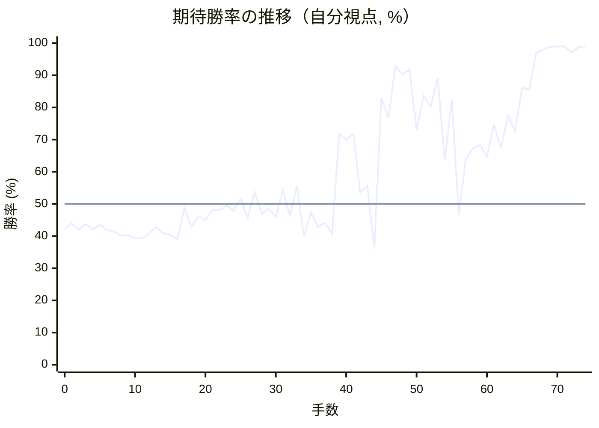

# 解析レポート vjm0el7hg9sz

[README に戻る](../../../README.md)　/　棋譜: [CSA](../../../data/csa/shogi5/vjm0el7hg9sz.csa)　/　解析の見方: [docs/mistake_analysis.md](../../../docs/mistake_analysis.md)

## 対局情報

| 項目 | 内容 |
|---|---|
| 日時 | 2026-11-07 10:03:25 |
| 持ち時間 | 5分 |
| 自分 | 後手（△）（1726） |
| 相手 | 相手（1695） |
| 結果 | 勝ち（投了, 74手） |

## 解析環境

| 項目 | 内容 |
|---|---|
| エンジン | YaneuraOu NNUE 9.00git 64AVX2（V9.00/YANEURAOU_ENGINE_NNUE/AVX2） |
| 評価関数 | **水匠5**（`suisho5`） |
| nn.bin SHA-256 | `768068f0d534a0603a5d38bcd143de6bbca820d5f1c95a14d40863e5b7892d76` |
| 第1パス | movetime=150ms, MultiPV 1 |
| 第2パス | movetime=2000ms, MultiPV 3 |
| Threads / Hash | 8 / 512MB |
| 判定基準 | 疑問手 ≥5pt, 悪手 ≥10pt, 大悪手 ≥20pt（期待勝率 W(E)=1/(1+exp(-E/600))） |
| 解析日時 | 2026-11-11T20:28:09+09:00（解析バージョン 1, 55秒） |

## サマリー

| 自分の手数 | 深掘りした手 | 詰み逃し | 大悪手 | 悪手 | 疑問手 |
|--:|--:|--:|--:|--:|--:|
| 37 | 11 | 0 | 2 | 5 | 1 |

## 期待勝率の推移



<details><summary>1手ごとの数値（第1パス）</summary>

| 手数 | 指し手 | 評価値 | 勝率 | 低下 | 判定 |
|--:|---|--:|--:|--:|---|
| 1 | ▲７六歩(77) | -145 | 44.0% |  |  |
| 2 | △３四歩(33) | -193 | 42.0% | +2.0pt |  |
| 3 | ▲２六歩(27) | -151 | 43.7% |  |  |
| 4 | △８四歩(83) | -191 | 42.1% | +1.6pt |  |
| 5 | ▲２五歩(26) | -156 | 43.5% |  |  |
| 6 | △８五歩(84) | -197 | 41.9% | +1.7pt |  |
| 7 | ▲７八金(69) | -206 | 41.5% |  |  |
| 8 | △３二金(41) | -240 | 40.1% | +1.4pt |  |
| 9 | ▲２四歩(25) | -236 | 40.3% |  |  |
| 10 | △同歩(23) | -262 | 39.3% | +1.0pt |  |
| 11 | ▲同飛(28) | -261 | 39.3% |  |  |
| 12 | △８六歩(85) | -223 | 40.8% | -1.5pt |  |
| 13 | ▲同歩(87) | -173 | 42.8% |  |  |
| 14 | △同飛(82) | -221 | 40.9% | +1.9pt |  |
| 15 | ▲３四飛(24) | -233 | 40.4% |  |  |
| 16 | △３三角(22) | -271 | 38.9% | +1.5pt |  |
| 17 | ▲３六飛(34) | -30 | 48.8% |  |  |
| 18 | △２二銀(31) | -173 | 42.8% | +5.9pt |  |
| 19 | ▲２六飛(36) | -92 | 46.2% |  |  |
| 20 | △１四歩(13) | -122 | 44.9% | +1.2pt |  |
| 21 | ▲１六歩(17) | -46 | 48.1% |  |  |
| 22 | △５二玉(51) | -48 | 48.0% | +0.1pt |  |
| 23 | ▲５八玉(59) | -13 | 49.5% |  |  |
| 24 | △９四歩(93) | -51 | 47.9% | +1.6pt |  |
| 25 | ▲３八金(49) | +40 | 51.7% |  |  |
| 26 | △７二銀(71) | -104 | 45.7% | +6.0pt |  |
| 27 | ▲４八銀(39) | +87 | 53.6% |  |  |
| 28 | △８四飛(86) | -72 | 47.0% | +6.6pt |  |
| 29 | ▲８七歩打 | -37 | 48.5% |  |  |
| 30 | △２三銀(22) | -98 | 45.9% | +2.5pt |  |
| 31 | ▲７五歩(76) | +106 | 54.4% |  |  |
| 32 | △２五歩打 | -90 | 46.3% | +8.1pt | [悪手](#ply-32) |
| 33 | ▲７六飛(26) | +138 | 55.7% |  |  |
| 34 | △２四飛(84) | -244 | 40.0% | +15.8pt | [悪手](#ply-34) |
| 35 | ▲２七歩打 | -65 | 47.3% |  |  |
| 36 | △８四飛(24) | -172 | 42.9% | +4.4pt |  |
| 37 | ▲９六歩(97) | -143 | 44.1% |  |  |
| 38 | △３四銀(23) | -227 | 40.7% | +3.4pt |  |
| 39 | ▲７七飛(76) | +563 | 71.9% |  |  |
| 40 | △２六歩(25) | +507 | 70.0% | +1.9pt |  |
| 41 | ▲同歩(27) | +557 | 71.7% |  |  |
| 42 | △８六歩打 | +85 | 53.5% | +18.1pt | [悪手](#ply-42) |
| 43 | ▲同歩(87) | +134 | 55.6% |  |  |
| 44 | △同飛(84) | -346 | 36.0% | +19.6pt | [悪手](#ply-44) |
| 45 | ▲９七桂(89) | +956 | 83.1% |  |  |
| 46 | △１五歩(14) | +714 | 76.7% | +6.4pt | [疑問手](#ply-46) |
| 47 | ▲８五歩打 | +1532 | 92.8% |  |  |
| 48 | △２六飛(86) | +1336 | 90.3% | +2.5pt |  |
| 49 | ▲２七歩打 | +1460 | 91.9% |  |  |
| 50 | △２五飛(26) | +594 | 72.9% | +19.0pt | [悪手](#ply-50) |
| 51 | ▲１五歩(16) | +976 | 83.6% |  |  |
| 52 | △１八歩打 | +838 | 80.2% | +3.4pt |  |
| 53 | ▲同香(19) | +1266 | 89.2% |  |  |
| 54 | △１六歩打 | +333 | 63.5% | +25.7pt | [大悪手](#ply-54) |
| 55 | ▲７六飛(77) | +927 | 82.4% |  |  |
| 56 | △１五飛(25) | -83 | 46.5% | +35.9pt | [大悪手](#ply-56) |
| 57 | ▲５六飛(76) | +347 | 64.1% |  |  |
| 58 | △８八角成(33) | +432 | 67.3% | -3.2pt |  |
| 59 | ▲同銀(79) | +460 | 68.3% |  |  |
| 60 | △７五飛(15) | +364 | 64.7% | +3.6pt |  |
| 61 | ▲７六歩打 | +650 | 74.7% |  |  |
| 62 | △２五飛(75) | +433 | 67.3% | +7.4pt |  |
| 63 | ▲１二歩打 | +738 | 77.4% |  |  |
| 64 | △同香(11) | +588 | 72.7% | +4.7pt |  |
| 65 | ▲２六歩(27) | +1096 | 86.1% |  |  |
| 66 | △２四飛(25) | +1068 | 85.6% | +0.6pt |  |
| 67 | ▲７五歩(76) | +2086 | 97.0% |  |  |
| 68 | △４五角打 | +2326 | 98.0% | -1.0pt |  |
| 69 | ▲３六歩(37) | +2707 | 98.9% |  |  |
| 70 | △５六角(45) | +2676 | 98.9% | +0.1pt |  |
| 71 | ▲同歩(57) | +2766 | 99.0% |  |  |
| 72 | △１九飛打 | +2111 | 97.1% | +1.9pt |  |
| 73 | ▲３九金(38) | +2664 | 98.8% |  |  |
| 74 | △１八飛成(19) | +2747 | 99.0% | -0.1pt |  |

</details>

## 課題局面

<a id="ply-32"></a>
### 32手目 △２五歩打 — 悪手

| | 着手前 | 着手後 | 差 |
|---|--:|--:|--:|
| 期待勝率 | 57.0% | 46.5% | -10.5pt |
| 評価値 | +168 | -85 | |

着手前の局面:

```text
後手の持駒：歩二
  ９ ８ ７ ６ ５ ４ ３ ２ １
+---------------------------+
|v香v桂 ・v金 ・ ・ ・v桂v香|一
| ・ ・v銀 ・v玉 ・v金 ・ ・|二
| ・ ・v歩v歩v歩v歩v角v銀 ・|三
|v歩v飛 ・ ・ ・ ・ ・ ・v歩|四
| ・ ・ 歩 ・ ・ ・ ・ ・ ・|五
| ・ ・ ・ ・ ・ ・ ・ 飛 歩|六
| 歩 歩 ・ 歩 歩 歩 歩 ・ ・|七
| ・ 角 金 ・ 玉 銀 金 ・ ・|八
| 香 桂 銀 ・ ・ ・ ・ 桂 香|九
+---------------------------+
先手の持駒：歩二
後手番
手数＝31　▲７五歩　まで
```

| | 指し手 | 評価値 | 読み筋 |
|---|---|--:|---|
| 実戦 | △２五歩打 | -85 | ▲同飛(26) △７四歩(73) ▲２四歩打 △３四銀(23) ▲２八飛(25) △２五歩打 |
| AI 1位 | △７四歩(73) | +168 | △７四歩(73) ▲２四歩打 △３四銀(23) ▲７四歩(75) △８八角成(33) ▲同銀(79) |
| AI 2位 | △２四飛(84) | +131 | △２四飛(84) ▲２五歩打 △８四飛(24) ▲３六歩(37) △３四銀(23) ▲３七桂(29) |
| AI 3位 | △９五歩(94) | +67 | △９五歩(94) ▲３三角成(88) △同桂(21) ▲７七桂(89) △４五角打 ▲８六歩(87) |

SFEN: `ln1g3nl/2s1k1g2/2ppppbs1/pr6p/2P6/7RP/PP1PPPP2/1BG1KSG2/LNS4NL w 2P2p 32`

<a id="ply-34"></a>
### 34手目 △２四飛(84) — 悪手

| | 着手前 | 着手後 | 差 |
|---|--:|--:|--:|
| 期待勝率 | 57.4% | 42.4% | -15.0pt |
| 評価値 | +178 | -185 | |

着手前の局面:

```text
後手の持駒：歩
  ９ ８ ７ ６ ５ ４ ３ ２ １
+---------------------------+
|v香v桂 ・v金 ・ ・ ・v桂v香|一
| ・ ・v銀 ・v玉 ・v金 ・ ・|二
| ・ ・v歩v歩v歩v歩v角v銀 ・|三
|v歩v飛 ・ ・ ・ ・ ・ ・v歩|四
| ・ ・ 歩 ・ ・ ・ ・v歩 ・|五
| ・ ・ 飛 ・ ・ ・ ・ ・ 歩|六
| 歩 歩 ・ 歩 歩 歩 歩 ・ ・|七
| ・ 角 金 ・ 玉 銀 金 ・ ・|八
| 香 桂 銀 ・ ・ ・ ・ 桂 香|九
+---------------------------+
先手の持駒：歩二
後手番
手数＝33　▲７六飛　まで
```

| | 指し手 | 評価値 | 読み筋 |
|---|---|--:|---|
| 実戦 | △２四飛(84) | -185 | ▲８六飛(76) △８三歩打 ▲２八歩打 △２六歩(25) ▲３六歩(37) △３四銀(23) |
| AI 1位 | △１五歩(14) | +178 | △１五歩(14) ▲５六飛(76) △２六歩(25) ▲２二歩打 △同角(33) ▲同角成(88) |
| AI 2位 | △８八角成(33) | +65 | △８八角成(33) ▲同銀(79) △１五歩(14) ▲７七桂(89) △１六歩(15) ▲２二歩打 |
| AI 3位 | △３四銀(23) | -127 | △３四銀(23) ▲７七桂(89) △６四歩(63) ▲９六歩(97) △４四角(33) ▲８六歩(87) |

SFEN: `ln1g3nl/2s1k1g2/2ppppbs1/pr6p/2P4p1/2R5P/PP1PPPP2/1BG1KSG2/LNS4NL w 2Pp 34`

<a id="ply-42"></a>
### 42手目 △８六歩打 — 悪手

| | 着手前 | 着手後 | 差 |
|---|--:|--:|--:|
| 期待勝率 | 75.4% | 55.4% | -20.0pt |
| 評価値 | +671 | +130 | |

着手前の局面:

```text
後手の持駒：歩
  ９ ８ ７ ６ ５ ４ ３ ２ １
+---------------------------+
|v香v桂 ・v金 ・ ・ ・v桂v香|一
| ・ ・v銀 ・v玉 ・v金 ・ ・|二
| ・ ・v歩v歩v歩v歩v角 ・ ・|三
|v歩v飛 ・ ・ ・ ・v銀 ・v歩|四
| ・ ・ 歩 ・ ・ ・ ・ ・ ・|五
| 歩 ・ ・ ・ ・ ・ ・ 歩 歩|六
| ・ 歩 飛 歩 歩 歩 歩 ・ ・|七
| ・ 角 金 ・ 玉 銀 金 ・ ・|八
| 香 桂 銀 ・ ・ ・ ・ 桂 香|九
+---------------------------+
先手の持駒：歩二
後手番
手数＝41　▲２六同歩　まで
```

| | 指し手 | 評価値 | 読み筋 |
|---|---|--:|---|
| 実戦 | △８六歩打 | +130 | ▲同歩(87) △７七角成(33) ▲同角(88) △３三桂(21) ▲３六歩(37) △２三銀(34) |
| AI 1位 | △７七角成(33) | +671 | △７七角成(33) ▲同角(88) △３三桂(21) ▲５五角打 △４四歩(43) ▲同角(55) |
| AI 2位 | △１五歩(14) | +434 | △１五歩(14) ▲７六飛(77) △８八角成(33) ▲同銀(79) △１六歩(15) ▲８六歩(87) |
| AI 3位 | △９五歩(94) | +364 | △９五歩(94) ▲７六飛(77) △８八角成(33) ▲同銀(79) △９六歩(95) ▲３六歩(37) |

SFEN: `ln1g3nl/2s1k1g2/2ppppb2/pr4s1p/2P6/P6PP/1PRPPPP2/1BG1KSG2/LNS4NL w 2Pp 42`

<a id="ply-44"></a>
### 44手目 △同飛(84) — 悪手

| | 着手前 | 着手後 | 差 |
|---|--:|--:|--:|
| 期待勝率 | 54.2% | 41.1% | -13.1pt |
| 評価値 | +101 | -216 | |

着手前の局面:

```text
後手の持駒：なし
  ９ ８ ７ ６ ５ ４ ３ ２ １
+---------------------------+
|v香v桂 ・v金 ・ ・ ・v桂v香|一
| ・ ・v銀 ・v玉 ・v金 ・ ・|二
| ・ ・v歩v歩v歩v歩v角 ・ ・|三
|v歩v飛 ・ ・ ・ ・v銀 ・v歩|四
| ・ ・ 歩 ・ ・ ・ ・ ・ ・|五
| 歩 歩 ・ ・ ・ ・ ・ 歩 歩|六
| ・ ・ 飛 歩 歩 歩 歩 ・ ・|七
| ・ 角 金 ・ 玉 銀 金 ・ ・|八
| 香 桂 銀 ・ ・ ・ ・ 桂 香|九
+---------------------------+
先手の持駒：歩三
後手番
手数＝43　▲８六同歩　まで
```

| | 指し手 | 評価値 | 読み筋 |
|---|---|--:|---|
| 実戦 | △同飛(84) | -216 | ▲８七飛(77) △同飛成(86) ▲同金(78) △８六歩打 ▲３三角成(88) △同桂(21) |
| AI 1位 | △７七角成(33) | +101 | △７七角成(33) ▲同角(88) △３三桂(21) ▲３六歩(37) △２三銀(34) ▲３九金(38) |
| AI 2位 | △３五銀(34) | -74 | △３五銀(34) ▲３六歩(37) △７七角成(33) ▲同角(88) △４四銀(35) ▲３九金(38) |
| AI 3位 | △１五歩(14) | -251 | △１五歩(14) ▲８七飛(77) △１六歩(15) ▲８五歩(86) △６四飛(84) ▲８四歩(85) |

SFEN: `ln1g3nl/2s1k1g2/2ppppb2/pr4s1p/2P6/PP5PP/2RPPPP2/1BG1KSG2/LNS4NL w 3P 44`

<a id="ply-46"></a>
### 46手目 △１五歩(14) — 疑問手

| | 着手前 | 着手後 | 差 |
|---|--:|--:|--:|
| 期待勝率 | 84.6% | 78.0% | -6.5pt |
| 評価値 | +1020 | +760 | |

着手前の局面:

```text
後手の持駒：歩
  ９ ８ ７ ６ ５ ４ ３ ２ １
+---------------------------+
|v香v桂 ・v金 ・ ・ ・v桂v香|一
| ・ ・v銀 ・v玉 ・v金 ・ ・|二
| ・ ・v歩v歩v歩v歩v角 ・ ・|三
|v歩 ・ ・ ・ ・ ・v銀 ・v歩|四
| ・ ・ 歩 ・ ・ ・ ・ ・ ・|五
| 歩v飛 ・ ・ ・ ・ ・ 歩 歩|六
| 桂 ・ 飛 歩 歩 歩 歩 ・ ・|七
| ・ 角 金 ・ 玉 銀 金 ・ ・|八
| 香 ・ 銀 ・ ・ ・ ・ 桂 香|九
+---------------------------+
先手の持駒：歩三
後手番
手数＝45　▲９七桂　まで
```

| | 指し手 | 評価値 | 読み筋 |
|---|---|--:|---|
| 実戦 | △１五歩(14) | +760 | ▲８七歩打 △２六飛(86) ▲２七歩打 △２四飛(26) ▲７四歩(75) △１六歩(15) |
| AI 1位 | △９五歩(94) | +1020 | △９五歩(94) ▲８七歩打 △２六飛(86) ▲２七歩打 △２五飛(26) ▲１七桂(29) |
| AI 2位 | △２七歩打 | +761 | △２七歩打 ▲８二歩打 △同飛(86) ▲７六飛(77) △９五歩(94) ▲同歩(96) |
| AI 3位 | △１五歩(14) | +668 | △１五歩(14) ▲７四歩(75) △２七歩打 ▲同金(38) △９五歩(94) ▲同歩(96) |

SFEN: `ln1g3nl/2s1k1g2/2ppppb2/p5s1p/2P6/Pr5PP/N1RPPPP2/1BG1KSG2/L1S4NL w 3Pp 46`

<a id="ply-50"></a>
### 50手目 △２五飛(26) — 悪手

| | 着手前 | 着手後 | 差 |
|---|--:|--:|--:|
| 期待勝率 | 93.8% | 74.4% | -19.5pt |
| 評価値 | +1635 | +640 | |

着手前の局面:

```text
後手の持駒：歩二
  ９ ８ ７ ６ ５ ４ ３ ２ １
+---------------------------+
|v香v桂 ・v金 ・ ・ ・v桂v香|一
| ・ ・v銀 ・v玉 ・v金 ・ ・|二
| ・ ・v歩v歩v歩v歩v角 ・ ・|三
|v歩 ・ ・ ・ ・ ・v銀 ・ ・|四
| ・ 歩 歩 ・ ・ ・ ・ ・v歩|五
| 歩 ・ ・ ・ ・ ・ ・v飛 歩|六
| 桂 ・ 飛 歩 歩 歩 歩 歩 ・|七
| ・ 角 金 ・ 玉 銀 金 ・ ・|八
| 香 ・ 銀 ・ ・ ・ ・ 桂 香|九
+---------------------------+
先手の持駒：歩
後手番
手数＝49　▲２七歩　まで
```

| | 指し手 | 評価値 | 読み筋 |
|---|---|--:|---|
| 実戦 | △２五飛(26) | +640 | ▲８七飛(77) △８八角成(33) ▲同飛(87) △４四角打 ▲６六歩(67) △同角(44) |
| AI 1位 | △８六飛(26) | +1635 | △８六飛(26) ▲８四歩(85) △９五歩(94) ▲８三歩成(84) △同飛(86) ▲８五歩打 |
| AI 2位 | △９六飛(26) | +885 | △９六飛(26) ▲９二歩打 △同香(91) ▲８七飛(77) △２八歩打 ▲３三角成(88) |
| AI 3位 | △２四飛(26) | +686 | △２四飛(26) ▲８七飛(77) △１六歩(15) ▲８六飛(87) △８二歩打 ▲６八銀(79) |

SFEN: `ln1g3nl/2s1k1g2/2ppppb2/p5s2/1PP5p/P6rP/N1RPPPPP1/1BG1KSG2/L1S4NL w P2p 50`

<a id="ply-54"></a>
### 54手目 △１六歩打 — 大悪手

| | 着手前 | 着手後 | 差 |
|---|--:|--:|--:|
| 期待勝率 | 90.5% | 62.0% | -28.6pt |
| 評価値 | +1355 | +293 | |

着手前の局面:

```text
後手の持駒：歩
  ９ ８ ７ ６ ５ ４ ３ ２ １
+---------------------------+
|v香v桂 ・v金 ・ ・ ・v桂v香|一
| ・ ・v銀 ・v玉 ・v金 ・ ・|二
| ・ ・v歩v歩v歩v歩v角 ・ ・|三
|v歩 ・ ・ ・ ・ ・v銀 ・ ・|四
| ・ 歩 歩 ・ ・ ・ ・v飛 歩|五
| 歩 ・ ・ ・ ・ ・ ・ ・ ・|六
| 桂 ・ 飛 歩 歩 歩 歩 歩 ・|七
| ・ 角 金 ・ 玉 銀 金 ・ 香|八
| 香 ・ 銀 ・ ・ ・ ・ 桂 ・|九
+---------------------------+
先手の持駒：歩三
後手番
手数＝53　▲１八同香　まで
```

| | 指し手 | 評価値 | 読み筋 |
|---|---|--:|---|
| 実戦 | △１六歩打 | +293 | ▲８七飛(77) △８八角成(33) ▲同飛(87) △３三角打 ▲６六歩(67) △同角(33) |
| AI 1位 | △１五香(11) | +1355 | △１五香(11) ▲１六歩打 △７七角成(33) ▲同角(88) △１九飛打 ▲１四角打 |
| AI 2位 | △７七角成(33) | +1202 | △７七角成(33) ▲同角(88) △１九飛打 ▲１一角成(77) △１八飛成(19) ▲１七桂(29) |
| AI 3位 | △２六歩打 | +933 | △２六歩打 ▲同歩(27) △同飛(25) ▲２七歩打 △８六飛(26) ▲８四歩(85) |

SFEN: `ln1g3nl/2s1k1g2/2ppppb2/p5s2/1PP4rP/P8/N1RPPPPP1/1BG1KSG1L/L1S4N1 w 3Pp 54`

<a id="ply-56"></a>
### 56手目 △１五飛(25) — 大悪手

| | 着手前 | 着手後 | 差 |
|---|--:|--:|--:|
| 期待勝率 | 85.1% | 44.7% | -40.4pt |
| 評価値 | +1046 | -127 | |

着手前の局面:

```text
後手の持駒：なし
  ９ ８ ７ ６ ５ ４ ３ ２ １
+---------------------------+
|v香v桂 ・v金 ・ ・ ・v桂v香|一
| ・ ・v銀 ・v玉 ・v金 ・ ・|二
| ・ ・v歩v歩v歩v歩v角 ・ ・|三
|v歩 ・ ・ ・ ・ ・v銀 ・ ・|四
| ・ 歩 歩 ・ ・ ・ ・v飛 歩|五
| 歩 ・ 飛 ・ ・ ・ ・ ・v歩|六
| 桂 ・ ・ 歩 歩 歩 歩 歩 ・|七
| ・ 角 金 ・ 玉 銀 金 ・ 香|八
| 香 ・ 銀 ・ ・ ・ ・ 桂 ・|九
+---------------------------+
先手の持駒：歩三
後手番
手数＝55　▲７六飛　まで
```

| | 指し手 | 評価値 | 読み筋 |
|---|---|--:|---|
| 実戦 | △１五飛(25) | -127 | ▲８四歩(85) △８二歩打 ▲１六香(18) △同飛(15) ▲同飛(76) △同香(11) |
| AI 1位 | △８八角成(33) | +1046 | △８八角成(33) ▲同銀(79) △５四角打 ▲８六飛(76) △２七角成(54) ▲２六歩打 |
| AI 2位 | △９五歩(94) | +216 | △９五歩(94) ▲３三角成(88) △同金(32) ▲８四歩(85) △９六歩(95) ▲８三歩成(84) |
| AI 3位 | △１五飛(25) | -15 | △１五飛(25) ▲８四歩(85) △８二歩打 ▲６八銀(79) △８八角成(33) ▲同金(78) |

SFEN: `ln1g3nl/2s1k1g2/2ppppb2/p5s2/1PP4rP/P1R5p/N2PPPPP1/1BG1KSG1L/L1S4N1 w 3P 56`

