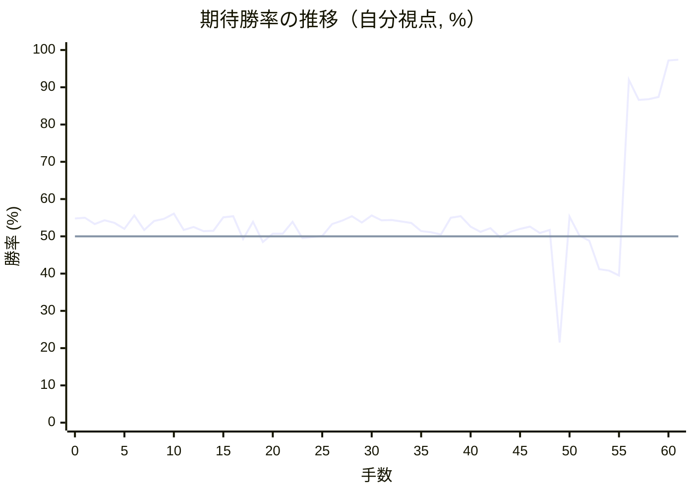

# 解析レポート vlmg7sowkwdc

[README に戻る](../../../README.md)　/　棋譜: [CSA](../../../data/csa/shogi5/vlmg7sowkwdc.csa)　/　解析の見方: [docs/mistake_analysis.md](../../../docs/mistake_analysis.md)

## 対局情報

| 項目 | 内容 |
|---|---|
| 日時 | 2026-11-03 06:30:25 |
| 持ち時間 | 5分 |
| 自分 | 先手（▲）（1724） |
| 相手 | 相手（1663） |
| 結果 | 勝ち（投了, 61手） |

## 解析環境

| 項目 | 内容 |
|---|---|
| エンジン | YaneuraOu NNUE 9.00git 64AVX2（V9.00/YANEURAOU_ENGINE_NNUE/AVX2） |
| 評価関数 | **水匠5**（`suisho5`） |
| nn.bin SHA-256 | `768068f0d534a0603a5d38bcd143de6bbca820d5f1c95a14d40863e5b7892d76` |
| 第1パス | movetime=150ms, MultiPV 1 |
| 第2パス | movetime=2000ms, MultiPV 3 |
| Threads / Hash | 8 / 512MB |
| 判定基準 | 疑問手 ≥5pt, 悪手 ≥10pt, 大悪手 ≥20pt（期待勝率 W(E)=1/(1+exp(-E/600))） |
| 解析日時 | 2026-11-06T01:50:41+09:00（解析バージョン 1, 21秒） |

## サマリー

| 自分の手数 | 深掘りした手 | 詰み逃し | 大悪手 | 悪手 | 疑問手 |
|--:|--:|--:|--:|--:|--:|
| 31 | 3 | 0 | 1 | 1 | 0 |

## 期待勝率の推移



<details><summary>1手ごとの数値（第1パス）</summary>

| 手数 | 指し手 | 評価値 | 勝率 | 低下 | 判定 |
|--:|---|--:|--:|--:|---|
| 1 | ▲７六歩(77) | +120 | 55.0% | -0.2pt |  |
| 2 | △８四歩(83) | +80 | 53.3% |  |  |
| 3 | ▲２六歩(27) | +103 | 54.3% | -1.0pt |  |
| 4 | △８五歩(84) | +86 | 53.6% |  |  |
| 5 | ▲７七角(88) | +47 | 52.0% | +1.6pt |  |
| 6 | △３四歩(33) | +136 | 55.6% |  |  |
| 7 | ▲６八銀(79) | +41 | 51.7% | +3.9pt |  |
| 8 | △７七角成(22) | +98 | 54.1% |  |  |
| 9 | ▲同銀(68) | +113 | 54.7% | -0.6pt |  |
| 10 | △４二銀(31) | +148 | 56.1% |  |  |
| 11 | ▲２五歩(26) | +42 | 51.7% | +4.4pt |  |
| 12 | △３三銀(42) | +60 | 52.5% |  |  |
| 13 | ▲７八金(69) | +33 | 51.4% | +1.1pt |  |
| 14 | △６二銀(71) | +36 | 51.5% |  |  |
| 15 | ▲４八銀(39) | +122 | 55.1% | -3.6pt |  |
| 16 | △３二金(41) | +130 | 55.4% |  |  |
| 17 | ▲４六歩(47) | -17 | 49.3% | +6.1pt |  |
| 18 | △６四歩(63) | +94 | 53.9% |  |  |
| 19 | ▲４七銀(48) | -37 | 48.5% | +5.4pt |  |
| 20 | △６三銀(62) | +18 | 50.7% |  |  |
| 21 | ▲６八玉(59) | +18 | 50.7% | +0.0pt |  |
| 22 | △７四歩(73) | +93 | 53.9% |  |  |
| 23 | ▲６六歩(67) | -12 | 49.5% | +4.4pt |  |
| 24 | △７三桂(81) | -5 | 49.8% |  |  |
| 25 | ▲５六銀(47) | +3 | 50.1% | -0.3pt |  |
| 26 | △５二金(61) | +80 | 53.3% |  |  |
| 27 | ▲３六歩(37) | +100 | 54.2% | -0.8pt |  |
| 28 | △８一飛(82) | +130 | 55.4% |  |  |
| 29 | ▲１六歩(17) | +90 | 53.7% | +1.7pt |  |
| 30 | △１四歩(13) | +135 | 55.6% |  |  |
| 31 | ▲３七桂(29) | +103 | 54.3% | +1.3pt |  |
| 32 | △６二玉(51) | +105 | 54.4% |  |  |
| 33 | ▲４八金(49) | +95 | 54.0% | +0.4pt |  |
| 34 | △５四歩(53) | +86 | 53.6% |  |  |
| 35 | ▲２九飛(28) | +34 | 51.4% | +2.2pt |  |
| 36 | △７二玉(62) | +27 | 51.1% |  |  |
| 37 | ▲５八玉(68) | +13 | 50.5% | +0.6pt |  |
| 38 | △６二金(52) | +121 | 55.0% |  |  |
| 39 | ▲９六歩(97) | +130 | 55.4% | -0.4pt |  |
| 40 | △４四銀(33) | +63 | 52.6% |  |  |
| 41 | ▲２四歩(25) | +28 | 51.2% | +1.5pt |  |
| 42 | △同歩(23) | +52 | 52.2% |  |  |
| 43 | ▲同飛(29) | -8 | 49.7% | +2.5pt |  |
| 44 | △３五歩(34) | +30 | 51.2% |  |  |
| 45 | ▲４七銀(56) | +48 | 52.0% | -0.7pt |  |
| 46 | △３六歩(35) | +62 | 52.6% |  |  |
| 47 | ▲同銀(47) | +21 | 50.9% | +1.7pt |  |
| 48 | △２五歩打 | +42 | 51.7% |  |  |
| 49 | ▲４五桂(37) | -778 | 21.5% | +30.3pt | [大悪手](#ply-49) |
| 50 | △同銀(44) | +128 | 55.3% |  |  |
| 51 | ▲同銀(36) | +6 | 50.2% | +5.1pt |  |
| 52 | △３三桂(21) | -30 | 48.8% |  |  |
| 53 | ▲３四飛(24) | -213 | 41.2% | +7.5pt | [悪手](#ply-53) |
| 54 | △２六歩(25) | -224 | 40.8% |  |  |
| 55 | ▲６八玉(58) | -257 | 39.5% | +1.3pt |  |
| 56 | △４二金(32) | +1467 | 92.0% |  |  |
| 57 | ▲５四銀(45) | +1121 | 86.6% | +5.4pt |  |
| 58 | △同銀(63) | +1132 | 86.8% |  |  |
| 59 | ▲同飛(34) | +1161 | 87.4% | -0.5pt |  |
| 60 | △２七角打 | +2135 | 97.2% |  |  |
| 61 | ▲２四飛(54) | +2164 | 97.4% | -0.1pt |  |

</details>

## 課題局面

<a id="ply-49"></a>
### 49手目 ▲４五桂(37) — 大悪手

| | 着手前 | 着手後 | 差 |
|---|--:|--:|--:|
| 期待勝率 | 47.8% | 14.1% | -33.8pt |
| 評価値 | -52 | -1086 | |

着手前の局面:

```text
後手の持駒：角　歩
  ９ ８ ７ ６ ５ ４ ３ ２ １
+---------------------------+
|v香v飛 ・ ・ ・ ・ ・v桂v香|一
| ・ ・v玉v金 ・ ・v金 ・ ・|二
|v歩 ・v桂v銀 ・v歩 ・ ・ ・|三
| ・ ・v歩v歩v歩v銀 ・ 飛v歩|四
| ・v歩 ・ ・ ・ ・ ・v歩 ・|五
| 歩 ・ 歩 歩 ・ 歩 銀 ・ 歩|六
| ・ 歩 銀 ・ 歩 ・ 桂 ・ ・|七
| ・ ・ 金 ・ 玉 金 ・ ・ ・|八
| 香 桂 ・ ・ ・ ・ ・ ・ 香|九
+---------------------------+
先手の持駒：角　歩二
手数＝48　△２五歩　まで
```

| | 指し手 | 評価値 | 読み筋 |
|---|---|--:|---|
| 実戦 | ▲４五桂(37) | -1086 | △２八角打 ▲３七歩打 △１九角成(28) ▲２三角打 △２二香打 ▲３二角成(23) |
| AI 1位 | ▲３四歩打 | -52 | ▲３四歩打 △２八角打 ▲２三歩打 △１九角成(28) ▲２二歩成(23) △１八馬(19) |
| AI 2位 | ▲４五歩(46) | -155 | ▲４五歩(46) △５五銀(44) ▲４七銀(36) △２八角打 ▲３三歩打 △同桂(21) |
| AI 3位 | ▲７五歩(76) | -332 | ▲７五歩(76) △同歩(74) ▲９五歩(96) △３五歩打 ▲４七銀(36) △３三銀(44) |

SFEN: `lr5nl/2kg2g2/p1ns1p3/2ppps1Rp/1p5p1/P1PP1PS1P/1PS1P1N2/2G1KG3/LN6L b B2Pbp 49`

<a id="ply-53"></a>
### 53手目 ▲３四飛(24) — 悪手

| | 着手前 | 着手後 | 差 |
|---|--:|--:|--:|
| 期待勝率 | 47.8% | 35.6% | -12.1pt |
| 評価値 | -54 | -355 | |

着手前の局面:

```text
後手の持駒：角　桂　歩
  ９ ８ ７ ６ ５ ４ ３ ２ １
+---------------------------+
|v香v飛 ・ ・ ・ ・ ・ ・v香|一
| ・ ・v玉v金 ・ ・v金 ・ ・|二
|v歩 ・v桂v銀 ・v歩v桂 ・ ・|三
| ・ ・v歩v歩v歩 ・ ・ 飛v歩|四
| ・v歩 ・ ・ ・ 銀 ・v歩 ・|五
| 歩 ・ 歩 歩 ・ 歩 ・ ・ 歩|六
| ・ 歩 銀 ・ 歩 ・ ・ ・ ・|七
| ・ ・ 金 ・ 玉 金 ・ ・ ・|八
| 香 桂 ・ ・ ・ ・ ・ ・ 香|九
+---------------------------+
先手の持駒：角　銀　歩二
手数＝52　△３三桂　まで
```

| | 指し手 | 評価値 | 読み筋 |
|---|---|--:|---|
| 実戦 | ▲３四飛(24) | -355 | △２六歩(25) ▲６八玉(58) △２三金(32) ▲３六飛(34) △２七歩成(26) ▲２四歩打 |
| AI 1位 | ▲７五歩(76) | -54 | ▲７五歩(76) △４五桂(33) ▲７四歩(75) △３七銀打 ▲７三歩成(74) △同金(62) |
| AI 2位 | ▲３四銀(45) | -152 | ▲３四銀(45) △１三角打 ▲３三銀不成(34) △２四角(13) ▲同銀不成(33) △２九飛打 |
| AI 3位 | ▲３四飛(24) | -250 | ▲３四飛(24) △２六歩(25) ▲７五歩(76) △２五角打 ▲６八玉(58) △３四角(25) |

SFEN: `lr6l/2kg2g2/p1ns1pn2/2ppp2Rp/1p3S1p1/P1PP1P2P/1PS1P4/2G1KG3/LN6L b BS2Pbnp 53`

