# 解析レポート vq6dz9aden01

[README に戻る](../../../README.md)　/　棋譜: [CSA](../../../data/csa/shogi5/vq6dz9aden01.csa)　/　解析の見方: [docs/mistake_analysis.md](../../../docs/mistake_analysis.md)

## 対局情報

| 項目 | 内容 |
|---|---|
| 日時 | 2026-11-05 01:28:04 |
| 持ち時間 | 5分 |
| 自分 | 後手（△）（1733） |
| 相手 | 相手（1608） |
| 結果 | 負け（時間切れ, 115手） |

## 解析環境

| 項目 | 内容 |
|---|---|
| エンジン | YaneuraOu NNUE 9.00git 64AVX2（V9.00/YANEURAOU_ENGINE_NNUE/AVX2） |
| 評価関数 | **水匠5**（`suisho5`） |
| nn.bin SHA-256 | `768068f0d534a0603a5d38bcd143de6bbca820d5f1c95a14d40863e5b7892d76` |
| 第1パス | movetime=150ms, MultiPV 1 |
| 第2パス | movetime=2000ms, MultiPV 3 |
| Threads / Hash | 8 / 512MB |
| 判定基準 | 疑問手 ≥5pt, 悪手 ≥10pt, 大悪手 ≥20pt（期待勝率 W(E)=1/(1+exp(-E/600))） |
| 解析日時 | 2026-11-06T01:47:32+09:00（解析バージョン 1, 94秒） |

## サマリー

| 自分の手数 | 深掘りした手 | 詰み逃し | 大悪手 | 悪手 | 疑問手 |
|--:|--:|--:|--:|--:|--:|
| 57 | 19 | 0 | 5 | 4 | 4 |

## 期待勝率の推移

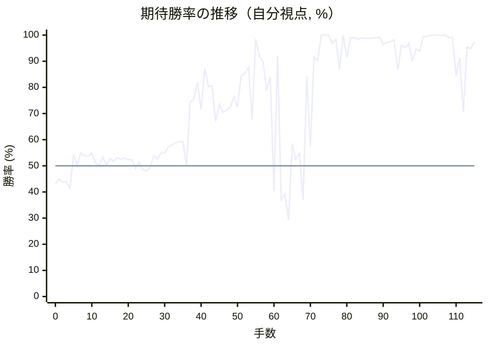

<details><summary>1手ごとの数値（第1パス）</summary>

| 手数 | 指し手 | 評価値 | 勝率 | 低下 | 判定 |
|--:|---|--:|--:|--:|---|
| 1 | ▲７六歩(77) | -123 | 44.9% |  |  |
| 2 | △３四歩(33) | -152 | 43.7% | +1.2pt |  |
| 3 | ▲２六歩(27) | -150 | 43.8% |  |  |
| 4 | △８四歩(83) | -207 | 41.5% | +2.3pt |  |
| 5 | ▲２二角成(88) | +102 | 54.2% |  |  |
| 6 | △同銀(31) | +8 | 50.3% | +3.9pt |  |
| 7 | ▲８八銀(79) | +120 | 55.0% |  |  |
| 8 | △３三銀(22) | +92 | 53.8% | +1.2pt |  |
| 9 | ▲４八銀(39) | +90 | 53.7% |  |  |
| 10 | △３二金(41) | +117 | 54.9% | -1.1pt |  |
| 11 | ▲７八金(69) | +28 | 51.2% |  |  |
| 12 | △６二銀(71) | +5 | 50.2% | +1.0pt |  |
| 13 | ▲６八玉(59) | +82 | 53.4% |  |  |
| 14 | △６四歩(63) | +5 | 50.2% | +3.2pt |  |
| 15 | ▲５八金(49) | +64 | 52.7% |  |  |
| 16 | △６三銀(62) | +41 | 51.7% | +1.0pt |  |
| 17 | ▲４六歩(47) | +74 | 53.1% |  |  |
| 18 | △４二玉(51) | +61 | 52.5% | +0.5pt |  |
| 19 | ▲４七銀(48) | +70 | 52.9% |  |  |
| 20 | △５四銀(63) | +58 | 52.4% | +0.5pt |  |
| 21 | ▲３六歩(37) | +50 | 52.1% |  |  |
| 22 | △４四歩(43) | -23 | 49.0% | +3.0pt |  |
| 23 | ▲３七桂(29) | +33 | 51.4% |  |  |
| 24 | △８五歩(84) | -37 | 48.5% | +2.9pt |  |
| 25 | ▲７七銀(88) | -45 | 48.1% |  |  |
| 26 | △７四歩(73) | -20 | 49.2% | -1.0pt |  |
| 27 | ▲２五歩(26) | +93 | 53.9% |  |  |
| 28 | △７三桂(81) | +62 | 52.6% | +1.3pt |  |
| 29 | ▲６六歩(67) | +118 | 54.9% |  |  |
| 30 | △６二金(61) | +117 | 54.9% | +0.0pt |  |
| 31 | ▲１六歩(17) | +175 | 57.2% |  |  |
| 32 | △１四歩(13) | +194 | 58.0% | -0.8pt |  |
| 33 | ▲９六歩(97) | +216 | 58.9% |  |  |
| 34 | △９四歩(93) | +224 | 59.2% | -0.3pt |  |
| 35 | ▲７九玉(68) | +226 | 59.3% |  |  |
| 36 | △５二金(62) | -4 | 49.8% | +9.5pt | [悪手](#ply-36) |
| 37 | ▲５六角打 | +638 | 74.3% |  |  |
| 38 | △６五歩(64) | +676 | 75.5% | -1.2pt |  |
| 39 | ▲３八銀(47) | +911 | 82.0% |  |  |
| 40 | △３五歩(34) | +548 | 71.4% | +10.7pt | [疑問手](#ply-40) |
| 41 | ▲２六飛(28) | +1151 | 87.2% |  |  |
| 42 | △３六歩(35) | +844 | 80.3% | +6.9pt | [疑問手](#ply-42) |
| 43 | ▲同飛(26) | +854 | 80.6% |  |  |
| 44 | △６六歩(65) | +425 | 67.0% | +13.6pt | [悪手](#ply-44) |
| 45 | ▲７四角(56) | +611 | 73.5% |  |  |
| 46 | △６五銀(54) | +520 | 70.4% | +3.1pt |  |
| 47 | ▲５二角成(74) | +545 | 71.3% |  |  |
| 48 | △同玉(42) | +576 | 72.3% | -1.0pt |  |
| 49 | ▲３四歩打 | +703 | 76.3% |  |  |
| 50 | △４二銀(33) | +588 | 72.7% | +3.6pt |  |
| 51 | ▲４五歩(46) | +1017 | 84.5% |  |  |
| 52 | △８六歩(85) | +1057 | 85.3% | -0.9pt |  |
| 53 | ▲同歩(87) | +1168 | 87.5% |  |  |
| 54 | △８七歩打 | +444 | 67.7% | +19.8pt | [大悪手](#ply-54) |
| 55 | ▲同金(78) | +2517 | 98.5% |  |  |
| 56 | △６七角打 | +1446 | 91.8% | +6.8pt |  |
| 57 | ▲４七銀(38) | +1303 | 89.8% |  |  |
| 58 | △５八角成(67) | +794 | 79.0% | +10.8pt |  |
| 59 | ▲同銀(47) | +992 | 83.9% |  |  |
| 60 | △６七角打 | -234 | 40.4% | +43.6pt | [大悪手](#ply-60) |
| 61 | ▲６八金打 | +1462 | 92.0% |  |  |
| 62 | △５八角成(67) | -320 | 37.0% | +55.0pt | [大悪手](#ply-62) |
| 63 | ▲同金(68) | -261 | 39.3% |  |  |
| 64 | △６七銀打 | -528 | 29.3% | +10.0pt |  |
| 65 | ▲６九角打 | +207 | 58.5% |  |  |
| 66 | △５八銀成(67) | +61 | 52.5% | +6.0pt |  |
| 67 | ▲同角(69) | +116 | 54.8% |  |  |
| 68 | △６七金打 | -322 | 36.9% | +17.9pt | [大悪手](#ply-68) |
| 69 | ▲６九銀打 | +1004 | 84.2% |  |  |
| 70 | △７八歩打 | +182 | 57.5% | +26.7pt | [悪手](#ply-70) |
| 71 | ▲同銀(69) | +1432 | 91.6% |  |  |
| 72 | △５八金(67) | +1335 | 90.2% | +1.3pt |  |
| 73 | ▲６六銀(77) | +5683 | 100.0% |  |  |
| 74 | △６八金打 | +6000 | 100.0% | -0.0pt |  |
| 75 | ▲８八玉(79) | +5610 | 100.0% |  |  |
| 76 | △６六銀(65) | +2058 | 96.9% | +3.1pt |  |
| 77 | ▲同飛(36) | +2472 | 98.4% |  |  |
| 78 | △５五角打 | +1133 | 86.9% | +11.5pt |  |
| 79 | ▲７七銀打 | +4175 | 99.9% |  |  |
| 80 | △６五銀打 | +1420 | 91.4% | +8.5pt | [疑問手](#ply-80) |
| 81 | ▲２六飛(66) | +2683 | 98.9% |  |  |
| 82 | △７八金(68) | +2754 | 99.0% | -0.1pt |  |
| 83 | ▲同玉(88) | +2505 | 98.5% |  |  |
| 84 | △３七角成(55) | +2710 | 98.9% | -0.4pt |  |
| 85 | ▲２九飛(26) | +2636 | 98.8% |  |  |
| 86 | △４七馬(37) | +2583 | 98.7% | +0.1pt |  |
| 87 | ▲２八飛(29) | +2714 | 98.9% |  |  |
| 88 | △５七馬(47) | +2693 | 98.9% | +0.0pt |  |
| 89 | ▲８八玉(78) | +2884 | 99.2% |  |  |
| 90 | △６六歩打 | +1981 | 96.4% | +2.7pt |  |
| 91 | ▲６八歩打 | +2135 | 97.2% |  |  |
| 92 | △６九金(58) | +2201 | 97.5% | -0.3pt |  |
| 93 | ▲７八金打 | +2416 | 98.2% |  |  |
| 94 | △５六銀(65) | +1132 | 86.8% | +11.4pt | [悪手](#ply-94) |
| 95 | ▲６四角打 | +1925 | 96.1% |  |  |
| 96 | △７二飛(82) | +1812 | 95.3% | +0.8pt |  |
| 97 | ▲５四歩打 | +2048 | 96.8% |  |  |
| 98 | △６五桂(73) | +1323 | 90.1% | +6.7pt |  |
| 99 | ▲５三歩成(54) | +1728 | 94.7% |  |  |
| 100 | △同銀(42) | +1643 | 93.9% | +0.8pt |  |
| 101 | ▲同角成(64) | +3132 | 99.5% |  |  |
| 102 | △同玉(52) | +3111 | 99.4% | +0.0pt |  |
| 103 | ▲５八歩打 | +5028 | 100.0% |  |  |
| 104 | △７七桂成(65) | +5192 | 100.0% | -0.0pt |  |
| 105 | ▲同金(87) | +5367 | 100.0% |  |  |
| 106 | △４六馬(57) | +3903 | 99.9% | +0.1pt |  |
| 107 | ▲２九飛(28) | +5031 | 100.0% |  |  |
| 108 | △５五馬(46) | +2830 | 99.1% | +0.9pt |  |
| 109 | ▲６九飛(29) | +2830 | 99.1% |  |  |
| 110 | △６七歩成(66) | +1018 | 84.5% | +14.6pt | [疑問手](#ply-110) |
| 111 | ▲同歩(68) | +1410 | 91.3% |  |  |
| 112 | △６五桂打 | +525 | 70.6% | +20.7pt | [大悪手](#ply-112) |
| 113 | ▲６六銀打 | +1817 | 95.4% |  |  |
| 114 | △７七桂成(65) | +1736 | 94.8% | +0.6pt |  |
| 115 | ▲同銀(66) | +2142 | 97.3% |  |  |

</details>

## 課題局面

<a id="ply-36"></a>
### 36手目 △５二金(62) — 悪手

| | 着手前 | 着手後 | 差 |
|---|--:|--:|--:|
| 期待勝率 | 59.3% | 47.6% | -11.6pt |
| 評価値 | +225 | -57 | |

着手前の局面:

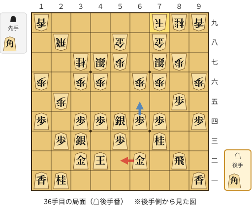

🔴 実戦 △５二金(62)　🔵 AI推奨 △６五歩(64)　🟨 直前の相手の指し手

<details><summary>テキストの盤面図（BOD・将棋ソフトに貼り付け可）</summary>

```text
後手の持駒：角
  ９ ８ ７ ６ ５ ４ ３ ２ １
+---------------------------+
|v香 ・ ・ ・ ・ ・ ・v桂v香|一
| ・v飛 ・v金 ・v玉v金 ・ ・|二
| ・ ・v桂 ・v歩 ・v銀v歩 ・|三
|v歩 ・v歩v歩v銀v歩v歩 ・v歩|四
| ・v歩 ・ ・ ・ ・ ・ 歩 ・|五
| 歩 ・ 歩 歩 ・ 歩 歩 ・ 歩|六
| ・ 歩 銀 ・ 歩 銀 桂 ・ ・|七
| ・ ・ 金 ・ 金 ・ ・ 飛 ・|八
| 香 桂 玉 ・ ・ ・ ・ ・ 香|九
+---------------------------+
先手の持駒：角
後手番
手数＝35　▲７九玉　まで
```

</details>

| | 指し手 | 評価値 | 読み筋 |
|---|---|--:|---|
| 実戦 | △５二金(62) | -57 | ▲４五歩(46) △同歩(44) ▲５六銀(47) △３一玉(42) ▲３五歩(36) △８六歩(85) |
| AI 1位 | △６五歩(64) | +225 | △６五歩(64) ▲４五歩(46) △６四角打 ▲２七飛(28) △６六歩(65) ▲同銀(77) |
| AI 2位 | △８六歩(85) | +181 | △８六歩(85) ▲同銀(77) △６五歩(64) ▲７五歩(76) △６三金(62) ▲２四歩(25) |
| AI 3位 | △８一飛(82) | +158 | △８一飛(82) ▲５六銀(47) △６五歩(64) ▲４五歩(46) △同歩(44) ▲６五歩(66) |

SFEN: `l6nl/1r1g1kg2/2n1p1sp1/p1ppspp1p/1p5P1/P1PP1PP1P/1PS1PSN2/2G1G2R1/LNK5L w Bb 36`

<a id="ply-40"></a>
### 40手目 △３五歩(34) — 疑問手

| | 着手前 | 着手後 | 差 |
|---|--:|--:|--:|
| 期待勝率 | 85.8% | 76.3% | -9.5pt |
| 評価値 | +1080 | +702 | |

着手前の局面:

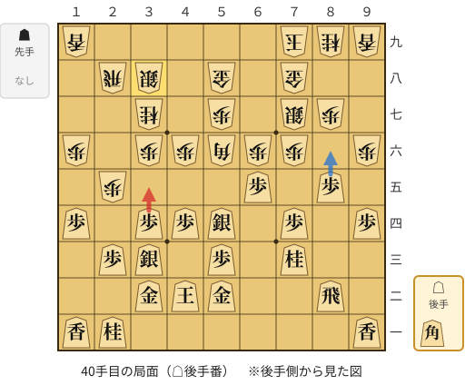

🔴 実戦 △３五歩(34)　🔵 AI推奨 △８六歩(85)　🟨 直前の相手の指し手

<details><summary>テキストの盤面図（BOD・将棋ソフトに貼り付け可）</summary>

```text
後手の持駒：角
  ９ ８ ７ ６ ５ ４ ３ ２ １
+---------------------------+
|v香 ・ ・ ・ ・ ・ ・v桂v香|一
| ・v飛 ・ ・v金v玉v金 ・ ・|二
| ・ ・v桂 ・v歩 ・v銀v歩 ・|三
|v歩 ・v歩 ・v銀v歩v歩 ・v歩|四
| ・v歩 ・v歩 ・ ・ ・ 歩 ・|五
| 歩 ・ 歩 歩 角 歩 歩 ・ 歩|六
| ・ 歩 銀 ・ 歩 ・ 桂 ・ ・|七
| ・ ・ 金 ・ 金 ・ 銀 飛 ・|八
| 香 桂 玉 ・ ・ ・ ・ ・ 香|九
+---------------------------+
先手の持駒：なし
後手番
手数＝39　▲３八銀　まで
```

</details>

| | 指し手 | 評価値 | 読み筋 |
|---|---|--:|---|
| 実戦 | △３五歩(34) | +702 | ▲７五歩(76) △８六歩(85) |
| AI 1位 | △８六歩(85) | +1080 | △８六歩(85) ▲同歩(87) △５五銀(54) ▲４七銀(38) △３五歩(34) ▲同歩(36) |
| AI 2位 | △５五銀(54) | +1058 | △５五銀(54) ▲４七銀(38) △８六歩(85) ▲同歩(87) △３五歩(34) ▲同歩(36) |
| AI 3位 | △６二飛(82) | +988 | △６二飛(82) ▲４七銀(38) △３一玉(42) ▲６八銀(77) △２二玉(31) ▲３五歩(36) |

SFEN: `l6nl/1r2gkg2/2n1p1sp1/p1p1spp1p/1p1p3P1/P1PPBPP1P/1PS1P1N2/2G1G1SR1/LNK5L w b 40`

<a id="ply-42"></a>
### 42手目 △３六歩(35) — 疑問手

| | 着手前 | 着手後 | 差 |
|---|--:|--:|--:|
| 期待勝率 | 89.4% | 82.3% | -7.1pt |
| 評価値 | +1278 | +921 | |

着手前の局面:

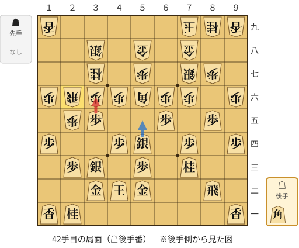

🔴 実戦 △３六歩(35)　🔵 AI推奨 △５五銀(54)　🟨 直前の相手の指し手

<details><summary>テキストの盤面図（BOD・将棋ソフトに貼り付け可）</summary>

```text
後手の持駒：角
  ９ ８ ７ ６ ５ ４ ３ ２ １
+---------------------------+
|v香 ・ ・ ・ ・ ・ ・v桂v香|一
| ・v飛 ・ ・v金v玉v金 ・ ・|二
| ・ ・v桂 ・v歩 ・v銀v歩 ・|三
|v歩 ・v歩 ・v銀v歩 ・ ・v歩|四
| ・v歩 ・v歩 ・ ・v歩 歩 ・|五
| 歩 ・ 歩 歩 角 歩 歩 飛 歩|六
| ・ 歩 銀 ・ 歩 ・ 桂 ・ ・|七
| ・ ・ 金 ・ 金 ・ 銀 ・ ・|八
| 香 桂 玉 ・ ・ ・ ・ ・ 香|九
+---------------------------+
先手の持駒：なし
後手番
手数＝41　▲２六飛　まで
```

</details>

| | 指し手 | 評価値 | 読み筋 |
|---|---|--:|---|
| 実戦 | △３六歩(35) | +921 | ▲同飛(26) △３四歩打 ▲２六飛(36) △６六歩(65) ▲３五歩打 △同歩(34) |
| AI 1位 | △５五銀(54) | +1278 | △５五銀(54) ▲４七角(56) △４六銀(55) ▲５六角(47) △５五角打 ▲４八金(58) |
| AI 2位 | △８六歩(85) | +1117 | △８六歩(85) ▲同歩(87) △５五銀(54) ▲３五歩(36) △５六銀(55) ▲同歩(57) |
| AI 3位 | △３六歩(35) | +918 | △３六歩(35) ▲同飛(26) △３四歩打 ▲２六飛(36) △６六歩(65) ▲３五歩打 |

SFEN: `l6nl/1r2gkg2/2n1p1sp1/p1p1sp2p/1p1p2pP1/P1PPBPPRP/1PS1P1N2/2G1G1S2/LNK5L w b 42`

<a id="ply-44"></a>
### 44手目 △６六歩(65) — 悪手

| | 着手前 | 着手後 | 差 |
|---|--:|--:|--:|
| 期待勝率 | 83.8% | 69.2% | -14.5pt |
| 評価値 | +985 | +487 | |

着手前の局面:

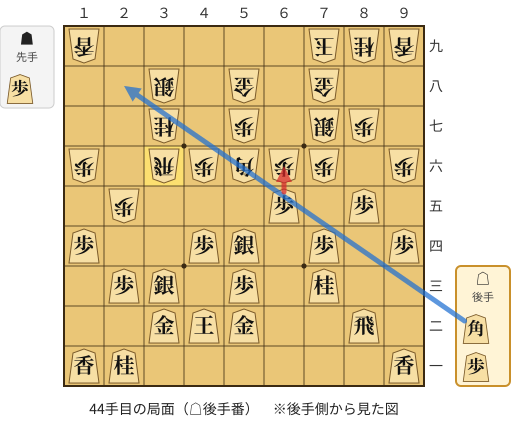

🔴 実戦 △６六歩(65)　🔵 AI推奨 △２八角打　🟨 直前の相手の指し手

<details><summary>テキストの盤面図（BOD・将棋ソフトに貼り付け可）</summary>

```text
後手の持駒：角　歩
  ９ ８ ７ ６ ５ ４ ３ ２ １
+---------------------------+
|v香 ・ ・ ・ ・ ・ ・v桂v香|一
| ・v飛 ・ ・v金v玉v金 ・ ・|二
| ・ ・v桂 ・v歩 ・v銀v歩 ・|三
|v歩 ・v歩 ・v銀v歩 ・ ・v歩|四
| ・v歩 ・v歩 ・ ・ ・ 歩 ・|五
| 歩 ・ 歩 歩 角 歩 飛 ・ 歩|六
| ・ 歩 銀 ・ 歩 ・ 桂 ・ ・|七
| ・ ・ 金 ・ 金 ・ 銀 ・ ・|八
| 香 桂 玉 ・ ・ ・ ・ ・ 香|九
+---------------------------+
先手の持駒：歩
後手番
手数＝43　▲３六同飛　まで
```

</details>

| | 指し手 | 評価値 | 読み筋 |
|---|---|--:|---|
| 実戦 | △６六歩(65) | +487 | ▲３四歩打 △２二銀(33) ▲７四角(56) △９五歩(94) ▲４五歩(46) △９六歩(95) |
| AI 1位 | △２八角打 | +985 | △２八角打 ▲３四歩打 △２二銀(33) ▲４五歩(46) △１九角成(28) ▲４四歩(45) |
| AI 2位 | △３四歩打 | +966 | △３四歩打 ▲２六飛(36) △６六歩(65) ▲同銀(77) △９五歩(94) ▲３五歩打 |
| AI 3位 | △８六歩(85) | +744 | △８六歩(85) ▲同銀(77) △３四歩打 ▲７五歩(76) △６三金(52) ▲６五歩(66) |

SFEN: `l6nl/1r2gkg2/2n1p1sp1/p1p1sp2p/1p1p3P1/P1PPBPR1P/1PS1P1N2/2G1G1S2/LNK5L w Pbp 44`

<a id="ply-54"></a>
### 54手目 △８七歩打 — 大悪手

| | 着手前 | 着手後 | 差 |
|---|--:|--:|--:|
| 期待勝率 | 87.6% | 66.8% | -20.8pt |
| 評価値 | +1175 | +420 | |

着手前の局面:

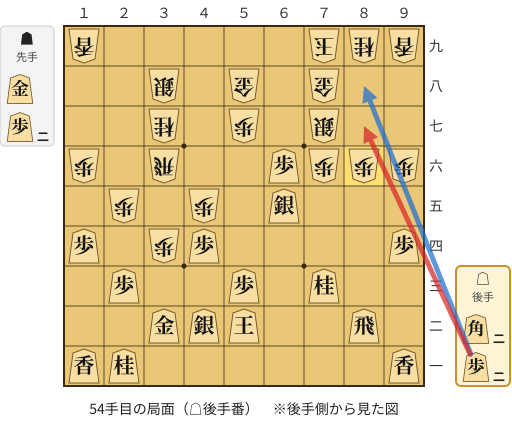

🔴 実戦 △８七歩打　🔵 AI推奨 △８八歩打　🟨 直前の相手の指し手

<details><summary>テキストの盤面図（BOD・将棋ソフトに貼り付け可）</summary>

```text
後手の持駒：角二　歩二
  ９ ８ ７ ６ ５ ４ ３ ２ １
+---------------------------+
|v香 ・ ・ ・ ・ ・ ・v桂v香|一
| ・v飛 ・ ・v玉v銀v金 ・ ・|二
| ・ ・v桂 ・v歩 ・ ・v歩 ・|三
|v歩 ・ ・ ・ ・v歩 歩 ・v歩|四
| ・ ・ ・v銀 ・ 歩 ・ 歩 ・|五
| 歩 歩 歩v歩 ・ ・ 飛 ・ 歩|六
| ・ ・ 銀 ・ 歩 ・ 桂 ・ ・|七
| ・ ・ 金 ・ 金 ・ 銀 ・ ・|八
| 香 桂 玉 ・ ・ ・ ・ ・ 香|九
+---------------------------+
先手の持駒：金　歩二
後手番
手数＝53　▲８六同歩　まで
```

</details>

| | 指し手 | 評価値 | 読み筋 |
|---|---|--:|---|
| 実戦 | △８七歩打 | +420 | ▲６四歩打 △４一玉(52) ▲６三歩成(64) △６七角打 ▲６八金打 △５八角成(67) |
| AI 1位 | △８八歩打 | +1175 | △８八歩打 ▲同銀(77) △６七角打 ▲６八金打 △７六角成(67) ▲７七銀(88) |
| AI 2位 | △６七角打 | +875 | △６七角打 ▲６八玉(79) △７八角成(67) ▲同玉(68) △６七金打 ▲同金(58) |
| AI 3位 | △４一玉(52) | +703 | △４一玉(52) ▲２四歩(25) △同歩(23) ▲２二歩打 △同金(32) ▲４四歩(45) |

SFEN: `l6nl/1r2ksg2/2n1p2p1/p4pP1p/3s1P1P1/PPPp2R1P/2S1P1N2/2G1G1S2/LNK5L w G2P2b2p 54`

<a id="ply-60"></a>
### 60手目 △６七角打 — 大悪手

| | 着手前 | 着手後 | 差 |
|---|--:|--:|--:|
| 期待勝率 | 91.6% | 59.4% | -32.2pt |
| 評価値 | +1431 | +228 | |

着手前の局面:

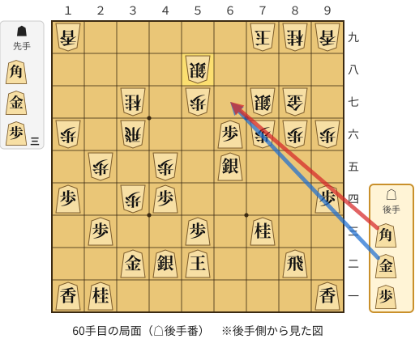

🔴 実戦 △６七角打　🔵 AI推奨 △６七金打　🟨 直前の相手の指し手

<details><summary>テキストの盤面図（BOD・将棋ソフトに貼り付け可）</summary>

```text
後手の持駒：角　金　歩
  ９ ８ ７ ６ ５ ４ ３ ２ １
+---------------------------+
|v香 ・ ・ ・ ・ ・ ・v桂v香|一
| ・v飛 ・ ・v玉v銀v金 ・ ・|二
| ・ ・v桂 ・v歩 ・ ・v歩 ・|三
|v歩 ・ ・ ・ ・v歩 歩 ・v歩|四
| ・ ・ ・v銀 ・ 歩 ・ 歩 ・|五
| 歩 歩 歩v歩 ・ ・ 飛 ・ 歩|六
| ・ 金 銀 ・ 歩 ・ 桂 ・ ・|七
| ・ ・ ・ ・ 銀 ・ ・ ・ ・|八
| 香 桂 玉 ・ ・ ・ ・ ・ 香|九
+---------------------------+
先手の持駒：角　金　歩三
後手番
手数＝59　▲５八同銀　まで
```

</details>

| | 指し手 | 評価値 | 読み筋 |
|---|---|--:|---|
| 実戦 | △６七角打 | +228 | ▲６九銀(58) △４九角成(67) ▲６八歩打 △２七馬(49) ▲１八角打 △２八馬(27) |
| AI 1位 | △６七金打 | +1431 | △６七金打 ▲４九角打 △３五歩打 ▲２六飛(36) △４八角打 ▲４七金打 |
| AI 2位 | △４八金打 | +1368 | △４八金打 ▲３三歩成(34) △同金(32) ▲６九金打 △５八金(48) ▲同金(69) |
| AI 3位 | △５九金打 | +1365 | △５九金打 ▲３三歩成(34) △同金(32) ▲４八金打 △５八金(59) ▲同金(48) |

SFEN: `l6nl/1r2ksg2/2n1p2p1/p4pP1p/3s1P1P1/PPPp2R1P/1GS1P1N2/4S4/LNK5L w BG3Pbgp 60`

<a id="ply-62"></a>
### 62手目 △５八角成(67) — 大悪手

| | 着手前 | 着手後 | 差 |
|---|--:|--:|--:|
| 期待勝率 | 94.6% | 27.2% | -67.3pt |
| 評価値 | +1714 | -590 | |

着手前の局面:

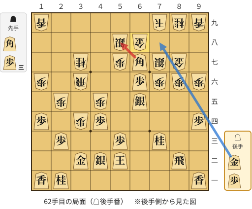

🔴 実戦 △５八角成(67)　🔵 AI推奨 △７八金打　🟨 直前の相手の指し手

<details><summary>テキストの盤面図（BOD・将棋ソフトに貼り付け可）</summary>

```text
後手の持駒：金　歩
  ９ ８ ７ ６ ５ ４ ３ ２ １
+---------------------------+
|v香 ・ ・ ・ ・ ・ ・v桂v香|一
| ・v飛 ・ ・v玉v銀v金 ・ ・|二
| ・ ・v桂 ・v歩 ・ ・v歩 ・|三
|v歩 ・ ・ ・ ・v歩 歩 ・v歩|四
| ・ ・ ・v銀 ・ 歩 ・ 歩 ・|五
| 歩 歩 歩v歩 ・ ・ 飛 ・ 歩|六
| ・ 金 銀v角 歩 ・ 桂 ・ ・|七
| ・ ・ ・ 金 銀 ・ ・ ・ ・|八
| 香 桂 玉 ・ ・ ・ ・ ・ 香|九
+---------------------------+
先手の持駒：角　歩三
後手番
手数＝61　▲６八金　まで
```

</details>

| | 指し手 | 評価値 | 読み筋 |
|---|---|--:|---|
| 実戦 | △５八角成(67) | -590 | ▲同金(68) △６七銀打 ▲６九玉(79) △６二飛(82) ▲６三歩打 △同飛(62) |
| AI 1位 | △７八金打 | +1714 | △７八金打 ▲同金(68) △５八角成(67) ▲６四歩打 △３六馬(58) ▲６三歩成(64) |
| AI 2位 | △７八歩打 | -60 | △７八歩打 ▲８八玉(79) △７九歩成(78) ▲６七銀(58) △同歩成(66) ▲７九玉(88) |
| AI 3位 | △５八角成(67) | -526 | △５八角成(67) ▲同金(68) △６七金打 ▲５五角打 △７八銀打 ▲８八玉(79) |

SFEN: `l6nl/1r2ksg2/2n1p2p1/p4pP1p/3s1P1P1/PPPp2R1P/1GSbP1N2/3GS4/LNK5L w B3Pgp 62`

<a id="ply-68"></a>
### 68手目 △６七金打 — 大悪手

| | 着手前 | 着手後 | 差 |
|---|--:|--:|--:|
| 期待勝率 | 66.3% | 37.3% | -29.0pt |
| 評価値 | +406 | -312 | |

着手前の局面:

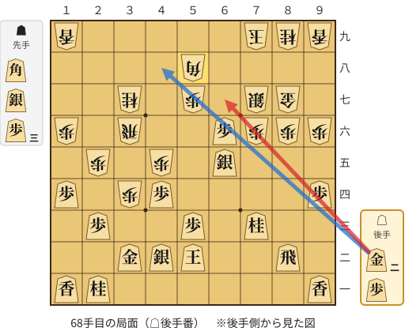

🔴 実戦 △６七金打　🔵 AI推奨 △４八金打　🟨 直前の相手の指し手

<details><summary>テキストの盤面図（BOD・将棋ソフトに貼り付け可）</summary>

```text
後手の持駒：金二　歩
  ９ ８ ７ ６ ５ ４ ３ ２ １
+---------------------------+
|v香 ・ ・ ・ ・ ・ ・v桂v香|一
| ・v飛 ・ ・v玉v銀v金 ・ ・|二
| ・ ・v桂 ・v歩 ・ ・v歩 ・|三
|v歩 ・ ・ ・ ・v歩 歩 ・v歩|四
| ・ ・ ・v銀 ・ 歩 ・ 歩 ・|五
| 歩 歩 歩v歩 ・ ・ 飛 ・ 歩|六
| ・ 金 銀 ・ 歩 ・ 桂 ・ ・|七
| ・ ・ ・ ・ 角 ・ ・ ・ ・|八
| 香 桂 玉 ・ ・ ・ ・ ・ 香|九
+---------------------------+
先手の持駒：角　銀　歩三
後手番
手数＝67　▲５八同角　まで
```

</details>

| | 指し手 | 評価値 | 読み筋 |
|---|---|--:|---|
| 実戦 | △６七金打 | -312 | ▲６九角(58) △９五歩(94) ▲同歩(96) △８五歩打 ▲６八歩打 △８六歩(85) |
| AI 1位 | △４八金打 | +406 | △４八金打 ▲６九角(58) △６七歩成(66) ▲８八玉(79) △５九金(48) ▲４七角(69) |
| AI 2位 | △５九金打 | +196 | △５九金打 ▲４七角(58) △６七歩成(66) ▲７八銀打 △同と(67) ▲同玉(79) |
| AI 3位 | △３五歩打 | +177 | △３五歩打 ▲４六飛(36) △５九金打 ▲４七角(58) △６七歩成(66) ▲７八銀打 |

SFEN: `l6nl/1r2ksg2/2n1p2p1/p4pP1p/3s1P1P1/PPPp2R1P/1GS1P1N2/4B4/LNK5L w BS3P2gp 68`

<a id="ply-70"></a>
### 70手目 △７八歩打 — 悪手

| | 着手前 | 着手後 | 差 |
|---|--:|--:|--:|
| 期待勝率 | 94.4% | 75.5% | -18.9pt |
| 評価値 | +1696 | +674 | |

着手前の局面:

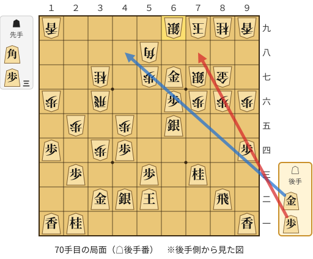

🔴 実戦 △７八歩打　🔵 AI推奨 △４八金打　🟨 直前の相手の指し手

<details><summary>テキストの盤面図（BOD・将棋ソフトに貼り付け可）</summary>

```text
後手の持駒：金　歩
  ９ ８ ７ ６ ５ ４ ３ ２ １
+---------------------------+
|v香 ・ ・ ・ ・ ・ ・v桂v香|一
| ・v飛 ・ ・v玉v銀v金 ・ ・|二
| ・ ・v桂 ・v歩 ・ ・v歩 ・|三
|v歩 ・ ・ ・ ・v歩 歩 ・v歩|四
| ・ ・ ・v銀 ・ 歩 ・ 歩 ・|五
| 歩 歩 歩v歩 ・ ・ 飛 ・ 歩|六
| ・ 金 銀v金 歩 ・ 桂 ・ ・|七
| ・ ・ ・ ・ 角 ・ ・ ・ ・|八
| 香 桂 玉 銀 ・ ・ ・ ・ 香|九
+---------------------------+
先手の持駒：角　歩三
後手番
手数＝69　▲６九銀　まで
```

</details>

| | 指し手 | 評価値 | 読み筋 |
|---|---|--:|---|
| 実戦 | △７八歩打 | +674 | ▲８八玉(79) △７九歩成(78) ▲同玉(88) △４八金打 ▲８八玉(79) △５八金(48) |
| AI 1位 | △４八金打 | +1696 | △４八金打 ▲３三歩成(34) △同金(32) ▲６四歩打 △５八金(48) ▲同銀(69) |
| AI 2位 | △５八金(67) | +1564 | △５八金(67) ▲同銀(69) △６七金打 ▲３三歩成(34) △同銀(42) ▲４四歩(45) |
| AI 3位 | △７八歩打 | +313 | △７八歩打 ▲８八玉(79) △７九歩成(78) ▲同玉(88) △５八金(67) ▲同銀(69) |

SFEN: `l6nl/1r2ksg2/2n1p2p1/p4pP1p/3s1P1P1/PPPp2R1P/1GSgP1N2/4B4/LNKS4L w B3Pgp 70`

<a id="ply-80"></a>
### 80手目 △６五銀打 — 疑問手

| | 着手前 | 着手後 | 差 |
|---|--:|--:|--:|
| 期待勝率 | 99.9% | 94.4% | -5.5pt |
| 評価値 | +4320 | +1697 | |

着手前の局面:

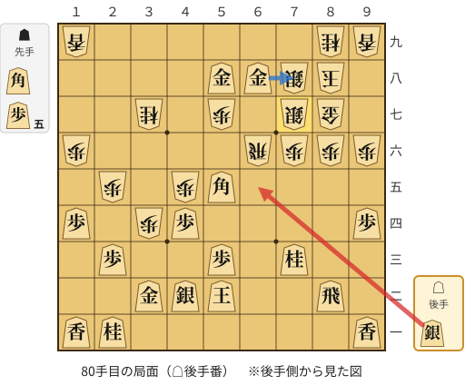

🔴 実戦 △６五銀打　🔵 AI推奨 △７八金(68)　🟨 直前の相手の指し手

<details><summary>テキストの盤面図（BOD・将棋ソフトに貼り付け可）</summary>

```text
後手の持駒：銀
  ９ ８ ７ ６ ５ ４ ３ ２ １
+---------------------------+
|v香 ・ ・ ・ ・ ・ ・v桂v香|一
| ・v飛 ・ ・v玉v銀v金 ・ ・|二
| ・ ・v桂 ・v歩 ・ ・v歩 ・|三
|v歩 ・ ・ ・ ・v歩 歩 ・v歩|四
| ・ ・ ・ ・v角 歩 ・ 歩 ・|五
| 歩 歩 歩 飛 ・ ・ ・ ・ 歩|六
| ・ 金 銀 ・ 歩 ・ 桂 ・ ・|七
| ・ 玉 銀v金v金 ・ ・ ・ ・|八
| 香 桂 ・ ・ ・ ・ ・ ・ 香|九
+---------------------------+
先手の持駒：角　歩五
後手番
手数＝79　▲７七銀打　まで
```

</details>

| | 指し手 | 評価値 | 読み筋 |
|---|---|--:|---|
| 実戦 | △６五銀打 | +1697 | ▲３六飛(66) △５七金(58) ▲６四歩打 △８五歩打 ▲６三歩成(64) △同玉(52) |
| AI 1位 | △７八金(68) | +4320 | △７八金(68) ▲同玉(88) △６六角(55) ▲６七金打 △５七角成(66) ▲同金(67) |
| AI 2位 | △７九銀打 | +4310 | △７九銀打 ▲９七玉(88) △７八金(68) ▲６三角打 △５一玉(52) ▲３三歩成(34) |
| AI 3位 | △６六角(55) | +3714 | △６六角(55) ▲６九銀(78) △７九銀打 ▲９七玉(88) △７七角成(66) ▲同桂(89) |

SFEN: `l6nl/1r2ksg2/2n1p2p1/p4pP1p/4bP1P1/PPPR4P/1GS1P1N2/1KSgg4/LN6L w B5Ps 80`

<a id="ply-94"></a>
### 94手目 △５六銀(65) — 悪手

| | 着手前 | 着手後 | 差 |
|---|--:|--:|--:|
| 期待勝率 | 99.5% | 87.4% | -12.1pt |
| 評価値 | +3165 | +1161 | |

着手前の局面:

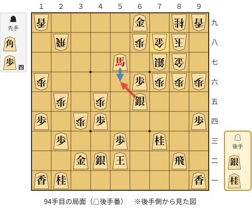

🔴 実戦 △５六銀(65)　🔵 AI推奨 △５六馬(57)　🟨 直前の相手の指し手

<details><summary>テキストの盤面図（BOD・将棋ソフトに貼り付け可）</summary>

```text
後手の持駒：銀　桂
  ９ ８ ７ ６ ５ ４ ３ ２ １
+---------------------------+
|v香 ・ ・ ・ ・ ・ ・v桂v香|一
| ・v飛 ・ ・v玉v銀v金 ・ ・|二
| ・ ・v桂 ・v歩 ・ ・v歩 ・|三
|v歩 ・ ・ ・ ・v歩 歩 ・v歩|四
| ・ ・ ・v銀 ・ 歩 ・ 歩 ・|五
| 歩 歩 歩v歩 ・ ・ ・ ・ 歩|六
| ・ 金 銀 ・v馬 ・ ・ ・ ・|七
| ・ 玉 金 歩 ・ ・ ・ 飛 ・|八
| 香 桂 ・v金 ・ ・ ・ ・ 香|九
+---------------------------+
先手の持駒：角　歩四
後手番
手数＝93　▲７八金　まで
```

</details>

| | 指し手 | 評価値 | 読み筋 |
|---|---|--:|---|
| 実戦 | △５六銀(65) | +1161 | ▲５五角打 △６七歩成(66) ▲同歩(68) △６一桂打 ▲５八歩打 △３九馬(57) |
| AI 1位 | △５六馬(57) | +3165 | △５六馬(57) ▲６四角打 △７九銀打 ▲同金(78) △同金(69) ▲７三角成(64) |
| AI 2位 | △７九銀打 | +2927 | △７九銀打 ▲同金(78) △同金(69) ▲同玉(88) △６七歩成(66) ▲７八銀打 |
| AI 3位 | △９五歩(94) | +2782 | △９五歩(94) ▲２四歩(25) △同歩(23) ▲２九飛(28) △６七歩成(66) ▲同金(78) |

SFEN: `l6nl/1r2ksg2/2n1p2p1/p4pP1p/3s1P1P1/PPPp4P/1GS1+b4/1KGP3R1/LN1g4L w B4Psn 94`

<a id="ply-110"></a>
### 110手目 △６七歩成(66) — 疑問手

| | 着手前 | 着手後 | 差 |
|---|--:|--:|--:|
| 期待勝率 | 99.1% | 92.7% | -6.4pt |
| 評価値 | +2817 | +1524 | |

着手前の局面:

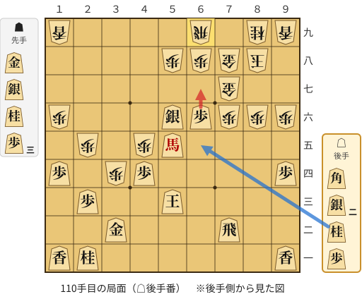

🔴 実戦 △６七歩成(66)　🔵 AI推奨 △６五桂打　🟨 直前の相手の指し手

<details><summary>テキストの盤面図（BOD・将棋ソフトに貼り付け可）</summary>

```text
後手の持駒：角　銀二　桂　歩
  ９ ８ ７ ６ ５ ４ ３ ２ １
+---------------------------+
|v香 ・ ・ ・ ・ ・ ・v桂v香|一
| ・ ・v飛 ・ ・ ・v金 ・ ・|二
| ・ ・ ・ ・v玉 ・ ・v歩 ・|三
|v歩 ・ ・ ・ ・v歩 歩 ・v歩|四
| ・ ・ ・ ・v馬 歩 ・ 歩 ・|五
| 歩 歩 歩v歩v銀 ・ ・ ・ 歩|六
| ・ ・ 金 ・ ・ ・ ・ ・ ・|七
| ・ 玉 金 歩 歩 ・ ・ ・ ・|八
| 香 桂 ・ 飛 ・ ・ ・ ・ 香|九
+---------------------------+
先手の持駒：金　銀　桂　歩三
後手番
手数＝109　▲６九飛　まで
```

</details>

| | 指し手 | 評価値 | 読み筋 |
|---|---|--:|---|
| 実戦 | △６七歩成(66) | +1524 | ▲同歩(68) △４五馬(55) ▲４九飛(69) △４七銀打 ▲６八桂打 △４八銀打 |
| AI 1位 | △６五桂打 | +2817 | △６五桂打 ▲８七銀打 △４五歩(44) ▲５七桂打 △７七桂成(65) ▲同桂(89) |
| AI 2位 | △７五歩打 | +2732 | △７五歩打 ▲同歩(76) △６五桂打 ▲７六桂打 △７七桂成(65) ▲同桂(89) |
| AI 3位 | △６四桂打 | +2563 | △６四桂打 ▲８五銀打 △６五銀打 ▲７五桂打 △７六銀(65) ▲６三金打 |

SFEN: `l6nl/2r3g2/4k2p1/p4pP1p/4+bP1P1/PPPps3P/2G6/1KGPP4/LN1R4L w GSN3Pb2snp 110`

<a id="ply-112"></a>
### 112手目 △６五桂打 — 大悪手

| | 着手前 | 着手後 | 差 |
|---|--:|--:|--:|
| 期待勝率 | 92.1% | 69.8% | -22.3pt |
| 評価値 | +1475 | +503 | |

着手前の局面:

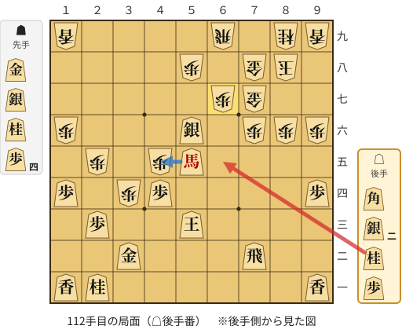

🔴 実戦 △６五桂打　🔵 AI推奨 △４五馬(55)　🟨 直前の相手の指し手

<details><summary>テキストの盤面図（BOD・将棋ソフトに貼り付け可）</summary>

```text
後手の持駒：角　銀二　桂　歩
  ９ ８ ７ ６ ５ ４ ３ ２ １
+---------------------------+
|v香 ・ ・ ・ ・ ・ ・v桂v香|一
| ・ ・v飛 ・ ・ ・v金 ・ ・|二
| ・ ・ ・ ・v玉 ・ ・v歩 ・|三
|v歩 ・ ・ ・ ・v歩 歩 ・v歩|四
| ・ ・ ・ ・v馬 歩 ・ 歩 ・|五
| 歩 歩 歩 ・v銀 ・ ・ ・ 歩|六
| ・ ・ 金 歩 ・ ・ ・ ・ ・|七
| ・ 玉 金 ・ 歩 ・ ・ ・ ・|八
| 香 桂 ・ 飛 ・ ・ ・ ・ 香|九
+---------------------------+
先手の持駒：金　銀　桂　歩四
後手番
手数＝111　▲６七同歩　まで
```

</details>

| | 指し手 | 評価値 | 読み筋 |
|---|---|--:|---|
| 実戦 | △６五桂打 | +503 | ▲６六金(77) △４五馬(55) ▲５五金打 △７七歩打 ▲同桂(89) △同桂成(65) |
| AI 1位 | △４五馬(55) | +1475 | △４五馬(55) ▲６六金打 △４三玉(53) ▲３九飛(69) △３八歩打 ▲同飛(39) |
| AI 2位 | △４五銀(56) | +1357 | △４五銀(56) ▲５七桂打 △５四銀(45) ▲６六金(77) △４六馬(55) ▲４九飛(69) |
| AI 3位 | △６四銀打 | +1266 | △６四銀打 ▲５七桂打 △４七角打 ▲６六金打 △３七馬(55) ▲５六金(66) |

SFEN: `l6nl/2r3g2/4k2p1/p4pP1p/4+bP1P1/PPP1s3P/2GP5/1KG1P4/LN1R4L w GSN4Pb2snp 112`

