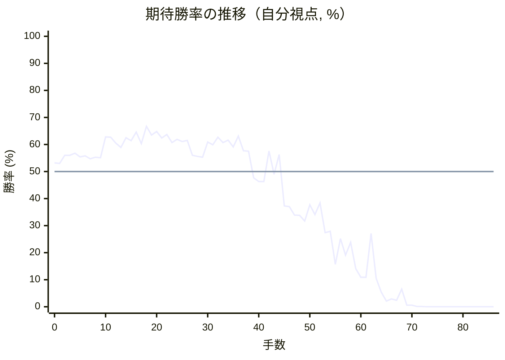
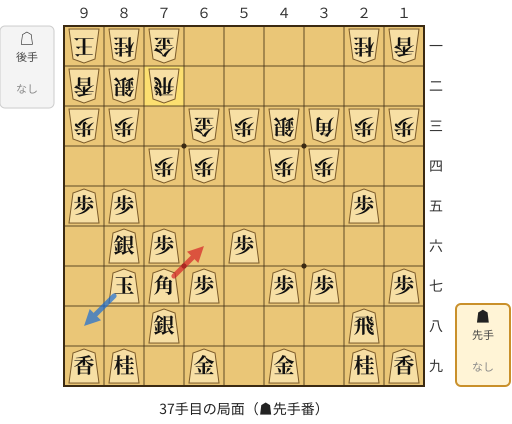
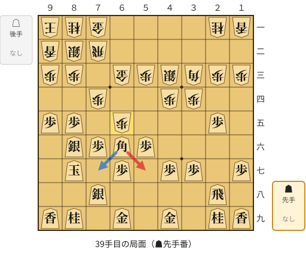
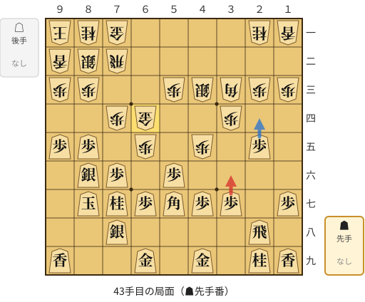
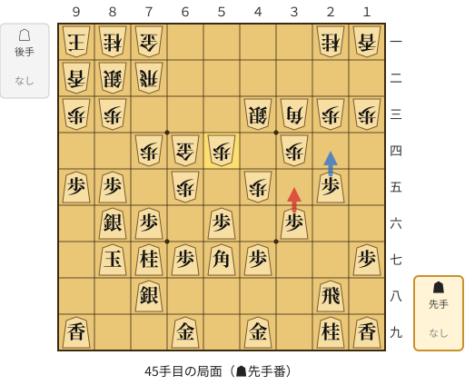
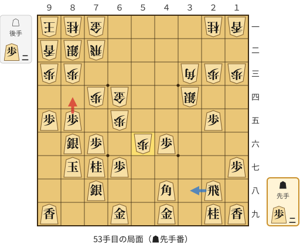
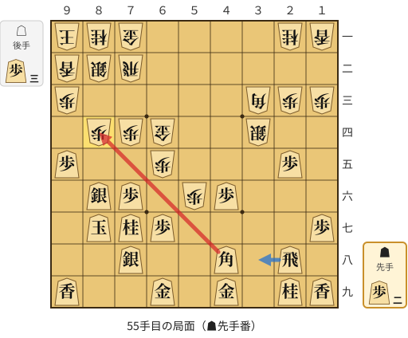
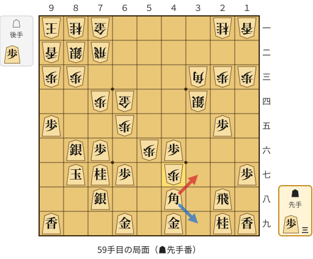

# 解析レポート vzfpybyoukky

[README に戻る](../../../README.md)　/　棋譜: [CSA](../../../data/csa/shogi5/vzfpybyoukky.csa)　/　解析の見方: [docs/mistake_analysis.md](../../../docs/mistake_analysis.md)

## 対局情報

| 項目 | 内容 |
|---|---|
| 日時 | 2026-11-01 07:50:52 |
| 持ち時間 | 5分 |
| 自分 | 先手（▲）（1722） |
| 相手 | 相手（1875） |
| 結果 | 負け（詰み, 86手） |

## 解析環境

| 項目 | 内容 |
|---|---|
| エンジン | YaneuraOu NNUE 9.00git 64AVX2（V9.00/YANEURAOU_ENGINE_NNUE/AVX2） |
| 評価関数 | **水匠5**（`suisho5`） |
| nn.bin SHA-256 | `768068f0d534a0603a5d38bcd143de6bbca820d5f1c95a14d40863e5b7892d76` |
| 第1パス | movetime=150ms, MultiPV 1 |
| 第2パス | movetime=2000ms, MultiPV 3 |
| Threads / Hash | 8 / 512MB |
| 判定基準 | 疑問手 ≥5pt, 悪手 ≥10pt, 大悪手 ≥20pt（期待勝率 W(E)=1/(1+exp(-E/600))） |
| 解析日時 | 2026-11-03T04:04:07+09:00（解析バージョン 1, 56秒） |

## サマリー

| 自分の手数 | 深掘りした手 | 詰み逃し | 大悪手 | 悪手 | 疑問手 |
|--:|--:|--:|--:|--:|--:|
| 43 | 11 | 0 | 1 | 5 | 1 |

## 期待勝率の推移



<details><summary>1手ごとの数値（第1パス）</summary>

| 手数 | 指し手 | 評価値 | 勝率 | 低下 | 判定 |
|--:|---|--:|--:|--:|---|
| 1 | ▲７六歩(77) | +71 | 53.0% | +0.2pt |  |
| 2 | △３四歩(33) | +145 | 56.0% |  |  |
| 3 | ▲２六歩(27) | +144 | 56.0% | +0.0pt |  |
| 4 | △４四歩(43) | +165 | 56.8% |  |  |
| 5 | ▲２五歩(26) | +130 | 55.4% | +1.4pt |  |
| 6 | △３三角(22) | +140 | 55.8% |  |  |
| 7 | ▲４八銀(39) | +113 | 54.7% | +1.1pt |  |
| 8 | △３二銀(31) | +127 | 55.3% |  |  |
| 9 | ▲６八玉(59) | +122 | 55.1% | +0.2pt |  |
| 10 | △４二飛(82) | +315 | 62.8% |  |  |
| 11 | ▲５六歩(57) | +311 | 62.7% | +0.2pt |  |
| 12 | △６二玉(51) | +257 | 60.5% |  |  |
| 13 | ▲７八玉(68) | +217 | 58.9% | +1.6pt |  |
| 14 | △７二玉(62) | +306 | 62.5% |  |  |
| 15 | ▲９六歩(97) | +278 | 61.4% | +1.1pt |  |
| 16 | △８二玉(72) | +361 | 64.6% |  |  |
| 17 | ▲８六歩(87) | +251 | 60.3% | +4.3pt |  |
| 18 | △９二香(91) | +416 | 66.7% |  |  |
| 19 | ▲８七玉(78) | +332 | 63.5% | +3.2pt |  |
| 20 | △９一玉(82) | +367 | 64.8% |  |  |
| 21 | ▲７八銀(79) | +305 | 62.4% | +2.4pt |  |
| 22 | △８二銀(71) | +337 | 63.7% |  |  |
| 23 | ▲５七銀(48) | +260 | 60.7% | +3.0pt |  |
| 24 | △７一金(61) | +291 | 61.9% |  |  |
| 25 | ▲９五歩(96) | +272 | 61.1% | +0.7pt |  |
| 26 | △４三銀(32) | +280 | 61.5% |  |  |
| 27 | ▲６六銀(57) | +145 | 56.0% | +5.4pt |  |
| 28 | △５二金(41) | +135 | 55.6% |  |  |
| 29 | ▲８五歩(86) | +128 | 55.3% | +0.3pt |  |
| 30 | △６四歩(63) | +267 | 60.9% |  |  |
| 31 | ▲７五銀(66) | +242 | 59.9% | +1.0pt |  |
| 32 | △６三金(52) | +311 | 62.7% |  |  |
| 33 | ▲７七角(88) | +260 | 60.7% | +2.0pt |  |
| 34 | △７四歩(73) | +284 | 61.6% |  |  |
| 35 | ▲８六銀(75) | +220 | 59.1% | +2.6pt |  |
| 36 | △７二飛(42) | +323 | 63.1% |  |  |
| 37 | ▲６六角(77) | +187 | 57.7% | +5.4pt | [悪手](#ply-37) |
| 38 | △６五歩(64) | +181 | 57.5% |  |  |
| 39 | ▲５七角(66) | -55 | 47.7% | +9.8pt | [悪手](#ply-39) |
| 40 | △４五歩(44) | -90 | 46.3% |  |  |
| 41 | ▲７七桂(89) | -90 | 46.3% | +0.0pt |  |
| 42 | △６四金(63) | +185 | 57.6% |  |  |
| 43 | ▲３六歩(37) | -23 | 49.0% | +8.6pt | [疑問手](#ply-43) |
| 44 | △５四歩(53) | +152 | 56.3% |  |  |
| 45 | ▲３五歩(36) | -312 | 37.3% | +19.0pt | [大悪手](#ply-45) |
| 46 | △５五歩(54) | -320 | 37.0% |  |  |
| 47 | ▲３四歩(35) | -401 | 33.9% | +3.1pt |  |
| 48 | △同銀(43) | -404 | 33.8% |  |  |
| 49 | ▲４八角(57) | -460 | 31.7% | +2.1pt |  |
| 50 | △４六歩(45) | -301 | 37.7% |  |  |
| 51 | ▲同歩(47) | -394 | 34.1% | +3.6pt |  |
| 52 | △５六歩(55) | -283 | 38.4% |  |  |
| 53 | ▲８四歩(85) | -586 | 27.4% | +11.1pt | [悪手](#ply-53) |
| 54 | △同歩(83) | -570 | 27.9% |  |  |
| 55 | ▲同角(48) | -1010 | 15.7% | +12.2pt | [悪手](#ply-55) |
| 56 | △８三歩打 | -652 | 25.2% |  |  |
| 57 | ▲４八角(84) | -865 | 19.1% | +6.1pt |  |
| 58 | △４七歩打 | -698 | 23.8% |  |  |
| 59 | ▲３七角(48) | -1083 | 14.1% | +9.7pt | [悪手](#ply-59) |
| 60 | △５七歩成(56) | -1261 | 10.9% |  |  |
| 61 | ▲４五歩(46) | -1263 | 10.9% | +0.0pt |  |
| 62 | △５五金(64) | -594 | 27.1% |  |  |
| 63 | ▲４四歩(45) | -1285 | 10.5% | +16.6pt |  |
| 64 | △同角(33) | -1713 | 5.4% |  |  |
| 65 | ▲２四歩(25) | -2310 | 2.1% | +3.4pt |  |
| 66 | △６六歩(65) | -2106 | 2.9% |  |  |
| 67 | ▲同歩(67) | -2230 | 2.4% | +0.5pt |  |
| 68 | △同金(55) | -1596 | 6.5% |  |  |
| 69 | ▲６八歩打 | -3056 | 0.6% | +5.9pt |  |
| 70 | △７五歩(74) | -3074 | 0.6% |  |  |
| 71 | ▲同銀(86) | -4250 | 0.1% | +0.5pt |  |
| 72 | △同飛(72) | -4537 | 0.1% |  |  |
| 73 | ▲同歩(76) | -4688 | 0.0% | +0.0pt |  |
| 74 | △７六歩打 | -4688 | 0.0% |  |  |
| 75 | ▲８五桂(77) | -5378 | 0.0% | +0.0pt |  |
| 76 | △７七歩成(76) | -5603 | 0.0% |  |  |
| 77 | ▲９七玉(87) | -6865 | 0.0% | +0.0pt |  |
| 78 | △７六金(66) | -7946 | 0.0% |  |  |
| 79 | ▲４二飛打 | #-11 | 0.0% | +0.0pt |  |
| 80 | △８六銀打 | #-10 | 0.0% |  |  |
| 81 | ▲９六玉(97) | #-9 | 0.0% | +0.0pt |  |
| 82 | △９五銀(86) | #-8 | 0.0% |  |  |
| 83 | ▲９七玉(96) | #-3 | 0.0% | +0.0pt |  |
| 84 | △８六金(76) | #-2 | 0.0% |  |  |
| 85 | ▲９八玉(97) | #-1 | 0.0% | +0.0pt |  |
| 86 | △８八と(77) | #- | 0.0% |  |  |

</details>

## 課題局面

<a id="ply-37"></a>
### 37手目 ▲６六角(77) — 悪手

| | 着手前 | 着手後 | 差 |
|---|--:|--:|--:|
| 期待勝率 | 63.9% | 53.7% | -10.3pt |
| 評価値 | +343 | +88 | |

着手前の局面:



🔴 実戦 ▲６六角(77)　🔵 AI推奨 ▲９八玉(87)　🟨 直前の相手の指し手

<details><summary>テキストの盤面図（BOD・将棋ソフトに貼り付け可）</summary>

```text
後手の持駒：なし
  ９ ８ ７ ６ ５ ４ ３ ２ １
+---------------------------+
|v玉v桂v金 ・ ・ ・ ・v桂v香|一
|v香v銀v飛 ・ ・ ・ ・ ・ ・|二
|v歩v歩 ・v金v歩v銀v角v歩v歩|三
| ・ ・v歩v歩 ・v歩v歩 ・ ・|四
| 歩 歩 ・ ・ ・ ・ ・ 歩 ・|五
| ・ 銀 歩 ・ 歩 ・ ・ ・ ・|六
| ・ 玉 角 歩 ・ 歩 歩 ・ 歩|七
| ・ ・ 銀 ・ ・ ・ ・ 飛 ・|八
| 香 桂 ・ 金 ・ 金 ・ 桂 香|九
+---------------------------+
先手の持駒：なし
手数＝36　△７二飛　まで
```

</details>

| | 指し手 | 評価値 | 読み筋 |
|---|---|--:|---|
| 実戦 | ▲６六角(77) | +88 | △３二飛(72) ▲５八金(49) △７三金(63) ▲７七桂(89) △５四銀(43) ▲９八玉(87) |
| AI 1位 | ▲９八玉(87) | +343 | ▲９八玉(87) △３五歩(34) ▲８七銀(78) △３二飛(72) ▲４六歩(47) △７三金(63) |
| AI 2位 | ▲５八金(49) | +320 | ▲５八金(49) △３二飛(72) ▲１六歩(17) △３五歩(34) ▲４六歩(47) △７三金(63) |
| AI 3位 | ▲５九金(49) | +285 | ▲５九金(49) △３二飛(72) ▲６八金(59) △７三金(63) ▲９八玉(87) △３五歩(34) |

SFEN: `kng4nl/lsr6/pp1gpsbpp/2pp1pp2/PP5P1/1SP1P4/1KBP1PP1P/2S4R1/LN1G1G1NL b - 37`

<a id="ply-39"></a>
### 39手目 ▲５七角(66) — 悪手

| | 着手前 | 着手後 | 差 |
|---|--:|--:|--:|
| 期待勝率 | 57.6% | 47.4% | -10.2pt |
| 評価値 | +184 | -63 | |

着手前の局面:



🔴 実戦 ▲５七角(66)　🔵 AI推奨 ▲７七角(66)　🟨 直前の相手の指し手

<details><summary>テキストの盤面図（BOD・将棋ソフトに貼り付け可）</summary>

```text
後手の持駒：なし
  ９ ８ ７ ６ ５ ４ ３ ２ １
+---------------------------+
|v玉v桂v金 ・ ・ ・ ・v桂v香|一
|v香v銀v飛 ・ ・ ・ ・ ・ ・|二
|v歩v歩 ・v金v歩v銀v角v歩v歩|三
| ・ ・v歩 ・ ・v歩v歩 ・ ・|四
| 歩 歩 ・v歩 ・ ・ ・ 歩 ・|五
| ・ 銀 歩 角 歩 ・ ・ ・ ・|六
| ・ 玉 ・ 歩 ・ 歩 歩 ・ 歩|七
| ・ ・ 銀 ・ ・ ・ ・ 飛 ・|八
| 香 桂 ・ 金 ・ 金 ・ 桂 香|九
+---------------------------+
先手の持駒：なし
手数＝38　△６五歩　まで
```

</details>

| | 指し手 | 評価値 | 読み筋 |
|---|---|--:|---|
| 実戦 | ▲５七角(66) | -63 | △４五歩(44) ▲９八玉(87) △５四歩(53) ▲２四歩(25) △同歩(23) ▲同角(57) |
| AI 1位 | ▲７七角(66) | +184 | ▲７七角(66) △３二飛(72) ▲５八金(49) △７三金(63) ▲１六歩(17) △３五歩(34) |
| AI 2位 | ▲８八角(66) | +137 | ▲８八角(66) △３二飛(72) ▲５八金(49) △７三金(63) ▲１六歩(17) △３五歩(34) |
| AI 3位 | ▲５五角(66) | +63 | ▲５五角(66) △３五歩(34) ▲７七角(55) △３二飛(72) ▲４六歩(47) △７三金(63) |

SFEN: `kng4nl/lsr6/pp1gpsbpp/2p2pp2/PP1p3P1/1SPBP4/1K1P1PP1P/2S4R1/LN1G1G1NL b - 39`

<a id="ply-43"></a>
### 43手目 ▲３六歩(37) — 疑問手

| | 着手前 | 着手後 | 差 |
|---|--:|--:|--:|
| 期待勝率 | 58.5% | 49.9% | -8.6pt |
| 評価値 | +205 | -3 | |

着手前の局面:



🔴 実戦 ▲３六歩(37)　🔵 AI推奨 ▲２四歩(25)　🟨 直前の相手の指し手

<details><summary>テキストの盤面図（BOD・将棋ソフトに貼り付け可）</summary>

```text
後手の持駒：なし
  ９ ８ ７ ６ ５ ４ ３ ２ １
+---------------------------+
|v玉v桂v金 ・ ・ ・ ・v桂v香|一
|v香v銀v飛 ・ ・ ・ ・ ・ ・|二
|v歩v歩 ・ ・v歩v銀v角v歩v歩|三
| ・ ・v歩v金 ・ ・v歩 ・ ・|四
| 歩 歩 ・v歩 ・v歩 ・ 歩 ・|五
| ・ 銀 歩 ・ 歩 ・ ・ ・ ・|六
| ・ 玉 桂 歩 角 歩 歩 ・ 歩|七
| ・ ・ 銀 ・ ・ ・ ・ 飛 ・|八
| 香 ・ ・ 金 ・ 金 ・ 桂 香|九
+---------------------------+
先手の持駒：なし
手数＝42　△６四金　まで
```

</details>

| | 指し手 | 評価値 | 読み筋 |
|---|---|--:|---|
| 実戦 | ▲３六歩(37) | -3 | △５四銀(43) ▲５八金(49) △６三銀(54) ▲２四歩(25) △同歩(23) ▲３七桂(29) |
| AI 1位 | ▲２四歩(25) | +205 | ▲２四歩(25) △同歩(23) ▲同角(57) △７五歩(74) ▲３三角成(24) △同桂(21) |
| AI 2位 | ▲８四歩(85) | +171 | ▲８四歩(85) △同歩(83) ▲２四歩(25) △同歩(23) ▲同角(57) △２五歩打 |
| AI 3位 | ▲５八金(49) | +117 | ▲５八金(49) △５四銀(43) ▲２六飛(28) △６三銀(54) ▲３六飛(26) △３二飛(72) |

SFEN: `kng4nl/lsr6/pp2psbpp/2pg2p2/PP1p1p1P1/1SP1P4/1KNPBPP1P/2S4R1/L2G1G1NL b - 43`

<a id="ply-45"></a>
### 45手目 ▲３五歩(36) — 大悪手

| | 着手前 | 着手後 | 差 |
|---|--:|--:|--:|
| 期待勝率 | 55.9% | 32.6% | -23.3pt |
| 評価値 | +142 | -437 | |

着手前の局面:



🔴 実戦 ▲３五歩(36)　🔵 AI推奨 ▲２四歩(25)　🟨 直前の相手の指し手

<details><summary>テキストの盤面図（BOD・将棋ソフトに貼り付け可）</summary>

```text
後手の持駒：なし
  ９ ８ ７ ６ ５ ４ ３ ２ １
+---------------------------+
|v玉v桂v金 ・ ・ ・ ・v桂v香|一
|v香v銀v飛 ・ ・ ・ ・ ・ ・|二
|v歩v歩 ・ ・ ・v銀v角v歩v歩|三
| ・ ・v歩v金v歩 ・v歩 ・ ・|四
| 歩 歩 ・v歩 ・v歩 ・ 歩 ・|五
| ・ 銀 歩 ・ 歩 ・ 歩 ・ ・|六
| ・ 玉 桂 歩 角 歩 ・ ・ 歩|七
| ・ ・ 銀 ・ ・ ・ ・ 飛 ・|八
| 香 ・ ・ 金 ・ 金 ・ 桂 香|九
+---------------------------+
先手の持駒：なし
手数＝44　△５四歩　まで
```

</details>

| | 指し手 | 評価値 | 読み筋 |
|---|---|--:|---|
| 実戦 | ▲３五歩(36) | -437 | △５五歩(54) ▲３四歩(35) △同銀(43) ▲８四歩(85) △同歩(83) ▲３八飛(28) |
| AI 1位 | ▲２四歩(25) | +142 | ▲２四歩(25) △同歩(23) ▲同角(57) △２二飛(72) ▲３三角成(24) △２八飛成(22) |
| AI 2位 | ▲８四歩(85) | -127 | ▲８四歩(85) △同歩(83) ▲２四歩(25) △同歩(23) ▲同角(57) △２六歩打 |
| AI 3位 | ▲９四歩(95) | -310 | ▲９四歩(95) △同歩(93) ▲２四歩(25) △同歩(23) ▲同角(57) △２二飛(72) |

SFEN: `kng4nl/lsr6/pp3sbpp/2pgp1p2/PP1p1p1P1/1SP1P1P2/1KNPBP2P/2S4R1/L2G1G1NL b - 45`

<a id="ply-53"></a>
### 53手目 ▲８四歩(85) — 悪手

| | 着手前 | 着手後 | 差 |
|---|--:|--:|--:|
| 期待勝率 | 38.2% | 27.4% | -10.9pt |
| 評価値 | -288 | -586 | |

着手前の局面:



🔴 実戦 ▲８四歩(85)　🔵 AI推奨 ▲３八飛(28)　🟨 直前の相手の指し手

<details><summary>テキストの盤面図（BOD・将棋ソフトに貼り付け可）</summary>

```text
後手の持駒：歩二
  ９ ８ ７ ６ ５ ４ ３ ２ １
+---------------------------+
|v玉v桂v金 ・ ・ ・ ・v桂v香|一
|v香v銀v飛 ・ ・ ・ ・ ・ ・|二
|v歩v歩 ・ ・ ・ ・v角v歩v歩|三
| ・ ・v歩v金 ・ ・v銀 ・ ・|四
| 歩 歩 ・v歩 ・ ・ ・ 歩 ・|五
| ・ 銀 歩 ・v歩 歩 ・ ・ ・|六
| ・ 玉 桂 歩 ・ ・ ・ ・ 歩|七
| ・ ・ 銀 ・ ・ 角 ・ 飛 ・|八
| 香 ・ ・ 金 ・ 金 ・ 桂 香|九
+---------------------------+
先手の持駒：歩二
手数＝52　△５六歩　まで
```

</details>

| | 指し手 | 評価値 | 読み筋 |
|---|---|--:|---|
| 実戦 | ▲８四歩(85) | -586 | △同歩(83) ▲３八飛(28) △３五歩打 ▲５八金(49) △８三銀(82) ▲６八金(69) |
| AI 1位 | ▲３八飛(28) | -288 | ▲３八飛(28) △３五歩打 ▲５八金(49) △４四角(33) ▲８四歩(85) △同歩(83) |
| AI 2位 | ▲５八金(49) | -452 | ▲５八金(49) △３五銀(34) ▲４七金(58) △５二飛(72) ▲３七桂(29) △５四飛(52) |
| AI 3位 | ▲９四歩(95) | -536 | ▲９四歩(95) △同歩(93) ▲３八飛(28) △３五歩打 ▲５八金(49) △５二飛(72) |

SFEN: `kng4nl/lsr6/pp4bpp/2pg2s2/PP1p3P1/1SP1pP3/1KNP4P/2S2B1R1/L2G1G1NL b 2P2p 53`

<a id="ply-55"></a>
### 55手目 ▲同角(48) — 悪手

| | 着手前 | 着手後 | 差 |
|---|--:|--:|--:|
| 期待勝率 | 28.2% | 14.3% | -13.9pt |
| 評価値 | -560 | -1074 | |

着手前の局面:



🔴 実戦 ▲同角(48)　🔵 AI推奨 ▲３八飛(28)　🟨 直前の相手の指し手

<details><summary>テキストの盤面図（BOD・将棋ソフトに貼り付け可）</summary>

```text
後手の持駒：歩三
  ９ ８ ７ ６ ５ ４ ３ ２ １
+---------------------------+
|v玉v桂v金 ・ ・ ・ ・v桂v香|一
|v香v銀v飛 ・ ・ ・ ・ ・ ・|二
|v歩 ・ ・ ・ ・ ・v角v歩v歩|三
| ・v歩v歩v金 ・ ・v銀 ・ ・|四
| 歩 ・ ・v歩 ・ ・ ・ 歩 ・|五
| ・ 銀 歩 ・v歩 歩 ・ ・ ・|六
| ・ 玉 桂 歩 ・ ・ ・ ・ 歩|七
| ・ ・ 銀 ・ ・ 角 ・ 飛 ・|八
| 香 ・ ・ 金 ・ 金 ・ 桂 香|九
+---------------------------+
先手の持駒：歩二
手数＝54　△８四同歩　まで
```

</details>

| | 指し手 | 評価値 | 読み筋 |
|---|---|--:|---|
| 実戦 | ▲同角(48) | -1074 | △８五歩打 ▲同銀(86) △８六歩打 ▲同玉(87) △８三歩打 ▲３九角(84) |
| AI 1位 | ▲３八飛(28) | -560 | ▲３八飛(28) △３五歩打 ▲５八金(49) △８三銀(82) ▲６八金(69) △８二金(71) |
| AI 2位 | ▲５八金(49) | -652 | ▲５八金(49) △８五歩(84) ▲同銀(86) △８六歩打 ▲同玉(87) △８四歩打 |
| AI 3位 | ▲２四歩(25) | -787 | ▲２四歩(25) △同歩(23) ▲３八飛(28) △３五歩打 ▲５八金(49) △５二飛(72) |

SFEN: `kng4nl/lsr6/p5bpp/1ppg2s2/P2p3P1/1SP1pP3/1KNP4P/2S2B1R1/L2G1G1NL b 2P3p 55`

<a id="ply-59"></a>
### 59手目 ▲３七角(48) — 悪手

| | 着手前 | 着手後 | 差 |
|---|--:|--:|--:|
| 期待勝率 | 19.6% | 9.3% | -10.3pt |
| 評価値 | -845 | -1365 | |

着手前の局面:



🔴 実戦 ▲３七角(48)　🔵 AI推奨 ▲３九角(48)　🟨 直前の相手の指し手

<details><summary>テキストの盤面図（BOD・将棋ソフトに貼り付け可）</summary>

```text
後手の持駒：歩
  ９ ８ ７ ６ ５ ４ ３ ２ １
+---------------------------+
|v玉v桂v金 ・ ・ ・ ・v桂v香|一
|v香v銀v飛 ・ ・ ・ ・ ・ ・|二
|v歩v歩 ・ ・ ・ ・v角v歩v歩|三
| ・ ・v歩v金 ・ ・v銀 ・ ・|四
| 歩 ・ ・v歩 ・ ・ ・ 歩 ・|五
| ・ 銀 歩 ・v歩 歩 ・ ・ ・|六
| ・ 玉 桂 歩 ・v歩 ・ ・ 歩|七
| ・ ・ 銀 ・ ・ 角 ・ 飛 ・|八
| 香 ・ ・ 金 ・ 金 ・ 桂 香|九
+---------------------------+
先手の持駒：歩三
手数＝58　△４七歩　まで
```

</details>

| | 指し手 | 評価値 | 読み筋 |
|---|---|--:|---|
| 実戦 | ▲３七角(48) | -1365 | △５七歩成(56) ▲４五歩(46) △４二角(33) ▲６六歩(67) △３六歩打 ▲４六角(37) |
| AI 1位 | ▲３九角(48) | -845 | ▲３九角(48) △７五歩(74) ▲同銀(86) △同金(64) ▲同歩(76) △５七歩成(56) |
| AI 2位 | ▲３九角(48) | -844 | ▲３九角(48) △７五歩(74) ▲同銀(86) △同金(64) ▲同角(39) △同飛(72) |
| AI 3位 | ▲３七角(48) | -1378 | ▲３七角(48) △５七歩成(56) ▲４五歩(46) △４二角(33) ▲９四歩(95) △同歩(93) |

SFEN: `kng4nl/lsr6/pp4bpp/2pg2s2/P2p3P1/1SP1pP3/1KNP1p2P/2S2B1R1/L2G1G1NL b 3Pp 59`

