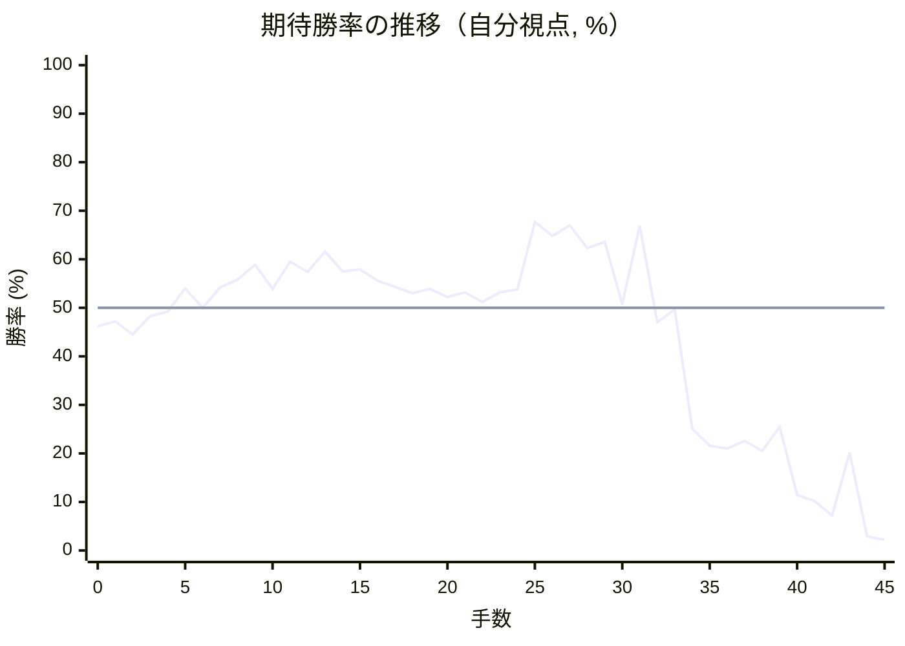
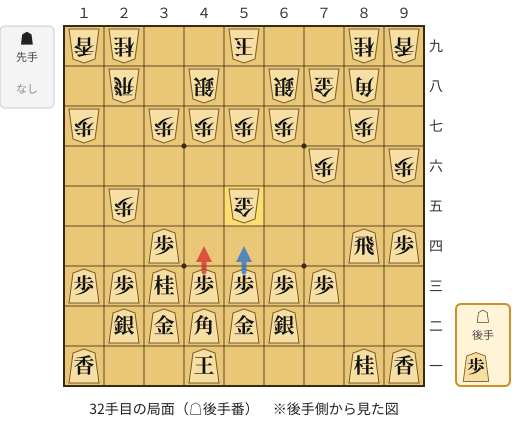
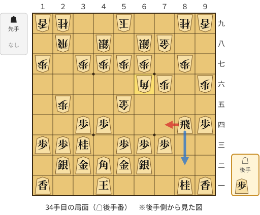
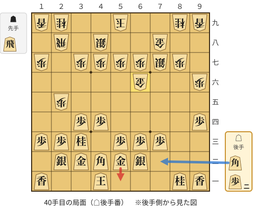
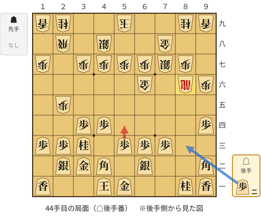

# 解析レポート w1n83pk42w8n

[README に戻る](../../../README.md)　/　棋譜: [CSA](../../../data/csa/shogi5/w1n83pk42w8n.csa)　/　解析の見方: [docs/mistake_analysis.md](../../../docs/mistake_analysis.md)

## 対局情報

| 項目 | 内容 |
|---|---|
| 日時 | 2026-11-08 13:54:27 |
| 持ち時間 | 5分 |
| 自分 | 後手（△）（1690） |
| 相手 | 相手（1432） |
| 結果 | 負け（投了, 45手） |

## 解析環境

| 項目 | 内容 |
|---|---|
| エンジン | YaneuraOu NNUE 9.00git 64AVX2（V9.00/YANEURAOU_ENGINE_NNUE/AVX2） |
| 評価関数 | **水匠5**（`suisho5`） |
| nn.bin SHA-256 | `768068f0d534a0603a5d38bcd143de6bbca820d5f1c95a14d40863e5b7892d76` |
| 第1パス | movetime=150ms, MultiPV 1 |
| 第2パス | movetime=2000ms, MultiPV 3 |
| Threads / Hash | 8 / 512MB |
| 判定基準 | 疑問手 ≥5pt, 悪手 ≥10pt, 大悪手 ≥20pt（期待勝率 W(E)=1/(1+exp(-E/600))） |
| 解析日時 | 2026-11-11T20:19:58+09:00（解析バージョン 1, 27秒） |

## サマリー

| 自分の手数 | 深掘りした手 | 詰み逃し | 大悪手 | 悪手 | 疑問手 |
|--:|--:|--:|--:|--:|--:|
| 22 | 5 | 0 | 1 | 3 | 0 |

## 期待勝率の推移



<details><summary>1手ごとの数値（第1パス）</summary>

| 手数 | 指し手 | 評価値 | 勝率 | 低下 | 判定 |
|--:|---|--:|--:|--:|---|
| 1 | ▲２六歩(27) | -68 | 47.2% |  |  |
| 2 | △８四歩(83) | -133 | 44.5% | +2.7pt |  |
| 3 | ▲７八金(69) | -42 | 48.3% |  |  |
| 4 | △８五歩(84) | -20 | 49.2% | -0.9pt |  |
| 5 | ▲３八金(49) | +95 | 54.0% |  |  |
| 6 | △３二金(41) | +1 | 50.0% | +3.9pt |  |
| 7 | ▲４八銀(39) | +101 | 54.2% |  |  |
| 8 | △３四歩(33) | +140 | 55.8% | -1.6pt |  |
| 9 | ▲６八銀(79) | +215 | 58.9% |  |  |
| 10 | △３三角(22) | +94 | 53.9% | +5.0pt |  |
| 11 | ▲２五歩(26) | +231 | 59.5% |  |  |
| 12 | △２二銀(31) | +180 | 57.4% | +2.1pt |  |
| 13 | ▲２七金(38) | +283 | 61.6% |  |  |
| 14 | △６二銀(71) | +182 | 57.5% | +4.1pt |  |
| 15 | ▲３六金(27) | +192 | 57.9% |  |  |
| 16 | △８六歩(85) | +134 | 55.6% | +2.4pt |  |
| 17 | ▲同歩(87) | +103 | 54.3% |  |  |
| 18 | △同飛(82) | +72 | 53.0% | +1.3pt |  |
| 19 | ▲８七歩打 | +93 | 53.9% |  |  |
| 20 | △８四飛(86) | +52 | 52.2% | +1.7pt |  |
| 21 | ▲４五金(36) | +78 | 53.2% |  |  |
| 22 | △５二金(61) | +30 | 51.2% | +2.0pt |  |
| 23 | ▲９六歩(97) | +78 | 53.2% |  |  |
| 24 | △４一玉(51) | +91 | 53.8% | -0.5pt |  |
| 25 | ▲７九角(88) | +444 | 67.7% |  |  |
| 26 | △４二角(33) | +365 | 64.8% | +2.9pt |  |
| 27 | ▲８八角(79) | +425 | 67.0% |  |  |
| 28 | △９四歩(93) | +302 | 62.3% | +4.7pt |  |
| 29 | ▲７六歩(77) | +335 | 63.6% |  |  |
| 30 | △３三桂(21) | +18 | 50.7% | +12.9pt |  |
| 31 | ▲５五金(45) | +421 | 66.9% |  |  |
| 32 | △４四歩(43) | -71 | 47.0% | +19.8pt | [悪手](#ply-32) |
| 33 | ▲６六角(88) | -8 | 49.7% |  |  |
| 34 | △７四飛(84) | -657 | 25.1% | +24.6pt | [大悪手](#ply-34) |
| 35 | ▲６五金(55) | -774 | 21.6% |  |  |
| 36 | △７六飛(74) | -794 | 21.0% | +0.6pt |  |
| 37 | ▲７七銀(68) | -738 | 22.6% |  |  |
| 38 | △６六飛(76) | -814 | 20.5% | +2.1pt |  |
| 39 | ▲同金(65) | -642 | 25.5% |  |  |
| 40 | △５一金(52) | -1232 | 11.4% | +14.2pt | [悪手](#ply-40) |
| 41 | ▲８二飛打 | -1302 | 10.2% |  |  |
| 42 | △９二角打 | -1534 | 7.2% | +3.0pt |  |
| 43 | ▲８六飛成(82) | -823 | 20.2% |  |  |
| 44 | △５四歩(53) | -2113 | 2.9% | +17.4pt | [悪手](#ply-44) |
| 45 | ▲８二龍(86) | -2283 | 2.2% |  |  |

</details>

## 課題局面

<a id="ply-32"></a>
### 32手目 △４四歩(43) — 悪手

| | 着手前 | 着手後 | 差 |
|---|--:|--:|--:|
| 期待勝率 | 65.6% | 47.3% | -18.3pt |
| 評価値 | +386 | -65 | |

着手前の局面:



🔴 実戦 △４四歩(43)　🔵 AI推奨 △５四歩(53)　🟨 直前の相手の指し手

<details><summary>テキストの盤面図（BOD・将棋ソフトに貼り付け可）</summary>

```text
後手の持駒：歩
  ９ ８ ７ ６ ５ ４ ３ ２ １
+---------------------------+
|v香v桂 ・ ・ ・v玉 ・ ・v香|一
| ・ ・ ・v銀v金v角v金v銀 ・|二
| ・ ・v歩v歩v歩v歩v桂v歩v歩|三
|v歩v飛 ・ ・ ・ ・v歩 ・ ・|四
| ・ ・ ・ ・ 金 ・ ・ 歩 ・|五
| 歩 ・ 歩 ・ ・ ・ ・ ・ ・|六
| ・ 歩 ・ 歩 歩 歩 歩 ・ 歩|七
| ・ 角 金 銀 ・ 銀 ・ 飛 ・|八
| 香 桂 ・ ・ 玉 ・ ・ 桂 香|九
+---------------------------+
先手の持駒：なし
後手番
手数＝31　▲５五金　まで
```

</details>

| | 指し手 | 評価値 | 読み筋 |
|---|---|--:|---|
| 実戦 | △４四歩(43) | -65 | ▲４六歩(47) △５四歩(53) ▲６六角(88) △８二飛(84) ▲４四金(55) △８六歩打 |
| AI 1位 | △５四歩(53) | +386 | △５四歩(53) ▲５六金(55) △５三銀(62) ▲６九玉(59) △３一玉(41) ▲３六歩(37) |
| AI 2位 | △１四歩(13) | +310 | △１四歩(13) ▲３六歩(37) △５四歩(53) ▲６六角(88) △８二飛(84) ▲５四金(55) |
| AI 3位 | △８六歩打 | +228 | △８六歩打 ▲６六角(88) △８三飛(84) ▲８六歩(87) △同飛(83) ▲８七歩打 |

SFEN: `ln3k2l/3sgbgs1/2ppppnpp/pr4p2/4G2P1/P1P6/1P1PPPP1P/1BGS1S1R1/LN2K2NL w p 32`

<a id="ply-34"></a>
### 34手目 △７四飛(84) — 大悪手

| | 着手前 | 着手後 | 差 |
|---|--:|--:|--:|
| 期待勝率 | 47.6% | 21.1% | -26.6pt |
| 評価値 | -57 | -793 | |

着手前の局面:



🔴 実戦 △７四飛(84)　🔵 AI推奨 △８二飛(84)　🟨 直前の相手の指し手

<details><summary>テキストの盤面図（BOD・将棋ソフトに貼り付け可）</summary>

```text
後手の持駒：歩
  ９ ８ ７ ６ ５ ４ ３ ２ １
+---------------------------+
|v香v桂 ・ ・ ・v玉 ・ ・v香|一
| ・ ・ ・v銀v金v角v金v銀 ・|二
| ・ ・v歩v歩v歩 ・v桂v歩v歩|三
|v歩v飛 ・ ・ ・v歩v歩 ・ ・|四
| ・ ・ ・ ・ 金 ・ ・ 歩 ・|五
| 歩 ・ 歩 角 ・ ・ ・ ・ ・|六
| ・ 歩 ・ 歩 歩 歩 歩 ・ 歩|七
| ・ ・ 金 銀 ・ 銀 ・ 飛 ・|八
| 香 桂 ・ ・ 玉 ・ ・ 桂 香|九
+---------------------------+
先手の持駒：なし
後手番
手数＝33　▲６六角　まで
```

</details>

| | 指し手 | 評価値 | 読み筋 |
|---|---|--:|---|
| 実戦 | △７四飛(84) | -793 | ▲６五金(55) △７六飛(74) ▲７七銀(68) △６六飛(76) ▲同銀(77) △７二角打 |
| AI 1位 | △８二飛(84) | -57 | △８二飛(84) ▲６九玉(59) △５四歩(53) ▲４四金(55) △４三金(32) ▲４六歩(47) |
| AI 2位 | △８三飛(84) | -226 | △８三飛(84) ▲６九玉(59) △６四歩(63) ▲７七角(66) △６五歩(64) ▲４四金(55) |
| AI 3位 | △８五飛(84) | -266 | △８五飛(84) ▲６九玉(59) △４三金(32) ▲４四金(55) △同金(43) ▲同角(66) |

SFEN: `ln3k2l/3sgbgs1/2ppp1npp/pr3pp2/4G2P1/P1PB5/1P1PPPP1P/2GS1S1R1/LN2K2NL w p 34`

<a id="ply-40"></a>
### 40手目 △５一金(52) — 悪手

| | 着手前 | 着手後 | 差 |
|---|--:|--:|--:|
| 期待勝率 | 25.5% | 6.9% | -18.5pt |
| 評価値 | -644 | -1557 | |

着手前の局面:



🔴 実戦 △５一金(52)　🔵 AI推奨 △７二角打　🟨 直前の相手の指し手

<details><summary>テキストの盤面図（BOD・将棋ソフトに貼り付け可）</summary>

```text
後手の持駒：角　歩二
  ９ ８ ７ ６ ５ ４ ３ ２ １
+---------------------------+
|v香v桂 ・ ・ ・v玉 ・ ・v香|一
| ・ ・ ・v銀v金v角v金v銀 ・|二
| ・ ・v歩v歩v歩 ・v桂v歩v歩|三
|v歩 ・ ・ ・ ・v歩v歩 ・ ・|四
| ・ ・ ・ ・ ・ ・ ・ 歩 ・|五
| 歩 ・ ・ 金 ・ ・ ・ ・ ・|六
| ・ 歩 銀 歩 歩 歩 歩 ・ 歩|七
| ・ ・ 金 ・ ・ 銀 ・ 飛 ・|八
| 香 桂 ・ ・ 玉 ・ ・ 桂 香|九
+---------------------------+
先手の持駒：飛
後手番
手数＝39　▲６六同金　まで
```

</details>

| | 指し手 | 評価値 | 読み筋 |
|---|---|--:|---|
| 実戦 | △５一金(52) | -1557 | ▲８二飛打 △９三桂(81) ▲８一飛成(82) △３五歩(34) ▲９一龍(81) △８五桂(93) |
| AI 1位 | △７二角打 | -644 | △７二角打 ▲４六歩(47) △６四歩(63) ▲６八玉(59) △４三金(32) ▲７九玉(68) |
| AI 2位 | △８八歩打 | -987 | △８八歩打 ▲同金(78) △７二角打 ▲６九玉(59) △５四歩(53) ▲７八玉(69) |
| AI 3位 | △５一銀(62) | -1265 | △５一銀(62) ▲８三飛打 △９三桂(81) ▲８一飛成(83) △３五歩(34) ▲９一龍(81) |

SFEN: `ln3k2l/3sgbgs1/2ppp1npp/p4pp2/7P1/P2G5/1PSPPPP1P/2G2S1R1/LN2K2NL w Rb2p 40`

<a id="ply-44"></a>
### 44手目 △５四歩(53) — 悪手

| | 着手前 | 着手後 | 差 |
|---|--:|--:|--:|
| 期待勝率 | 17.6% | 1.4% | -16.1pt |
| 評価値 | -928 | -2534 | |

着手前の局面:



🔴 実戦 △５四歩(53)　🔵 AI推奨 △８三歩打　🟨 直前の相手の指し手

<details><summary>テキストの盤面図（BOD・将棋ソフトに貼り付け可）</summary>

```text
後手の持駒：歩二
  ９ ８ ７ ６ ５ ４ ３ ２ １
+---------------------------+
|v香v桂 ・ ・v金v玉 ・ ・v香|一
|v角 ・ ・v銀 ・v角v金v銀 ・|二
| ・ ・v歩v歩v歩 ・v桂v歩v歩|三
|v歩 ・ ・ ・ ・v歩v歩 ・ ・|四
| ・ ・ ・ ・ ・ ・ ・ 歩 ・|五
| 歩 龍 ・ 金 ・ ・ ・ ・ ・|六
| ・ 歩 銀 歩 歩 歩 歩 ・ 歩|七
| ・ ・ 金 ・ ・ 銀 ・ 飛 ・|八
| 香 桂 ・ ・ 玉 ・ ・ 桂 香|九
+---------------------------+
先手の持駒：なし
後手番
手数＝43　▲８六飛成　まで
```

</details>

| | 指し手 | 評価値 | 読み筋 |
|---|---|--:|---|
| 実戦 | △５四歩(53) | -2534 | ▲８二龍(86) △７四角(92) ▲９一龍(82) △６四歩(63) ▲８一龍(91) △６三角(74) |
| AI 1位 | △８三歩打 | -928 | △８三歩打 ▲９五歩(96) △５四歩(53) ▲８五龍(86) △９五歩(94) ▲同龍(85) |
| AI 2位 | △７一銀(62) | -982 | △７一銀(62) ▲９五歩(96) △５四歩(53) ▲８四龍(86) △９五歩(94) ▲同龍(84) |
| AI 3位 | △８八歩打 | -1427 | △８八歩打 ▲同銀(77) △８三歩打 ▲９五歩(96) △同歩(94) ▲同龍(86) |

SFEN: `ln2gk2l/b2s1bgs1/2ppp1npp/p4pp2/7P1/P+R1G5/1PSPPPP1P/2G2S1R1/LN2K2NL w 2p 44`

