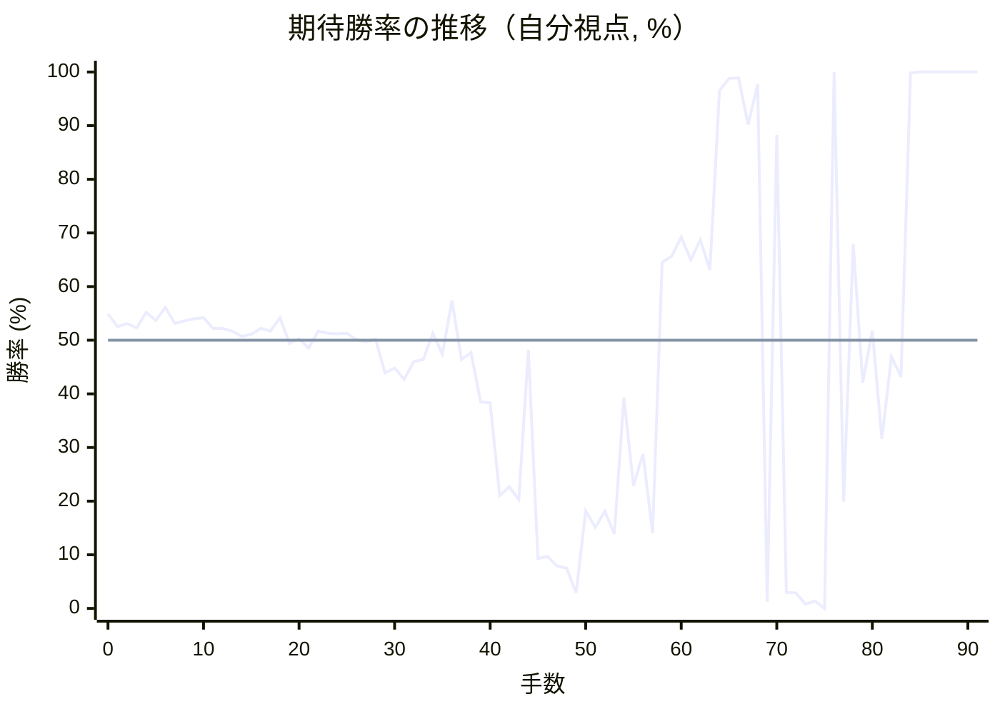
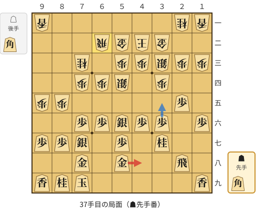
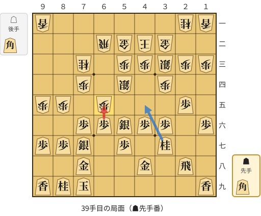
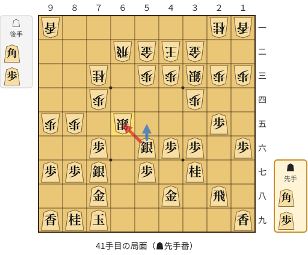
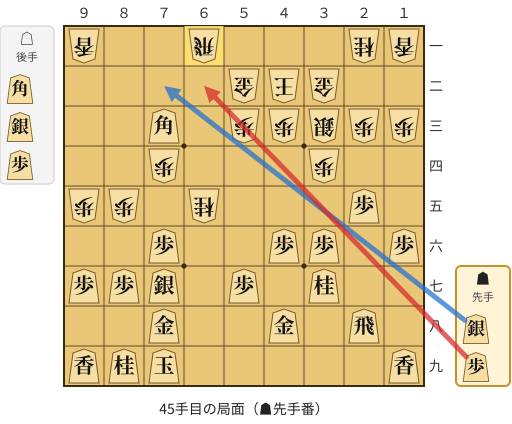
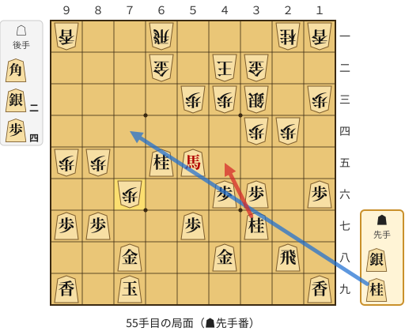
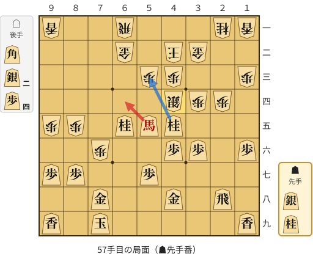
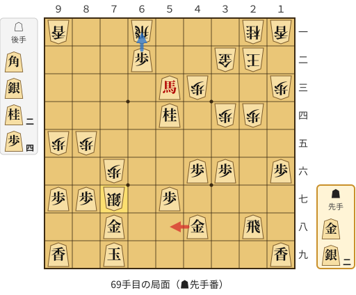
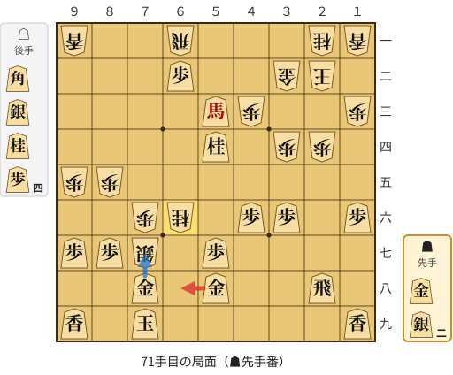
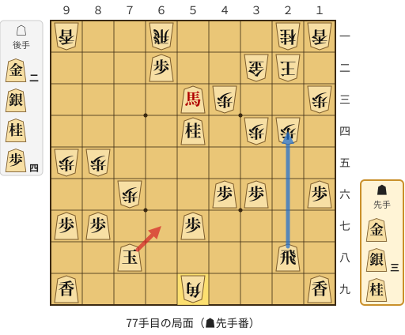

# 解析レポート w23hhrkby71v

[README に戻る](../../../README.md)　/　棋譜: [CSA](../../../data/csa/shogi5/w23hhrkby71v.csa)　/　解析の見方: [docs/mistake_analysis.md](../../../docs/mistake_analysis.md)

## 対局情報

| 項目 | 内容 |
|---|---|
| 日時 | 2026-11-07 13:04:24 |
| 持ち時間 | 5分 |
| 自分 | 先手（▲）（1699） |
| 相手 | 相手（1511） |
| 結果 | 勝ち（投了, 91手） |

## 解析環境

| 項目 | 内容 |
|---|---|
| エンジン | YaneuraOu NNUE 9.00git 64AVX2（V9.00/YANEURAOU_ENGINE_NNUE/AVX2） |
| 評価関数 | **水匠5**（`suisho5`） |
| nn.bin SHA-256 | `768068f0d534a0603a5d38bcd143de6bbca820d5f1c95a14d40863e5b7892d76` |
| 第1パス | movetime=150ms, MultiPV 1 |
| 第2パス | movetime=2000ms, MultiPV 3 |
| Threads / Hash | 8 / 512MB |
| 判定基準 | 疑問手 ≥5pt, 悪手 ≥10pt, 大悪手 ≥20pt（期待勝率 W(E)=1/(1+exp(-E/600))） |
| 解析日時 | 2026-11-11T20:22:09+09:00（解析バージョン 1, 59秒） |

## サマリー

| 自分の手数 | 深掘りした手 | 詰み逃し | 大悪手 | 悪手 | 疑問手 |
|--:|--:|--:|--:|--:|--:|
| 46 | 11 | 1 | 6 | 1 | 1 |

## 期待勝率の推移



<details><summary>1手ごとの数値（第1パス）</summary>

| 手数 | 指し手 | 評価値 | 勝率 | 低下 | 判定 |
|--:|---|--:|--:|--:|---|
| 1 | ▲７六歩(77) | +61 | 52.5% | +2.3pt |  |
| 2 | △８四歩(83) | +75 | 53.1% |  |  |
| 3 | ▲２六歩(27) | +55 | 52.3% | +0.8pt |  |
| 4 | △３二金(41) | +126 | 55.2% |  |  |
| 5 | ▲２五歩(26) | +88 | 53.7% | +1.6pt |  |
| 6 | △８五歩(84) | +148 | 56.1% |  |  |
| 7 | ▲７七角(88) | +75 | 53.1% | +3.0pt |  |
| 8 | △３四歩(33) | +87 | 53.6% |  |  |
| 9 | ▲８八銀(79) | +97 | 54.0% | -0.4pt |  |
| 10 | △７七角成(22) | +100 | 54.2% |  |  |
| 11 | ▲同銀(88) | +54 | 52.2% | +1.9pt |  |
| 12 | △２二銀(31) | +53 | 52.2% |  |  |
| 13 | ▲７八金(69) | +41 | 51.7% | +0.5pt |  |
| 14 | △３三銀(22) | +18 | 50.7% |  |  |
| 15 | ▲４八銀(39) | +26 | 51.1% | -0.3pt |  |
| 16 | △７二銀(71) | +54 | 52.2% |  |  |
| 17 | ▲４六歩(47) | +42 | 51.7% | +0.5pt |  |
| 18 | △６四歩(63) | +101 | 54.2% |  |  |
| 19 | ▲４七銀(48) | -14 | 49.4% | +4.8pt |  |
| 20 | △６三銀(72) | +7 | 50.3% |  |  |
| 21 | ▲５六銀(47) | -36 | 48.5% | +1.8pt |  |
| 22 | △４二玉(51) | +42 | 51.7% |  |  |
| 23 | ▲１六歩(17) | +31 | 51.3% | +0.5pt |  |
| 24 | △７四歩(73) | +28 | 51.2% |  |  |
| 25 | ▲６六歩(67) | +31 | 51.3% | -0.1pt |  |
| 26 | △７三桂(81) | +2 | 50.1% |  |  |
| 27 | ▲６八玉(59) | -8 | 49.7% | +0.4pt |  |
| 28 | △９四歩(93) | +4 | 50.2% |  |  |
| 29 | ▲７九玉(68) | -148 | 43.9% | +6.3pt |  |
| 30 | △９五歩(94) | -126 | 44.8% |  |  |
| 31 | ▲３六歩(37) | -176 | 42.7% | +2.1pt |  |
| 32 | △５四銀(63) | -96 | 46.0% |  |  |
| 33 | ▲３七桂(29) | -87 | 46.4% | -0.4pt |  |
| 34 | △５二金(61) | +32 | 51.3% |  |  |
| 35 | ▲５八金(49) | -62 | 47.4% | +3.9pt |  |
| 36 | △６二飛(82) | +180 | 57.4% |  |  |
| 37 | ▲４八金(58) | -86 | 46.4% | +11.0pt | [悪手](#ply-37) |
| 38 | △６五歩(64) | -56 | 47.7% |  |  |
| 39 | ▲同歩(66) | -281 | 38.5% | +9.2pt | [疑問手](#ply-39) |
| 40 | △同銀(54) | -287 | 38.3% |  |  |
| 41 | ▲同銀(56) | -796 | 21.0% | +17.3pt | [大悪手](#ply-41) |
| 42 | △同桂(73) | -736 | 22.7% |  |  |
| 43 | ▲７三角打 | -820 | 20.3% | +2.4pt |  |
| 44 | △６一飛(62) | -44 | 48.2% |  |  |
| 45 | ▲６二歩打 | -1370 | 9.3% | +38.9pt | [大悪手](#ply-45) |
| 46 | △同金(52) | -1342 | 9.7% |  |  |
| 47 | ▲５五角成(73) | -1472 | 7.9% | +1.7pt |  |
| 48 | △７七桂成(65) | -1505 | 7.5% |  |  |
| 49 | ▲同桂(89) | -2098 | 2.9% | +4.6pt |  |
| 50 | △７五歩(74) | -901 | 18.2% |  |  |
| 51 | ▲２四歩(25) | -1036 | 15.1% | +3.1pt |  |
| 52 | △同歩(23) | -907 | 18.1% |  |  |
| 53 | ▲６五桂(77) | -1096 | 13.9% | +4.2pt |  |
| 54 | △７六歩(75) | -260 | 39.3% |  |  |
| 55 | ▲４五桂(37) | -727 | 22.9% | +16.4pt | [大悪手](#ply-55) |
| 56 | △４四銀(33) | -543 | 28.8% |  |  |
| 57 | ▲６四馬(55) | -1090 | 14.0% | +14.8pt | [大悪手](#ply-57) |
| 58 | △５二金(62) | +358 | 64.5% |  |  |
| 59 | ▲５三桂成(65) | +390 | 65.7% | -1.2pt |  |
| 60 | △同銀(44) | +485 | 69.2% |  |  |
| 61 | ▲同桂成(45) | +371 | 65.0% | +4.2pt |  |
| 62 | △同金(52) | +471 | 68.7% |  |  |
| 63 | ▲５四桂打 | +323 | 63.1% | +5.5pt |  |
| 64 | △３一玉(42) | +1991 | 96.5% |  |  |
| 65 | ▲５三馬(64) | +2646 | 98.8% | -2.3pt |  |
| 66 | △２二玉(31) | +2693 | 98.9% |  |  |
| 67 | ▲６二歩打 | +1332 | 90.2% | +8.7pt |  |
| 68 | △７七銀打 | +2261 | 97.7% |  |  |
| 69 | ▲５八金(48) | -2630 | 1.2% | +96.5pt | [大悪手](#ply-69) |
| 70 | △６六桂打 | +1214 | 88.3% |  |  |
| 71 | ▲６八金(58) | -2088 | 3.0% | +85.3pt | [大悪手](#ply-71) |
| 72 | △７八桂成(66) | -2097 | 2.9% |  |  |
| 73 | ▲同金(68) | -2863 | 0.8% | +2.1pt |  |
| 74 | △同銀成(77) | -2546 | 1.4% |  |  |
| 75 | ▲同玉(79) | -5470 | 0.0% | +1.4pt |  |
| 76 | △５九角打 | +4751 | 100.0% |  |  |
| 77 | ▲６七玉(78) | -835 | 19.9% | +80.0pt | [詰み逃し](#ply-77) |
| 78 | △７七歩成(76) | +450 | 67.9% |  |  |
| 79 | ▲５六玉(67) | -190 | 42.1% | +25.8pt |  |
| 80 | △４四銀打 | +44 | 51.8% |  |  |
| 81 | ▲同馬(53) | -464 | 31.6% | +20.3pt |  |
| 82 | △同歩(43) | -74 | 46.9% |  |  |
| 83 | ▲６一歩成(62) | -163 | 43.2% | +3.7pt |  |
| 84 | △６四金打 | +3710 | 99.8% |  |  |
| 85 | ▲２三銀打 | #+24 | 100.0% | -0.2pt |  |
| 86 | △同金(32) | #+11 | 100.0% |  |  |
| 87 | ▲６二飛打 | #+12 | 100.0% | +0.0pt |  |
| 88 | △３二角打 | #+9 | 100.0% |  |  |
| 89 | ▲３一銀打 | #+8 | 100.0% | +0.0pt |  |
| 90 | △同玉(22) | #+7 | 100.0% |  |  |
| 91 | ▲４二金打 | #+16 | 100.0% | +0.0pt |  |

</details>

## 課題局面

<a id="ply-37"></a>
### 37手目 ▲４八金(58) — 悪手

| | 着手前 | 着手後 | 差 |
|---|--:|--:|--:|
| 期待勝率 | 57.0% | 44.0% | -12.9pt |
| 評価値 | +168 | -144 | |

着手前の局面:



🔴 実戦 ▲４八金(58)　🔵 AI推奨 ▲３五歩(36)　🟨 直前の相手の指し手

<details><summary>テキストの盤面図（BOD・将棋ソフトに貼り付け可）</summary>

```text
後手の持駒：角
  ９ ８ ７ ６ ５ ４ ３ ２ １
+---------------------------+
|v香 ・ ・ ・ ・ ・ ・v桂v香|一
| ・ ・ ・v飛v金v玉v金 ・ ・|二
| ・ ・v桂 ・v歩v歩v銀v歩v歩|三
| ・ ・v歩v歩v銀 ・v歩 ・ ・|四
|v歩v歩 ・ ・ ・ ・ ・ 歩 ・|五
| ・ ・ 歩 歩 銀 歩 歩 ・ 歩|六
| 歩 歩 銀 ・ 歩 ・ 桂 ・ ・|七
| ・ ・ 金 ・ 金 ・ ・ 飛 ・|八
| 香 桂 玉 ・ ・ ・ ・ ・ 香|九
+---------------------------+
先手の持駒：角
手数＝36　△６二飛　まで
```

</details>

| | 指し手 | 評価値 | 読み筋 |
|---|---|--:|---|
| 実戦 | ▲４八金(58) | -144 | △６五歩(64) ▲４五桂(37) △４四銀(33) ▲２四歩(25) △同歩(23) ▲同飛(28) |
| AI 1位 | ▲３五歩(36) | +168 | ▲３五歩(36) △同歩(34) ▲４五桂(37) △４四銀(33) ▲７五歩(76) △同歩(74) |
| AI 2位 | ▲８八玉(79) | +113 | ▲８八玉(79) △８二飛(62) ▲４五桂(37) △２二銀(33) ▲２四歩(25) △３七角打 |
| AI 3位 | ▲１五歩(16) | +96 | ▲１五歩(16) △８二飛(62) ▲３五歩(36) △同歩(34) ▲４五桂(37) △４四銀(33) |

SFEN: `l6nl/3rgkg2/2n1ppspp/2pps1p2/pp5P1/2PPSPP1P/PPS1P1N2/2G1G2R1/LNK5L b Bb 37`

<a id="ply-39"></a>
### 39手目 ▲同歩(66) — 疑問手

| | 着手前 | 着手後 | 差 |
|---|--:|--:|--:|
| 期待勝率 | 43.0% | 37.8% | -5.1pt |
| 評価値 | -170 | -298 | |

着手前の局面:



🔴 実戦 ▲同歩(66)　🔵 AI推奨 ▲４五桂(37)　🟨 直前の相手の指し手

<details><summary>テキストの盤面図（BOD・将棋ソフトに貼り付け可）</summary>

```text
後手の持駒：角
  ９ ８ ７ ６ ５ ４ ３ ２ １
+---------------------------+
|v香 ・ ・ ・ ・ ・ ・v桂v香|一
| ・ ・ ・v飛v金v玉v金 ・ ・|二
| ・ ・v桂 ・v歩v歩v銀v歩v歩|三
| ・ ・v歩 ・v銀 ・v歩 ・ ・|四
|v歩v歩 ・v歩 ・ ・ ・ 歩 ・|五
| ・ ・ 歩 歩 銀 歩 歩 ・ 歩|六
| 歩 歩 銀 ・ 歩 ・ 桂 ・ ・|七
| ・ ・ 金 ・ ・ 金 ・ 飛 ・|八
| 香 桂 玉 ・ ・ ・ ・ ・ 香|九
+---------------------------+
先手の持駒：角
手数＝38　△６五歩　まで
```

</details>

| | 指し手 | 評価値 | 読み筋 |
|---|---|--:|---|
| 実戦 | ▲同歩(66) | -298 | △同銀(54) ▲５五銀(56) △８六歩(85) ▲同歩(87) △８八歩打 ▲同玉(79) |
| AI 1位 | ▲４五桂(37) | -170 | ▲４五桂(37) △４四銀(33) ▲２四歩(25) △同歩(23) ▲７五歩(76) △同歩(74) |
| AI 2位 | ▲８四角打 | -240 | ▲８四角打 △６三金(52) ▲６五歩(66) △７五歩(74) ▲６四歩(65) △７四金(63) |
| AI 3位 | ▲２四歩(25) | -277 | ▲２四歩(25) △同銀(33) ▲２九飛(28) △６六歩(65) ▲８四角打 △６四角打 |

SFEN: `l6nl/3rgkg2/2n1ppspp/2p1s1p2/pp1p3P1/2PPSPP1P/PPS1P1N2/2G2G1R1/LNK5L b Bb 39`

<a id="ply-41"></a>
### 41手目 ▲同銀(56) — 大悪手

| | 着手前 | 着手後 | 差 |
|---|--:|--:|--:|
| 期待勝率 | 39.1% | 18.7% | -20.4pt |
| 評価値 | -267 | -883 | |

着手前の局面:



🔴 実戦 ▲同銀(56)　🔵 AI推奨 ▲５五銀(56)　🟨 直前の相手の指し手

<details><summary>テキストの盤面図（BOD・将棋ソフトに貼り付け可）</summary>

```text
後手の持駒：角　歩
  ９ ８ ７ ６ ５ ４ ３ ２ １
+---------------------------+
|v香 ・ ・ ・ ・ ・ ・v桂v香|一
| ・ ・ ・v飛v金v玉v金 ・ ・|二
| ・ ・v桂 ・v歩v歩v銀v歩v歩|三
| ・ ・v歩 ・ ・ ・v歩 ・ ・|四
|v歩v歩 ・v銀 ・ ・ ・ 歩 ・|五
| ・ ・ 歩 ・ 銀 歩 歩 ・ 歩|六
| 歩 歩 銀 ・ 歩 ・ 桂 ・ ・|七
| ・ ・ 金 ・ ・ 金 ・ 飛 ・|八
| 香 桂 玉 ・ ・ ・ ・ ・ 香|九
+---------------------------+
先手の持駒：角　歩
手数＝40　△６五同銀　まで
```

</details>

| | 指し手 | 評価値 | 読み筋 |
|---|---|--:|---|
| 実戦 | ▲同銀(56) | -883 | △同桂(73) ▲７三角打 △７七桂成(65) ▲同桂(89) △８八銀打 ▲同金(78) |
| AI 1位 | ▲５五銀(56) | -267 | ▲５五銀(56) △８六歩(85) ▲同歩(87) △８八歩打 ▲同玉(79) △７五歩(74) |
| AI 2位 | ▲６七銀(56) | -414 | ▲６七銀(56) △６六歩打 ▲５八銀(67) △４四歩(43) ▲４七金(48) △５四角打 |
| AI 3位 | ▲８四角打 | -463 | ▲８四角打 △５六銀(65) ▲７三角成(84) △６七銀打 ▲６二馬(73) △７八銀成(67) |

SFEN: `l6nl/3rgkg2/2n1ppspp/2p3p2/pp1s3P1/2P1SPP1P/PPS1P1N2/2G2G1R1/LNK5L b BPbp 41`

<a id="ply-45"></a>
### 45手目 ▲６二歩打 — 大悪手

| | 着手前 | 着手後 | 差 |
|---|--:|--:|--:|
| 期待勝率 | 42.9% | 8.3% | -34.6pt |
| 評価値 | -171 | -1438 | |

着手前の局面:



🔴 実戦 ▲６二歩打　🔵 AI推奨 ▲７二銀打　🟨 直前の相手の指し手

<details><summary>テキストの盤面図（BOD・将棋ソフトに貼り付け可）</summary>

```text
後手の持駒：角　銀　歩
  ９ ８ ７ ６ ５ ４ ３ ２ １
+---------------------------+
|v香 ・ ・v飛 ・ ・ ・v桂v香|一
| ・ ・ ・ ・v金v玉v金 ・ ・|二
| ・ ・ 角 ・v歩v歩v銀v歩v歩|三
| ・ ・v歩 ・ ・ ・v歩 ・ ・|四
|v歩v歩 ・v桂 ・ ・ ・ 歩 ・|五
| ・ ・ 歩 ・ ・ 歩 歩 ・ 歩|六
| 歩 歩 銀 ・ 歩 ・ 桂 ・ ・|七
| ・ ・ 金 ・ ・ 金 ・ 飛 ・|八
| 香 桂 玉 ・ ・ ・ ・ ・ 香|九
+---------------------------+
先手の持駒：銀　歩
手数＝44　△６一飛　まで
```

</details>

| | 指し手 | 評価値 | 読み筋 |
|---|---|--:|---|
| 実戦 | ▲６二歩打 | -1438 | △同金(52) ▲６四角成(73) △３九銀打 ▲１八飛(28) △４八銀不成(39) ▲６五馬(64) |
| AI 1位 | ▲７二銀打 | -171 | ▲７二銀打 △６二飛(61) ▲同角成(73) △同金(52) ▲８一飛打 △８六歩(85) |
| AI 2位 | ▲２九飛(28) | -585 | ▲２九飛(28) △７七桂成(65) ▲同桂(89) △６七歩打 ▲６四桂打 △６二金(52) |
| AI 3位 | ▲６八銀(77) | -737 | ▲６八銀(77) △３九銀打 ▲１八飛(28) △４八銀成(39) ▲同飛(18) △８六歩(85) |

SFEN: `l2r3nl/4gkg2/2B1ppspp/2p3p2/pp1n3P1/2P2PP1P/PPS1P1N2/2G2G1R1/LNK5L b SPbsp 45`

<a id="ply-55"></a>
### 55手目 ▲４五桂(37) — 大悪手

| | 着手前 | 着手後 | 差 |
|---|--:|--:|--:|
| 期待勝率 | 38.8% | 17.8% | -21.0pt |
| 評価値 | -274 | -917 | |

着手前の局面:



🔴 実戦 ▲４五桂(37)　🔵 AI推奨 ▲７四桂打　🟨 直前の相手の指し手

<details><summary>テキストの盤面図（BOD・将棋ソフトに貼り付け可）</summary>

```text
後手の持駒：角　銀二　歩四
  ９ ８ ７ ６ ５ ４ ３ ２ １
+---------------------------+
|v香 ・ ・v飛 ・ ・ ・v桂v香|一
| ・ ・ ・v金 ・v玉v金 ・ ・|二
| ・ ・ ・ ・v歩v歩v銀 ・v歩|三
| ・ ・ ・ ・ ・ ・v歩v歩 ・|四
|v歩v歩 ・ 桂 馬 ・ ・ ・ ・|五
| ・ ・v歩 ・ ・ 歩 歩 ・ 歩|六
| 歩 歩 ・ ・ 歩 ・ 桂 ・ ・|七
| ・ ・ 金 ・ ・ 金 ・ 飛 ・|八
| 香 ・ 玉 ・ ・ ・ ・ ・ 香|九
+---------------------------+
先手の持駒：銀　桂
手数＝54　△７六歩　まで
```

</details>

| | 指し手 | 評価値 | 読み筋 |
|---|---|--:|---|
| 実戦 | ▲４五桂(37) | -917 | △７七銀打 ▲同金(78) △同歩成(76) ▲同馬(55) △４四角打 ▲６六歩打 |
| AI 1位 | ▲７四桂打 | -274 | ▲７四桂打 △４四銀(33) ▲６二桂成(74) △同飛(61) ▲２四飛(28) △２三歩打 |
| AI 2位 | ▲４五桂(37) | -794 | ▲４五桂(37) △７七銀打 ▲同金(78) △同歩成(76) ▲同馬(55) △４四角打 |
| AI 3位 | ▲４五桂打 | -1066 | ▲４五桂打 △７七銀打 ▲同金(78) △同歩成(76) ▲同馬(55) △４四角打 |

SFEN: `l2r3nl/3g1kg2/4pps1p/6pp1/pp1N+B4/2p2PP1P/PP2P1N2/2G2G1R1/L1K5L b SNb2s4p 55`

<a id="ply-57"></a>
### 57手目 ▲６四馬(55) — 大悪手

| | 着手前 | 着手後 | 差 |
|---|--:|--:|--:|
| 期待勝率 | 36.9% | 6.3% | -30.5pt |
| 評価値 | -323 | -1618 | |

着手前の局面:



🔴 実戦 ▲６四馬(55)　🔵 AI推奨 ▲５三桂成(45)　🟨 直前の相手の指し手

<details><summary>テキストの盤面図（BOD・将棋ソフトに貼り付け可）</summary>

```text
後手の持駒：角　銀二　歩四
  ９ ８ ７ ６ ５ ４ ３ ２ １
+---------------------------+
|v香 ・ ・v飛 ・ ・ ・v桂v香|一
| ・ ・ ・v金 ・v玉v金 ・ ・|二
| ・ ・ ・ ・v歩v歩 ・ ・v歩|三
| ・ ・ ・ ・ ・v銀v歩v歩 ・|四
|v歩v歩 ・ 桂 馬 桂 ・ ・ ・|五
| ・ ・v歩 ・ ・ 歩 歩 ・ 歩|六
| 歩 歩 ・ ・ 歩 ・ ・ ・ ・|七
| ・ ・ 金 ・ ・ 金 ・ 飛 ・|八
| 香 ・ 玉 ・ ・ ・ ・ ・ 香|九
+---------------------------+
先手の持駒：銀　桂
手数＝56　△４四銀　まで
```

</details>

| | 指し手 | 評価値 | 読み筋 |
|---|---|--:|---|
| 実戦 | ▲６四馬(55) | -1618 | △７七銀打 ▲２四飛(28) △４五銀(44) ▲同歩(46) △７八銀不成(77) ▲同玉(79) |
| AI 1位 | ▲５三桂成(45) | -323 | ▲５三桂成(45) △同銀(44) ▲同桂成(65) △同金(62) ▲４五桂打 △５二歩打 |
| AI 2位 | ▲５三桂不成(65) | -368 | ▲５三桂不成(65) △同金(62) ▲同桂成(45) △同銀(44) ▲４五桂打 △５二歩打 |
| AI 3位 | ▲５三桂成(65) | -395 | ▲５三桂成(65) △同金(62) ▲同桂成(45) △同銀(44) ▲４五桂打 △４四銀(53) |

SFEN: `l2r3nl/3g1kg2/4pp2p/5spp1/pp1N+BN3/2p2PP1P/PP2P4/2G2G1R1/L1K5L b SNb2s4p 57`

<a id="ply-69"></a>
### 69手目 ▲５八金(48) — 大悪手

| | 着手前 | 着手後 | 差 |
|---|--:|--:|--:|
| 期待勝率 | 98.6% | 11.6% | -87.1pt |
| 評価値 | +2565 | -1221 | |

着手前の局面:



🔴 実戦 ▲５八金(48)　🔵 AI推奨 ▲６一歩成(62)　🟨 直前の相手の指し手

<details><summary>テキストの盤面図（BOD・将棋ソフトに貼り付け可）</summary>

```text
後手の持駒：角　銀　桂二　歩四
  ９ ８ ７ ６ ５ ４ ３ ２ １
+---------------------------+
|v香 ・ ・v飛 ・ ・ ・v桂v香|一
| ・ ・ ・ 歩 ・ ・v金v玉 ・|二
| ・ ・ ・ ・ 馬v歩 ・ ・v歩|三
| ・ ・ ・ ・ 桂 ・v歩v歩 ・|四
|v歩v歩 ・ ・ ・ ・ ・ ・ ・|五
| ・ ・v歩 ・ ・ 歩 歩 ・ 歩|六
| 歩 歩v銀 ・ 歩 ・ ・ ・ ・|七
| ・ ・ 金 ・ ・ 金 ・ 飛 ・|八
| 香 ・ 玉 ・ ・ ・ ・ ・ 香|九
+---------------------------+
先手の持駒：金　銀二
手数＝68　△７七銀　まで
```

</details>

| | 指し手 | 評価値 | 読み筋 |
|---|---|--:|---|
| 実戦 | ▲５八金(48) | -1221 | △７八銀不成(77) ▲同玉(79) △７七銀打 ▲６九玉(78) △７八金打 ▲５九玉(69) |
| AI 1位 | ▲６一歩成(62) | +2565 | ▲６一歩成(62) △３三角打 ▲６九玉(79) △６六桂打 ▲５九玉(69) △７八銀不成(77) |
| AI 2位 | ▲同金(78) | +1984 | ▲同金(78) △６八銀打 ▲同玉(79) △７七歩成(76) ▲５八玉(68) △５一飛(61) |
| AI 3位 | ▲２四飛(28) | +1482 | ▲２四飛(28) △２三歩打 ▲６一歩成(62) △８八角打 ▲６九玉(79) △７八銀不成(77) |

SFEN: `l2r3nl/3P2gk1/4+Bp2p/4N1pp1/pp7/2p2PP1P/PPs1P4/2G2G1R1/L1K5L b G2Sbs2n4p 69`

<a id="ply-71"></a>
### 71手目 ▲６八金(58) — 大悪手

| | 着手前 | 着手後 | 差 |
|---|--:|--:|--:|
| 期待勝率 | 97.0% | 0.1% | -96.9pt |
| 評価値 | +2094 | -3960 | |

着手前の局面:



🔴 実戦 ▲６八金(58)　🔵 AI推奨 ▲７七金(78)　🟨 直前の相手の指し手

<details><summary>テキストの盤面図（BOD・将棋ソフトに貼り付け可）</summary>

```text
後手の持駒：角　銀　桂　歩四
  ９ ８ ７ ６ ５ ４ ３ ２ １
+---------------------------+
|v香 ・ ・v飛 ・ ・ ・v桂v香|一
| ・ ・ ・ 歩 ・ ・v金v玉 ・|二
| ・ ・ ・ ・ 馬v歩 ・ ・v歩|三
| ・ ・ ・ ・ 桂 ・v歩v歩 ・|四
|v歩v歩 ・ ・ ・ ・ ・ ・ ・|五
| ・ ・v歩v桂 ・ 歩 歩 ・ 歩|六
| 歩 歩v銀 ・ 歩 ・ ・ ・ ・|七
| ・ ・ 金 ・ 金 ・ ・ 飛 ・|八
| 香 ・ 玉 ・ ・ ・ ・ ・ 香|九
+---------------------------+
先手の持駒：金　銀二
手数＝70　△６六桂　まで
```

</details>

| | 指し手 | 評価値 | 読み筋 |
|---|---|--:|---|
| 実戦 | ▲６八金(58) | -3960 | △７八桂成(66) ▲同金(68) △同銀成(77) ▲同飛(28) △６七桂打 ▲６八玉(79) |
| AI 1位 | ▲７七金(78) | +2094 | ▲７七金(78) △７八銀打 ▲同金(77) △３三角打 ▲６八金(58) △７八桂成(66) |
| AI 2位 | ▲３一銀打 | -365 | ▲３一銀打 △同飛(61) ▲７七金(78) △３七角打 ▲４二桂成(54) △２八角成(37) |
| AI 3位 | ▲２四飛(28) | -1720 | ▲２四飛(28) △２三歩打 ▲７七金(78) △２四歩(23) ▲２三歩打 △同玉(22) |

SFEN: `l2r3nl/3P2gk1/4+Bp2p/4N1pp1/pp7/2pn1PP1P/PPs1P4/2G1G2R1/L1K5L b G2Sbsn4p 71`

<a id="ply-77"></a>
### 77手目 ▲６七玉(78) — 詰み逃し

| | 着手前 | 着手後 | 差 |
|---|--:|--:|--:|
| 期待勝率 | 100.0% | 22.0% | -78.0pt |
| 評価値 | 27手詰め | -758 | |

着手前の局面:



🔴 実戦 ▲６七玉(78)　🔵 AI推奨 ▲２四飛(28)　🟨 直前の相手の指し手

<details><summary>テキストの盤面図（BOD・将棋ソフトに貼り付け可）</summary>

```text
後手の持駒：金二　銀　桂　歩四
  ９ ８ ７ ６ ５ ４ ３ ２ １
+---------------------------+
|v香 ・ ・v飛 ・ ・ ・v桂v香|一
| ・ ・ ・ 歩 ・ ・v金v玉 ・|二
| ・ ・ ・ ・ 馬v歩 ・ ・v歩|三
| ・ ・ ・ ・ 桂 ・v歩v歩 ・|四
|v歩v歩 ・ ・ ・ ・ ・ ・ ・|五
| ・ ・v歩 ・ ・ 歩 歩 ・ 歩|六
| 歩 歩 ・ ・ 歩 ・ ・ ・ ・|七
| ・ ・ 玉 ・ ・ ・ ・ 飛 ・|八
| 香 ・ ・ ・v角 ・ ・ ・ 香|九
+---------------------------+
先手の持駒：金　銀三　桂
手数＝76　△５九角　まで
```

</details>

| | 指し手 | 評価値 | 読み筋 |
|---|---|--:|---|
| 実戦 | ▲６七玉(78) | -758 | △７七角成(59) ▲５六玉(67) △６七銀打 ▲６五玉(56) △７一飛(61) ▲６六桂打 |
| AI 1位 | ▲２四飛(28) | 27手詰め | ▲２四飛(28) △２三桂打 ▲同飛成(24) △同玉(22) ▲２四歩打 △１四玉(23) |
| AI 2位 | ▲３一銀打 | 29手詰め | ▲３一銀打 △同飛(61) ▲２三銀打 △同金(32) ▲３一馬(53) △１二玉(22) |
| AI 3位 | ▲２三銀打 | 29手詰め | ▲２三銀打 △同金(32) ▲３一銀打 △同飛(61) ▲同馬(53) △１二玉(22) |

SFEN: `l2r3nl/3P2gk1/4+Bp2p/4N1pp1/pp7/2p2PP1P/PP2P4/2K4R1/L3b3L b G3SN2gsn4p 77`

