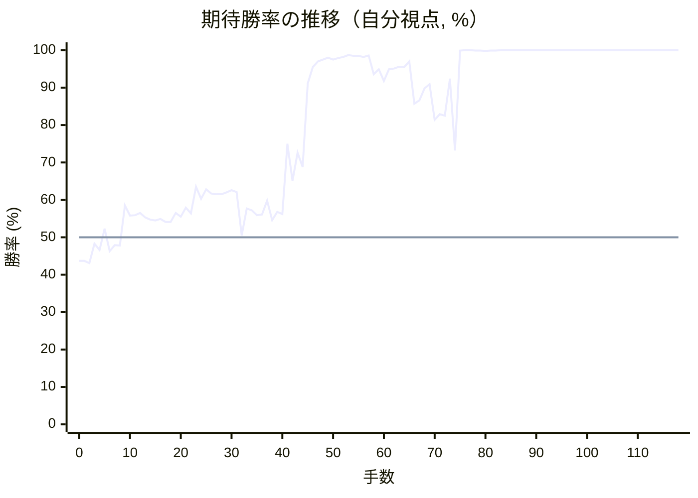
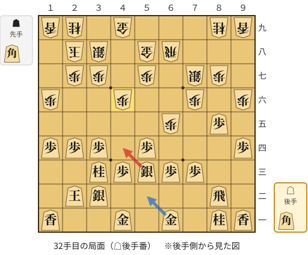
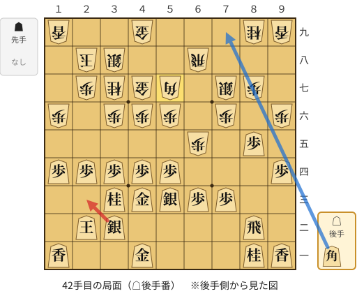
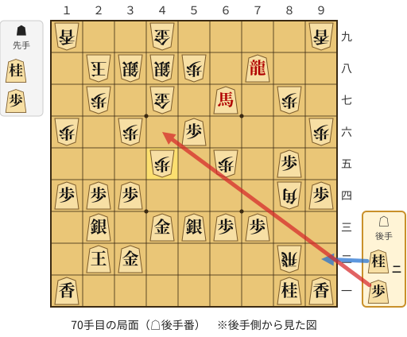
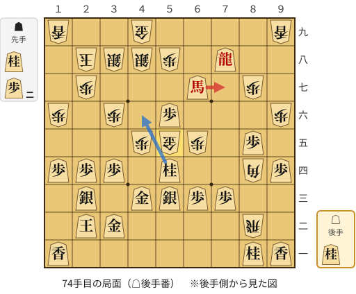
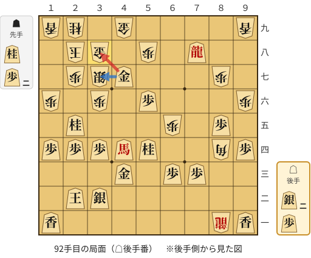
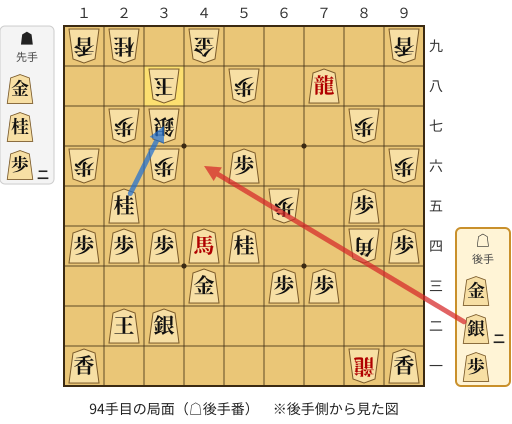
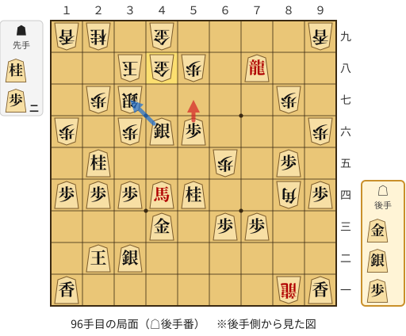

# 解析レポート w5hd44n9v4jh

[README に戻る](../../../README.md)　/　棋譜: [CSA](../../../data/csa/shogi5/w5hd44n9v4jh.csa)　/　解析の見方: [docs/mistake_analysis.md](../../../docs/mistake_analysis.md)

## 対局情報

| 項目 | 内容 |
|---|---|
| 日時 | 2026-10-29 19:39:39 |
| 持ち時間 | 5分 |
| 自分 | 後手（△）（1732） |
| 相手 | 相手（1805） |
| 結果 | 勝ち（詰み, 118手） |

## 解析環境

| 項目 | 内容 |
|---|---|
| エンジン | YaneuraOu NNUE 9.00git 64AVX2（V9.00/YANEURAOU_ENGINE_NNUE/AVX2） |
| 評価関数 | **水匠5**（`suisho5`） |
| nn.bin SHA-256 | `768068f0d534a0603a5d38bcd143de6bbca820d5f1c95a14d40863e5b7892d76` |
| 第1パス | movetime=150ms, MultiPV 1 |
| 第2パス | movetime=2000ms, MultiPV 3 |
| Threads / Hash | 8 / 512MB |
| 判定基準 | 疑問手 ≥5pt, 悪手 ≥10pt, 大悪手 ≥20pt（期待勝率 W(E)=1/(1+exp(-E/600))） |
| 解析日時 | 2026-11-03T04:18:25+09:00（解析バージョン 1, 57秒） |

## サマリー

| 自分の手数 | 深掘りした手 | 詰み逃し | 大悪手 | 悪手 | 疑問手 |
|--:|--:|--:|--:|--:|--:|
| 59 | 10 | 3 | 0 | 2 | 2 |

## 期待勝率の推移



<details><summary>1手ごとの数値（第1パス）</summary>

| 手数 | 指し手 | 評価値 | 勝率 | 低下 | 判定 |
|--:|---|--:|--:|--:|---|
| 1 | ▲７六歩(77) | -151 | 43.7% |  |  |
| 2 | △８四歩(83) | -167 | 43.1% | +0.7pt |  |
| 3 | ▲６六歩(67) | -40 | 48.3% |  |  |
| 4 | △３四歩(33) | -82 | 46.6% | +1.7pt |  |
| 5 | ▲７七角(88) | +56 | 52.3% |  |  |
| 6 | △８五歩(84) | -88 | 46.3% | +6.0pt |  |
| 7 | ▲７八銀(79) | -51 | 47.9% |  |  |
| 8 | △６二銀(71) | -53 | 47.8% | +0.1pt |  |
| 9 | ▲６八飛(28) | +205 | 58.5% |  |  |
| 10 | △４二玉(51) | +140 | 55.8% | +2.7pt |  |
| 11 | ▲１六歩(17) | +143 | 55.9% |  |  |
| 12 | △１四歩(13) | +157 | 56.5% | -0.6pt |  |
| 13 | ▲３八銀(39) | +127 | 55.3% |  |  |
| 14 | △５四歩(53) | +113 | 54.7% | +0.6pt |  |
| 15 | ▲４八玉(59) | +108 | 54.5% |  |  |
| 16 | △５三銀(62) | +118 | 54.9% | -0.4pt |  |
| 17 | ▲３九玉(48) | +98 | 54.1% |  |  |
| 18 | △３二玉(42) | +98 | 54.1% | +0.0pt |  |
| 19 | ▲２八玉(39) | +157 | 56.5% |  |  |
| 20 | △２四歩(23) | +133 | 55.5% | +1.0pt |  |
| 21 | ▲９六歩(97) | +191 | 57.9% |  |  |
| 22 | △２三玉(32) | +155 | 56.4% | +1.5pt |  |
| 23 | ▲６五歩(66) | +333 | 63.5% |  |  |
| 24 | △３二銀(31) | +250 | 60.3% | +3.3pt |  |
| 25 | ▲２二角成(77) | +314 | 62.8% |  |  |
| 26 | △同玉(23) | +286 | 61.7% | +1.1pt |  |
| 27 | ▲７七銀(78) | +280 | 61.5% |  |  |
| 28 | △３三桂(21) | +281 | 61.5% | -0.0pt |  |
| 29 | ▲５八金(69) | +295 | 62.0% |  |  |
| 30 | △９四歩(93) | +310 | 62.6% | -0.6pt |  |
| 31 | ▲４六歩(47) | +297 | 62.1% |  |  |
| 32 | △４四銀(53) | +12 | 50.5% | +11.6pt | [疑問手](#ply-32) |
| 33 | ▲４七金(58) | +186 | 57.7% |  |  |
| 34 | △５三銀(44) | +173 | 57.2% | +0.5pt |  |
| 35 | ▲３六歩(37) | +143 | 55.9% |  |  |
| 36 | △５二金(61) | +146 | 56.1% | -0.1pt |  |
| 37 | ▲３七桂(29) | +238 | 59.8% |  |  |
| 38 | △４四歩(43) | +110 | 54.6% | +5.2pt |  |
| 39 | ▲５六歩(57) | +165 | 56.8% |  |  |
| 40 | △４三金(52) | +150 | 56.2% | +0.6pt |  |
| 41 | ▲５七角打 | +660 | 75.0% |  |  |
| 42 | △２三銀(32) | +375 | 65.1% | +9.9pt | [悪手](#ply-42) |
| 43 | ▲７五歩(76) | +584 | 72.6% |  |  |
| 44 | △３二金(41) | +474 | 68.8% | +3.8pt |  |
| 45 | ▲６六飛(68) | +1393 | 91.1% |  |  |
| 46 | △７八角打 | +1830 | 95.5% | -4.4pt |  |
| 47 | ▲７六飛(66) | +2084 | 97.0% |  |  |
| 48 | △８九角成(78) | +2204 | 97.5% | -0.5pt |  |
| 49 | ▲７四歩(75) | +2348 | 98.0% |  |  |
| 50 | △同歩(73) | +2204 | 97.5% | +0.5pt |  |
| 51 | ▲同飛(76) | +2313 | 97.9% |  |  |
| 52 | △７三歩打 | +2396 | 98.2% | -0.3pt |  |
| 53 | ▲８四飛(74) | +2591 | 98.7% |  |  |
| 54 | △同飛(82) | +2523 | 98.5% | +0.2pt |  |
| 55 | ▲同角(57) | +2526 | 98.5% |  |  |
| 56 | △６七馬(89) | +2384 | 98.2% | +0.4pt |  |
| 57 | ▲６六銀(77) | +2571 | 98.6% |  |  |
| 58 | △６八飛打 | +1614 | 93.6% | +5.0pt |  |
| 59 | ▲５七銀(66) | +1757 | 94.9% |  |  |
| 60 | △７八飛成(68) | +1446 | 91.8% | +3.2pt |  |
| 61 | ▲４八銀(57) | +1755 | 94.9% |  |  |
| 62 | △５五歩(54) | +1776 | 95.1% | -0.2pt |  |
| 63 | ▲８二飛打 | +1851 | 95.6% |  |  |
| 64 | △５六歩(55) | +1836 | 95.5% | +0.1pt |  |
| 65 | ▲５八歩打 | +2094 | 97.0% |  |  |
| 66 | △４五歩(44) | +1073 | 85.7% | +11.4pt |  |
| 67 | ▲同桂(37) | +1122 | 86.6% |  |  |
| 68 | △同桂(33) | +1307 | 89.8% | -3.2pt |  |
| 69 | ▲同歩(46) | +1383 | 90.9% |  |  |
| 70 | △４六歩打 | +884 | 81.4% | +9.6pt | [疑問手](#ply-70) |
| 71 | ▲同金(47) | +948 | 82.9% |  |  |
| 72 | △５四桂打 | +932 | 82.5% | +0.4pt |  |
| 73 | ▲５五金(46) | +1495 | 92.4% |  |  |
| 74 | △７七馬(67) | +603 | 73.2% | +19.2pt | [悪手](#ply-74) |
| 75 | ▲４四桂打 | +4211 | 99.9% |  |  |
| 76 | △５五馬(77) | +4644 | 100.0% | -0.0pt |  |
| 77 | ▲３七銀(48) | +4660 | 100.0% |  |  |
| 78 | △４四銀(53) | +4285 | 99.9% | +0.0pt |  |
| 79 | ▲同歩(45) | +4414 | 99.9% |  |  |
| 80 | △同馬(55) | +3792 | 99.8% | +0.1pt |  |
| 81 | ▲８一飛成(82) | +4268 | 99.9% |  |  |
| 82 | △４五桂打 | +4130 | 99.9% | +0.0pt |  |
| 83 | ▲４一銀打 | +4670 | 100.0% |  |  |
| 84 | △３七桂成(45) | +4741 | 100.0% | -0.0pt |  |
| 85 | ▲同銀(38) | +4758 | 100.0% |  |  |
| 86 | △２五桂打 | +5040 | 100.0% | -0.0pt |  |
| 87 | ▲３二銀成(41) | +5956 | 100.0% |  |  |
| 88 | △同銀(23) | +6204 | 100.0% | -0.0pt |  |
| 89 | ▲２九桂打 | #+19 | 100.0% |  |  |
| 90 | △４七金打 | +6315 | 100.0% | +0.0pt |  |
| 91 | ▲３八金打 | #+17 | 100.0% |  |  |
| 92 | △同金(47) | +5471 | 100.0% | +0.0pt | [詰み逃し](#ply-92) |
| 93 | ▲同玉(28) | #+15 | 100.0% |  |  |
| 94 | △４六銀打 | +7185 | 100.0% | +0.0pt | [詰み逃し](#ply-94) |
| 95 | ▲４八金打 | #+17 | 100.0% |  |  |
| 96 | △５七歩成(56) | +6276 | 100.0% | +0.0pt | [詰み逃し](#ply-96) |
| 97 | ▲同角(84) | +6242 | 100.0% |  |  |
| 98 | △同銀成(46) | +6168 | 100.0% | +0.0pt |  |
| 99 | ▲同金(48) | +6105 | 100.0% |  |  |
| 100 | △５六歩打 | +5202 | 100.0% | +0.0pt |  |
| 101 | ▲４七金(57) | +5626 | 100.0% |  |  |
| 102 | △３七桂成(25) | +6071 | 100.0% | -0.0pt |  |
| 103 | ▲同桂(29) | +6381 | 100.0% |  |  |
| 104 | △４六銀打 | +6611 | 100.0% | -0.0pt |  |
| 105 | ▲４八歩打 | +6671 | 100.0% |  |  |
| 106 | △４七銀成(46) | +6331 | 100.0% | +0.0pt |  |
| 107 | ▲同歩(48) | +6486 | 100.0% |  |  |
| 108 | △５七歩成(56) | +6443 | 100.0% | +0.0pt |  |
| 109 | ▲５九銀打 | #+11 | 100.0% |  |  |
| 110 | △４七と(57) | #+10 | 100.0% | +0.0pt |  |
| 111 | ▲同玉(38) | #+5 | 100.0% |  |  |
| 112 | △４六歩打 | #+10 | 100.0% | +0.0pt |  |
| 113 | ▲３八玉(47) | #+7 | 100.0% |  |  |
| 114 | △５六角打 | #+6 | 100.0% | +0.0pt |  |
| 115 | ▲２八玉(38) | #+3 | 100.0% |  |  |
| 116 | △２九金打 | #+2 | 100.0% | +0.0pt |  |
| 117 | ▲１八玉(28) | #+1 | 100.0% |  |  |
| 118 | △２八金打 | #+ | 100.0% | +0.0pt |  |

</details>

## 課題局面

<a id="ply-32"></a>
### 32手目 △４四銀(53) — 疑問手

| | 着手前 | 着手後 | 差 |
|---|--:|--:|--:|
| 期待勝率 | 61.3% | 51.7% | -9.6pt |
| 評価値 | +276 | +40 | |

着手前の局面:



🔴 実戦 △４四銀(53)　🔵 AI推奨 △５二金(61)　🟨 直前の相手の指し手

<details><summary>テキストの盤面図（BOD・将棋ソフトに貼り付け可）</summary>

```text
後手の持駒：角
  ９ ８ ７ ６ ５ ４ ３ ２ １
+---------------------------+
|v香v桂 ・v金 ・v金 ・ ・v香|一
| ・v飛 ・ ・ ・ ・v銀v玉 ・|二
| ・ ・v歩v歩v銀v歩v桂 ・ ・|三
|v歩 ・ ・ ・v歩 ・v歩v歩v歩|四
| ・v歩 ・ 歩 ・ ・ ・ ・ ・|五
| 歩 ・ 歩 ・ ・ 歩 ・ ・ 歩|六
| ・ 歩 銀 ・ 歩 ・ 歩 歩 ・|七
| ・ ・ ・ 飛 金 ・ 銀 玉 ・|八
| 香 桂 ・ ・ ・ 金 ・ 桂 香|九
+---------------------------+
先手の持駒：角
後手番
手数＝31　▲４六歩　まで
```

</details>

| | 指し手 | 評価値 | 読み筋 |
|---|---|--:|---|
| 実戦 | △４四銀(53) | +40 | ▲６四歩(65) △同歩(63) ▲同飛(68) △６二歩打 ▲６三歩打 △５三銀(44) |
| AI 1位 | △５二金(61) | +276 | △５二金(61) ▲３六歩(37) △４四歩(43) ▲７五歩(76) △５五歩(54) ▲４七金(58) |
| AI 2位 | △４四歩(43) | +293 | △４四歩(43) ▲４七金(58) △５二金(61) ▲３六歩(37) △５五歩(54) ▲７五歩(76) |
| AI 3位 | △７四歩(73) | +245 | △７四歩(73) ▲４七金(58) △２三銀(32) ▲３六歩(37) △５二金(61) ▲３七桂(29) |

SFEN: `ln1g1g2l/1r4sk1/2ppspn2/p3p1ppp/1p1P5/P1P2P2P/1PS1P1PP1/3RG1SK1/LN3G1NL w Bb 32`

<a id="ply-42"></a>
### 42手目 △２三銀(32) — 悪手

| | 着手前 | 着手後 | 差 |
|---|--:|--:|--:|
| 期待勝率 | 80.1% | 67.8% | -12.3pt |
| 評価値 | +837 | +447 | |

着手前の局面:



🔴 実戦 △２三銀(32)　🔵 AI推奨 △７九角打　🟨 直前の相手の指し手

<details><summary>テキストの盤面図（BOD・将棋ソフトに貼り付け可）</summary>

```text
後手の持駒：角
  ９ ８ ７ ６ ５ ４ ３ ２ １
+---------------------------+
|v香v桂 ・ ・ ・v金 ・ ・v香|一
| ・v飛 ・ ・ ・ ・v銀v玉 ・|二
| ・ ・v歩v歩v銀v金v桂 ・ ・|三
|v歩 ・ ・ ・v歩v歩v歩v歩v歩|四
| ・v歩 ・ 歩 ・ ・ ・ ・ ・|五
| 歩 ・ 歩 ・ 歩 歩 歩 ・ 歩|六
| ・ 歩 銀 ・ 角 金 桂 歩 ・|七
| ・ ・ ・ 飛 ・ ・ 銀 玉 ・|八
| 香 桂 ・ ・ ・ 金 ・ ・ 香|九
+---------------------------+
先手の持駒：なし
後手番
手数＝41　▲５七角　まで
```

</details>

| | 指し手 | 評価値 | 読み筋 |
|---|---|--:|---|
| 実戦 | △２三銀(32) | +447 | ▲４八角(57) △２五桂(33) |
| AI 1位 | △７九角打 | +837 | △７九角打 ▲２六歩(27) △６八角成(79) ▲同角(57) △２三銀(32) ▲６六角打 |
| AI 2位 | △２三銀(32) | +421 | △２三銀(32) ▲３九角(57) △２五桂(33) ▲同桂(37) △同歩(24) ▲３七銀(38) |
| AI 3位 | △７四歩(73) | +377 | △７四歩(73) ▲３九角(57) △２五桂(33) ▲同桂(37) △同歩(24) ▲３七桂打 |

SFEN: `ln3g2l/1r4sk1/2ppsgn2/p3ppppp/1p1P5/P1P1PPP1P/1PS1BGNP1/3R2SK1/LN3G2L w b 42`

<a id="ply-70"></a>
### 70手目 △４六歩打 — 疑問手

| | 着手前 | 着手後 | 差 |
|---|--:|--:|--:|
| 期待勝率 | 93.8% | 83.8% | -10.0pt |
| 評価値 | +1634 | +988 | |

着手前の局面:



🔴 実戦 △４六歩打　🔵 AI推奨 △９二桂打　🟨 直前の相手の指し手

<details><summary>テキストの盤面図（BOD・将棋ソフトに貼り付け可）</summary>

```text
後手の持駒：桂二　歩
  ９ ８ ７ ６ ５ ４ ３ ２ １
+---------------------------+
|v香v桂 ・ ・ ・ ・ ・ ・v香|一
| ・ 飛 ・ ・ ・ ・v金v玉 ・|二
| ・ ・v歩v歩v銀v金 ・v銀 ・|三
|v歩 角 ・ ・ ・ ・v歩v歩v歩|四
| ・v歩 ・ 歩 ・ 歩 ・ ・ ・|五
| 歩 ・ ・ ・v歩 ・ 歩 ・ 歩|六
| ・ 歩 ・v馬 ・ 金 ・ 歩 ・|七
| ・ ・v龍 ・ 歩 銀 銀 玉 ・|八
| 香 ・ ・ ・ ・ 金 ・ ・ 香|九
+---------------------------+
先手の持駒：桂　歩
後手番
手数＝69　▲４五同歩　まで
```

</details>

| | 指し手 | 評価値 | 読み筋 |
|---|---|--:|---|
| 実戦 | △４六歩打 | +988 | ▲同金(47) △５四桂打 ▲４七金(46) △９二桂打 ▲５五桂打 △４二金(43) |
| AI 1位 | △９二桂打 | +1634 | △９二桂打 ▲４四桂打 △８四桂(92) ▲３二桂成(44) △同銀(23) ▲８一飛成(82) |
| AI 2位 | △５五桂打 | +1255 | △５五桂打 ▲４四桂打 △４七桂成(55) ▲３二桂成(44) △同銀(23) ▲４七銀(38) |
| AI 3位 | △７七馬(67) | +941 | △７七馬(67) ▲５六金(47) △９九馬(77) ▲４四桂打 △同銀(53) ▲同歩(45) |

SFEN: `ln6l/1R4gk1/2ppsg1s1/pB4ppp/1p1P1P3/P3p1P1P/1P1+b1G1P1/2+r1PSSK1/L4G2L w NP2np 70`

<a id="ply-74"></a>
### 74手目 △７七馬(67) — 悪手

| | 着手前 | 着手後 | 差 |
|---|--:|--:|--:|
| 期待勝率 | 96.5% | 78.4% | -18.1pt |
| 評価値 | +1988 | +772 | |

着手前の局面:



🔴 実戦 △７七馬(67)　🔵 AI推奨 △４六桂(54)　🟨 直前の相手の指し手

<details><summary>テキストの盤面図（BOD・将棋ソフトに貼り付け可）</summary>

```text
後手の持駒：桂
  ９ ８ ７ ６ ５ ４ ３ ２ １
+---------------------------+
|v香v桂 ・ ・ ・ ・ ・ ・v香|一
| ・ 飛 ・ ・ ・ ・v金v玉 ・|二
| ・ ・v歩v歩v銀v金 ・v銀 ・|三
|v歩 角 ・ ・v桂 ・v歩v歩v歩|四
| ・v歩 ・ 歩 金 歩 ・ ・ ・|五
| 歩 ・ ・ ・v歩 ・ 歩 ・ 歩|六
| ・ 歩 ・v馬 ・ ・ ・ 歩 ・|七
| ・ ・v龍 ・ 歩 銀 銀 玉 ・|八
| 香 ・ ・ ・ ・ 金 ・ ・ 香|九
+---------------------------+
先手の持駒：桂　歩二
後手番
手数＝73　▲５五金　まで
```

</details>

| | 指し手 | 評価値 | 読み筋 |
|---|---|--:|---|
| 実戦 | △７七馬(67) | +772 | ▲５六金(55) △４六桂打 ▲４七銀(38) △６九龍(78) ▲５九桂打 △９九馬(77) |
| AI 1位 | △４六桂(54) | +1988 | △４六桂(54) ▲４四歩(45) △同銀(53) ▲同金(55) △同金(43) ▲５三銀打 |
| AI 2位 | △４六桂打 | +1270 | △４六桂打 ▲４四桂打 △５八馬(67) ▲同金(49) △同龍(78) ▲４七銀(38) |
| AI 3位 | △２五桂打 | +1182 | △２五桂打 ▲２六歩(27) △４六桂(54) ▲２五歩(26) △３八桂成(46) ▲同金(49) |

SFEN: `ln6l/1R4gk1/2ppsg1s1/pB2n1ppp/1p1PGP3/P3p1P1P/1P1+b3P1/2+r1PSSK1/L4G2L w N2Pn 74`

<a id="ply-92"></a>
### 92手目 △同金(47) — 詰み逃し

| | 着手前 | 着手後 | 差 |
|---|--:|--:|--:|
| 期待勝率 | 100.0% | 100.0% | -0.0pt |
| 評価値 | 19手詰め | +6570 | |

着手前の局面:



🔴 実戦 △同金(47)　🔵 AI推奨 △３七金(47)　🟨 直前の相手の指し手

<details><summary>テキストの盤面図（BOD・将棋ソフトに貼り付け可）</summary>

```text
後手の持駒：銀二　歩
  ９ ８ ７ ６ ５ ４ ３ ２ １
+---------------------------+
|v香 龍 ・ ・ ・ ・ ・ ・v香|一
| ・ ・ ・ ・ ・ ・v銀v玉 ・|二
| ・ ・v歩v歩 ・v金 ・ ・ ・|三
|v歩 角 ・ ・v桂v馬v歩v歩v歩|四
| ・v歩 ・ 歩 ・ ・ ・v桂 ・|五
| 歩 ・ ・ ・v歩 ・ 歩 ・ 歩|六
| ・ 歩 ・ ・ ・v金 銀 歩 ・|七
| ・ ・v龍 ・ 歩 ・ 金 玉 ・|八
| 香 ・ ・ ・ ・ 金 ・ 桂 香|九
+---------------------------+
先手の持駒：桂　歩二
後手番
手数＝91　▲３八金打　まで
```

</details>

| | 指し手 | 評価値 | 読み筋 |
|---|---|--:|---|
| 実戦 | △同金(47) | +6570 | ▲同金(49) △４九銀打 ▲１一龍(81) △同玉(22) ▲４八金打 △３八銀成(49) |
| AI 1位 | △３七金(47) | 19手詰め | △３七金(47) ▲同金(38) △１七銀打 ▲同香(19) △同馬(44) ▲３八玉(28) |
| AI 2位 | △１七銀打 | 23手詰め | △１七銀打 ▲３九玉(28) △３七桂成(25) ▲１一龍(81) △同玉(22) ▲２三桂打 |
| AI 3位 | △同金(47) | +6402 | △同金(47) ▲同金(49) △４九銀打 ▲３九金打 △３八銀成(49) ▲同金(39) |

SFEN: `l+R6l/6sk1/2pp1g3/pB2n+bppp/1p1P3n1/P3p1P1P/1P3gSP1/2+r1P1GK1/L4G1NL w N2P2sp 92`

<a id="ply-94"></a>
### 94手目 △４六銀打 — 詰み逃し

| | 着手前 | 着手後 | 差 |
|---|--:|--:|--:|
| 期待勝率 | 100.0% | 100.0% | -0.0pt |
| 評価値 | 13手詰め | +7697 | |

着手前の局面:



🔴 実戦 △４六銀打　🔵 AI推奨 △３七桂成(25)　🟨 直前の相手の指し手

<details><summary>テキストの盤面図（BOD・将棋ソフトに貼り付け可）</summary>

```text
後手の持駒：金　銀二　歩
  ９ ８ ７ ６ ５ ４ ３ ２ １
+---------------------------+
|v香 龍 ・ ・ ・ ・ ・ ・v香|一
| ・ ・ ・ ・ ・ ・v銀v玉 ・|二
| ・ ・v歩v歩 ・v金 ・ ・ ・|三
|v歩 角 ・ ・v桂v馬v歩v歩v歩|四
| ・v歩 ・ 歩 ・ ・ ・v桂 ・|五
| 歩 ・ ・ ・v歩 ・ 歩 ・ 歩|六
| ・ 歩 ・ ・ ・ ・ 銀 歩 ・|七
| ・ ・v龍 ・ 歩 ・ 玉 ・ ・|八
| 香 ・ ・ ・ ・ 金 ・ 桂 香|九
+---------------------------+
先手の持駒：金　桂　歩二
後手番
手数＝93　▲３八同玉　まで
```

</details>

| | 指し手 | 評価値 | 読み筋 |
|---|---|--:|---|
| 実戦 | △４六銀打 | +7697 | ▲１一龍(81) △同玉(22) |
| AI 1位 | △３七桂成(25) | 13手詰め | △３七桂成(25) ▲同桂(29) △４七銀打 ▲２八玉(38) △３八金打 ▲同金(49) |
| AI 2位 | △４七銀打 | 15手詰め | △４七銀打 ▲３九玉(38) △３八金打 ▲同金(49) △同銀成(47) ▲同玉(39) |
| AI 3位 | △４七金打 | 17手詰め | △４七金打 ▲同玉(38) △３七桂成(25) ▲同桂(29) △４六銀打 ▲４八玉(47) |

SFEN: `l+R6l/6sk1/2pp1g3/pB2n+bppp/1p1P3n1/P3p1P1P/1P4SP1/2+r1P1K2/L4G1NL w GN2Pg2sp 94`

<a id="ply-96"></a>
### 96手目 △５七歩成(56) — 詰み逃し

| | 着手前 | 着手後 | 差 |
|---|--:|--:|--:|
| 期待勝率 | 100.0% | 100.0% | -0.0pt |
| 評価値 | 15手詰め | +6467 | |

着手前の局面:



🔴 実戦 △５七歩成(56)　🔵 AI推奨 △３七銀不成(46)　🟨 直前の相手の指し手

<details><summary>テキストの盤面図（BOD・将棋ソフトに貼り付け可）</summary>

```text
後手の持駒：金　銀　歩
  ９ ８ ７ ６ ５ ４ ３ ２ １
+---------------------------+
|v香 龍 ・ ・ ・ ・ ・ ・v香|一
| ・ ・ ・ ・ ・ ・v銀v玉 ・|二
| ・ ・v歩v歩 ・v金 ・ ・ ・|三
|v歩 角 ・ ・v桂v馬v歩v歩v歩|四
| ・v歩 ・ 歩 ・ ・ ・v桂 ・|五
| 歩 ・ ・ ・v歩v銀 歩 ・ 歩|六
| ・ 歩 ・ ・ ・ ・ 銀 歩 ・|七
| ・ ・v龍 ・ 歩 金 玉 ・ ・|八
| 香 ・ ・ ・ ・ 金 ・ 桂 香|九
+---------------------------+
先手の持駒：桂　歩二
後手番
手数＝95　▲４八金打　まで
```

</details>

| | 指し手 | 評価値 | 読み筋 |
|---|---|--:|---|
| 実戦 | △５七歩成(56) | +6467 | ▲同角(84) △３七桂成(25) ▲同桂(29) △５七銀不成(46) ▲同金(48) △４六銀打 |
| AI 1位 | △３七銀不成(46) | 15手詰め | △３七銀不成(46) ▲同金(48) △同桂成(25) ▲同桂(29) △４七金打 ▲同玉(38) |
| AI 2位 | △３七銀成(46) | 15手詰め | △３七銀成(46) ▲同金(48) △同桂成(25) ▲同桂(29) △４七金打 ▲同玉(38) |
| AI 3位 | △３七桂成(25) | 15手詰め | △３七桂成(25) ▲同桂(29) △４七金打 ▲同金(48) △同銀不成(46) ▲同玉(38) |

SFEN: `l+R6l/6sk1/2pp1g3/pB2n+bppp/1p1P3n1/P3psP1P/1P4SP1/2+r1PGK2/L4G1NL w N2Pgsp 96`

