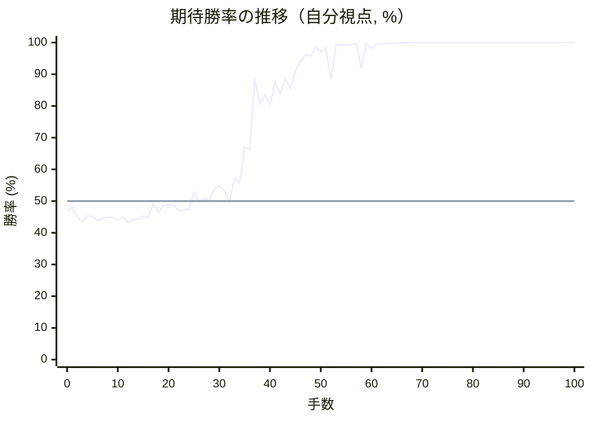

# 解析レポート wjpeijxgl76z

[README に戻る](../../../README.md)　/　棋譜: [CSA](../../../data/csa/shogi5/wjpeijxgl76z.csa)　/　解析の見方: [docs/mistake_analysis.md](../../../docs/mistake_analysis.md)

## 対局情報

| 項目 | 内容 |
|---|---|
| 日時 | 2026-11-19 03:19:58 |
| 持ち時間 | 5分 |
| 自分 | 後手（△）（1692） |
| 相手 | 相手（1688） |
| 結果 | 勝ち（詰み, 100手） |

## 解析環境

| 項目 | 内容 |
|---|---|
| エンジン | YaneuraOu NNUE 9.00git 64AVX2（V9.00/YANEURAOU_ENGINE_NNUE/AVX2） |
| 評価関数 | **水匠5**（`suisho5`） |
| nn.bin SHA-256 | `768068f0d534a0603a5d38bcd143de6bbca820d5f1c95a14d40863e5b7892d76` |
| 第1パス | movetime=150ms, MultiPV 1 |
| 第2パス | movetime=2000ms, MultiPV 3 |
| Threads / Hash | 8 / 512MB |
| 判定基準 | 疑問手 ≥5pt, 悪手 ≥10pt, 大悪手 ≥20pt（期待勝率 W(E)=1/(1+exp(-E/600))） |
| 解析日時 | 2026-11-20T20:05:08+09:00（解析バージョン 1, 26秒） |

## サマリー

| 自分の手数 | 深掘りした手 | 詰み逃し | 大悪手 | 悪手 | 疑問手 |
|--:|--:|--:|--:|--:|--:|
| 50 | 3 | 0 | 0 | 0 | 0 |

## 期待勝率の推移

1手ごとの数値（第1パス）

| 手数 | 指し手 | 評価値 | 勝率 | 低下 | 判定 |
|--:|---|--:|--:|--:|---|
| 1 | ▲７六歩(77) | -46 | 48.1% |  |  |
| 2 | △３四歩(33) | -120 | 45.0% | +3.1pt |  |
| 3 | ▲２六歩(27) | -160 | 43.4% |  |  |
| 4 | △８四歩(83) | -110 | 45.4% | -2.1pt |  |
| 5 | ▲２五歩(26) | -116 | 45.2% |  |  |
| 6 | △８五歩(84) | -146 | 43.9% | +1.2pt |  |
| 7 | ▲７八金(69) | -132 | 44.5% |  |  |
| 8 | △３二金(41) | -124 | 44.9% | -0.3pt |  |
| 9 | ▲２四歩(25) | -125 | 44.8% |  |  |
| 10 | △同歩(23) | -145 | 44.0% | +0.8pt |  |
| 11 | ▲同飛(28) | -120 | 45.0% |  |  |
| 12 | △８六歩(85) | -162 | 43.3% | +1.7pt |  |
| 13 | ▲同歩(87) | -141 | 44.2% |  |  |
| 14 | △同飛(82) | -141 | 44.2% | +0.0pt |  |
| 15 | ▲３四飛(24) | -116 | 45.2% |  |  |
| 16 | △３三角(22) | -120 | 45.0% | +0.2pt |  |
| 17 | ▲３六飛(34) | -24 | 49.0% |  |  |
| 18 | △２二銀(31) | -81 | 46.6% | +2.4pt |  |
| 19 | ▲３八金(49) | -36 | 48.5% |  |  |
| 20 | △５二玉(51) | -23 | 49.0% | -0.5pt |  |
| 21 | ▲５八玉(59) | -28 | 48.8% |  |  |
| 22 | △８四飛(86) | -74 | 46.9% | +1.9pt |  |
| 23 | ▲９六歩(97) | -65 | 47.3% |  |  |
| 24 | △７二銀(71) | -62 | 47.4% | -0.1pt |  |
| 25 | ▲６八銀(79) | +68 | 52.8% |  |  |
| 26 | △９四歩(93) | -8 | 49.7% | +3.2pt |  |
| 27 | ▲８七歩打 | +25 | 51.0% |  |  |
| 28 | △１四歩(13) | +3 | 50.1% | +0.9pt |  |
| 29 | ▲４八銀(39) | +90 | 53.7% |  |  |
| 30 | △２四飛(84) | +118 | 54.9% | -1.2pt |  |
| 31 | ▲２六歩打 | +76 | 53.2% |  |  |
| 32 | △８四飛(24) | -4 | 49.8% | +3.3pt |  |
| 33 | ▲２五歩(26) | +175 | 57.2% |  |  |
| 34 | △８五飛(84) | +137 | 55.7% | +1.6pt |  |
| 35 | ▲２四歩(25) | +428 | 67.1% |  |  |
| 36 | △２五飛(85) | +403 | 66.2% | +0.9pt |  |
| 37 | ▲３三角成(88) | +1227 | 88.5% |  |  |
| 38 | △同桂(21) | +863 | 80.8% | +7.7pt |  |
| 39 | ▲２六角打 | +975 | 83.5% |  |  |
| 40 | △２四飛(25) | +850 | 80.5% | +3.1pt |  |
| 41 | ▲７七銀(68) | +1172 | 87.6% |  |  |
| 42 | △１五歩(14) | +982 | 83.7% | +3.9pt |  |
| 43 | ▲６六銀(77) | +1236 | 88.7% |  |  |
| 44 | △１六歩(15) | +1070 | 85.6% | +3.1pt |  |
| 45 | ▲２五歩打 | +1388 | 91.0% |  |  |
| 46 | △同飛(24) | +1663 | 94.1% | -3.1pt |  |
| 47 | ▲１六歩(17) | +1940 | 96.2% |  |  |
| 48 | △１八歩打 | +1873 | 95.8% | +0.4pt |  |
| 49 | ▲２三歩打 | +2570 | 98.6% |  |  |
| 50 | △同銀(22) | +2092 | 97.0% | +1.6pt |  |
| 51 | ▲１八香(19) | +2462 | 98.4% |  |  |
| 52 | △５四角打 | +1214 | 88.3% | +10.1pt |  |
| 53 | ▲２七歩打 | +2895 | 99.2% |  |  |
| 54 | △３六角(54) | +2924 | 99.2% | -0.0pt |  |
| 55 | ▲同歩(37) | +2954 | 99.3% |  |  |
| 56 | △１九飛打 | +2894 | 99.2% | +0.1pt |  |
| 57 | ▲２八金(38) | +3782 | 99.8% |  |  |
| 58 | △３一金(32) | +1450 | 91.8% | +8.0pt |  |
| 59 | ▲８二角打 | +3390 | 99.6% |  |  |
| 60 | △９三香(91) | +2355 | 98.1% | +1.6pt |  |
| 61 | ▲９一角成(82) | +3351 | 99.6% |  |  |
| 62 | △２六飛(25) | +3151 | 99.5% | +0.1pt |  |
| 63 | ▲同歩(27) | +3252 | 99.6% |  |  |
| 64 | △２七歩打 | +3868 | 99.8% | -0.3pt |  |
| 65 | ▲同金(28) | +4347 | 99.9% |  |  |
| 66 | △２九飛成(19) | +4503 | 99.9% | -0.0pt |  |
| 67 | ▲３七金(27) | +4118 | 99.9% |  |  |
| 68 | △４五桂(33) | +4765 | 100.0% | -0.1pt |  |
| 69 | ▲４六金(37) | +5167 | 100.0% |  |  |
| 70 | △８九龍(29) | +5070 | 100.0% | +0.0pt |  |
| 71 | ▲７九飛打 | +5318 | 100.0% |  |  |
| 72 | △同龍(89) | +5247 | 100.0% | +0.0pt |  |
| 73 | ▲同金(78) | +5555 | 100.0% |  |  |
| 74 | △１九飛打 | +5550 | 100.0% | +0.0pt |  |
| 75 | ▲６九飛打 | +5757 | 100.0% |  |  |
| 76 | △１八飛成(19) | +5575 | 100.0% | +0.0pt |  |
| 77 | ▲４五金(46) | +5791 | 100.0% |  |  |
| 78 | △３七歩打 | +5856 | 100.0% | -0.0pt |  |
| 79 | ▲９二馬(91) | +6243 | 100.0% |  |  |
| 80 | △３八歩成(37) | +6341 | 100.0% | -0.0pt |  |
| 81 | ▲５九銀(48) | +6584 | 100.0% |  |  |
| 82 | △４九と(38) | +6800 | 100.0% | -0.0pt |  |
| 83 | ▲４八桂打 | +6942 | 100.0% |  |  |
| 84 | △５九と(49) | +6906 | 100.0% | +0.0pt |  |
| 85 | ▲同飛(69) | +7083 | 100.0% |  |  |
| 86 | △３七歩打 | +6248 | 100.0% | +0.0pt |  |
| 87 | ▲５六馬(92) | +7018 | 100.0% |  |  |
| 88 | △３八歩成(37) | +6860 | 100.0% | +0.0pt |  |
| 89 | ▲６八玉(58) | +7638 | 100.0% |  |  |
| 90 | △４八と(38) | +7545 | 100.0% | +0.0pt |  |
| 91 | ▲７八玉(68) | #+11 | 100.0% |  |  |
| 92 | △５九と(48) | #+8 | 100.0% | +0.0pt |  |
| 93 | ▲６八金(79) | #+7 | 100.0% |  |  |
| 94 | △８五桂打 | #+8 | 100.0% | +0.0pt |  |
| 95 | ▲９五歩(96) | #+5 | 100.0% |  |  |
| 96 | △６八龍(18) | #+4 | 100.0% | +0.0pt |  |
| 97 | ▲同玉(78) | #+3 | 100.0% |  |  |
| 98 | △５八飛打 | #+2 | 100.0% | +0.0pt |  |
| 99 | ▲７九玉(68) | #+1 | 100.0% |  |  |
| 100 | △７八金打 | #+ | 100.0% | +0.0pt |  |

## 課題局面

判定基準に該当する手はありませんでした。
