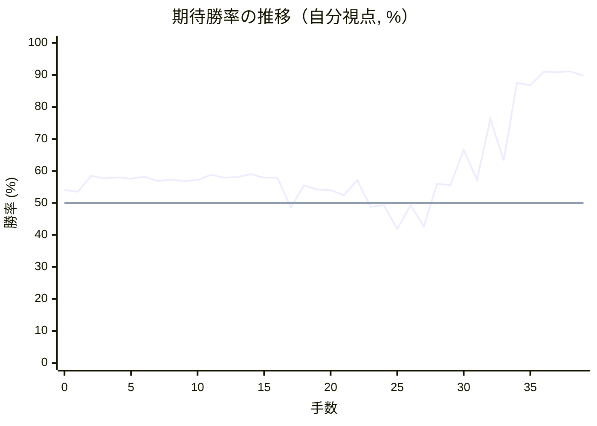
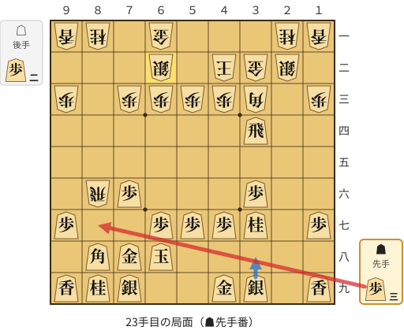
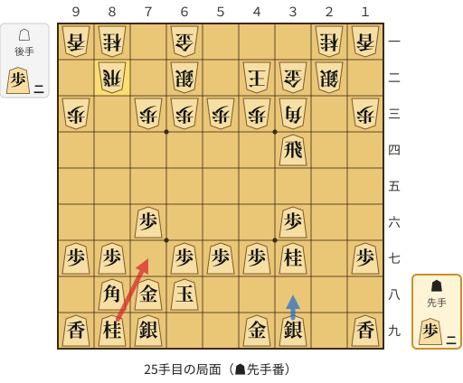
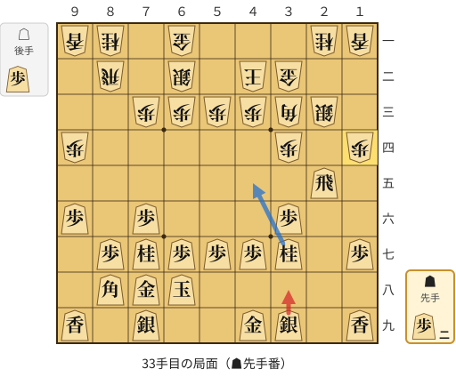

# 解析レポート wtzekthsq676

[README に戻る](../../../README.md)　/　棋譜: [CSA](../../../data/csa/shogi5/wtzekthsq676.csa)　/　解析の見方: [docs/mistake_analysis.md](../../../docs/mistake_analysis.md)

## 対局情報

| 項目 | 内容 |
|---|---|
| 日時 | 2026-11-16 20:18:34 |
| 持ち時間 | 5分 |
| 自分 | 先手（▲）（1657） |
| 相手 | 相手（1687） |
| 結果 | 勝ち（投了, 39手） |

## 解析環境

| 項目 | 内容 |
|---|---|
| エンジン | YaneuraOu NNUE 9.00git 64AVX2（V9.00/YANEURAOU_ENGINE_NNUE/AVX2） |
| 評価関数 | **水匠5**（`suisho5`） |
| nn.bin SHA-256 | `768068f0d534a0603a5d38bcd143de6bbca820d5f1c95a14d40863e5b7892d76` |
| 第1パス | movetime=150ms, MultiPV 1 |
| 第2パス | movetime=2000ms, MultiPV 3 |
| Threads / Hash | 8 / 512MB |
| 判定基準 | 疑問手 ≥5pt, 悪手 ≥10pt, 大悪手 ≥20pt（期待勝率 W(E)=1/(1+exp(-E/600))） |
| 解析日時 | 2026-11-20T20:19:15+09:00（解析バージョン 1, 26秒） |

## サマリー

| 自分の手数 | 深掘りした手 | 詰み逃し | 大悪手 | 悪手 | 疑問手 |
|--:|--:|--:|--:|--:|--:|
| 20 | 5 | 0 | 1 | 1 | 1 |

## 期待勝率の推移



<details><summary>1手ごとの数値（第1パス）</summary>

| 手数 | 指し手 | 評価値 | 勝率 | 低下 | 判定 |
|--:|---|--:|--:|--:|---|
| 1 | ▲７六歩(77) | +85 | 53.5% | +0.5pt |  |
| 2 | △３四歩(33) | +205 | 58.5% |  |  |
| 3 | ▲２六歩(27) | +187 | 57.7% | +0.7pt |  |
| 4 | △８四歩(83) | +194 | 58.0% |  |  |
| 5 | ▲２五歩(26) | +185 | 57.6% | +0.4pt |  |
| 6 | △８五歩(84) | +198 | 58.2% |  |  |
| 7 | ▲７八金(69) | +166 | 56.9% | +1.3pt |  |
| 8 | △３二金(41) | +177 | 57.3% |  |  |
| 9 | ▲２四歩(25) | +167 | 56.9% | +0.4pt |  |
| 10 | △同歩(23) | +174 | 57.2% |  |  |
| 11 | ▲同飛(28) | +213 | 58.8% | -1.6pt |  |
| 12 | △８六歩(85) | +192 | 57.9% |  |  |
| 13 | ▲同歩(87) | +195 | 58.1% | -0.1pt |  |
| 14 | △同飛(82) | +218 | 59.0% |  |  |
| 15 | ▲３四飛(24) | +190 | 57.9% | +1.1pt |  |
| 16 | △３三角(22) | +191 | 57.9% |  |  |
| 17 | ▲６八玉(59) | -33 | 48.6% | +9.3pt |  |
| 18 | △４二玉(51) | +133 | 55.5% |  |  |
| 19 | ▲３六歩(37) | +100 | 54.2% | +1.4pt |  |
| 20 | △２二銀(31) | +96 | 54.0% |  |  |
| 21 | ▲３七桂(29) | +57 | 52.4% | +1.6pt |  |
| 22 | △６二銀(71) | +171 | 57.1% |  |  |
| 23 | ▲８七歩打 | -28 | 48.8% | +8.2pt | [悪手](#ply-23) |
| 24 | △８二飛(86) | -16 | 49.3% |  |  |
| 25 | ▲７七桂(89) | -197 | 41.9% | +7.5pt | [疑問手](#ply-25) |
| 26 | △２三銀(22) | -17 | 49.3% |  |  |
| 27 | ▲３五飛(34) | -176 | 42.7% | +6.6pt |  |
| 28 | △３四歩打 | +145 | 56.0% |  |  |
| 29 | ▲２五飛(35) | +136 | 55.6% | +0.4pt |  |
| 30 | △９四歩(93) | +413 | 66.6% |  |  |
| 31 | ▲９六歩(97) | +174 | 57.2% | +9.4pt |  |
| 32 | △１四歩(13) | +700 | 76.3% |  |  |
| 33 | ▲３八銀(39) | +326 | 63.3% | +13.0pt | [大悪手](#ply-33) |
| 34 | △５一金(61) | +1167 | 87.5% |  |  |
| 35 | ▲４五桂(37) | +1132 | 86.8% | +0.7pt |  |
| 36 | △４四角(33) | +1388 | 91.0% |  |  |
| 37 | ▲２四歩打 | +1383 | 90.9% | +0.1pt |  |
| 38 | △１二銀(23) | +1398 | 91.1% |  |  |
| 39 | ▲６五桂(77) | +1300 | 89.7% | +1.4pt |  |

</details>

## 課題局面

<a id="ply-23"></a>
### 23手目 ▲８七歩打 — 悪手

| | 着手前 | 着手後 | 差 |
|---|--:|--:|--:|
| 期待勝率 | 56.3% | 45.9% | -10.3pt |
| 評価値 | +151 | -98 | |

着手前の局面:



🔴 実戦 ▲８七歩打　🔵 AI推奨 ▲３八銀(39)　🟨 直前の相手の指し手

<details><summary>テキストの盤面図（BOD・将棋ソフトに貼り付け可）</summary>

```text
後手の持駒：歩二
  ９ ８ ７ ６ ５ ４ ３ ２ １
+---------------------------+
|v香v桂 ・v金 ・ ・ ・v桂v香|一
| ・ ・ ・v銀 ・v玉v金v銀 ・|二
|v歩 ・v歩v歩v歩v歩v角 ・v歩|三
| ・ ・ ・ ・ ・ ・ 飛 ・ ・|四
| ・ ・ ・ ・ ・ ・ ・ ・ ・|五
| ・v飛 歩 ・ ・ ・ 歩 ・ ・|六
| 歩 ・ ・ 歩 歩 歩 桂 ・ 歩|七
| ・ 角 金 玉 ・ ・ ・ ・ ・|八
| 香 桂 銀 ・ ・ 金 銀 ・ 香|九
+---------------------------+
先手の持駒：歩三
手数＝22　△６二銀　まで
```

</details>

| | 指し手 | 評価値 | 読み筋 |
|---|---|--:|---|
| 実戦 | ▲８七歩打 | -98 | △８二飛(86) ▲３八銀(39) △６四歩(63) ▲９六歩(97) △６三銀(62) ▲３五飛(34) |
| AI 1位 | ▲３八銀(39) | +151 | ▲３八銀(39) △２三銀(22) ▲３五飛(34) △８二飛(86) ▲５八玉(68) △６四歩(63) |
| AI 2位 | ▲５八玉(68) | +100 | ▲５八玉(68) △８二飛(86) ▲３八銀(39) △５一金(61) ▲９六歩(97) △２三銀(22) |
| AI 3位 | ▲３五飛(34) | +87 | ▲３五飛(34) △８二飛(86) ▲３八銀(39) △５一金(61) ▲５八玉(68) △１四歩(13) |

SFEN: `ln1g3nl/3s1kgs1/p1ppppb1p/6R2/9/1rP3P2/P2PPPN1P/1BGK5/LNS2GS1L b 3P2p 23`

<a id="ply-25"></a>
### 25手目 ▲７七桂(89) — 疑問手

| | 着手前 | 着手後 | 差 |
|---|--:|--:|--:|
| 期待勝率 | 46.6% | 39.5% | -7.1pt |
| 評価値 | -82 | -257 | |

着手前の局面:



🔴 実戦 ▲７七桂(89)　🔵 AI推奨 ▲３八銀(39)　🟨 直前の相手の指し手

<details><summary>テキストの盤面図（BOD・将棋ソフトに貼り付け可）</summary>

```text
後手の持駒：歩二
  ９ ８ ７ ６ ５ ４ ３ ２ １
+---------------------------+
|v香v桂 ・v金 ・ ・ ・v桂v香|一
| ・v飛 ・v銀 ・v玉v金v銀 ・|二
|v歩 ・v歩v歩v歩v歩v角 ・v歩|三
| ・ ・ ・ ・ ・ ・ 飛 ・ ・|四
| ・ ・ ・ ・ ・ ・ ・ ・ ・|五
| ・ ・ 歩 ・ ・ ・ 歩 ・ ・|六
| 歩 歩 ・ 歩 歩 歩 桂 ・ 歩|七
| ・ 角 金 玉 ・ ・ ・ ・ ・|八
| 香 桂 銀 ・ ・ 金 銀 ・ 香|九
+---------------------------+
先手の持駒：歩二
手数＝24　△８二飛　まで
```

</details>

| | 指し手 | 評価値 | 読み筋 |
|---|---|--:|---|
| 実戦 | ▲７七桂(89) | -257 | △４四角(33) ▲６五桂(77) △３三銀(22) ▲３五飛(34) △同角(44) ▲同歩(36) |
| AI 1位 | ▲３八銀(39) | -82 | ▲３八銀(39) △６四歩(63) ▲３五飛(34) △８八角成(33) ▲同銀(79) △３三桂(21) |
| AI 2位 | ▲３八金(49) | -82 | ▲３八金(49) △２四歩打 ▲４八銀(39) △２三銀(22) ▲３五飛(34) △６四歩(63) |
| AI 3位 | ▲９六歩(97) | -74 | ▲９六歩(97) △８八角成(33) ▲同銀(79) △２三銀(22) ▲３五飛(34) △２六角打 |

SFEN: `ln1g3nl/1r1s1kgs1/p1ppppb1p/6R2/9/2P3P2/PP1PPPN1P/1BGK5/LNS2GS1L b 2P2p 25`

<a id="ply-33"></a>
### 33手目 ▲３八銀(39) — 大悪手

| | 着手前 | 着手後 | 差 |
|---|--:|--:|--:|
| 期待勝率 | 79.3% | 59.1% | -20.2pt |
| 評価値 | +806 | +221 | |

着手前の局面:



🔴 実戦 ▲３八銀(39)　🔵 AI推奨 ▲４五桂(37)　🟨 直前の相手の指し手

<details><summary>テキストの盤面図（BOD・将棋ソフトに貼り付け可）</summary>

```text
後手の持駒：歩
  ９ ８ ７ ６ ５ ４ ３ ２ １
+---------------------------+
|v香v桂 ・v金 ・ ・ ・v桂v香|一
| ・v飛 ・v銀 ・v玉v金 ・ ・|二
| ・ ・v歩v歩v歩v歩v角v銀 ・|三
|v歩 ・ ・ ・ ・ ・v歩 ・v歩|四
| ・ ・ ・ ・ ・ ・ ・ 飛 ・|五
| 歩 ・ 歩 ・ ・ ・ 歩 ・ ・|六
| ・ 歩 桂 歩 歩 歩 桂 ・ 歩|七
| ・ 角 金 玉 ・ ・ ・ ・ ・|八
| 香 ・ 銀 ・ ・ 金 銀 ・ 香|九
+---------------------------+
先手の持駒：歩二
手数＝32　△１四歩　まで
```

</details>

| | 指し手 | 評価値 | 読み筋 |
|---|---|--:|---|
| 実戦 | ▲３八銀(39) | +221 | △２四銀(23) ▲２九飛(25) △２三歩打 ▲５八玉(68) △６四歩(63) ▲６八銀(79) |
| AI 1位 | ▲４五桂(37) | +806 | ▲４五桂(37) △４四角(33) ▲２四歩打 △１二銀(23) ▲６五桂(77) △１三桂(21) |
| AI 2位 | ▲３八銀(39) | +297 | ▲３八銀(39) △２四銀(23) ▲２九飛(25) △２三歩打 ▲４八金(49) △６四歩(63) |
| AI 3位 | ▲２二歩打 | +241 | ▲２二歩打 △２四歩打 ▲８五飛(25) △同飛(82) ▲同桂(77) △２二金(32) |

SFEN: `ln1g3nl/1r1s1kg2/2ppppbs1/p5p1p/7R1/P1P3P2/1PNPPPN1P/1BGK5/L1S2GS1L b 2Pp 33`

