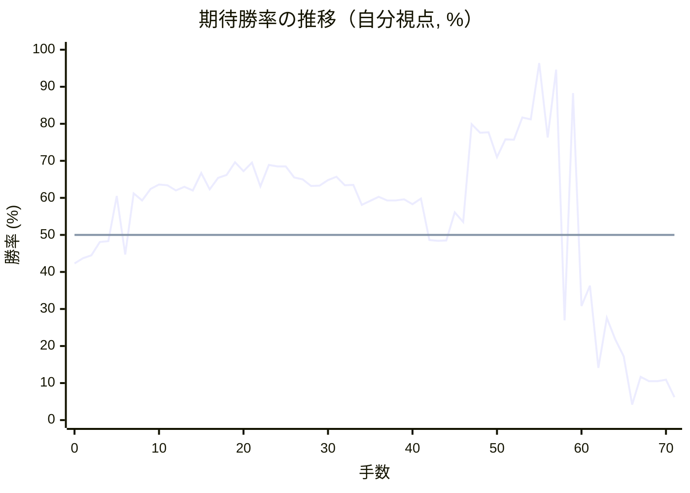
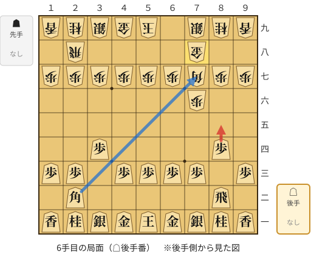
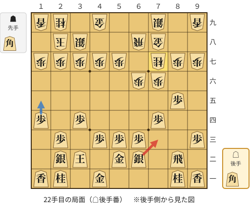
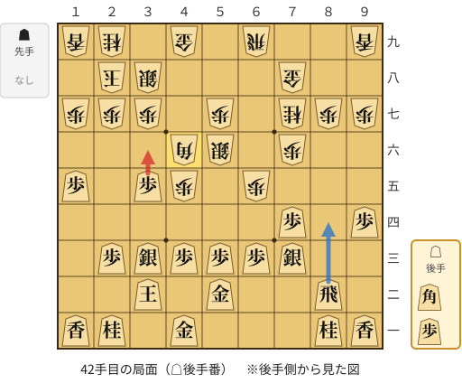
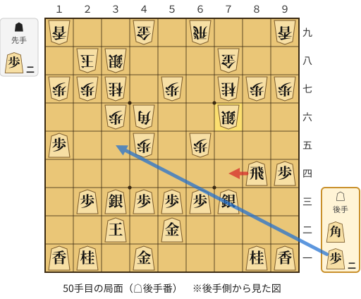
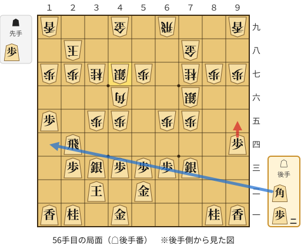
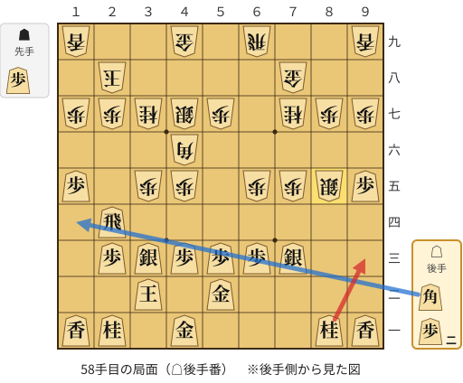
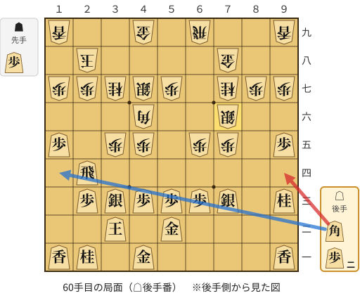
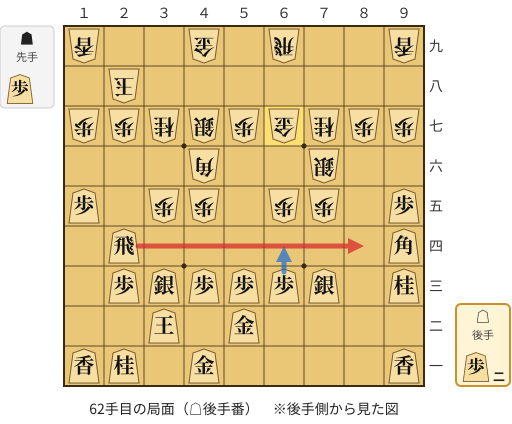
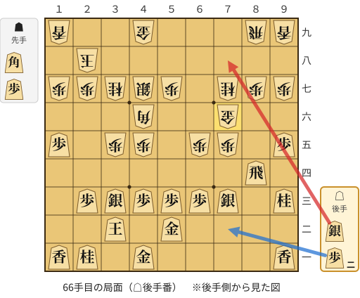

# 解析レポート xmgjdpotb72n

[README に戻る](../../../README.md)　/　棋譜: [CSA](../../../data/csa/shogi5/xmgjdpotb72n.csa)　/　解析の見方: [docs/mistake_analysis.md](../../../docs/mistake_analysis.md)

## 対局情報

| 項目 | 内容 |
|---|---|
| 日時 | 2026-11-08 14:13:31 |
| 持ち時間 | 5分 |
| 自分 | 後手（△）（1671） |
| 相手 | 相手（1514） |
| 結果 | 負け（時間切れ, 71手） |

## 解析環境

| 項目 | 内容 |
|---|---|
| エンジン | YaneuraOu NNUE 9.00git 64AVX2（V9.00/YANEURAOU_ENGINE_NNUE/AVX2） |
| 評価関数 | **水匠5**（`suisho5`） |
| nn.bin SHA-256 | `768068f0d534a0603a5d38bcd143de6bbca820d5f1c95a14d40863e5b7892d76` |
| 第1パス | movetime=150ms, MultiPV 1 |
| 第2パス | movetime=2000ms, MultiPV 3 |
| Threads / Hash | 8 / 512MB |
| 判定基準 | 疑問手 ≥5pt, 悪手 ≥10pt, 大悪手 ≥20pt（期待勝率 W(E)=1/(1+exp(-E/600))） |
| 解析日時 | 2026-11-11T20:18:19+09:00（解析バージョン 1, 55秒） |

## サマリー

| 自分の手数 | 深掘りした手 | 詰み逃し | 大悪手 | 悪手 | 疑問手 |
|--:|--:|--:|--:|--:|--:|
| 35 | 11 | 0 | 3 | 4 | 2 |

## 期待勝率の推移



<details><summary>1手ごとの数値（第1パス）</summary>

| 手数 | 指し手 | 評価値 | 勝率 | 低下 | 判定 |
|--:|---|--:|--:|--:|---|
| 1 | ▲７六歩(77) | -151 | 43.7% |  |  |
| 2 | △８四歩(83) | -132 | 44.5% | -0.8pt |  |
| 3 | ▲７七角(88) | -46 | 48.1% |  |  |
| 4 | △３四歩(33) | -42 | 48.3% | -0.2pt |  |
| 5 | ▲７八金(69) | +255 | 60.5% |  |  |
| 6 | △８五歩(84) | -127 | 44.7% | +15.7pt | [悪手](#ply-6) |
| 7 | ▲６八飛(28) | +273 | 61.2% |  |  |
| 8 | △６二銀(71) | +226 | 59.3% | +1.9pt |  |
| 9 | ▲４八玉(59) | +305 | 62.4% |  |  |
| 10 | △４二玉(51) | +336 | 63.6% | -1.2pt |  |
| 11 | ▲３八玉(48) | +330 | 63.4% |  |  |
| 12 | △３二玉(42) | +294 | 62.0% | +1.4pt |  |
| 13 | ▲２八玉(38) | +320 | 63.0% |  |  |
| 14 | △１四歩(13) | +295 | 62.0% | +1.0pt |  |
| 15 | ▲３八銀(39) | +418 | 66.7% |  |  |
| 16 | △５二金(61) | +302 | 62.3% | +4.4pt |  |
| 17 | ▲２二角成(77) | +381 | 65.4% |  |  |
| 18 | △同銀(31) | +403 | 66.2% | -0.8pt |  |
| 19 | ▲６六歩(67) | +496 | 69.6% |  |  |
| 20 | △７四歩(73) | +431 | 67.2% | +2.3pt |  |
| 21 | ▲７七桂(89) | +494 | 69.5% |  |  |
| 22 | △７三銀(62) | +323 | 63.1% | +6.4pt | [疑問手](#ply-22) |
| 23 | ▲６五歩(66) | +478 | 68.9% |  |  |
| 24 | △１五歩(14) | +465 | 68.5% | +0.5pt |  |
| 25 | ▲６九飛(68) | +466 | 68.5% |  |  |
| 26 | △９四歩(93) | +385 | 65.5% | +3.0pt |  |
| 27 | ▲６八銀(79) | +372 | 65.0% |  |  |
| 28 | △３五歩(34) | +325 | 63.2% | +1.8pt |  |
| 29 | ▲６七銀(68) | +326 | 63.3% |  |  |
| 30 | △３三銀(22) | +365 | 64.8% | -1.5pt |  |
| 31 | ▲５六銀(67) | +391 | 65.7% |  |  |
| 32 | △４四銀(33) | +330 | 63.4% | +2.3pt |  |
| 33 | ▲４六歩(47) | +332 | 63.5% |  |  |
| 34 | △８六歩(85) | +195 | 58.1% | +5.4pt |  |
| 35 | ▲同歩(87) | +224 | 59.2% |  |  |
| 36 | △同飛(82) | +250 | 60.3% | -1.0pt |  |
| 37 | ▲８七歩打 | +226 | 59.3% |  |  |
| 38 | △８二飛(86) | +227 | 59.3% | -0.0pt |  |
| 39 | ▲４五歩(46) | +234 | 59.6% |  |  |
| 40 | △３三銀(44) | +201 | 58.3% | +1.3pt |  |
| 41 | ▲４六角打 | +238 | 59.8% |  |  |
| 42 | △３六歩(35) | -34 | 48.6% | +11.2pt | [悪手](#ply-42) |
| 43 | ▲同歩(37) | -38 | 48.4% |  |  |
| 44 | △８四飛(82) | -35 | 48.5% | -0.1pt |  |
| 45 | ▲３七桂(29) | +146 | 56.1% |  |  |
| 46 | △７五歩(74) | +85 | 53.5% | +2.5pt |  |
| 47 | ▲６七銀(56) | +828 | 79.9% |  |  |
| 48 | △７六歩(75) | +745 | 77.6% | +2.3pt |  |
| 49 | ▲同銀(67) | +748 | 77.7% |  |  |
| 50 | △７四飛(84) | +538 | 71.0% | +6.6pt | [疑問手](#ply-50) |
| 51 | ▲７五歩打 | +685 | 75.8% |  |  |
| 52 | △３四飛(74) | +681 | 75.7% | +0.1pt |  |
| 53 | ▲３五歩(36) | +898 | 81.7% |  |  |
| 54 | △２四飛(34) | +878 | 81.2% | +0.5pt |  |
| 55 | ▲４七銀(38) | +1970 | 96.4% |  |  |
| 56 | △９五歩(94) | +702 | 76.3% | +20.1pt | [悪手](#ply-56) |
| 57 | ▲８五銀(76) | +1716 | 94.6% |  |  |
| 58 | △９三桂(81) | -600 | 26.9% | +67.7pt | [大悪手](#ply-58) |
| 59 | ▲７六銀(85) | +1214 | 88.3% |  |  |
| 60 | △９四角打 | -487 | 30.8% | +57.6pt | [大悪手](#ply-60) |
| 61 | ▲６七金(78) | -338 | 36.3% |  |  |
| 62 | △８四飛(24) | -1082 | 14.1% | +22.1pt | [大悪手](#ply-62) |
| 63 | ▲８九飛(69) | -580 | 27.6% |  |  |
| 64 | △７六角(94) | -768 | 21.8% | +5.8pt |  |
| 65 | ▲同金(67) | -942 | 17.2% |  |  |
| 66 | △７八銀打 | -1880 | 4.2% | +13.0pt | [悪手](#ply-66) |
| 67 | ▲８八飛(89) | -1210 | 11.7% |  |  |
| 68 | △８七銀不成(78) | -1285 | 10.5% | +1.2pt |  |
| 69 | ▲８五歩打 | -1286 | 10.5% |  |  |
| 70 | △８八銀不成(87) | -1263 | 10.9% | -0.4pt |  |
| 71 | ▲８四歩(85) | -1631 | 6.2% |  |  |

</details>

## 課題局面

<a id="ply-6"></a>
### 6手目 △８五歩(84) — 悪手

| | 着手前 | 着手後 | 差 |
|---|--:|--:|--:|
| 期待勝率 | 56.8% | 44.6% | -12.1pt |
| 評価値 | +163 | -130 | |

着手前の局面:



🔴 実戦 △８五歩(84)　🔵 AI推奨 △７七角成(22)　🟨 直前の相手の指し手

<details><summary>テキストの盤面図（BOD・将棋ソフトに貼り付け可）</summary>

```text
後手の持駒：なし
  ９ ８ ７ ６ ５ ４ ３ ２ １
+---------------------------+
|v香v桂v銀v金v玉v金v銀v桂v香|一
| ・v飛 ・ ・ ・ ・ ・v角 ・|二
|v歩 ・v歩v歩v歩v歩 ・v歩v歩|三
| ・v歩 ・ ・ ・ ・v歩 ・ ・|四
| ・ ・ ・ ・ ・ ・ ・ ・ ・|五
| ・ ・ 歩 ・ ・ ・ ・ ・ ・|六
| 歩 歩 角 歩 歩 歩 歩 歩 歩|七
| ・ ・ 金 ・ ・ ・ ・ 飛 ・|八
| 香 桂 銀 ・ 玉 金 銀 桂 香|九
+---------------------------+
先手の持駒：なし
後手番
手数＝5　▲７八金　まで
```

</details>

| | 指し手 | 評価値 | 読み筋 |
|---|---|--:|---|
| 実戦 | △８五歩(84) | -130 | ▲６八銀(79) △７七角成(22) ▲同銀(68) △２二銀(31) ▲３八銀(39) △３三銀(22) |
| AI 1位 | △７七角成(22) | +163 | △７七角成(22) ▲同桂(89) △２二銀(31) ▲６八銀(79) △３三銀(22) ▲６六歩(67) |
| AI 2位 | △６二銀(71) | +0 | △６二銀(71) ▲６八銀(79) △６四歩(63) ▲２六歩(27) △７七角成(22) ▲同銀(68) |
| AI 3位 | △３二金(41) | -21 | △３二金(41) ▲６八銀(79) △７七角成(22) ▲同銀(68) △４二銀(31) ▲３八銀(39) |

SFEN: `lnsgkgsnl/1r5b1/p1pppp1pp/1p4p2/9/2P6/PPBPPPPPP/2G4R1/LNS1KGSNL w - 6`

<a id="ply-22"></a>
### 22手目 △７三銀(62) — 疑問手

| | 着手前 | 着手後 | 差 |
|---|--:|--:|--:|
| 期待勝率 | 67.7% | 62.1% | -5.6pt |
| 評価値 | +445 | +297 | |

着手前の局面:



🔴 実戦 △７三銀(62)　🔵 AI推奨 △１五歩(14)　🟨 直前の相手の指し手

<details><summary>テキストの盤面図（BOD・将棋ソフトに貼り付け可）</summary>

```text
後手の持駒：角
  ９ ８ ７ ６ ５ ４ ３ ２ １
+---------------------------+
|v香v桂 ・ ・ ・v金 ・v桂v香|一
| ・v飛 ・v銀v金 ・v玉v銀 ・|二
|v歩 ・ ・v歩v歩v歩 ・v歩 ・|三
| ・ ・v歩 ・ ・ ・v歩 ・v歩|四
| ・v歩 ・ ・ ・ ・ ・ ・ ・|五
| ・ ・ 歩 歩 ・ ・ ・ ・ ・|六
| 歩 歩 桂 ・ 歩 歩 歩 歩 歩|七
| ・ ・ 金 飛 ・ ・ 銀 玉 ・|八
| 香 ・ 銀 ・ ・ 金 ・ 桂 香|九
+---------------------------+
先手の持駒：角
後手番
手数＝21　▲７七桂　まで
```

</details>

| | 指し手 | 評価値 | 読み筋 |
|---|---|--:|---|
| 実戦 | △７三銀(62) | +297 | ▲１六歩(17) △８六歩(85) ▲同歩(87) △同飛(82) ▲８八銀(79) △８二飛(86) |
| AI 1位 | △１五歩(14) | +445 | △１五歩(14) ▲６九飛(68) △７三桂(81) ▲６八銀(79) △２四歩(23) ▲６七銀(68) |
| AI 2位 | △７三桂(81) | +444 | △７三桂(81) ▲６九飛(68) △１五歩(14) ▲６八銀(79) △２四歩(23) ▲６七銀(68) |
| AI 3位 | △３三銀(22) | +431 | △３三銀(22) ▲１六歩(17) △８六歩(85) ▲同歩(87) △７五歩(74) ▲同歩(76) |

SFEN: `ln3g1nl/1r1sg1ks1/p2ppp1p1/2p3p1p/1p7/2PP5/PPN1PPPPP/2GR2SK1/L1S2G1NL w Bb 22`

<a id="ply-42"></a>
### 42手目 △３六歩(35) — 悪手

| | 着手前 | 着手後 | 差 |
|---|--:|--:|--:|
| 期待勝率 | 60.7% | 50.0% | -10.7pt |
| 評価値 | +260 | -1 | |

着手前の局面:



🔴 実戦 △３六歩(35)　🔵 AI推奨 △８四飛(82)　🟨 直前の相手の指し手

<details><summary>テキストの盤面図（BOD・将棋ソフトに貼り付け可）</summary>

```text
後手の持駒：角　歩
  ９ ８ ７ ６ ５ ４ ３ ２ １
+---------------------------+
|v香v桂 ・ ・ ・v金 ・v桂v香|一
| ・v飛 ・ ・v金 ・v玉 ・ ・|二
| ・ ・v銀v歩v歩v歩v銀v歩 ・|三
|v歩 ・v歩 ・ ・ ・ ・ ・ ・|四
| ・ ・ ・ 歩 ・ 歩v歩 ・v歩|五
| ・ ・ 歩 ・ 銀 角 ・ ・ ・|六
| 歩 歩 桂 ・ 歩 ・ 歩 歩 歩|七
| ・ ・ 金 ・ ・ ・ 銀 玉 ・|八
| 香 ・ ・ 飛 ・ 金 ・ 桂 香|九
+---------------------------+
先手の持駒：なし
後手番
手数＝41　▲４六角　まで
```

</details>

| | 指し手 | 評価値 | 読み筋 |
|---|---|--:|---|
| 実戦 | △３六歩(35) | -1 | ▲同歩(37) △８四飛(82) ▲６六飛(69) △２二玉(32) ▲２六歩(27) △４四歩(43) |
| AI 1位 | △８四飛(82) | +260 | △８四飛(82) ▲３五角(46) △２二玉(32) ▲６六飛(69) △４二金(52) ▲３六歩(37) |
| AI 2位 | △８六歩打 | +255 | △８六歩打 ▲同歩(87) △同飛(82) ▲８七歩打 △８四飛(86) ▲３五角(46) |
| AI 3位 | △３四銀(33) | +197 | △３四銀(33) ▲８九飛(69) △８五歩打 ▲４七銀(38) △５四歩(53) ▲３六歩(37) |

SFEN: `ln3g1nl/1r2g1k2/2spppsp1/p1p6/3P1Pp1p/2P1SB3/PPN1P1PPP/2G3SK1/L2R1G1NL w bp 42`

<a id="ply-50"></a>
### 50手目 △７四飛(84) — 疑問手

| | 着手前 | 着手後 | 差 |
|---|--:|--:|--:|
| 期待勝率 | 78.9% | 71.8% | -7.1pt |
| 評価値 | +791 | +560 | |

着手前の局面:



🔴 実戦 △７四飛(84)　🔵 AI推奨 △３五歩打　🟨 直前の相手の指し手

<details><summary>テキストの盤面図（BOD・将棋ソフトに貼り付け可）</summary>

```text
後手の持駒：角　歩二
  ９ ８ ７ ６ ５ ４ ３ ２ １
+---------------------------+
|v香v桂 ・ ・ ・v金 ・v桂v香|一
| ・ ・ ・ ・v金 ・v玉 ・ ・|二
| ・ ・v銀v歩v歩v歩v銀v歩 ・|三
|v歩v飛 ・ ・ ・ ・ ・ ・ ・|四
| ・ ・ ・ 歩 ・ 歩 ・ ・v歩|五
| ・ ・ 銀 ・ ・ 角 歩 ・ ・|六
| 歩 歩 桂 ・ 歩 ・ 桂 歩 歩|七
| ・ ・ 金 ・ ・ ・ 銀 玉 ・|八
| 香 ・ ・ 飛 ・ 金 ・ ・ 香|九
+---------------------------+
先手の持駒：歩二
後手番
手数＝49　▲７六同銀　まで
```

</details>

| | 指し手 | 評価値 | 読み筋 |
|---|---|--:|---|
| 実戦 | △７四飛(84) | +560 | ▲６六飛(69) △４四歩(43) ▲同歩(45) △４五歩打 ▲３五角(46) △４四銀(33) |
| AI 1位 | △３五歩打 | +791 | △３五歩打 ▲７五銀(76) △１四飛(84) ▲３五角(46) △３四飛(14) ▲４六角(35) |
| AI 2位 | △３四飛(84) | +675 | △３四飛(84) ▲４七銀(38) △２四銀(33) ▲４八金(49) △３五歩打 ▲同角(46) |
| AI 3位 | △４四歩(43) | +618 | △４四歩(43) ▲６四歩(65) △同銀(73) ▲８五銀(76) △８二飛(84) ▲６五歩打 |

SFEN: `ln3g1nl/4g1k2/2spppsp1/pr7/3P1P2p/2S2BP2/PPN1P1NPP/2G3SK1/L2R1G2L w 2Pb2p 50`

<a id="ply-56"></a>
### 56手目 △９五歩(94) — 悪手

| | 着手前 | 着手後 | 差 |
|---|--:|--:|--:|
| 期待勝率 | 98.8% | 87.6% | -11.2pt |
| 評価値 | +2643 | +1173 | |

着手前の局面:



🔴 実戦 △９五歩(94)　🔵 AI推奨 △１四角打　🟨 直前の相手の指し手

<details><summary>テキストの盤面図（BOD・将棋ソフトに貼り付け可）</summary>

```text
後手の持駒：角　歩二
  ９ ８ ７ ６ ５ ４ ３ ２ １
+---------------------------+
|v香v桂 ・ ・ ・v金 ・v桂v香|一
| ・ ・ ・ ・v金 ・v玉 ・ ・|二
| ・ ・v銀v歩v歩v歩v銀v歩 ・|三
|v歩 ・ ・ ・ ・ ・ ・v飛 ・|四
| ・ ・ 歩 歩 ・ 歩 歩 ・v歩|五
| ・ ・ 銀 ・ ・ 角 ・ ・ ・|六
| 歩 歩 桂 ・ 歩 銀 桂 歩 歩|七
| ・ ・ 金 ・ ・ ・ ・ 玉 ・|八
| 香 ・ ・ 飛 ・ 金 ・ ・ 香|九
+---------------------------+
先手の持駒：歩
後手番
手数＝55　▲４七銀　まで
```

</details>

| | 指し手 | 評価値 | 読み筋 |
|---|---|--:|---|
| 実戦 | △９五歩(94) | +1173 | ▲４八金(49) △１四角打 ▲２九飛(69) △３六歩打 ▲５六歩(57) △４四歩(43) |
| AI 1位 | △１四角打 | +2643 | △１四角打 ▲５八銀(47) △３六角(14) ▲３九玉(28) △２七飛成(24) ▲３四歩(35) |
| AI 2位 | △３六歩打 | +1755 | △３六歩打 ▲４八金(49) △３七歩成(36) ▲同角(46) △１四角打 ▲６六飛(69) |
| AI 3位 | △４四歩(43) | +1577 | △４四歩(43) ▲５五角(46) △５四歩(53) ▲６四歩(65) △同銀(73) ▲同角(55) |

SFEN: `ln3g1nl/4g1k2/2spppsp1/p6r1/2PP1PP1p/2S2B3/PPN1PSNPP/2G4K1/L2R1G2L w Pb2p 56`

<a id="ply-58"></a>
### 58手目 △９三桂(81) — 大悪手

| | 着手前 | 着手後 | 差 |
|---|--:|--:|--:|
| 期待勝率 | 98.9% | 23.3% | -75.6pt |
| 評価値 | +2688 | -715 | |

着手前の局面:



🔴 実戦 △９三桂(81)　🔵 AI推奨 △１四角打　🟨 直前の相手の指し手

<details><summary>テキストの盤面図（BOD・将棋ソフトに貼り付け可）</summary>

```text
後手の持駒：角　歩二
  ９ ８ ７ ６ ５ ４ ３ ２ １
+---------------------------+
|v香v桂 ・ ・ ・v金 ・v桂v香|一
| ・ ・ ・ ・v金 ・v玉 ・ ・|二
| ・ ・v銀v歩v歩v歩v銀v歩 ・|三
| ・ ・ ・ ・ ・ ・ ・v飛 ・|四
|v歩 銀 歩 歩 ・ 歩 歩 ・v歩|五
| ・ ・ ・ ・ ・ 角 ・ ・ ・|六
| 歩 歩 桂 ・ 歩 銀 桂 歩 歩|七
| ・ ・ 金 ・ ・ ・ ・ 玉 ・|八
| 香 ・ ・ 飛 ・ 金 ・ ・ 香|九
+---------------------------+
先手の持駒：歩
後手番
手数＝57　▲８五銀　まで
```

</details>

| | 指し手 | 評価値 | 読み筋 |
|---|---|--:|---|
| 実戦 | △９三桂(81) | -715 | ▲７三角成(46) △１四角打 ▲３六銀打 △８五桂(93) ▲同桂(77) △３四歩打 |
| AI 1位 | △１四角打 | +2688 | △１四角打 ▲３四歩(35) △４七角成(14) ▲３三歩成(34) △同桂(21) ▲２四角(46) |
| AI 2位 | △４四歩(43) | +1796 | △４四歩(43) ▲４八金(49) △４五歩(44) ▲５五角(46) △４四銀(33) ▲同角(55) |
| AI 3位 | △３六歩打 | +1771 | △３六歩打 ▲４八金(49) △３七歩成(36) ▲同角(46) △４四歩(43) ▲７四歩(75) |

SFEN: `ln3g1nl/4g1k2/2spppsp1/7r1/pSPP1PP1p/5B3/PPN1PSNPP/2G4K1/L2R1G2L w Pb2p 58`

<a id="ply-60"></a>
### 60手目 △９四角打 — 大悪手

| | 着手前 | 着手後 | 差 |
|---|--:|--:|--:|
| 期待勝率 | 94.7% | 24.6% | -70.1pt |
| 評価値 | +1735 | -672 | |

着手前の局面:



🔴 実戦 △９四角打　🔵 AI推奨 △１四角打　🟨 直前の相手の指し手

<details><summary>テキストの盤面図（BOD・将棋ソフトに貼り付け可）</summary>

```text
後手の持駒：角　歩二
  ９ ８ ７ ６ ５ ４ ３ ２ １
+---------------------------+
|v香 ・ ・ ・ ・v金 ・v桂v香|一
| ・ ・ ・ ・v金 ・v玉 ・ ・|二
|v桂 ・v銀v歩v歩v歩v銀v歩 ・|三
| ・ ・ ・ ・ ・ ・ ・v飛 ・|四
|v歩 ・ 歩 歩 ・ 歩 歩 ・v歩|五
| ・ ・ 銀 ・ ・ 角 ・ ・ ・|六
| 歩 歩 桂 ・ 歩 銀 桂 歩 歩|七
| ・ ・ 金 ・ ・ ・ ・ 玉 ・|八
| 香 ・ ・ 飛 ・ 金 ・ ・ 香|九
+---------------------------+
先手の持駒：歩
後手番
手数＝59　▲７六銀　まで
```

</details>

| | 指し手 | 評価値 | 読み筋 |
|---|---|--:|---|
| 実戦 | △９四角打 | -672 | ▲７三角成(46) △７六角(94) ▲４八金(49) △３四歩打 ▲２五銀打 △３五歩(34) |
| AI 1位 | △１四角打 | +1735 | △１四角打 ▲５八銀(47) △３六角(14) ▲３九玉(28) △７二歩打 ▲６七銀(76) |
| AI 2位 | △７二歩打 | +785 | △７二歩打 ▲６六飛(69) △１四角打 ▲３八金(49) △３六歩打 ▲６七銀(76) |
| AI 3位 | △６二金(52) | +743 | △６二金(52) ▲３四歩(35) △同飛(24) ▲３六歩打 △２四角打 ▲同角(46) |

SFEN: `l4g1nl/4g1k2/n1spppsp1/7r1/p1PP1PP1p/2S2B3/PPN1PSNPP/2G4K1/L2R1G2L w Pb2p 60`

<a id="ply-62"></a>
### 62手目 △８四飛(24) — 大悪手

| | 着手前 | 着手後 | 差 |
|---|--:|--:|--:|
| 期待勝率 | 39.1% | 4.3% | -34.8pt |
| 評価値 | -265 | -1863 | |

着手前の局面:



🔴 実戦 △８四飛(24)　🔵 AI推奨 △６四歩(63)　🟨 直前の相手の指し手

<details><summary>テキストの盤面図（BOD・将棋ソフトに貼り付け可）</summary>

```text
後手の持駒：歩二
  ９ ８ ７ ６ ５ ４ ３ ２ １
+---------------------------+
|v香 ・ ・ ・ ・v金 ・v桂v香|一
| ・ ・ ・ ・v金 ・v玉 ・ ・|二
|v桂 ・v銀v歩v歩v歩v銀v歩 ・|三
|v角 ・ ・ ・ ・ ・ ・v飛 ・|四
|v歩 ・ 歩 歩 ・ 歩 歩 ・v歩|五
| ・ ・ 銀 ・ ・ 角 ・ ・ ・|六
| 歩 歩 桂 金 歩 銀 桂 歩 歩|七
| ・ ・ ・ ・ ・ ・ ・ 玉 ・|八
| 香 ・ ・ 飛 ・ 金 ・ ・ 香|九
+---------------------------+
先手の持駒：歩
後手番
手数＝61　▲６七金　まで
```

</details>

| | 指し手 | 評価値 | 読み筋 |
|---|---|--:|---|
| 実戦 | △８四飛(24) | -1863 | ▲７三角成(46) △８一飛(84) ▲８九飛(69) △７六角(94) ▲同金(67) △６七銀打 |
| AI 1位 | △６四歩(63) | -265 | △６四歩(63) ▲７四歩(75) △同銀(73) ▲７五歩打 △６三銀(74) ▲５六歩(57) |
| AI 2位 | △７二歩打 | -320 | △７二歩打 ▲３八金(49) △４四歩(43) ▲７四歩(75) △４五歩(44) ▲同桂(37) |
| AI 3位 | △６二金(52) | -690 | △６二金(52) ▲３八金(49) △８四飛(24) ▲８九飛(69) △３四歩打 ▲８六歩(87) |

SFEN: `l4g1nl/4g1k2/n1spppsp1/b6r1/p1PP1PP1p/2S2B3/PPNGPSNPP/7K1/L2R1G2L w P2p 62`

<a id="ply-66"></a>
### 66手目 △７八銀打 — 悪手

| | 着手前 | 着手後 | 差 |
|---|--:|--:|--:|
| 期待勝率 | 20.2% | 2.5% | -17.8pt |
| 評価値 | -823 | -2203 | |

着手前の局面:



🔴 実戦 △７八銀打　🔵 AI推奨 △７二歩打　🟨 直前の相手の指し手

<details><summary>テキストの盤面図（BOD・将棋ソフトに貼り付け可）</summary>

```text
後手の持駒：銀　歩二
  ９ ８ ７ ６ ５ ４ ３ ２ １
+---------------------------+
|v香 ・ ・ ・ ・v金 ・v桂v香|一
| ・ ・ ・ ・v金 ・v玉 ・ ・|二
|v桂 ・v銀v歩v歩v歩v銀v歩 ・|三
| ・v飛 ・ ・ ・ ・ ・ ・ ・|四
|v歩 ・ 歩 歩 ・ 歩 歩 ・v歩|五
| ・ ・ 金 ・ ・ 角 ・ ・ ・|六
| 歩 歩 桂 ・ 歩 銀 桂 歩 歩|七
| ・ ・ ・ ・ ・ ・ ・ 玉 ・|八
| 香 飛 ・ ・ ・ 金 ・ ・ 香|九
+---------------------------+
先手の持駒：角　歩
後手番
手数＝65　▲７六同金　まで
```

</details>

| | 指し手 | 評価値 | 読み筋 |
|---|---|--:|---|
| 実戦 | △７八銀打 | -2203 | ▲７三角成(46) △５四飛(84) ▲８八飛(89) △６七銀不成(78) ▲３八飛(88) △７六銀不成(67) |
| AI 1位 | △７二歩打 | -823 | △７二歩打 ▲３八金(49) △４四歩(43) ▲６六角打 △７八銀打 ▲３九飛(89) |
| AI 2位 | △６二銀(73) | -1041 | △６二銀(73) ▲９一角成(46) △６七銀打 ▲５五馬(91) △７六銀成(67) ▲３四香打 |
| AI 3位 | △６二金(52) | -1247 | △６二金(52) ▲３八金(49) △５四飛(84) ▲６六角打 △４二金(41) ▲３九飛(89) |

SFEN: `l4g1nl/4g1k2/n1spppsp1/1r7/p1PP1PP1p/2G2B3/PPN1PSNPP/7K1/LR3G2L w BPs2p 66`

