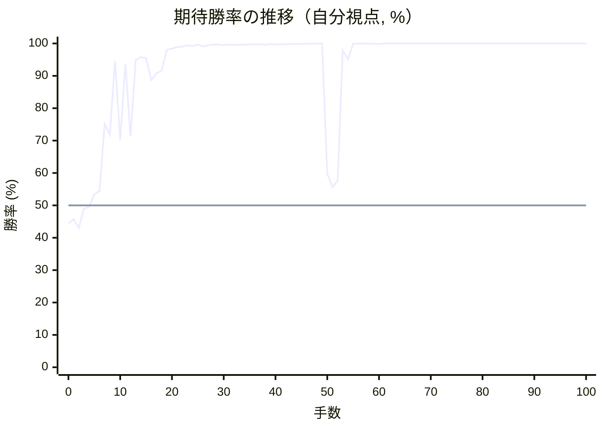
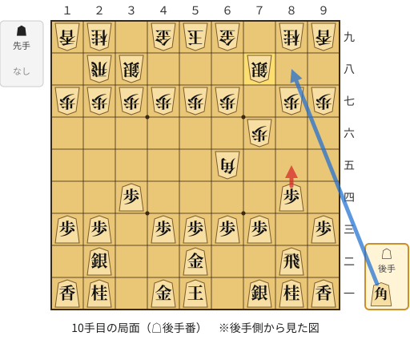
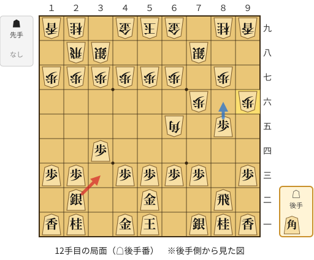
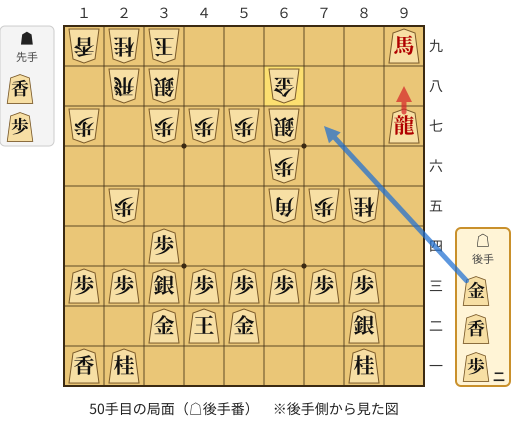
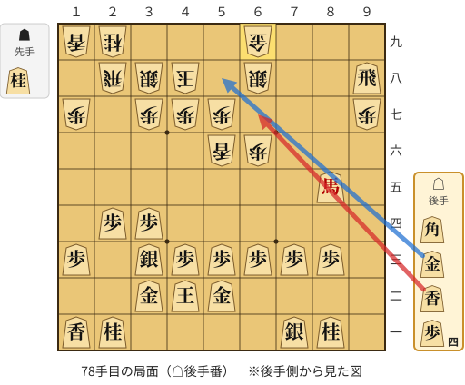

# 解析レポート xusa73w8p1so

[README に戻る](../../../README.md)　/　棋譜: [CSA](../../../data/csa/shogi5/xusa73w8p1so.csa)　/　解析の見方: [docs/mistake_analysis.md](../../../docs/mistake_analysis.md)

## 対局情報

| 項目 | 内容 |
|---|---|
| 日時 | 2026-10-29 03:25:48 |
| 持ち時間 | 5分 |
| 自分 | 後手（△）（1738） |
| 相手 | 相手（1356） |
| 結果 | 勝ち（詰み, 100手） |

## 解析環境

| 項目 | 内容 |
|---|---|
| エンジン | YaneuraOu NNUE 9.00git 64AVX2（V9.00/YANEURAOU_ENGINE_NNUE/AVX2） |
| 評価関数 | **水匠5**（`suisho5`） |
| nn.bin SHA-256 | `768068f0d534a0603a5d38bcd143de6bbca820d5f1c95a14d40863e5b7892d76` |
| 第1パス | movetime=150ms, MultiPV 1 |
| 第2パス | movetime=2000ms, MultiPV 3 |
| Threads / Hash | 8 / 512MB |
| 判定基準 | 疑問手 ≥5pt, 悪手 ≥10pt, 大悪手 ≥20pt（期待勝率 W(E)=1/(1+exp(-E/600))） |
| 解析日時 | 2026-11-03T04:21:53+09:00（解析バージョン 1, 34秒） |

## サマリー

| 自分の手数 | 深掘りした手 | 詰み逃し | 大悪手 | 悪手 | 疑問手 |
|--:|--:|--:|--:|--:|--:|
| 50 | 5 | 1 | 3 | 0 | 0 |

## 期待勝率の推移



<details><summary>1手ごとの数値（第1パス）</summary>

| 手数 | 指し手 | 評価値 | 勝率 | 低下 | 判定 |
|--:|---|--:|--:|--:|---|
| 1 | ▲７六歩(77) | -104 | 45.7% |  |  |
| 2 | △３四歩(33) | -170 | 43.0% | +2.7pt |  |
| 3 | ▲３八銀(39) | -23 | 49.0% |  |  |
| 4 | △８四歩(83) | -13 | 49.5% | -0.4pt |  |
| 5 | ▲２二角成(88) | +81 | 53.4% |  |  |
| 6 | △同銀(31) | +105 | 54.4% | -1.0pt |  |
| 7 | ▲６五角打 | +661 | 75.1% |  |  |
| 8 | △５二金(61) | +560 | 71.8% | +3.3pt |  |
| 9 | ▲７八銀(79) | +1714 | 94.6% |  |  |
| 10 | △８五歩(84) | +517 | 70.3% | +24.3pt | [大悪手](#ply-10) |
| 11 | ▲９六歩(97) | +1620 | 93.7% |  |  |
| 12 | △３三銀(22) | +546 | 71.3% | +22.4pt | [大悪手](#ply-12) |
| 13 | ▲９五歩(96) | +1753 | 94.9% |  |  |
| 14 | △８六歩(85) | +1870 | 95.8% | -0.9pt |  |
| 15 | ▲同歩(87) | +1823 | 95.4% |  |  |
| 16 | △同飛(82) | +1234 | 88.7% | +6.8pt |  |
| 17 | ▲８七歩打 | +1371 | 90.8% |  |  |
| 18 | △８四飛(86) | +1436 | 91.6% | -0.9pt |  |
| 19 | ▲６六歩(67) | +2367 | 98.1% |  |  |
| 20 | △８八角打 | +2455 | 98.4% | -0.3pt |  |
| 21 | ▲９四歩(95) | +2687 | 98.9% |  |  |
| 22 | △９九角成(88) | +2754 | 99.0% | -0.1pt |  |
| 23 | ▲９三歩成(94) | +3040 | 99.4% |  |  |
| 24 | △同香(91) | +2900 | 99.2% | +0.2pt |  |
| 25 | ▲５八金(69) | +3367 | 99.6% |  |  |
| 26 | △８三歩打 | +2812 | 99.1% | +0.5pt |  |
| 27 | ▲２六歩(27) | +3174 | 99.5% |  |  |
| 28 | △９八香成(93) | +3351 | 99.6% | -0.1pt |  |
| 29 | ▲７七桂(89) | +3590 | 99.7% |  |  |
| 30 | △４二玉(51) | +3232 | 99.5% | +0.2pt |  |
| 31 | ▲６八金(58) | +3503 | 99.7% |  |  |
| 32 | △８二銀(71) | +3145 | 99.5% | +0.2pt |  |
| 33 | ▲４八玉(59) | +3261 | 99.6% |  |  |
| 34 | △８八成香(98) | +3264 | 99.6% | -0.0pt |  |
| 35 | ▲８六歩(87) | +3573 | 99.7% |  |  |
| 36 | △同飛(84) | +3512 | 99.7% | +0.0pt |  |
| 37 | ▲３九玉(48) | +3672 | 99.8% |  |  |
| 38 | △９六飛(86) | +3321 | 99.6% | +0.2pt |  |
| 39 | ▲６七銀(78) | +3684 | 99.8% |  |  |
| 40 | △９七飛成(96) | +3573 | 99.7% | +0.0pt |  |
| 41 | ▲２五歩(26) | +3673 | 99.8% |  |  |
| 42 | △３二金(41) | +3400 | 99.7% | +0.1pt |  |
| 43 | ▲７五歩(76) | +3927 | 99.9% |  |  |
| 44 | △８七成香(88) | +3837 | 99.8% | +0.0pt |  |
| 45 | ▲８五桂(77) | +4196 | 99.9% |  |  |
| 46 | △７七成香(87) | +4263 | 99.9% | -0.0pt |  |
| 47 | ▲５八金(49) | +4260 | 99.9% |  |  |
| 48 | △６八成香(77) | +4521 | 99.9% | -0.0pt |  |
| 49 | ▲同金(58) | +4588 | 100.0% |  |  |
| 50 | △９八龍(97) | +238 | 59.8% | +40.2pt | [大悪手](#ply-50) |
| 51 | ▲同角(65) | +138 | 55.7% |  |  |
| 52 | △同馬(99) | +181 | 57.5% | -1.8pt |  |
| 53 | ▲４八玉(39) | +2304 | 97.9% |  |  |
| 54 | △８九馬(98) | +1784 | 95.1% | +2.8pt |  |
| 55 | ▲７二飛打 | +4328 | 99.9% |  |  |
| 56 | △７一金打 | +4432 | 99.9% | -0.0pt |  |
| 57 | ▲７八銀(67) | +5093 | 100.0% |  |  |
| 58 | △７九馬(89) | +4265 | 99.9% | +0.1pt |  |
| 59 | ▲６九金(68) | +4442 | 99.9% |  |  |
| 60 | △９七馬(79) | +3836 | 99.8% | +0.1pt |  |
| 61 | ▲９八歩打 | +4921 | 100.0% |  |  |
| 62 | △７五馬(97) | +5088 | 100.0% | -0.0pt |  |
| 63 | ▲７一飛成(72) | +4991 | 100.0% |  |  |
| 64 | △同銀(82) | +5144 | 100.0% | -0.0pt |  |
| 65 | ▲２四歩(25) | +5243 | 100.0% |  |  |
| 66 | △同歩(23) | +5354 | 100.0% | -0.0pt |  |
| 67 | ▲５六香打 | +5757 | 100.0% |  |  |
| 68 | △８五馬(75) | +5725 | 100.0% | +0.0pt |  |
| 69 | ▲９七歩(98) | +5976 | 100.0% |  |  |
| 70 | △８六桂打 | +6046 | 100.0% | -0.0pt |  |
| 71 | ▲７七銀(78) | +6174 | 100.0% |  |  |
| 72 | △９八飛打 | +6054 | 100.0% | +0.0pt |  |
| 73 | ▲６八銀(77) | +6600 | 100.0% |  |  |
| 74 | △７八桂成(86) | +6748 | 100.0% | -0.0pt |  |
| 75 | ▲５九金打 | +7460 | 100.0% |  |  |
| 76 | △６九成桂(78) | +7825 | 100.0% | -0.0pt |  |
| 77 | ▲同金(59) | #+21 | 100.0% |  |  |
| 78 | △６七香打 | +6591 | 100.0% | +0.0pt | [詰み逃し](#ply-78) |
| 79 | ▲７八桂打 | +7488 | 100.0% |  |  |
| 80 | △６八香成(67) | +7957 | 100.0% | -0.0pt |  |
| 81 | ▲５三香成(56) | #+27 | 100.0% |  |  |
| 82 | △同金(52) | #+22 | 100.0% | +0.0pt |  |
| 83 | ▲６八金(69) | #+13 | 100.0% |  |  |
| 84 | △９九飛成(98) | #+20 | 100.0% | +0.0pt |  |
| 85 | ▲４六歩(47) | #+13 | 100.0% |  |  |
| 86 | △３九銀打 | #+14 | 100.0% | +0.0pt |  |
| 87 | ▲４七玉(48) | #+11 | 100.0% |  |  |
| 88 | △２八銀成(39) | #+20 | 100.0% | +0.0pt |  |
| 89 | ▲１六歩(17) | #+7 | 100.0% |  |  |
| 90 | △３八成銀(28) | #+10 | 100.0% | +0.0pt |  |
| 91 | ▲５八金(68) | #+7 | 100.0% |  |  |
| 92 | △４九龍(99) | #+6 | 100.0% | +0.0pt |  |
| 93 | ▲４八香打 | #+5 | 100.0% |  |  |
| 94 | △５八馬(85) | #+4 | 100.0% | +0.0pt |  |
| 95 | ▲５六玉(47) | #+3 | 100.0% |  |  |
| 96 | △５五歩打 | #+4 | 100.0% | +0.0pt |  |
| 97 | ▲同玉(56) | #+3 | 100.0% |  |  |
| 98 | △５四銀打 | #+2 | 100.0% | +0.0pt |  |
| 99 | ▲５六玉(55) | #+1 | 100.0% |  |  |
| 100 | △５五金打 | #+ | 100.0% | +0.0pt |  |

</details>

## 課題局面

<a id="ply-10"></a>
### 10手目 △８五歩(84) — 大悪手

| | 着手前 | 着手後 | 差 |
|---|--:|--:|--:|
| 期待勝率 | 95.4% | 69.7% | -25.7pt |
| 評価値 | +1818 | +500 | |

着手前の局面:



🔴 実戦 △８五歩(84)　🔵 AI推奨 △８八角打　🟨 直前の相手の指し手

<details><summary>テキストの盤面図（BOD・将棋ソフトに貼り付け可）</summary>

```text
後手の持駒：角
  ９ ８ ７ ６ ５ ４ ３ ２ １
+---------------------------+
|v香v桂v銀 ・v玉v金 ・v桂v香|一
| ・v飛 ・ ・v金 ・ ・v銀 ・|二
|v歩 ・v歩v歩v歩v歩 ・v歩v歩|三
| ・v歩 ・ ・ ・ ・v歩 ・ ・|四
| ・ ・ ・ 角 ・ ・ ・ ・ ・|五
| ・ ・ 歩 ・ ・ ・ ・ ・ ・|六
| 歩 歩 ・ 歩 歩 歩 歩 歩 歩|七
| ・ ・ 銀 ・ ・ ・ 銀 飛 ・|八
| 香 桂 ・ 金 玉 金 ・ 桂 香|九
+---------------------------+
先手の持駒：なし
後手番
手数＝9　▲７八銀　まで
```

</details>

| | 指し手 | 評価値 | 読み筋 |
|---|---|--:|---|
| 実戦 | △８五歩(84) | +500 | ▲７七銀(78) △３三銀(22) ▲３六歩(37) △３二金(41) ▲３七銀(38) △４二玉(51) |
| AI 1位 | △８八角打 | +1818 | △８八角打 ▲９八香(99) △９九角成(88) ▲４六歩(47) △８五歩(84) ▲７九金(69) |
| AI 2位 | △６四歩(63) | +1647 | △６四歩(63) ▲５六角(65) △８八角打 ▲９八香(99) △９九角成(88) ▲３六歩(37) |
| AI 3位 | △６二銀(71) | +560 | △６二銀(71) ▲７七銀(78) △３三銀(22) ▲５六角(65) △５四歩(53) ▲６六歩(67) |

SFEN: `lns1kg1nl/1r2g2s1/p1pppp1pp/1p4p2/3B5/2P6/PP1PPPPPP/2S3SR1/LN1GKG1NL w b 10`

<a id="ply-12"></a>
### 12手目 △３三銀(22) — 大悪手

| | 着手前 | 着手後 | 差 |
|---|--:|--:|--:|
| 期待勝率 | 96.6% | 71.5% | -25.1pt |
| 評価値 | +2006 | +551 | |

着手前の局面:



🔴 実戦 △３三銀(22)　🔵 AI推奨 △８六歩(85)　🟨 直前の相手の指し手

<details><summary>テキストの盤面図（BOD・将棋ソフトに貼り付け可）</summary>

```text
後手の持駒：角
  ９ ８ ７ ６ ５ ４ ３ ２ １
+---------------------------+
|v香v桂v銀 ・v玉v金 ・v桂v香|一
| ・v飛 ・ ・v金 ・ ・v銀 ・|二
|v歩 ・v歩v歩v歩v歩 ・v歩v歩|三
| ・ ・ ・ ・ ・ ・v歩 ・ ・|四
| ・v歩 ・ 角 ・ ・ ・ ・ ・|五
| 歩 ・ 歩 ・ ・ ・ ・ ・ ・|六
| ・ 歩 ・ 歩 歩 歩 歩 歩 歩|七
| ・ ・ 銀 ・ ・ ・ 銀 飛 ・|八
| 香 桂 ・ 金 玉 金 ・ 桂 香|九
+---------------------------+
先手の持駒：なし
後手番
手数＝11　▲９六歩　まで
```

</details>

| | 指し手 | 評価値 | 読み筋 |
|---|---|--:|---|
| 実戦 | △３三銀(22) | +551 | ▲７七銀(78) △６二銀(71) ▲６六歩(67) △５四歩(53) ▲３六歩(37) △５五歩(54) |
| AI 1位 | △８六歩(85) | +2006 | △８六歩(85) ▲同歩(87) △８八角打 ▲９七香(99) △８六飛(82) ▲１六歩(17) |
| AI 2位 | △８八角打 | +1977 | △８八角打 ▲９七香(99) △８六歩(85) ▲同歩(87) △同飛(82) ▲１六歩(17) |
| AI 3位 | △６四歩(63) | +1597 | △６四歩(63) ▲５六角(65) △８六歩(85) ▲同歩(87) △８八角打 ▲９七香(99) |

SFEN: `lns1kg1nl/1r2g2s1/p1pppp1pp/6p2/1p1B5/P1P6/1P1PPPPPP/2S3SR1/LN1GKG1NL w b 12`

<a id="ply-50"></a>
### 50手目 △９八龍(97) — 大悪手

| | 着手前 | 着手後 | 差 |
|---|--:|--:|--:|
| 期待勝率 | 100.0% | 57.8% | -42.2pt |
| 評価値 | +4596 | +188 | |

着手前の局面:



🔴 実戦 △９八龍(97)　🔵 AI推奨 △７七金打　🟨 直前の相手の指し手

<details><summary>テキストの盤面図（BOD・将棋ソフトに貼り付け可）</summary>

```text
後手の持駒：金　香　歩二
  ９ ８ ７ ６ ５ ４ ３ ２ １
+---------------------------+
| ・v桂 ・ ・ ・ ・ ・v桂v香|一
| ・v銀 ・ ・v金v玉v金 ・ ・|二
| ・v歩v歩v歩v歩v歩v銀v歩v歩|三
| ・ ・ ・ ・ ・ ・v歩 ・ ・|四
| ・ 桂 歩 角 ・ ・ ・ 歩 ・|五
| ・ ・ ・ 歩 ・ ・ ・ ・ ・|六
|v龍 ・ ・ 銀 歩 歩 歩 ・ 歩|七
| ・ ・ ・ 金 ・ ・ 銀 飛 ・|八
|v馬 ・ ・ ・ ・ ・ 玉 桂 香|九
+---------------------------+
先手の持駒：香　歩
後手番
手数＝49　▲６八同金　まで
```

</details>

| | 指し手 | 評価値 | 読み筋 |
|---|---|--:|---|
| 実戦 | △９八龍(97) | +188 | ▲同角(65) △同馬(99) ▲９二飛打 △９三銀(82) ▲同桂不成(85) △同桂(81) |
| AI 1位 | △７七金打 | +4596 | △７七金打 ▲同金(68) △同馬(99) ▲５八銀(67) △９九龍(97) ▲４九銀(38) |
| AI 2位 | △８八龍(97) | +4557 | △８八龍(97) ▲４九銀(38) △８五龍(88) ▲４六歩(47) △７五龍(85) ▲７七歩打 |
| AI 3位 | △９六龍(97) | +4430 | △９六龍(97) ▲９三歩打 △９一歩打 ▲７六角(65) △７七金打 ▲同金(68) |

SFEN: `1n5nl/1s2gkg2/1pppppspp/6p2/1NPB3P1/3P5/+r2SPPP1P/3G2SR1/+b5KNL w LPgl2p 50`

<a id="ply-78"></a>
### 78手目 △６七香打 — 詰み逃し

| | 着手前 | 着手後 | 差 |
|---|--:|--:|--:|
| 期待勝率 | 100.0% | 100.0% | -0.0pt |
| 評価値 | 13手詰め | +7621 | |

着手前の局面:



🔴 実戦 △６七香打　🔵 AI推奨 △５八金打　🟨 直前の相手の指し手

<details><summary>テキストの盤面図（BOD・将棋ソフトに貼り付け可）</summary>

```text
後手の持駒：角　金　香　歩四
  ９ ８ ７ ６ ５ ４ ３ ２ １
+---------------------------+
| ・v桂v銀 ・ ・ ・ ・v桂v香|一
| ・ ・ ・ ・v金v玉v金 ・ ・|二
| ・v歩v歩v歩v歩v歩v銀 ・v歩|三
| ・ ・ ・ ・ ・ ・v歩v歩 ・|四
| ・v馬 ・ ・ ・ ・ ・ ・ ・|五
| ・ ・ ・ 歩 香 ・ ・ ・ ・|六
| 歩 ・ ・ ・ 歩 歩 歩 ・ 歩|七
|v飛 ・ ・ 銀 ・ 玉 銀 飛 ・|八
| ・ ・ ・ 金 ・ ・ ・ 桂 香|九
+---------------------------+
先手の持駒：桂
後手番
手数＝77　▲６九同金　まで
```

</details>

| | 指し手 | 評価値 | 読み筋 |
|---|---|--:|---|
| 実戦 | △６七香打 | +7621 | ▲４四桂打 △同歩(43) |
| AI 1位 | △５八金打 | 13手詰め | △５八金打 ▲同金(69) △同馬(85) ▲同玉(48) △６九角打 ▲同玉(58) |
| AI 2位 | △７七角打 | +7161 | △７七角打 ▲５八桂打 △６八角成(77) ▲同金(69) △同飛成(98) ▲４九銀(38) |
| AI 3位 | △８六角打 | +6585 | △８六角打 ▲７七桂打 △同角成(86) ▲５三香成(56) △同金(52) ▲８八歩打 |

SFEN: `1ns4nl/4gkg2/1ppppps1p/6pp1/1+b7/3PL4/P3PPP1P/r2S1KSR1/3G3NL w Nbgl4p 78`

