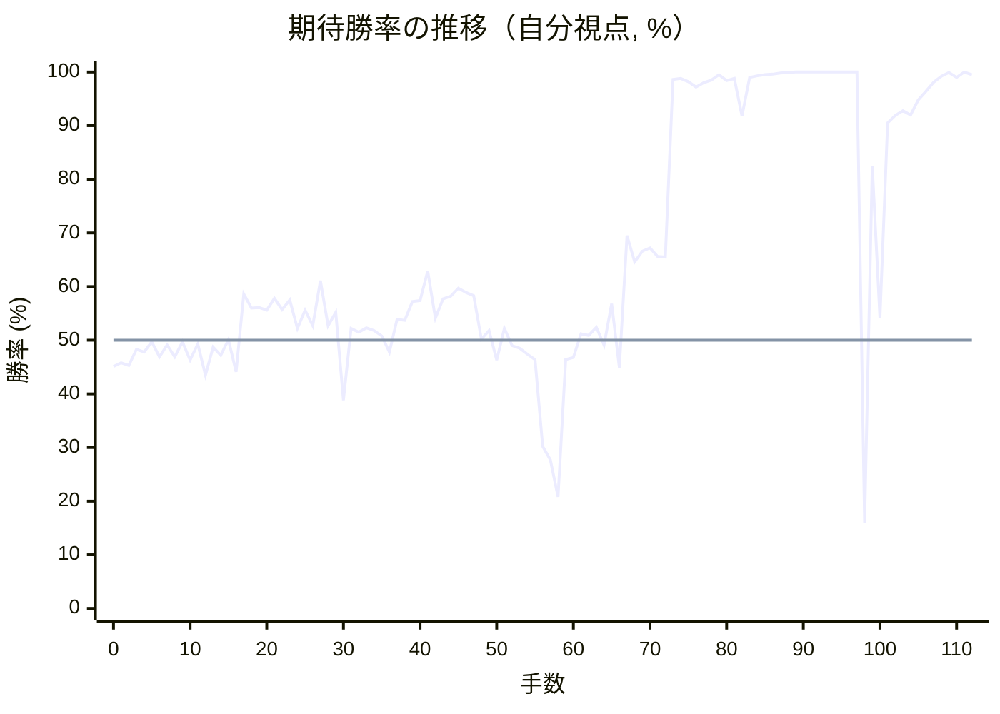
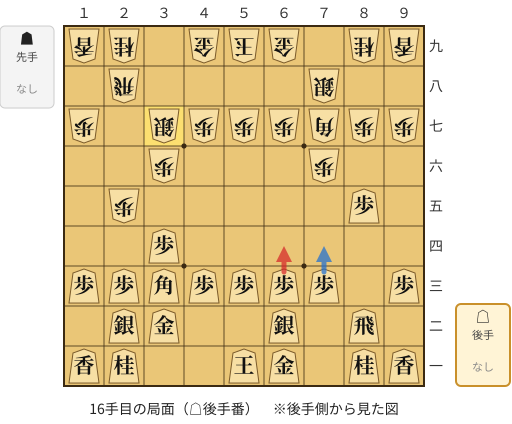
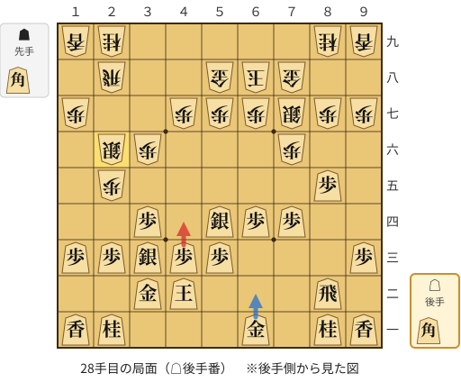
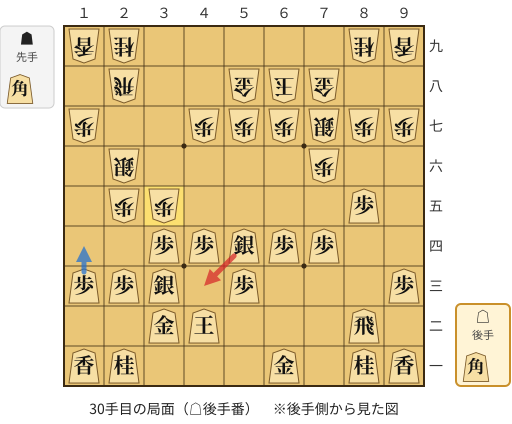
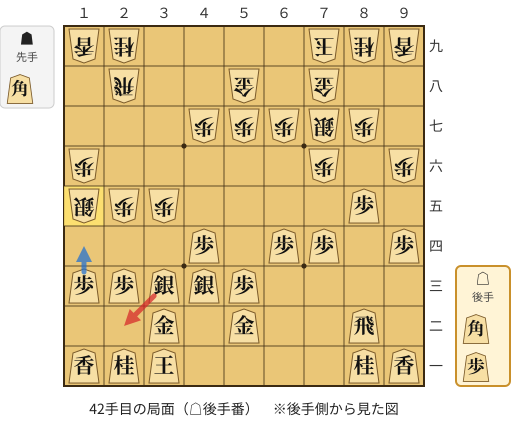
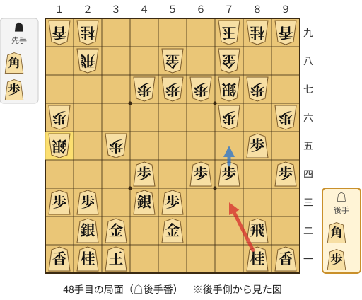
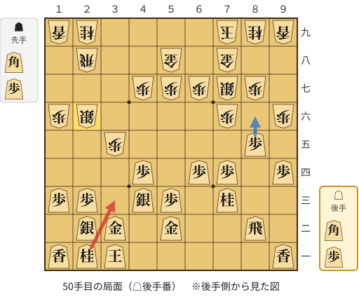
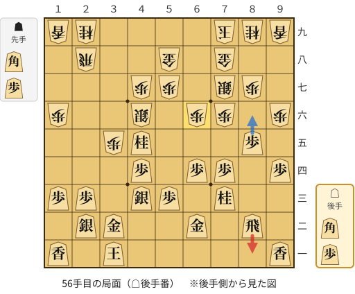
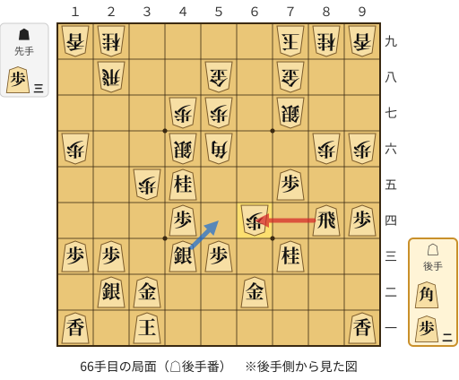
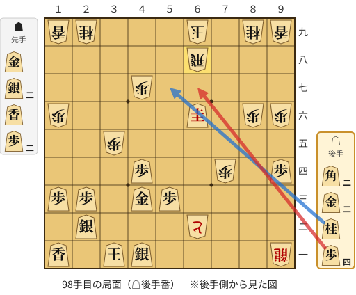

# 解析レポート xx74qf0p7ona

[README に戻る](../../../README.md)　/　棋譜: [CSA](../../../data/csa/shogi5/xx74qf0p7ona.csa)　/　解析の見方: [docs/mistake_analysis.md](../../../docs/mistake_analysis.md)

## 対局情報

| 項目 | 内容 |
|---|---|
| 日時 | 2026-11-19 02:04:52 |
| 持ち時間 | 5分 |
| 自分 | 後手（△）（1677） |
| 相手 | 相手（1682） |
| 結果 | 勝ち（時間切れ, 112手） |

## 解析環境

| 項目 | 内容 |
|---|---|
| エンジン | YaneuraOu NNUE 9.00git 64AVX2（V9.00/YANEURAOU_ENGINE_NNUE/AVX2） |
| 評価関数 | **水匠5**（`suisho5`） |
| nn.bin SHA-256 | `768068f0d534a0603a5d38bcd143de6bbca820d5f1c95a14d40863e5b7892d76` |
| 第1パス | movetime=150ms, MultiPV 1 |
| 第2パス | movetime=2000ms, MultiPV 3 |
| Threads / Hash | 8 / 512MB |
| 判定基準 | 疑問手 ≥5pt, 悪手 ≥10pt, 大悪手 ≥20pt（期待勝率 W(E)=1/(1+exp(-E/600))） |
| 解析日時 | 2026-11-20T20:09:19+09:00（解析バージョン 1, 73秒） |

## サマリー

| 自分の手数 | 深掘りした手 | 詰み逃し | 大悪手 | 悪手 | 疑問手 |
|--:|--:|--:|--:|--:|--:|
| 56 | 14 | 1 | 0 | 3 | 5 |

## 期待勝率の推移



<details><summary>1手ごとの数値（第1パス）</summary>

| 手数 | 指し手 | 評価値 | 勝率 | 低下 | 判定 |
|--:|---|--:|--:|--:|---|
| 1 | ▲２六歩(27) | -101 | 45.8% |  |  |
| 2 | △８四歩(83) | -113 | 45.3% | +0.5pt |  |
| 3 | ▲２五歩(26) | -41 | 48.3% |  |  |
| 4 | △８五歩(84) | -52 | 47.8% | +0.5pt |  |
| 5 | ▲７六歩(77) | -8 | 49.7% |  |  |
| 6 | △３二金(41) | -74 | 46.9% | +2.7pt |  |
| 7 | ▲７七角(88) | -21 | 49.1% |  |  |
| 8 | △３四歩(33) | -75 | 46.9% | +2.2pt |  |
| 9 | ▲７八銀(79) | -7 | 49.7% |  |  |
| 10 | △６二銀(71) | -90 | 46.3% | +3.5pt |  |
| 11 | ▲４八銀(39) | -18 | 49.3% |  |  |
| 12 | △３三角(22) | -156 | 43.5% | +5.7pt |  |
| 13 | ▲３六歩(37) | -31 | 48.7% |  |  |
| 14 | △２二銀(31) | -68 | 47.2% | +1.5pt |  |
| 15 | ▲３七銀(48) | +3 | 50.1% |  |  |
| 16 | △６四歩(63) | -143 | 44.1% | +6.1pt | [疑問手](#ply-16) |
| 17 | ▲３三角成(77) | +208 | 58.6% |  |  |
| 18 | △同銀(22) | +144 | 56.0% | +2.6pt |  |
| 19 | ▲７七銀(78) | +148 | 56.1% |  |  |
| 20 | △６三銀(62) | +134 | 55.6% | +0.6pt |  |
| 21 | ▲７八金(69) | +188 | 57.8% |  |  |
| 22 | △５四銀(63) | +137 | 55.7% | +2.1pt |  |
| 23 | ▲６八玉(59) | +182 | 57.5% |  |  |
| 24 | △４二玉(51) | +53 | 52.2% | +5.3pt |  |
| 25 | ▲５八金(49) | +134 | 55.6% |  |  |
| 26 | △７四歩(73) | +65 | 52.7% | +2.9pt |  |
| 27 | ▲２六銀(37) | +271 | 61.1% |  |  |
| 28 | △４四歩(43) | +64 | 52.7% | +8.4pt | [疑問手](#ply-28) |
| 29 | ▲３五歩(36) | +125 | 55.2% |  |  |
| 30 | △４三銀(54) | -273 | 38.8% | +16.4pt | [悪手](#ply-30) |
| 31 | ▲１六歩(17) | +52 | 52.2% |  |  |
| 32 | △５二金(61) | +37 | 51.5% | +0.6pt |  |
| 33 | ▲７九玉(68) | +56 | 52.3% |  |  |
| 34 | △９四歩(93) | +43 | 51.8% | +0.5pt |  |
| 35 | ▲９六歩(97) | +20 | 50.8% |  |  |
| 36 | △３一玉(42) | -52 | 47.8% | +3.0pt |  |
| 37 | ▲３四歩(35) | +94 | 53.9% |  |  |
| 38 | △同銀(43) | +88 | 53.7% | +0.2pt |  |
| 39 | ▲３五歩打 | +173 | 57.2% |  |  |
| 40 | △４三銀(34) | +178 | 57.4% | -0.2pt |  |
| 41 | ▲１五銀(26) | +317 | 62.9% |  |  |
| 42 | △２二銀(33) | +98 | 54.1% | +8.8pt | [疑問手](#ply-42) |
| 43 | ▲２四歩(25) | +186 | 57.7% |  |  |
| 44 | △同歩(23) | +198 | 58.2% | -0.5pt |  |
| 45 | ▲同銀(15) | +235 | 59.7% |  |  |
| 46 | △２三歩打 | +215 | 58.9% | +0.8pt |  |
| 47 | ▲１五銀(24) | +202 | 58.3% |  |  |
| 48 | △７三桂(81) | +4 | 50.2% | +8.2pt | [疑問手](#ply-48) |
| 49 | ▲２六銀(15) | +44 | 51.8% |  |  |
| 50 | △３三桂(21) | -90 | 46.3% | +5.6pt | [疑問手](#ply-50) |
| 51 | ▲３七銀(26) | +53 | 52.2% |  |  |
| 52 | △４五桂(33) | -24 | 49.0% | +3.2pt |  |
| 53 | ▲４六銀(37) | -37 | 48.5% |  |  |
| 54 | △６二金(52) | -63 | 47.4% | +1.1pt |  |
| 55 | ▲６六歩(67) | -87 | 46.4% |  |  |
| 56 | △８一飛(82) | -503 | 30.2% | +16.2pt | [悪手](#ply-56) |
| 57 | ▲７五歩(76) | -575 | 27.7% |  |  |
| 58 | △８四飛(81) | -802 | 20.8% | +6.9pt |  |
| 59 | ▲５六角打 | -87 | 46.4% |  |  |
| 60 | △６五歩(64) | -76 | 46.8% | -0.5pt |  |
| 61 | ▲同歩(66) | +30 | 51.2% |  |  |
| 62 | △８六歩(85) | +21 | 50.9% | +0.4pt |  |
| 63 | ▲同歩(87) | +58 | 52.4% |  |  |
| 64 | △７五歩(74) | -22 | 49.1% | +3.3pt |  |
| 65 | ▲６四歩(65) | +164 | 56.8% |  |  |
| 66 | △同飛(84) | -124 | 44.9% | +11.9pt | [悪手](#ply-66) |
| 67 | ▲７四歩打 | +494 | 69.5% |  |  |
| 68 | △６五桂(73) | +360 | 64.6% | +4.9pt |  |
| 69 | ▲６六銀(77) | +415 | 66.6% |  |  |
| 70 | △５七桂成(65) | +431 | 67.2% | -0.6pt |  |
| 71 | ▲同銀(46) | +387 | 65.6% |  |  |
| 72 | △同桂成(45) | +385 | 65.5% | +0.1pt |  |
| 73 | ▲６五歩打 | +2567 | 98.6% |  |  |
| 74 | △５六成桂(57) | +2665 | 98.8% | -0.2pt |  |
| 75 | ▲６四歩(65) | +2415 | 98.2% |  |  |
| 76 | △６六成桂(56) | +2128 | 97.2% | +1.0pt |  |
| 77 | ▲５一飛打 | +2333 | 98.0% |  |  |
| 78 | △４一銀打 | +2498 | 98.5% | -0.5pt |  |
| 79 | ▲９一飛成(51) | +3140 | 99.5% |  |  |
| 80 | △７六歩(75) | +2468 | 98.4% | +1.1pt |  |
| 81 | ▲５五桂打 | +2642 | 98.8% |  |  |
| 82 | △５四銀(43) | +1446 | 91.8% | +7.0pt |  |
| 83 | ▲４三香打 | +2757 | 99.0% |  |  |
| 84 | △同銀(54) | +2937 | 99.3% | -0.3pt |  |
| 85 | ▲同桂成(55) | +3216 | 99.5% |  |  |
| 86 | △同金(32) | +3281 | 99.6% | -0.0pt |  |
| 87 | ▲６三歩成(64) | +3797 | 99.8% |  |  |
| 88 | △７七香打 | +4122 | 99.9% | -0.1pt |  |
| 89 | ▲６二と(63) | #+11 | 100.0% |  |  |
| 90 | △７八香成(77) | #+10 | 100.0% | +0.0pt |  |
| 91 | ▲同玉(79) | #+9 | 100.0% |  |  |
| 92 | △７七歩成(76) | +6823 | 100.0% | +0.0pt |  |
| 93 | ▲６九玉(78) | #+29 | 100.0% |  |  |
| 94 | △６八銀打 | #+26 | 100.0% | +0.0pt |  |
| 95 | ▲同金(58) | #+23 | 100.0% |  |  |
| 96 | △同と(77) | #+22 | 100.0% | +0.0pt |  |
| 97 | ▲同飛(28) | #+19 | 100.0% |  |  |
| 98 | △６七歩打 | -1001 | 15.9% | +84.1pt | [詰み逃し](#ply-98) |
| 99 | ▲４一龍(91) | +932 | 82.5% |  |  |
| 100 | △同玉(31) | +98 | 54.1% | +28.5pt |  |
| 101 | ▲５二銀打 | +1353 | 90.5% |  |  |
| 102 | △３一玉(41) | +1455 | 91.9% | -1.4pt |  |
| 103 | ▲３二銀打 | +1535 | 92.8% |  |  |
| 104 | △同玉(31) | +1462 | 92.0% | +0.9pt |  |
| 105 | ▲４三銀成(52) | +1746 | 94.8% |  |  |
| 106 | △同玉(32) | +1978 | 96.4% | -1.6pt |  |
| 107 | ▲３四金打 | +2355 | 98.1% |  |  |
| 108 | △５四玉(43) | +2895 | 99.2% | -1.1pt |  |
| 109 | ▲５九香打 | +4192 | 99.9% |  |  |
| 110 | △６五玉(54) | +2765 | 99.0% | +0.9pt |  |
| 111 | ▲５五金打 | +5556 | 100.0% |  |  |
| 112 | △７五玉(65) | +3203 | 99.5% | +0.5pt |  |

</details>

## 課題局面

<a id="ply-16"></a>
### 16手目 △６四歩(63) — 疑問手

| | 着手前 | 着手後 | 差 |
|---|--:|--:|--:|
| 期待勝率 | 51.8% | 46.3% | -5.6pt |
| 評価値 | +44 | -90 | |

着手前の局面:



🔴 実戦 △６四歩(63)　🔵 AI推奨 △７四歩(73)　🟨 直前の相手の指し手

<details><summary>テキストの盤面図（BOD・将棋ソフトに貼り付け可）</summary>

```text
後手の持駒：なし
  ９ ８ ７ ６ ５ ４ ３ ２ １
+---------------------------+
|v香v桂 ・v金v玉 ・ ・v桂v香|一
| ・v飛 ・v銀 ・ ・v金v銀 ・|二
|v歩 ・v歩v歩v歩v歩v角v歩v歩|三
| ・ ・ ・ ・ ・ ・v歩 ・ ・|四
| ・v歩 ・ ・ ・ ・ ・ 歩 ・|五
| ・ ・ 歩 ・ ・ ・ 歩 ・ ・|六
| 歩 歩 角 歩 歩 歩 銀 ・ 歩|七
| ・ ・ 銀 ・ ・ ・ ・ 飛 ・|八
| 香 桂 ・ 金 玉 金 ・ 桂 香|九
+---------------------------+
先手の持駒：なし
後手番
手数＝15　▲３七銀　まで
```

</details>

| | 指し手 | 評価値 | 読み筋 |
|---|---|--:|---|
| 実戦 | △６四歩(63) | -90 | ▲６六歩(67) △７四歩(73) |
| AI 1位 | △７四歩(73) | +44 | △７四歩(73) ▲４六銀(37) △５二金(61) ▲６八玉(59) △４一玉(51) ▲５八金(49) |
| AI 2位 | △５二金(61) | +27 | △５二金(61) ▲６八玉(59) △７四歩(73) ▲３三角成(77) △同銀(22) ▲７七銀(78) |
| AI 3位 | △４一玉(51) | +17 | △４一玉(51) ▲４六銀(37) △７四歩(73) ▲４五銀(46) △７三桂(81) ▲３四銀(45) |

SFEN: `ln1gk2nl/1r1s2gs1/p1ppppbpp/6p2/1p5P1/2P3P2/PPBPPPS1P/2S4R1/LN1GKG1NL w - 16`

<a id="ply-28"></a>
### 28手目 △４四歩(43) — 疑問手

| | 着手前 | 着手後 | 差 |
|---|--:|--:|--:|
| 期待勝率 | 60.0% | 53.5% | -6.5pt |
| 評価値 | +243 | +84 | |

着手前の局面:



🔴 実戦 △４四歩(43)　🔵 AI推奨 △６二金(61)　🟨 直前の相手の指し手

<details><summary>テキストの盤面図（BOD・将棋ソフトに貼り付け可）</summary>

```text
後手の持駒：角
  ９ ８ ７ ６ ５ ４ ３ ２ １
+---------------------------+
|v香v桂 ・v金 ・ ・ ・v桂v香|一
| ・v飛 ・ ・ ・v玉v金 ・ ・|二
|v歩 ・ ・ ・v歩v歩v銀v歩v歩|三
| ・ ・v歩v歩v銀 ・v歩 ・ ・|四
| ・v歩 ・ ・ ・ ・ ・ 歩 ・|五
| ・ ・ 歩 ・ ・ ・ 歩 銀 ・|六
| 歩 歩 銀 歩 歩 歩 ・ ・ 歩|七
| ・ ・ 金 玉 金 ・ ・ 飛 ・|八
| 香 桂 ・ ・ ・ ・ ・ 桂 香|九
+---------------------------+
先手の持駒：角
後手番
手数＝27　▲２六銀　まで
```

</details>

| | 指し手 | 評価値 | 読み筋 |
|---|---|--:|---|
| 実戦 | △４四歩(43) | +84 | ▲１五銀(26) △２二銀(33) ▲２四歩(25) △同歩(23) ▲同銀(15) △２三歩打 |
| AI 1位 | △６二金(61) | +243 | △６二金(61) ▲３五歩(36) △７三桂(81) ▲４六歩(47) △６五桂(73) ▲３四歩(35) |
| AI 2位 | △７三桂(81) | +238 | △７三桂(81) ▲３五歩(36) △６二金(61) ▲４六歩(47) △６五桂(73) ▲３四歩(35) |
| AI 3位 | △７二金(61) | +174 | △７二金(61) ▲３五歩(36) △７三桂(81) ▲４六歩(47) △６五桂(73) ▲６六銀(77) |

SFEN: `ln1g3nl/1r3kg2/p3ppspp/2pps1p2/1p5P1/2P3PS1/PPSPPP2P/2GKG2R1/LN5NL w Bb 28`

<a id="ply-30"></a>
### 30手目 △４三銀(54) — 悪手

| | 着手前 | 着手後 | 差 |
|---|--:|--:|--:|
| 期待勝率 | 54.8% | 35.4% | -19.4pt |
| 評価値 | +116 | -361 | |

着手前の局面:



🔴 実戦 △４三銀(54)　🔵 AI推奨 △１四歩(13)　🟨 直前の相手の指し手

<details><summary>テキストの盤面図（BOD・将棋ソフトに貼り付け可）</summary>

```text
後手の持駒：角
  ９ ８ ７ ６ ５ ４ ３ ２ １
+---------------------------+
|v香v桂 ・v金 ・ ・ ・v桂v香|一
| ・v飛 ・ ・ ・v玉v金 ・ ・|二
|v歩 ・ ・ ・v歩 ・v銀v歩v歩|三
| ・ ・v歩v歩v銀v歩v歩 ・ ・|四
| ・v歩 ・ ・ ・ ・ 歩 歩 ・|五
| ・ ・ 歩 ・ ・ ・ ・ 銀 ・|六
| 歩 歩 銀 歩 歩 歩 ・ ・ 歩|七
| ・ ・ 金 玉 金 ・ ・ 飛 ・|八
| 香 桂 ・ ・ ・ ・ ・ 桂 香|九
+---------------------------+
先手の持駒：角
後手番
手数＝29　▲３五歩　まで
```

</details>

| | 指し手 | 評価値 | 読み筋 |
|---|---|--:|---|
| 実戦 | △４三銀(54) | -361 | ▲６三角打 △７五歩(74) ▲同歩(76) △５五角打 ▲２七角成(63) △２八角成(55) |
| AI 1位 | △１四歩(13) | +116 | △１四歩(13) ▲３四歩(35) △同銀(33) ▲３七銀(26) △３三桂(21) ▲２四歩(25) |
| AI 2位 | △９四歩(93) | +126 | △９四歩(93) ▲９六歩(97) △１四歩(13) ▲１六歩(17) △７三桂(81) ▲１五歩(16) |
| AI 3位 | △５二金(61) | +98 | △５二金(61) ▲３四歩(35) △同銀(33) ▲３七銀(26) △３三桂(21) ▲２四歩(25) |

SFEN: `ln1g3nl/1r3kg2/p3p1spp/2ppspp2/1p4PP1/2P4S1/PPSPPP2P/2GKG2R1/LN5NL w Bb 30`

<a id="ply-42"></a>
### 42手目 △２二銀(33) — 疑問手

| | 着手前 | 着手後 | 差 |
|---|--:|--:|--:|
| 期待勝率 | 64.8% | 55.6% | -9.2pt |
| 評価値 | +367 | +136 | |

着手前の局面:



🔴 実戦 △２二銀(33)　🔵 AI推奨 △１四歩(13)　🟨 直前の相手の指し手

<details><summary>テキストの盤面図（BOD・将棋ソフトに貼り付け可）</summary>

```text
後手の持駒：角　歩
  ９ ８ ７ ６ ５ ４ ３ ２ １
+---------------------------+
|v香v桂 ・ ・ ・ ・v玉v桂v香|一
| ・v飛 ・ ・v金 ・v金 ・ ・|二
| ・ ・ ・ ・v歩v銀v銀v歩v歩|三
|v歩 ・v歩v歩 ・v歩 ・ ・ ・|四
| ・v歩 ・ ・ ・ ・ 歩 歩 銀|五
| 歩 ・ 歩 ・ ・ ・ ・ ・ 歩|六
| ・ 歩 銀 歩 歩 歩 ・ ・ ・|七
| ・ ・ 金 ・ 金 ・ ・ 飛 ・|八
| 香 桂 玉 ・ ・ ・ ・ 桂 香|九
+---------------------------+
先手の持駒：角
後手番
手数＝41　▲１五銀　まで
```

</details>

| | 指し手 | 評価値 | 読み筋 |
|---|---|--:|---|
| 実戦 | △２二銀(33) | +136 | ▲６八金(58) △３八歩打 ▲同飛(28) △２七角打 ▲２八飛(38) △４五角成(27) |
| AI 1位 | △１四歩(13) | +367 | △１四歩(13) ▲２六銀(15) △７五歩(74) ▲同歩(76) △７六歩打 ▲８八銀(77) |
| AI 2位 | △７五歩(74) | +354 | △７五歩(74) ▲同歩(76) △８六歩(85) ▲同歩(87) △７六歩打 ▲８八銀(77) |
| AI 3位 | △８六歩(85) | +320 | △８六歩(85) ▲同歩(87) △７五歩(74) ▲同歩(76) △７六歩打 ▲６六銀(77) |

SFEN: `ln4knl/1r2g1g2/4psspp/p1pp1p3/1p4PPS/P1P5P/1PSPPP3/2G1G2R1/LNK4NL w Bbp 42`

<a id="ply-48"></a>
### 48手目 △７三桂(81) — 疑問手

| | 着手前 | 着手後 | 差 |
|---|--:|--:|--:|
| 期待勝率 | 59.7% | 50.7% | -9.0pt |
| 評価値 | +236 | +16 | |

着手前の局面:



🔴 実戦 △７三桂(81)　🔵 AI推奨 △７五歩(74)　🟨 直前の相手の指し手

<details><summary>テキストの盤面図（BOD・将棋ソフトに貼り付け可）</summary>

```text
後手の持駒：角　歩
  ９ ８ ７ ６ ５ ４ ３ ２ １
+---------------------------+
|v香v桂 ・ ・ ・ ・v玉v桂v香|一
| ・v飛 ・ ・v金 ・v金v銀 ・|二
| ・ ・ ・ ・v歩v銀 ・v歩v歩|三
|v歩 ・v歩v歩 ・v歩 ・ ・ ・|四
| ・v歩 ・ ・ ・ ・ 歩 ・ 銀|五
| 歩 ・ 歩 ・ ・ ・ ・ ・ 歩|六
| ・ 歩 銀 歩 歩 歩 ・ ・ ・|七
| ・ ・ 金 ・ 金 ・ ・ 飛 ・|八
| 香 桂 玉 ・ ・ ・ ・ 桂 香|九
+---------------------------+
先手の持駒：角　歩
後手番
手数＝47　▲１五銀　まで
```

</details>

| | 指し手 | 評価値 | 読み筋 |
|---|---|--:|---|
| 実戦 | △７三桂(81) | +16 | ▲２六銀(15) △３八歩打 ▲同飛(28) △２七角打 ▲２八飛(38) △４五角成(27) |
| AI 1位 | △７五歩(74) | +236 | △７五歩(74) ▲同歩(76) △７六歩打 ▲８八銀(77) △８六歩(85) ▲同歩(87) |
| AI 2位 | △８六歩(85) | +233 | △８六歩(85) ▲同歩(87) △７五歩(74) ▲同歩(76) △７六歩打 ▲８八銀(77) |
| AI 3位 | △１四歩(13) | +183 | △１四歩(13) ▲２六銀(15) △８六歩(85) ▲同歩(87) △７五歩(74) ▲同歩(76) |

SFEN: `ln4knl/1r2g1gs1/4ps1pp/p1pp1p3/1p4P1S/P1P5P/1PSPPP3/2G1G2R1/LNK4NL w BPbp 48`

<a id="ply-50"></a>
### 50手目 △３三桂(21) — 疑問手

| | 着手前 | 着手後 | 差 |
|---|--:|--:|--:|
| 期待勝率 | 51.3% | 44.9% | -6.4pt |
| 評価値 | +31 | -122 | |

着手前の局面:



🔴 実戦 △３三桂(21)　🔵 AI推奨 △８六歩(85)　🟨 直前の相手の指し手

<details><summary>テキストの盤面図（BOD・将棋ソフトに貼り付け可）</summary>

```text
後手の持駒：角　歩
  ９ ８ ７ ６ ５ ４ ３ ２ １
+---------------------------+
|v香 ・ ・ ・ ・ ・v玉v桂v香|一
| ・v飛 ・ ・v金 ・v金v銀 ・|二
| ・ ・v桂 ・v歩v銀 ・v歩v歩|三
|v歩 ・v歩v歩 ・v歩 ・ ・ ・|四
| ・v歩 ・ ・ ・ ・ 歩 ・ ・|五
| 歩 ・ 歩 ・ ・ ・ ・ 銀 歩|六
| ・ 歩 銀 歩 歩 歩 ・ ・ ・|七
| ・ ・ 金 ・ 金 ・ ・ 飛 ・|八
| 香 桂 玉 ・ ・ ・ ・ 桂 香|九
+---------------------------+
先手の持駒：角　歩
後手番
手数＝49　▲２六銀　まで
```

</details>

| | 指し手 | 評価値 | 読み筋 |
|---|---|--:|---|
| 実戦 | △３三桂(21) | -122 | ▲４六歩(47) △４五歩(44) ▲３七銀(26) △２一玉(31) ▲２四歩打 △同歩(23) |
| AI 1位 | △８六歩(85) | +31 | △８六歩(85) ▲同歩(87) △７五歩(74) ▲６六歩(67) △７六歩(75) ▲同銀(77) |
| AI 2位 | △７五歩(74) | +25 | △７五歩(74) ▲６六歩(67) △８六歩(85) ▲同歩(87) △７六歩(75) ▲同銀(77) |
| AI 3位 | △３八歩打 | +25 | △３八歩打 ▲同飛(28) △２七角打 ▲２八飛(38) △５四角成(27) ▲４六歩(47) |

SFEN: `l5knl/1r2g1gs1/2n1ps1pp/p1pp1p3/1p4P2/P1P4SP/1PSPPP3/2G1G2R1/LNK4NL w BPbp 50`

<a id="ply-56"></a>
### 56手目 △８一飛(82) — 悪手

| | 着手前 | 着手後 | 差 |
|---|--:|--:|--:|
| 期待勝率 | 43.7% | 24.5% | -19.2pt |
| 評価値 | -151 | -675 | |

着手前の局面:



🔴 実戦 △８一飛(82)　🔵 AI推奨 △８六歩(85)　🟨 直前の相手の指し手

<details><summary>テキストの盤面図（BOD・将棋ソフトに貼り付け可）</summary>

```text
後手の持駒：角　歩
  ９ ８ ７ ６ ５ ４ ３ ２ １
+---------------------------+
|v香 ・ ・ ・ ・ ・v玉 ・v香|一
| ・v飛 ・v金 ・ ・v金v銀 ・|二
| ・ ・v桂 ・v歩v銀 ・v歩v歩|三
|v歩 ・v歩v歩 ・v歩 ・ ・ ・|四
| ・v歩 ・ ・ ・v桂 歩 ・ ・|五
| 歩 ・ 歩 歩 ・ 銀 ・ ・ 歩|六
| ・ 歩 銀 ・ 歩 歩 ・ ・ ・|七
| ・ ・ 金 ・ 金 ・ ・ 飛 ・|八
| 香 桂 玉 ・ ・ ・ ・ 桂 香|九
+---------------------------+
先手の持駒：角　歩
後手番
手数＝55　▲６六歩　まで
```

</details>

| | 指し手 | 評価値 | 読み筋 |
|---|---|--:|---|
| 実戦 | △８一飛(82) | -675 | ▲７五歩(76) △８六歩(85) ▲同歩(87) △５二角打 ▲５五銀(46) △８五歩打 |
| AI 1位 | △８六歩(85) | -151 | △８六歩(85) ▲同歩(87) △６五歩(64) ▲同歩(66) △７五歩(74) ▲６七金(58) |
| AI 2位 | △８六歩(85) | -158 | △８六歩(85) ▲同歩(87) △６五歩(64) ▲同歩(66) △７五歩(74) ▲６七金(58) |
| AI 3位 | △３六歩打 | -353 | △３六歩打 ▲７五歩(76) △同歩(74) ▲７四歩打 △６五桂(73) ▲同歩(66) |

SFEN: `l5k1l/1r1g2gs1/2n1ps1pp/p1pp1p3/1p3nP2/P1PP1S2P/1PS1PP3/2G1G2R1/LNK4NL w BPbp 56`

<a id="ply-66"></a>
### 66手目 △同飛(84) — 悪手

| | 着手前 | 着手後 | 差 |
|---|--:|--:|--:|
| 期待勝率 | 59.3% | 42.0% | -17.4pt |
| 評価値 | +227 | -194 | |

着手前の局面:



🔴 実戦 △同飛(84)　🔵 AI推奨 △５四銀(43)　🟨 直前の相手の指し手

<details><summary>テキストの盤面図（BOD・将棋ソフトに貼り付け可）</summary>

```text
後手の持駒：角　歩二
  ９ ８ ７ ６ ５ ４ ３ ２ １
+---------------------------+
|v香 ・ ・ ・ ・ ・v玉 ・v香|一
| ・ ・ ・v金 ・ ・v金v銀 ・|二
| ・ ・v桂 ・v歩v銀 ・v歩v歩|三
|v歩v飛 ・ 歩 ・v歩 ・ ・ ・|四
| ・ ・v歩 ・ ・v桂 歩 ・ ・|五
| 歩 歩 ・ ・ 角 銀 ・ ・ 歩|六
| ・ ・ 銀 ・ 歩 歩 ・ ・ ・|七
| ・ ・ 金 ・ 金 ・ ・ 飛 ・|八
| 香 桂 玉 ・ ・ ・ ・ 桂 香|九
+---------------------------+
先手の持駒：歩三
後手番
手数＝65　▲６四歩　まで
```

</details>

| | 指し手 | 評価値 | 読み筋 |
|---|---|--:|---|
| 実戦 | △同飛(84) | -194 | ▲５五銀(46) △８四飛(64) ▲４六歩(47) △５四銀(43) ▲同銀(55) △同飛(84) |
| AI 1位 | △５四銀(43) | +227 | △５四銀(43) ▲２四歩打 △同歩(23) ▲７四歩打 △６五桂(73) ▲６六銀(77) |
| AI 2位 | △５四銀(43) | +186 | △５四銀(43) ▲７四歩打 △６五桂(73) ▲６六銀(77) △８八歩打 ▲同金(78) |
| AI 3位 | △８八歩打 | +167 | △８八歩打 ▲同銀(77) △５四銀(43) ▲８五歩(86) △８一飛(84) ▲３四歩(35) |

SFEN: `l5k1l/3g2gs1/2n1ps1pp/pr1P1p3/2p2nP2/PP2BS2P/2S1PP3/2G1G2R1/LNK4NL w 3Pb2p 66`

<a id="ply-98"></a>
### 98手目 △６七歩打 — 詰み逃し

| | 着手前 | 着手後 | 差 |
|---|--:|--:|--:|
| 期待勝率 | 100.0% | 36.0% | -64.0pt |
| 評価値 | 15手詰め | -345 | |

着手前の局面:



🔴 実戦 △６七歩打　🔵 AI推奨 △５七桂打　🟨 直前の相手の指し手

<details><summary>テキストの盤面図（BOD・将棋ソフトに貼り付け可）</summary>

```text
後手の持駒：角二　金二　桂　歩四
  ９ ８ ７ ６ ５ ４ ３ ２ １
+---------------------------+
| 龍 ・ ・ ・ ・v銀v玉 ・v香|一
| ・ ・ ・ と ・ ・ ・v銀 ・|二
| ・ ・ ・ ・v歩v金 ・v歩v歩|三
|v歩 ・ 歩 ・ ・v歩 ・ ・ ・|四
| ・ ・ ・ ・ ・ ・ 歩 ・ ・|五
| 歩 歩 ・v圭 ・ ・ ・ ・ 歩|六
| ・ ・ ・ ・ ・ 歩 ・ ・ ・|七
| ・ ・ ・ 飛 ・ ・ ・ ・ ・|八
| 香 桂 ・ 玉 ・ ・ ・ 桂 香|九
+---------------------------+
先手の持駒：金　銀二　香　歩二
後手番
手数＝97　▲６八同飛　まで
```

</details>

| | 指し手 | 評価値 | 読み筋 |
|---|---|--:|---|
| 実戦 | △６七歩打 | -345 | ▲３四香打 △３三銀(22) ▲同香不成(34) △同金(43) ▲４二銀打 △同玉(31) |
| AI 1位 | △５七桂打 | 15手詰め | △５七桂打 ▲７九玉(69) △６九金打 ▲同飛(68) △同桂成(57) ▲同玉(79) |
| AI 2位 | △８七角打 | +2231 | △８七角打 ▲５九玉(69) △６九金打 ▲４九玉(59) △７六角成(87) ▲６七歩打 |
| AI 3位 | △６一歩打 | +1503 | △６一歩打 ▲６六飛(68) △８七角打 ▲６八玉(69) △３九角打 ▲６一龍(91) |

SFEN: `+R4sk1l/3+P3s1/4pg1pp/p1P2p3/6P2/PP1+n4P/5P3/3R5/LN1K3NL w G2SL2P2b2gn4p 98`

