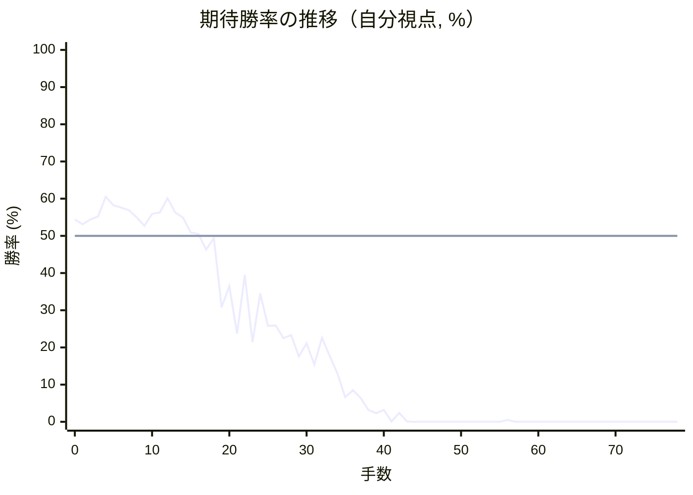

# 解析レポート y78upltfolnn

[README に戻る](../../../README.md)　/　棋譜: [CSA](../../../data/csa/shogi5/y78upltfolnn.csa)　/　解析の見方: [docs/mistake_analysis.md](../../../docs/mistake_analysis.md)

## 対局情報

| 項目 | 内容 |
|---|---|
| 日時 | 2026-11-07 12:50:33 |
| 持ち時間 | 5分 |
| 自分 | 先手（▲）（1715） |
| 相手 | 相手（1548） |
| 結果 | 負け（詰み, 78手） |

## 解析環境

| 項目 | 内容 |
|---|---|
| エンジン | YaneuraOu NNUE 9.00git 64AVX2（V9.00/YANEURAOU_ENGINE_NNUE/AVX2） |
| 評価関数 | **水匠5**（`suisho5`） |
| nn.bin SHA-256 | `768068f0d534a0603a5d38bcd143de6bbca820d5f1c95a14d40863e5b7892d76` |
| 第1パス | movetime=150ms, MultiPV 1 |
| 第2パス | movetime=2000ms, MultiPV 3 |
| Threads / Hash | 8 / 512MB |
| 判定基準 | 疑問手 ≥5pt, 悪手 ≥10pt, 大悪手 ≥20pt（期待勝率 W(E)=1/(1+exp(-E/600))） |
| 解析日時 | 2026-11-11T20:23:24+09:00（解析バージョン 1, 34秒） |

## サマリー

| 自分の手数 | 深掘りした手 | 詰み逃し | 大悪手 | 悪手 | 疑問手 |
|--:|--:|--:|--:|--:|--:|
| 39 | 6 | 0 | 2 | 2 | 1 |

## 期待勝率の推移



<details><summary>1手ごとの数値（第1パス）</summary>

| 手数 | 指し手 | 評価値 | 勝率 | 低下 | 判定 |
|--:|---|--:|--:|--:|---|
| 1 | ▲７六歩(77) | +74 | 53.1% | +1.4pt |  |
| 2 | △３四歩(33) | +106 | 54.4% |  |  |
| 3 | ▲２六歩(27) | +126 | 55.2% | -0.8pt |  |
| 4 | △８八角成(22) | +256 | 60.5% |  |  |
| 5 | ▲同銀(79) | +198 | 58.2% | +2.3pt |  |
| 6 | △３二金(41) | +185 | 57.6% |  |  |
| 7 | ▲７七銀(88) | +166 | 56.9% | +0.8pt |  |
| 8 | △４二銀(31) | +121 | 55.0% |  |  |
| 9 | ▲７八金(69) | +64 | 52.7% | +2.4pt |  |
| 10 | △４四歩(43) | +142 | 55.9% |  |  |
| 11 | ▲４八銀(39) | +152 | 56.3% | -0.4pt |  |
| 12 | △４三銀(42) | +246 | 60.1% |  |  |
| 13 | ▲４六歩(47) | +153 | 56.3% | +3.8pt |  |
| 14 | △４二飛(82) | +117 | 54.9% |  |  |
| 15 | ▲４七銀(48) | +21 | 50.9% | +4.0pt |  |
| 16 | △６二玉(51) | +11 | 50.5% |  |  |
| 17 | ▲５六銀(47) | -90 | 46.3% | +4.2pt |  |
| 18 | △７二玉(62) | -14 | 49.4% |  |  |
| 19 | ▲３六歩(37) | -486 | 30.8% | +18.6pt | [悪手](#ply-19) |
| 20 | △３三桂(21) | -333 | 36.5% |  |  |
| 21 | ▲３七桂(29) | -700 | 23.7% | +12.7pt | [悪手](#ply-21) |
| 22 | △８二玉(72) | -257 | 39.5% |  |  |
| 23 | ▲６六歩(67) | -782 | 21.4% | +18.1pt | [大悪手](#ply-23) |
| 24 | △７二銀(71) | -384 | 34.5% |  |  |
| 25 | ▲６八玉(59) | -633 | 25.8% | +8.7pt |  |
| 26 | △５四銀(43) | -632 | 25.9% |  |  |
| 27 | ▲４八飛(28) | -741 | 22.5% | +3.3pt |  |
| 28 | △２七角打 | -716 | 23.3% |  |  |
| 29 | ▲４七銀(56) | -928 | 17.6% | +5.7pt | [大悪手](#ply-29) |
| 30 | △４五歩(44) | -793 | 21.1% |  |  |
| 31 | ▲同歩(46) | -1024 | 15.4% | +5.7pt |  |
| 32 | △同桂(33) | -740 | 22.6% |  |  |
| 33 | ▲同桂(37) | -924 | 17.7% | +4.9pt |  |
| 34 | △同銀(54) | -1140 | 13.0% |  |  |
| 35 | ▲３八金(49) | -1588 | 6.6% | +6.4pt | [疑問手](#ply-35) |
| 36 | △４六歩打 | -1423 | 8.5% |  |  |
| 37 | ▲２七金(38) | -1605 | 6.4% | +2.1pt |  |
| 38 | △４七歩成(46) | -2051 | 3.2% |  |  |
| 39 | ▲同飛(48) | -2257 | 2.3% | +0.9pt |  |
| 40 | △４六銀(45) | -2045 | 3.2% |  |  |
| 41 | ▲４三歩打 | -4303 | 0.1% | +3.1pt |  |
| 42 | △同飛(42) | -2230 | 2.4% |  |  |
| 43 | ▲６五角打 | -4526 | 0.1% | +2.3pt |  |
| 44 | △４七銀成(46) | -5040 | 0.0% |  |  |
| 45 | ▲４三角成(65) | -6414 | 0.0% | +0.0pt |  |
| 46 | △同金(32) | -5647 | 0.0% |  |  |
| 47 | ▲４一飛打 | #-15 | 0.0% | +0.0pt |  |
| 48 | △５二銀打 | -4696 | 0.0% |  |  |
| 49 | ▲１一飛成(41) | -4953 | 0.0% | +0.0pt |  |
| 50 | △４九飛打 | -5508 | 0.0% |  |  |
| 51 | ▲５九香打 | -5363 | 0.0% | -0.0pt |  |
| 52 | △４八角打 | -5610 | 0.0% |  |  |
| 53 | ▲７九玉(68) | -5692 | 0.0% | +0.0pt |  |
| 54 | △５九飛成(49) | -5138 | 0.0% |  |  |
| 55 | ▲８八玉(79) | -5064 | 0.0% | -0.0pt |  |
| 56 | △８五桂打 | -3214 | 0.5% |  |  |
| 57 | ▲８六桂打 | -6257 | 0.0% | +0.5pt |  |
| 58 | △７七桂成(85) | -5521 | 0.0% |  |  |
| 59 | ▲同桂(89) | -5676 | 0.0% | +0.0pt |  |
| 60 | △８九銀打 | -5798 | 0.0% |  |  |
| 61 | ▲９六歩(97) | #-11 | 0.0% | +0.0pt |  |
| 62 | △７八銀成(89) | #-10 | 0.0% |  |  |
| 63 | ▲同玉(88) | #-9 | 0.0% | +0.0pt |  |
| 64 | △５七角成(48) | -6140 | 0.0% |  |  |
| 65 | ▲７四桂打 | -35281 | 0.0% | +0.0pt |  |
| 66 | △同歩(73) | -35281 | 0.0% |  |  |
| 67 | ▲同桂(86) | -35281 | 0.0% | +0.0pt |  |
| 68 | △９二玉(82) | -35281 | 0.0% |  |  |
| 69 | ▲９七角打 | #-3 | 0.0% | +0.0pt |  |
| 70 | △９九龍(59) | #-12 | 0.0% |  |  |
| 71 | ▲６一龍(11) | #-1 | 0.0% | +0.0pt |  |
| 72 | △７九金打 | #-2 | 0.0% |  |  |
| 73 | ▲同角(97) | #-1 | 0.0% | +0.0pt |  |
| 74 | △同馬(57) | #-2 | 0.0% |  |  |
| 75 | ▲６七玉(78) | #-1 | 0.0% | +0.0pt |  |
| 76 | △５七馬(79) | #-2 | 0.0% |  |  |
| 77 | ▲７八玉(67) | #-1 | 0.0% | +0.0pt |  |
| 78 | △６七角打 | #- | 0.0% |  |  |

</details>

## 課題局面

<a id="ply-19"></a>
### 19手目 ▲３六歩(37) — 悪手

| | 着手前 | 着手後 | 差 |
|---|--:|--:|--:|
| 期待勝率 | 48.5% | 30.3% | -18.2pt |
| 評価値 | -37 | -500 | |

着手前の局面:

```text
後手の持駒：角
  ９ ８ ７ ６ ５ ４ ３ ２ １
+---------------------------+
|v香v桂v銀v金 ・ ・ ・v桂v香|一
| ・ ・v玉 ・ ・v飛v金 ・ ・|二
|v歩v歩v歩v歩v歩v銀 ・v歩v歩|三
| ・ ・ ・ ・ ・v歩v歩 ・ ・|四
| ・ ・ ・ ・ ・ ・ ・ ・ ・|五
| ・ ・ 歩 ・ 銀 歩 ・ 歩 ・|六
| 歩 歩 銀 歩 歩 ・ 歩 ・ 歩|七
| ・ ・ 金 ・ ・ ・ ・ 飛 ・|八
| 香 桂 ・ ・ 玉 金 ・ 桂 香|九
+---------------------------+
先手の持駒：角
手数＝18　△７二玉　まで
```

| | 指し手 | 評価値 | 読み筋 |
|---|---|--:|---|
| 実戦 | ▲３六歩(37) | -500 | △５四銀(43) ▲４八飛(28) △３三桂(21) ▲３八金(49) △４五歩(44) ▲同歩(46) |
| AI 1位 | ▲４八飛(28) | -37 | ▲４八飛(28) △３三桂(21) ▲６八玉(59) △９四歩(93) ▲９六歩(97) △５四銀(43) |
| AI 2位 | ▲６八玉(59) | -40 | ▲６八玉(59) △３三桂(21) ▲７九玉(68) △５四銀(43) ▲４八飛(28) △９四歩(93) |
| AI 3位 | ▲６九玉(59) | -30 | ▲６九玉(59) △５四銀(43) ▲４八飛(28) △３三桂(21) ▲７九玉(69) △９四歩(93) |

SFEN: `lnsg3nl/2k2rg2/ppppps1pp/5pp2/9/2P1SP1P1/PPSPP1P1P/2G4R1/LN2KG1NL b Bb 19`

<a id="ply-21"></a>
### 21手目 ▲３七桂(29) — 悪手

| | 着手前 | 着手後 | 差 |
|---|--:|--:|--:|
| 期待勝率 | 31.4% | 19.7% | -11.6pt |
| 評価値 | -470 | -842 | |

着手前の局面:

```text
後手の持駒：角
  ９ ８ ７ ６ ５ ４ ３ ２ １
+---------------------------+
|v香v桂v銀v金 ・ ・ ・ ・v香|一
| ・ ・v玉 ・ ・v飛v金 ・ ・|二
|v歩v歩v歩v歩v歩v銀v桂v歩v歩|三
| ・ ・ ・ ・ ・v歩v歩 ・ ・|四
| ・ ・ ・ ・ ・ ・ ・ ・ ・|五
| ・ ・ 歩 ・ 銀 歩 歩 歩 ・|六
| 歩 歩 銀 歩 歩 ・ ・ ・ 歩|七
| ・ ・ 金 ・ ・ ・ ・ 飛 ・|八
| 香 桂 ・ ・ 玉 金 ・ 桂 香|九
+---------------------------+
先手の持駒：角
手数＝20　△３三桂　まで
```

| | 指し手 | 評価値 | 読み筋 |
|---|---|--:|---|
| 実戦 | ▲３七桂(29) | -842 | △４五歩(44) ▲同歩(46) |
| AI 1位 | ▲６六銀(77) | -470 | ▲６六銀(77) △５四銀(43) ▲３八金(49) △４五歩(44) ▲同歩(46) △同銀(54) |
| AI 2位 | ▲４八飛(28) | -502 | ▲４八飛(28) △５四銀(43) ▲６六銀(77) △４五歩(44) ▲同歩(46) △６四角打 |
| AI 3位 | ▲６八玉(59) | -613 | ▲６八玉(59) △４五歩(44) ▲同歩(46) △５四銀(43) ▲５八金(49) △４五銀(54) |

SFEN: `lnsg4l/2k2rg2/pppppsnpp/5pp2/9/2P1SPPP1/PPSPP3P/2G4R1/LN2KG1NL b Bb 21`

<a id="ply-23"></a>
### 23手目 ▲６六歩(67) — 大悪手

| | 着手前 | 着手後 | 差 |
|---|--:|--:|--:|
| 期待勝率 | 36.5% | 15.3% | -21.2pt |
| 評価値 | -332 | -1028 | |

着手前の局面:

```text
後手の持駒：角
  ９ ８ ７ ６ ５ ４ ３ ２ １
+---------------------------+
|v香v桂v銀v金 ・ ・ ・ ・v香|一
| ・v玉 ・ ・ ・v飛v金 ・ ・|二
|v歩v歩v歩v歩v歩v銀v桂v歩v歩|三
| ・ ・ ・ ・ ・v歩v歩 ・ ・|四
| ・ ・ ・ ・ ・ ・ ・ ・ ・|五
| ・ ・ 歩 ・ 銀 歩 歩 歩 ・|六
| 歩 歩 銀 歩 歩 ・ 桂 ・ 歩|七
| ・ ・ 金 ・ ・ ・ ・ 飛 ・|八
| 香 桂 ・ ・ 玉 金 ・ ・ 香|九
+---------------------------+
先手の持駒：角
手数＝22　△８二玉　まで
```

| | 指し手 | 評価値 | 読み筋 |
|---|---|--:|---|
| 実戦 | ▲６六歩(67) | -1028 | △４五歩(44) ▲同歩(46) △５四銀(43) ▲４八飛(28) △２七角打 ▲４四歩(45) |
| AI 1位 | ▲４八飛(28) | -332 | ▲４八飛(28) △３五歩(34) ▲同歩(36) △２七角打 ▲５八角打 △５四角成(27) |
| AI 2位 | ▲６八玉(59) | -378 | ▲６八玉(59) △４五歩(44) ▲同歩(46) △６四角打 ▲４八金(49) △５四銀(43) |
| AI 3位 | ▲６八玉(59) | -374 | ▲６八玉(59) △４五歩(44) ▲同歩(46) △６四角打 ▲４八金(49) △５四銀(43) |

SFEN: `lnsg4l/1k3rg2/pppppsnpp/5pp2/9/2P1SPPP1/PPSPP1N1P/2G4R1/LN2KG2L b Bb 23`

<a id="ply-29"></a>
### 29手目 ▲４七銀(56) — 大悪手

| | 着手前 | 着手後 | 差 |
|---|--:|--:|--:|
| 期待勝率 | 35.7% | 12.4% | -23.3pt |
| 評価値 | -352 | -1171 | |

着手前の局面:

```text
後手の持駒：なし
  ９ ８ ７ ６ ５ ４ ３ ２ １
+---------------------------+
|v香v桂 ・v金 ・ ・ ・ ・v香|一
| ・v玉v銀 ・ ・v飛v金 ・ ・|二
|v歩v歩v歩v歩v歩 ・v桂v歩v歩|三
| ・ ・ ・ ・v銀v歩v歩 ・ ・|四
| ・ ・ ・ ・ ・ ・ ・ ・ ・|五
| ・ ・ 歩 歩 銀 歩 歩 歩 ・|六
| 歩 歩 銀 ・ 歩 ・ 桂v角 歩|七
| ・ ・ 金 玉 ・ 飛 ・ ・ ・|八
| 香 桂 ・ ・ ・ 金 ・ ・ 香|九
+---------------------------+
先手の持駒：角
手数＝28　△２七角　まで
```

| | 指し手 | 評価値 | 読み筋 |
|---|---|--:|---|
| 実戦 | ▲４七銀(56) | -1171 | △４五歩(44) ▲同歩(46) △同桂(33) ▲同桂(37) △同銀(54) ▲５五角打 |
| AI 1位 | ▲６九角打 | -352 | ▲６九角打 △４五歩(44) ▲３九金(49) △３五歩(34) ▲同歩(36) △４六歩(45) |
| AI 2位 | ▲５八角打 | -748 | ▲５八角打 △４五歩(44) ▲同桂(37) △同桂(33) ▲同歩(46) △３五歩(34) |
| AI 3位 | ▲８六角打 | -804 | ▲８六角打 △３六角成(27) ▲５三角成(86) △４三飛(42) ▲同馬(53) △同銀(54) |

SFEN: `ln1g4l/1ks2rg2/ppppp1npp/4spp2/9/2PPSPPP1/PPS1P1NbP/2GK1R3/LN3G2L b B 29`

<a id="ply-35"></a>
### 35手目 ▲３八金(49) — 疑問手

| | 着手前 | 着手後 | 差 |
|---|--:|--:|--:|
| 期待勝率 | 12.3% | 3.2% | -9.1pt |
| 評価値 | -1178 | -2042 | |

着手前の局面:

```text
後手の持駒：桂　歩
  ９ ８ ７ ６ ５ ４ ３ ２ １
+---------------------------+
|v香v桂 ・v金 ・ ・ ・ ・v香|一
| ・v玉v銀 ・ ・v飛v金 ・ ・|二
|v歩v歩v歩v歩v歩 ・ ・v歩v歩|三
| ・ ・ ・ ・ ・ ・v歩 ・ ・|四
| ・ ・ ・ ・ ・v銀 ・ ・ ・|五
| ・ ・ 歩 歩 ・ ・ 歩 歩 ・|六
| 歩 歩 銀 ・ 歩 銀 ・v角 歩|七
| ・ ・ 金 玉 ・ 飛 ・ ・ ・|八
| 香 桂 ・ ・ ・ 金 ・ ・ 香|九
+---------------------------+
先手の持駒：角　桂　歩
手数＝34　△４五同銀　まで
```

| | 指し手 | 評価値 | 読み筋 |
|---|---|--:|---|
| 実戦 | ▲３八金(49) | -2042 | △３六銀(45) ▲２七金(38) △４七飛成(42) ▲同飛(48) △同銀成(36) ▲７九玉(68) |
| AI 1位 | ▲４六歩打 | -1178 | ▲４六歩打 △３六銀(45) ▲３八銀(47) △４七歩打 ▲５八飛(48) △３八角成(27) |
| AI 2位 | ▲５八銀(47) | -1282 | ▲５八銀(47) △３六角成(27) ▲５五角打 △４一飛(42) ▲７五歩(76) △９二玉(82) |
| AI 3位 | ▲５五角打 | -1304 | ▲５五角打 △４六歩打 ▲同銀(47) △同銀(45) ▲同飛(48) △同飛(42) |

SFEN: `ln1g4l/1ks2rg2/ppppp2pp/6p2/5s3/2PP2PP1/PPS1PS1bP/2GK1R3/LN3G2L b BNPnp 35`

