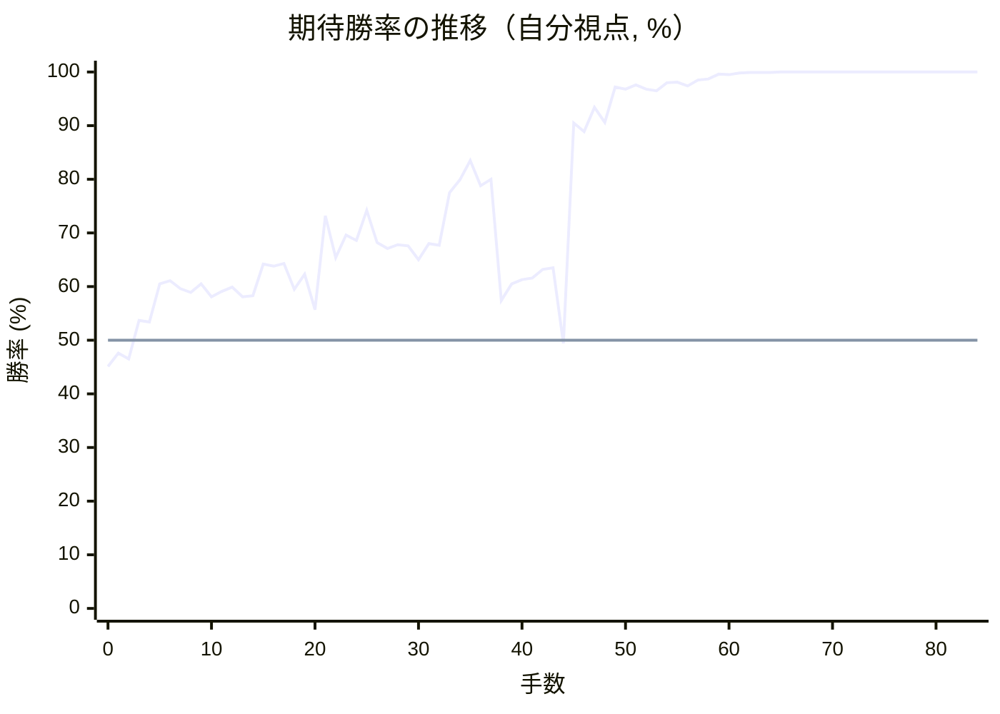
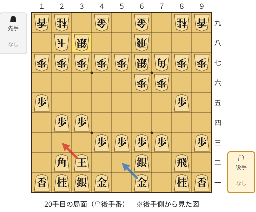
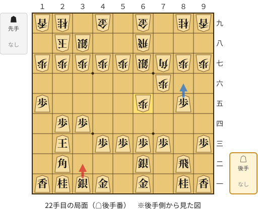
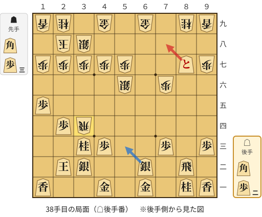

# 解析レポート yhyaazl9prhk

[README に戻る](../../../README.md)　/　棋譜: [CSA](../../../data/csa/shogi5/yhyaazl9prhk.csa)　/　解析の見方: [docs/mistake_analysis.md](../../../docs/mistake_analysis.md)

## 対局情報

| 項目 | 内容 |
|---|---|
| 日時 | 2026-11-19 18:53:22 |
| 持ち時間 | 5分 |
| 自分 | 後手（△）（1714） |
| 相手 | 相手（1733） |
| 結果 | 勝ち（投了, 84手） |

## 解析環境

| 項目 | 内容 |
|---|---|
| エンジン | YaneuraOu NNUE 9.00git 64AVX2（V9.00/YANEURAOU_ENGINE_NNUE/AVX2） |
| 評価関数 | **水匠5**（`suisho5`） |
| nn.bin SHA-256 | `768068f0d534a0603a5d38bcd143de6bbca820d5f1c95a14d40863e5b7892d76` |
| 第1パス | movetime=150ms, MultiPV 1 |
| 第2パス | movetime=2000ms, MultiPV 3 |
| Threads / Hash | 8 / 512MB |
| 判定基準 | 疑問手 ≥5pt, 悪手 ≥10pt, 大悪手 ≥20pt（期待勝率 W(E)=1/(1+exp(-E/600))） |
| 解析日時 | 2026-11-20T20:02:11+09:00（解析バージョン 1, 33秒） |

## サマリー

| 自分の手数 | 深掘りした手 | 詰み逃し | 大悪手 | 悪手 | 疑問手 |
|--:|--:|--:|--:|--:|--:|
| 42 | 5 | 0 | 0 | 1 | 2 |

## 期待勝率の推移



<details><summary>1手ごとの数値（第1パス）</summary>

| 手数 | 指し手 | 評価値 | 勝率 | 低下 | 判定 |
|--:|---|--:|--:|--:|---|
| 1 | ▲７六歩(77) | -58 | 47.6% |  |  |
| 2 | △３四歩(33) | -84 | 46.5% | +1.1pt |  |
| 3 | ▲６六歩(67) | +90 | 53.7% |  |  |
| 4 | △８四歩(83) | +81 | 53.4% | +0.4pt |  |
| 5 | ▲６八飛(28) | +255 | 60.5% |  |  |
| 6 | △８五歩(84) | +270 | 61.1% | -0.6pt |  |
| 7 | ▲７七角(88) | +234 | 59.6% |  |  |
| 8 | △６二銀(71) | +216 | 58.9% | +0.7pt |  |
| 9 | ▲４八玉(59) | +256 | 60.5% |  |  |
| 10 | △４二玉(51) | +196 | 58.1% | +2.4pt |  |
| 11 | ▲３八玉(48) | +221 | 59.1% |  |  |
| 12 | △３二玉(42) | +241 | 59.9% | -0.8pt |  |
| 13 | ▲２八玉(38) | +197 | 58.1% |  |  |
| 14 | △１四歩(13) | +200 | 58.3% | -0.1pt |  |
| 15 | ▲７八銀(79) | +351 | 64.2% |  |  |
| 16 | △１五歩(14) | +340 | 63.8% | +0.4pt |  |
| 17 | ▲６七銀(78) | +353 | 64.3% |  |  |
| 18 | △２四歩(23) | +232 | 59.5% | +4.8pt |  |
| 19 | ▲３八銀(39) | +302 | 62.3% |  |  |
| 20 | △２三玉(32) | +138 | 55.7% | +6.6pt | [疑問手](#ply-20) |
| 21 | ▲６五歩(66) | +603 | 73.2% |  |  |
| 22 | △３二銀(31) | +382 | 65.4% | +7.8pt | [疑問手](#ply-22) |
| 23 | ▲２二角成(77) | +496 | 69.6% |  |  |
| 24 | △同玉(23) | +470 | 68.6% | +0.9pt |  |
| 25 | ▲５六銀(67) | +635 | 74.2% |  |  |
| 26 | △５四歩(53) | +457 | 68.2% | +6.1pt |  |
| 27 | ▲６四歩(65) | +427 | 67.1% |  |  |
| 28 | △同歩(63) | +447 | 67.8% | -0.7pt |  |
| 29 | ▲同飛(68) | +440 | 67.6% |  |  |
| 30 | △８六歩(85) | +372 | 65.0% | +2.5pt |  |
| 31 | ▲７七角打 | +453 | 68.0% |  |  |
| 32 | △３三角打 | +443 | 67.7% | +0.4pt |  |
| 33 | ▲同角成(77) | +741 | 77.5% |  |  |
| 34 | △同桂(21) | +828 | 79.9% | -2.4pt |  |
| 35 | ▲５四飛(64) | +972 | 83.5% |  |  |
| 36 | △８七歩成(86) | +788 | 78.8% | +4.7pt |  |
| 37 | ▲３四飛(54) | +830 | 80.0% |  |  |
| 38 | △７八と(87) | +178 | 57.4% | +22.6pt | [悪手](#ply-38) |
| 39 | ▲８三歩打 | +257 | 60.5% |  |  |
| 40 | △同飛(82) | +277 | 61.3% | -0.8pt |  |
| 41 | ▲８四歩打 | +283 | 61.6% |  |  |
| 42 | △８二飛(83) | +324 | 63.2% | -1.6pt |  |
| 43 | ▲７八金(69) | +331 | 63.5% |  |  |
| 44 | △５五歩打 | -15 | 49.4% | +14.1pt |  |
| 45 | ▲同銀(56) | +1351 | 90.5% |  |  |
| 46 | △４五角打 | +1250 | 88.9% | +1.6pt |  |
| 47 | ▲２四飛(34) | +1592 | 93.4% |  |  |
| 48 | △２三歩打 | +1362 | 90.6% | +2.8pt |  |
| 49 | ▲８三歩成(84) | +2136 | 97.2% |  |  |
| 50 | △同飛(82) | +2043 | 96.8% | +0.4pt |  |
| 51 | ▲８四歩打 | +2225 | 97.6% |  |  |
| 52 | △８二飛(83) | +2052 | 96.8% | +0.8pt |  |
| 53 | ▲８三歩成(84) | +1988 | 96.5% |  |  |
| 54 | △同飛(82) | +2336 | 98.0% | -1.5pt |  |
| 55 | ▲８四歩打 | +2375 | 98.1% |  |  |
| 56 | △８二飛(83) | +2185 | 97.4% | +0.7pt |  |
| 57 | ▲８三歩成(84) | +2523 | 98.5% |  |  |
| 58 | △同飛(82) | +2576 | 98.7% | -0.1pt |  |
| 59 | ▲４六歩(47) | +3313 | 99.6% |  |  |
| 60 | △７八角成(45) | +3217 | 99.5% | +0.1pt |  |
| 61 | ▲６四飛(24) | +3740 | 99.8% |  |  |
| 62 | △８九飛成(83) | +4001 | 99.9% | -0.1pt |  |
| 63 | ▲５四角打 | +4478 | 99.9% |  |  |
| 64 | △６三歩打 | +4431 | 99.9% | +0.0pt |  |
| 65 | ▲同角成(54) | +5170 | 100.0% |  |  |
| 66 | △同銀(62) | +5177 | 100.0% | -0.0pt |  |
| 67 | ▲同飛成(64) | +5350 | 100.0% |  |  |
| 68 | △５二金(61) | +5418 | 100.0% | -0.0pt |  |
| 69 | ▲６一龍(63) | +5428 | 100.0% |  |  |
| 70 | △８三角打 | +5208 | 100.0% | +0.0pt |  |
| 71 | ▲７一龍(61) | +6407 | 100.0% |  |  |
| 72 | △３八角成(83) | +6175 | 100.0% | +0.0pt |  |
| 73 | ▲同金(49) | +6463 | 100.0% |  |  |
| 74 | △４九銀打 | +6502 | 100.0% | -0.0pt |  |
| 75 | ▲３九金(38) | +6814 | 100.0% |  |  |
| 76 | △４七桂打 | +6072 | 100.0% | +0.0pt |  |
| 77 | ▲４八金(39) | +7167 | 100.0% |  |  |
| 78 | △５九龍(89) | +7191 | 100.0% | -0.0pt |  |
| 79 | ▲３一銀打 | +35281 | 100.0% |  |  |
| 80 | △同金(41) | +35281 | 100.0% | +0.0pt |  |
| 81 | ▲同龍(71) | +35281 | 100.0% |  |  |
| 82 | △同玉(22) | #+12 | 100.0% | +0.0pt |  |
| 83 | ▲８六角打 | #+11 | 100.0% |  |  |
| 84 | △５三歩打 | #+10 | 100.0% | +0.0pt |  |

</details>

## 課題局面

<a id="ply-20"></a>
### 20手目 △２三玉(32) — 疑問手

| | 着手前 | 着手後 | 差 |
|---|--:|--:|--:|
| 期待勝率 | 61.1% | 54.7% | -6.4pt |
| 評価値 | +272 | +113 | |

着手前の局面:



🔴 実戦 △２三玉(32)　🔵 AI推奨 △５二金(61)　🟨 直前の相手の指し手

<details><summary>テキストの盤面図（BOD・将棋ソフトに貼り付け可）</summary>

```text
後手の持駒：なし
  ９ ８ ７ ６ ５ ４ ３ ２ １
+---------------------------+
|v香v桂 ・v金 ・v金v銀v桂v香|一
| ・v飛 ・v銀 ・ ・v玉v角 ・|二
|v歩 ・v歩v歩v歩v歩 ・ ・ ・|三
| ・ ・ ・ ・ ・ ・v歩v歩 ・|四
| ・v歩 ・ ・ ・ ・ ・ ・v歩|五
| ・ ・ 歩 歩 ・ ・ ・ ・ ・|六
| 歩 歩 角 銀 歩 歩 歩 歩 歩|七
| ・ ・ ・ 飛 ・ ・ 銀 玉 ・|八
| 香 桂 ・ 金 ・ 金 ・ 桂 香|九
+---------------------------+
先手の持駒：なし
後手番
手数＝19　▲３八銀　まで
```

</details>

| | 指し手 | 評価値 | 読み筋 |
|---|---|--:|---|
| 実戦 | △２三玉(32) | +113 | ▲２六歩(27) △３二銀(31) ▲２七銀(38) △７四歩(73) ▲３六歩(37) △７三桂(81) |
| AI 1位 | △５二金(61) | +272 | △５二金(61) ▲５八金(69) △３三角(22) ▲３六歩(37) △２二銀(31) ▲３七桂(29) |
| AI 2位 | △５四歩(53) | +260 | △５四歩(53) ▲５八金(69) △７四歩(73) ▲３六歩(37) △５二金(61) ▲３七桂(29) |
| AI 3位 | △７四歩(73) | +245 | △７四歩(73) ▲５八金(69) △５二金(61) ▲３六歩(37) △５四歩(53) ▲３七桂(29) |

SFEN: `ln1g1gsnl/1r1s2kb1/p1pppp3/6pp1/1p6p/2PP5/PPBSPPPPP/3R2SK1/LN1G1G1NL w - 20`

<a id="ply-22"></a>
### 22手目 △３二銀(31) — 疑問手

| | 着手前 | 着手後 | 差 |
|---|--:|--:|--:|
| 期待勝率 | 68.8% | 63.2% | -5.6pt |
| 評価値 | +474 | +325 | |

着手前の局面:



🔴 実戦 △３二銀(31)　🔵 AI推奨 △８六歩(85)　🟨 直前の相手の指し手

<details><summary>テキストの盤面図（BOD・将棋ソフトに貼り付け可）</summary>

```text
後手の持駒：なし
  ９ ８ ７ ６ ５ ４ ３ ２ １
+---------------------------+
|v香v桂 ・v金 ・v金v銀v桂v香|一
| ・v飛 ・v銀 ・ ・ ・v角 ・|二
|v歩 ・v歩v歩v歩v歩 ・v玉 ・|三
| ・ ・ ・ ・ ・ ・v歩v歩 ・|四
| ・v歩 ・ 歩 ・ ・ ・ ・v歩|五
| ・ ・ 歩 ・ ・ ・ ・ ・ ・|六
| 歩 歩 角 銀 歩 歩 歩 歩 歩|七
| ・ ・ ・ 飛 ・ ・ 銀 玉 ・|八
| 香 桂 ・ 金 ・ 金 ・ 桂 香|九
+---------------------------+
先手の持駒：なし
後手番
手数＝21　▲６五歩　まで
```

</details>

| | 指し手 | 評価値 | 読み筋 |
|---|---|--:|---|
| 実戦 | △３二銀(31) | +325 | ▲６六銀(67) △５二金(61) ▲２六歩(27) △７四歩(73) ▲３六歩(37) △７三桂(81) |
| AI 1位 | △８六歩(85) | +474 | △８六歩(85) ▲同歩(87) △７七角成(22) ▲同桂(89) △８六飛(82) ▲７八銀(67) |
| AI 2位 | △８六歩(85) | +454 | △８六歩(85) ▲同歩(87) △７七角成(22) ▲同桂(89) △８六飛(82) ▲６四歩(65) |
| AI 3位 | △３二銀(31) | +311 | △３二銀(31) ▲６六銀(67) △５二金(61) ▲２六歩(27) △５四歩(53) ▲３六歩(37) |

SFEN: `ln1g1gsnl/1r1s3b1/p1pppp1k1/6pp1/1p1P4p/2P6/PPBSPPPPP/3R2SK1/LN1G1G1NL w - 22`

<a id="ply-38"></a>
### 38手目 △７八と(87) — 悪手

| | 着手前 | 着手後 | 差 |
|---|--:|--:|--:|
| 期待勝率 | 79.8% | 66.6% | -13.2pt |
| 評価値 | +824 | +414 | |

着手前の局面:



🔴 実戦 △７八と(87)　🔵 AI推奨 △５三銀(62)　🟨 直前の相手の指し手

<details><summary>テキストの盤面図（BOD・将棋ソフトに貼り付け可）</summary>

```text
後手の持駒：角　歩二
  ９ ８ ７ ６ ５ ４ ３ ２ １
+---------------------------+
|v香v桂 ・v金 ・v金 ・ ・v香|一
| ・v飛 ・v銀 ・ ・v銀v玉 ・|二
|v歩 ・v歩 ・ ・v歩v桂 ・ ・|三
| ・ ・ ・ ・ ・ ・ 飛v歩 ・|四
| ・ ・ ・ ・ ・ ・ ・ ・v歩|五
| ・ ・ 歩 ・ 銀 ・ ・ ・ ・|六
| 歩vと ・ ・ 歩 歩 歩 歩 歩|七
| ・ ・ ・ ・ ・ ・ 銀 玉 ・|八
| 香 桂 ・ 金 ・ 金 ・ 桂 香|九
+---------------------------+
先手の持駒：角　歩三
後手番
手数＝37　▲３四飛　まで
```

</details>

| | 指し手 | 評価値 | 読み筋 |
|---|---|--:|---|
| 実戦 | △７八と(87) | +414 | ▲８三歩打 △同飛(82) ▲８四歩打 △８二飛(83) ▲７八金(69) △５三銀(62) |
| AI 1位 | △５三銀(62) | +824 | △５三銀(62) ▲８三歩打 △同飛(82) ▲８四歩打 △８二飛(83) ▲６四歩打 |
| AI 2位 | △８六飛(82) | +791 | △８六飛(82) ▲６四角打 △８二飛(86) ▲２四飛(34) △２三歩打 ▲３四飛(24) |
| AI 3位 | △２三玉(22) | +770 | △２三玉(22) ▲５四飛(34) △８八角打 ▲８三歩打 △同飛(82) ▲８四歩打 |

SFEN: `ln1g1g2l/1r1s2sk1/p1p2pn2/6Rp1/8p/2P1S4/P+p2PPPPP/6SK1/LN1G1G1NL w B3Pb2p 38`

