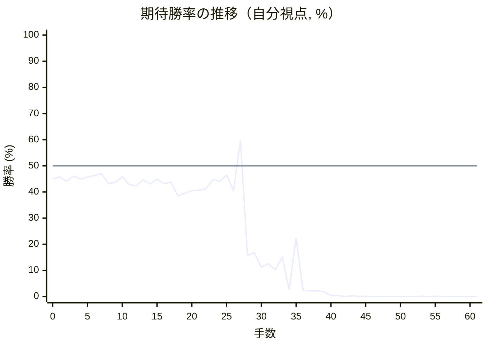
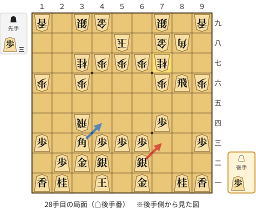
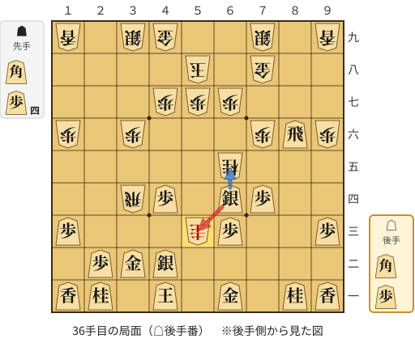

# 解析レポート yj0fhzepxh3g

[README に戻る](../../../README.md)　/　棋譜: [CSA](../../../data/csa/shogi5/yj0fhzepxh3g.csa)　/　解析の見方: [docs/mistake_analysis.md](../../../docs/mistake_analysis.md)

## 対局情報

| 項目 | 内容 |
|---|---|
| 日時 | 2026-11-16 21:07:06 |
| 持ち時間 | 5分 |
| 自分 | 後手（△）（1679） |
| 相手 | 相手（1741） |
| 結果 | 負け（投了, 61手） |

## 解析環境

| 項目 | 内容 |
|---|---|
| エンジン | YaneuraOu NNUE 9.00git 64AVX2（V9.00/YANEURAOU_ENGINE_NNUE/AVX2） |
| 評価関数 | **水匠5**（`suisho5`） |
| nn.bin SHA-256 | `768068f0d534a0603a5d38bcd143de6bbca820d5f1c95a14d40863e5b7892d76` |
| 第1パス | movetime=150ms, MultiPV 1 |
| 第2パス | movetime=2000ms, MultiPV 3 |
| Threads / Hash | 8 / 512MB |
| 判定基準 | 疑問手 ≥5pt, 悪手 ≥10pt, 大悪手 ≥20pt（期待勝率 W(E)=1/(1+exp(-E/600))） |
| 解析日時 | 2026-11-20T20:17:55+09:00（解析バージョン 1, 29秒） |

## サマリー

| 自分の手数 | 深掘りした手 | 詰み逃し | 大悪手 | 悪手 | 疑問手 |
|--:|--:|--:|--:|--:|--:|
| 30 | 5 | 0 | 1 | 0 | 1 |

## 期待勝率の推移



<details><summary>1手ごとの数値（第1パス）</summary>

| 手数 | 指し手 | 評価値 | 勝率 | 低下 | 判定 |
|--:|---|--:|--:|--:|---|
| 1 | ▲２六歩(27) | -102 | 45.8% |  |  |
| 2 | △８四歩(83) | -143 | 44.1% | +1.7pt |  |
| 3 | ▲７六歩(77) | -93 | 46.1% |  |  |
| 4 | △３四歩(33) | -123 | 44.9% | +1.2pt |  |
| 5 | ▲２五歩(26) | -104 | 45.7% |  |  |
| 6 | △８五歩(84) | -90 | 46.3% | -0.6pt |  |
| 7 | ▲７八金(69) | -73 | 47.0% |  |  |
| 8 | △３二金(41) | -163 | 43.2% | +3.7pt |  |
| 9 | ▲２四歩(25) | -151 | 43.7% |  |  |
| 10 | △同歩(23) | -102 | 45.8% | -2.0pt |  |
| 11 | ▲同飛(28) | -173 | 42.8% |  |  |
| 12 | △８六歩(85) | -183 | 42.4% | +0.4pt |  |
| 13 | ▲同歩(87) | -131 | 44.6% |  |  |
| 14 | △同飛(82) | -167 | 43.1% | +1.5pt |  |
| 15 | ▲３四飛(24) | -123 | 44.9% |  |  |
| 16 | △３三角(22) | -165 | 43.2% | +1.7pt |  |
| 17 | ▲５八玉(59) | -152 | 43.7% |  |  |
| 18 | △４二銀(31) | -282 | 38.5% | +5.2pt |  |
| 19 | ▲３六歩(37) | -255 | 39.5% |  |  |
| 20 | △４一玉(51) | -231 | 40.5% | -1.0pt |  |
| 21 | ▲３七桂(29) | -226 | 40.7% |  |  |
| 22 | △２二歩打 | -213 | 41.2% | -0.5pt |  |
| 23 | ▲１六歩(17) | -127 | 44.7% |  |  |
| 24 | △６二銀(71) | -142 | 44.1% | +0.6pt |  |
| 25 | ▲９六歩(97) | -87 | 46.4% |  |  |
| 26 | △７四歩(73) | -230 | 40.5% | +5.8pt |  |
| 27 | ▲７七桂(89) | +237 | 59.7% |  |  |
| 28 | △７三銀(62) | -1005 | 15.8% | +44.0pt | [大悪手](#ply-28) |
| 29 | ▲４五桂(37) | -966 | 16.7% |  |  |
| 30 | △４四角(33) | -1242 | 11.2% | +5.5pt |  |
| 31 | ▲６五桂(77) | -1160 | 12.6% |  |  |
| 32 | △６四銀(73) | -1304 | 10.2% | +2.4pt |  |
| 33 | ▲４四角(88) | -1038 | 15.1% |  |  |
| 34 | △同歩(43) | -2178 | 2.6% | +12.5pt |  |
| 35 | ▲５三桂成(45) | -742 | 22.5% |  |  |
| 36 | △同銀(64) | -2254 | 2.3% | +20.2pt | [疑問手](#ply-36) |
| 37 | ▲同桂成(65) | -2283 | 2.2% |  |  |
| 38 | △同銀(42) | -2284 | 2.2% | +0.0pt |  |
| 39 | ▲９七角打 | -2401 | 1.8% |  |  |
| 40 | △８二飛(86) | -3254 | 0.4% | +1.4pt |  |
| 41 | ▲５三角成(97) | -3364 | 0.4% |  |  |
| 42 | △５二金(61) | -4611 | 0.0% | +0.3pt |  |
| 43 | ▲７一馬(53) | -3542 | 0.3% |  |  |
| 44 | △８九飛成(82) | -4164 | 0.1% | +0.2pt |  |
| 45 | ▲５三銀打 | -4336 | 0.1% |  |  |
| 46 | △同金(52) | -6017 | 0.0% | +0.1pt |  |
| 47 | ▲同馬(71) | -6486 | 0.0% |  |  |
| 48 | △５二歩打 | #-3 | 0.0% | +0.0pt |  |
| 49 | ▲同馬(53) | -5062 | 0.0% |  |  |
| 50 | △同玉(41) | -5917 | 0.0% | +0.0pt |  |
| 51 | ▲３二飛成(34) | -5531 | 0.0% |  |  |
| 52 | △５三玉(52) | #-11 | 0.0% | +0.0pt |  |
| 53 | ▲５五銀打 | -4477 | 0.1% |  |  |
| 54 | △５二桂打 | -6158 | 0.0% | +0.1pt |  |
| 55 | ▲５四金打 | -4347 | 0.1% |  |  |
| 56 | △６二玉(53) | -4917 | 0.0% | +0.0pt |  |
| 57 | ▲６四銀(55) | -4923 | 0.0% |  |  |
| 58 | △同歩(63) | -5000 | 0.0% | +0.0pt |  |
| 59 | ▲６三金打 | -5227 | 0.0% |  |  |
| 60 | △７一玉(62) | -5268 | 0.0% | +0.0pt |  |
| 61 | ▲５二龍(32) | -5396 | 0.0% |  |  |

</details>

## 課題局面

<a id="ply-28"></a>
### 28手目 △７三銀(62) — 大悪手

| | 着手前 | 着手後 | 差 |
|---|--:|--:|--:|
| 期待勝率 | 60.9% | 14.8% | -46.1pt |
| 評価値 | +266 | -1050 | |

着手前の局面:



🔴 実戦 △７三銀(62)　🔵 AI推奨 △４四角(33)　🟨 直前の相手の指し手

<details><summary>テキストの盤面図（BOD・将棋ソフトに貼り付け可）</summary>

```text
後手の持駒：歩
  ９ ８ ７ ６ ５ ４ ３ ２ １
+---------------------------+
|v香v桂 ・v金 ・v玉 ・v桂v香|一
| ・ ・ ・v銀 ・v銀v金v歩 ・|二
|v歩 ・ ・v歩v歩v歩v角 ・v歩|三
| ・ ・v歩 ・ ・ ・ 飛 ・ ・|四
| ・ ・ ・ ・ ・ ・ ・ ・ ・|五
| 歩v飛 歩 ・ ・ ・ 歩 ・ 歩|六
| ・ ・ 桂 歩 歩 歩 桂 ・ ・|七
| ・ 角 金 ・ 玉 ・ ・ ・ ・|八
| 香 ・ 銀 ・ ・ 金 銀 ・ 香|九
+---------------------------+
先手の持駒：歩三
後手番
手数＝27　▲７七桂　まで
```

</details>

| | 指し手 | 評価値 | 読み筋 |
|---|---|--:|---|
| 実戦 | △７三銀(62) | -1050 | ▲４五桂(37) △６四銀(73) ▲３三桂不成(45) △同桂(21) ▲３五飛(34) △７三桂(81) |
| AI 1位 | △４四角(33) | +266 | △４四角(33) ▲３八銀(39) △５一金(61) ▲４六歩(47) △６四歩(63) ▲２四飛(34) |
| AI 2位 | △６四歩(63) | +188 | △６四歩(63) ▲３八銀(39) △４四角(33) ▲２四飛(34) △５一金(61) ▲２九飛(24) |
| AI 3位 | △５五角(33) | +91 | △５五角(33) ▲３八銀(39) △４四角(55) ▲６五桂(77) △６四歩(63) ▲２三歩打 |

SFEN: `ln1g1k1nl/3s1sgp1/p2pppb1p/2p3R2/9/PrP3P1P/2NPPPN2/1BG1K4/L1S2GS1L w 3Pp 28`

<a id="ply-36"></a>
### 36手目 △同銀(64) — 疑問手

| | 着手前 | 着手後 | 差 |
|---|--:|--:|--:|
| 期待勝率 | 7.2% | 1.9% | -5.3pt |
| 評価値 | -1535 | -2367 | |

着手前の局面:



🔴 実戦 △同銀(64)　🔵 AI推奨 △６五銀(64)　🟨 直前の相手の指し手

<details><summary>テキストの盤面図（BOD・将棋ソフトに貼り付け可）</summary>

```text
後手の持駒：角　歩
  ９ ８ ７ ６ ５ ４ ３ ２ １
+---------------------------+
|v香v桂 ・v金 ・v玉 ・v桂v香|一
| ・ ・ ・ ・ ・v銀v金v歩 ・|二
|v歩 ・ ・v歩 圭 ・ ・ ・v歩|三
| ・ ・v歩v銀 ・v歩 飛 ・ ・|四
| ・ ・ ・ 桂 ・ ・ ・ ・ ・|五
| 歩v飛 歩 ・ ・ ・ 歩 ・ 歩|六
| ・ ・ ・ 歩 歩 歩 ・ ・ ・|七
| ・ ・ 金 ・ 玉 ・ ・ ・ ・|八
| 香 ・ 銀 ・ ・ 金 銀 ・ 香|九
+---------------------------+
先手の持駒：角　歩四
後手番
手数＝35　▲５三桂右成　まで
```

</details>

| | 指し手 | 評価値 | 読み筋 |
|---|---|--:|---|
| 実戦 | △同銀(64) | -2367 | ▲同桂不成(65) △同銀(42) |
| AI 1位 | △６五銀(64) | -1535 | △６五銀(64) ▲５二角打 △同金(61) ▲同成桂(53) △同玉(41) ▲３二飛成(34) |
| AI 2位 | △３三桂(21) | -1654 | △３三桂(21) ▲４二成桂(53) △同金(32) ▲５三銀打 △５二金(61) ▲同銀成(53) |
| AI 3位 | △３三角打 | -2065 | △３三角打 ▲４二成桂(53) △同玉(41) ▲５三銀打 △４三玉(42) ▲３三飛成(34) |

SFEN: `ln1g1k1nl/5sgp1/p2p+N3p/2ps1pR2/3N5/PrP3P1P/3PPP3/2G1K4/L1S2GS1L w B4Pbp 36`

