# 解析レポート zmnamldfi3g8

[README に戻る](../../../README.md)　/　棋譜: [CSA](../../../data/csa/shogi5/zmnamldfi3g8.csa)　/　解析の見方: [docs/mistake_analysis.md](../../../docs/mistake_analysis.md)

## 対局情報

| 項目 | 内容 |
|---|---|
| 日時 | 2026-11-10 00:07:32 |
| 持ち時間 | 5分 |
| 自分 | 後手（△）（1669） |
| 相手 | 相手（1430） |
| 結果 | 負け（時間切れ, 119手） |

## 解析環境

| 項目 | 内容 |
|---|---|
| エンジン | YaneuraOu NNUE 9.00git 64AVX2（V9.00/YANEURAOU_ENGINE_NNUE/AVX2） |
| 評価関数 | **水匠5**（`suisho5`） |
| nn.bin SHA-256 | `768068f0d534a0603a5d38bcd143de6bbca820d5f1c95a14d40863e5b7892d76` |
| 第1パス | movetime=150ms, MultiPV 1 |
| 第2パス | movetime=2000ms, MultiPV 3 |
| Threads / Hash | 8 / 512MB |
| 判定基準 | 疑問手 ≥5pt, 悪手 ≥10pt, 大悪手 ≥20pt（期待勝率 W(E)=1/(1+exp(-E/600))） |
| 解析日時 | 2026-11-11T20:13:41+09:00（解析バージョン 1, 66秒） |

## サマリー

| 自分の手数 | 深掘りした手 | 詰み逃し | 大悪手 | 悪手 | 疑問手 |
|--:|--:|--:|--:|--:|--:|
| 59 | 12 | 2 | 0 | 4 | 4 |

## 期待勝率の推移

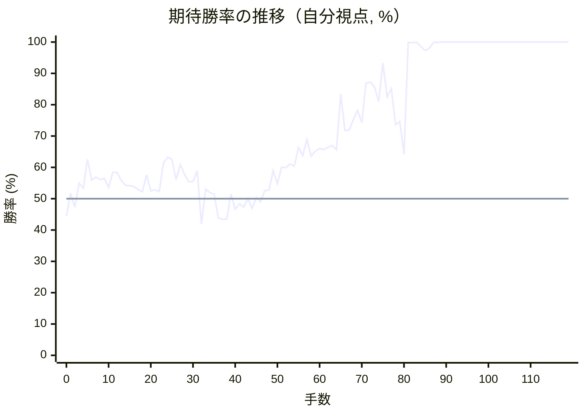

<details><summary>1手ごとの数値（第1パス）</summary>

| 手数 | 指し手 | 評価値 | 勝率 | 低下 | 判定 |
|--:|---|--:|--:|--:|---|
| 1 | ▲６八銀(79) | +40 | 51.7% |  |  |
| 2 | △８四歩(83) | -64 | 47.3% | +4.3pt |  |
| 3 | ▲５六歩(57) | +118 | 54.9% |  |  |
| 4 | △８五歩(84) | +82 | 53.4% | +1.5pt |  |
| 5 | ▲５七銀(68) | +310 | 62.6% |  |  |
| 6 | △８六歩(85) | +143 | 55.9% | +6.7pt |  |
| 7 | ▲同歩(87) | +166 | 56.9% |  |  |
| 8 | △同飛(82) | +148 | 56.1% | +0.7pt |  |
| 9 | ▲７八金(69) | +157 | 56.5% |  |  |
| 10 | △８二飛(86) | +86 | 53.6% | +2.9pt |  |
| 11 | ▲８七歩打 | +204 | 58.4% |  |  |
| 12 | △７二銀(71) | +204 | 58.4% | +0.0pt |  |
| 13 | ▲２六歩(27) | +141 | 55.8% |  |  |
| 14 | △８三銀(72) | +104 | 54.3% | +1.5pt |  |
| 15 | ▲２五歩(26) | +98 | 54.1% |  |  |
| 16 | △３二金(41) | +93 | 53.9% | +0.2pt |  |
| 17 | ▲２四歩(25) | +70 | 52.9% |  |  |
| 18 | △同歩(23) | +54 | 52.2% | +0.7pt |  |
| 19 | ▲同飛(28) | +183 | 57.6% |  |  |
| 20 | △１四歩(13) | +61 | 52.5% | +5.0pt | [疑問手](#ply-20) |
| 21 | ▲２八飛(24) | +67 | 52.8% |  |  |
| 22 | △２三歩打 | +56 | 52.3% | +0.5pt |  |
| 23 | ▲６九玉(59) | +278 | 61.4% |  |  |
| 24 | △７四銀(83) | +324 | 63.2% | -1.8pt |  |
| 25 | ▲６六銀(57) | +310 | 62.6% |  |  |
| 26 | △５二玉(51) | +148 | 56.1% | +6.5pt | [悪手](#ply-26) |
| 27 | ▲７九角(88) | +266 | 60.9% |  |  |
| 28 | △８五銀(74) | +188 | 57.8% | +3.1pt |  |
| 29 | ▲７五銀(66) | +130 | 55.4% |  |  |
| 30 | △３四歩(33) | +132 | 55.5% | -0.1pt |  |
| 31 | ▲４八銀(39) | +216 | 58.9% |  |  |
| 32 | △７六銀(85) | -195 | 41.9% | +17.0pt | [悪手](#ply-32) |
| 33 | ▲８六銀(75) | +75 | 53.1% |  |  |
| 34 | △６五銀(76) | +46 | 51.9% | +1.2pt |  |
| 35 | ▲５七銀(48) | +35 | 51.5% |  |  |
| 36 | △７四銀(65) | -146 | 43.9% | +7.5pt | [疑問手](#ply-36) |
| 37 | ▲９六歩(97) | -160 | 43.4% |  |  |
| 38 | △９四歩(93) | -158 | 43.5% | -0.1pt |  |
| 39 | ▲９七銀(86) | +35 | 51.5% |  |  |
| 40 | △３三角(22) | -81 | 46.6% | +4.8pt |  |
| 41 | ▲１六歩(17) | -38 | 48.4% |  |  |
| 42 | △２二銀(31) | -64 | 47.3% | +1.1pt |  |
| 43 | ▲８八銀(97) | -1 | 50.0% |  |  |
| 44 | △４二角(33) | -74 | 46.9% | +3.0pt |  |
| 45 | ▲３六歩(37) | +8 | 50.3% |  |  |
| 46 | △３三銀(22) | -25 | 49.0% | +1.4pt |  |
| 47 | ▲４六銀(57) | +62 | 52.6% |  |  |
| 48 | △４一玉(52) | +64 | 52.7% | -0.1pt |  |
| 49 | ▲５七角(79) | +217 | 58.9% |  |  |
| 50 | △５四歩(53) | +115 | 54.8% | +4.2pt |  |
| 51 | ▲３五歩(36) | +246 | 60.1% |  |  |
| 52 | △同歩(34) | +241 | 59.9% | +0.2pt |  |
| 53 | ▲同銀(46) | +270 | 61.1% |  |  |
| 54 | △６五銀(74) | +253 | 60.4% | +0.7pt |  |
| 55 | ▲２四歩打 | +406 | 66.3% |  |  |
| 56 | △同歩(23) | +340 | 63.8% | +2.5pt |  |
| 57 | ▲同銀(35) | +476 | 68.9% |  |  |
| 58 | △同銀(33) | +334 | 63.6% | +5.3pt | [疑問手](#ply-58) |
| 59 | ▲同角(57) | +376 | 65.2% |  |  |
| 60 | △同角(42) | +397 | 66.0% | -0.8pt |  |
| 61 | ▲同飛(28) | +390 | 65.7% |  |  |
| 62 | △２三歩打 | +410 | 66.4% | -0.7pt |  |
| 63 | ▲２八飛(24) | +424 | 67.0% |  |  |
| 64 | △５六銀(65) | +390 | 65.7% | +1.3pt |  |
| 65 | ▲６八金(78) | +970 | 83.4% |  |  |
| 66 | △８六歩打 | +561 | 71.8% | +11.6pt | [疑問手](#ply-66) |
| 67 | ▲同歩(87) | +565 | 71.9% |  |  |
| 68 | △８七歩打 | +667 | 75.2% | -3.3pt |  |
| 69 | ▲同銀(88) | +767 | 78.2% |  |  |
| 70 | △８八歩打 | +637 | 74.3% | +3.9pt |  |
| 71 | ▲７九玉(69) | +1130 | 86.8% |  |  |
| 72 | △８九歩成(88) | +1152 | 87.2% | -0.4pt |  |
| 73 | ▲同玉(79) | +1072 | 85.7% |  |  |
| 74 | △７五桂打 | +870 | 81.0% | +4.7pt |  |
| 75 | ▲７八銀(87) | +1585 | 93.3% |  |  |
| 76 | △８六飛(82) | +930 | 82.5% | +10.9pt | [悪手](#ply-76) |
| 77 | ▲８八歩打 | +1045 | 85.1% |  |  |
| 78 | △８七歩打 | +615 | 73.6% | +11.5pt | [悪手](#ply-78) |
| 79 | ▲同歩(88) | +645 | 74.6% |  |  |
| 80 | △同桂成(75) | +350 | 64.2% | +10.4pt |  |
| 81 | ▲７九玉(89) | +4012 | 99.9% |  |  |
| 82 | △８八成桂(87) | +3831 | 99.8% | +0.0pt |  |
| 83 | ▲６九玉(79) | +4227 | 99.9% |  |  |
| 84 | △７八成桂(88) | +2542 | 98.6% | +1.3pt |  |
| 85 | ▲同金(68) | +2148 | 97.3% |  |  |
| 86 | △８九飛成(86) | +2347 | 98.0% | -0.8pt |  |
| 87 | ▲７九桂打 | +3930 | 99.9% |  |  |
| 88 | △４七銀成(56) | +4003 | 99.9% | -0.0pt |  |
| 89 | ▲６六角打 | +5374 | 100.0% |  |  |
| 90 | △４六角打 | +5382 | 100.0% | -0.0pt |  |
| 91 | ▲６八飛(28) | +6566 | 100.0% |  |  |
| 92 | △５七銀打 | +6775 | 100.0% | -0.0pt |  |
| 93 | ▲５九銀打 | +6860 | 100.0% |  |  |
| 94 | △６六銀成(57) | +6952 | 100.0% | -0.0pt |  |
| 95 | ▲同歩(67) | +7528 | 100.0% |  |  |
| 96 | △８七歩打 | +6527 | 100.0% | +0.0pt |  |
| 97 | ▲９八銀打 | +6442 | 100.0% |  |  |
| 98 | △９九龍(89) | +6640 | 100.0% | -0.0pt |  |
| 99 | ▲８七銀(98) | +6420 | 100.0% |  |  |
| 100 | △５五香打 | +6522 | 100.0% | -0.0pt |  |
| 101 | ▲５八歩打 | +6864 | 100.0% |  |  |
| 102 | △８九銀打 | +6590 | 100.0% | +0.0pt |  |
| 103 | ▲３三歩打 | +6670 | 100.0% |  |  |
| 104 | △同桂(21) | +6883 | 100.0% | -0.0pt |  |
| 105 | ▲３四歩打 | +35281 | 100.0% |  |  |
| 106 | △７八銀成(89) | +7800 | 100.0% | +0.0pt |  |
| 107 | ▲同玉(69) | #+13 | 100.0% |  |  |
| 108 | △８八金打 | +35281 | 100.0% | +0.0pt |  |
| 109 | ▲６七玉(78) | #+13 | 100.0% |  |  |
| 110 | △６八角成(46) | +35281 | 100.0% | +0.0pt | [詰み逃し](#ply-110) |
| 111 | ▲同銀(59) | +35281 | 100.0% |  |  |
| 112 | △４五角打 | +35281 | 100.0% | +0.0pt |  |
| 113 | ▲７六玉(67) | +35281 | 100.0% |  |  |
| 114 | △８七金(88) | +35281 | 100.0% | +0.0pt |  |
| 115 | ▲同桂(79) | #+7 | 100.0% |  |  |
| 116 | △７四歩(73) | +5270 | 100.0% | +0.0pt | [詰み逃し](#ply-116) |
| 117 | ▲３三歩成(34) | #+5 | 100.0% |  |  |
| 118 | △９六龍(99) | #+4 | 100.0% | +0.0pt |  |
| 119 | ▲６五玉(76) | #+1 | 100.0% |  |  |

</details>

## 課題局面

<a id="ply-20"></a>
### 20手目 △１四歩(13) — 疑問手

| | 着手前 | 着手後 | 差 |
|---|--:|--:|--:|
| 期待勝率 | 59.1% | 53.0% | -6.0pt |
| 評価値 | +220 | +73 | |

着手前の局面:

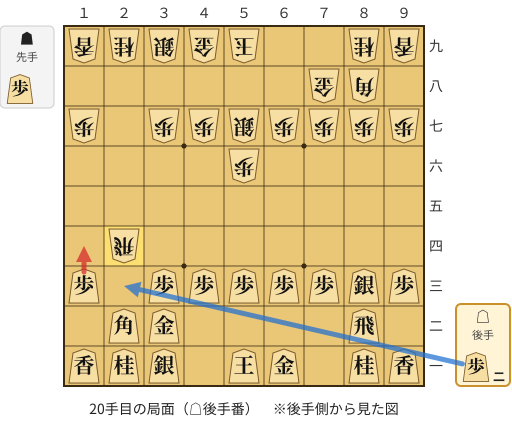

🔴 実戦 △１四歩(13)　🔵 AI推奨 △２三歩打　🟨 直前の相手の指し手

<details><summary>テキストの盤面図（BOD・将棋ソフトに貼り付け可）</summary>

```text
後手の持駒：歩二
  ９ ８ ７ ６ ５ ４ ３ ２ １
+---------------------------+
|v香v桂 ・v金v玉 ・v銀v桂v香|一
| ・v飛 ・ ・ ・ ・v金v角 ・|二
|v歩v銀v歩v歩v歩v歩v歩 ・v歩|三
| ・ ・ ・ ・ ・ ・ ・ 飛 ・|四
| ・ ・ ・ ・ ・ ・ ・ ・ ・|五
| ・ ・ ・ ・ 歩 ・ ・ ・ ・|六
| 歩 歩 歩 歩 銀 歩 歩 ・ 歩|七
| ・ 角 金 ・ ・ ・ ・ ・ ・|八
| 香 桂 ・ ・ 玉 金 銀 桂 香|九
+---------------------------+
先手の持駒：歩
後手番
手数＝19　▲２四同飛　まで
```

</details>

| | 指し手 | 評価値 | 読み筋 |
|---|---|--:|---|
| 実戦 | △１四歩(13) | +73 | ▲２八飛(24) △２三歩打 ▲７九角(88) △３四歩(33) ▲４六銀(57) △４四歩(43) |
| AI 1位 | △２三歩打 | +220 | △２三歩打 ▲２五飛(24) △３四歩(33) ▲７九角(88) △７四銀(83) ▲３六歩(37) |
| AI 2位 | △４二銀(31) | +163 | △４二銀(31) ▲４六銀(57) △２三歩打 ▲２八飛(24) △３四歩(33) ▲３六歩(37) |
| AI 3位 | △３四歩(33) | +65 | △３四歩(33) ▲７九角(88) △７四銀(83) ▲３四飛(24) △８五銀(74) ▲４六銀(57) |

SFEN: `ln1gk1snl/1r4gb1/psppppp1p/7R1/9/4P4/PPPPSPP1P/1BG6/LN2KGSNL w P2p 20`

<a id="ply-26"></a>
### 26手目 △５二玉(51) — 悪手

| | 着手前 | 着手後 | 差 |
|---|--:|--:|--:|
| 期待勝率 | 62.5% | 52.5% | -10.0pt |
| 評価値 | +307 | +60 | |

着手前の局面:

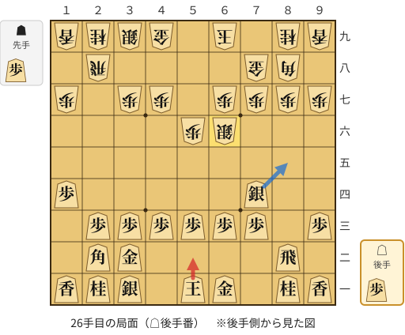

🔴 実戦 △５二玉(51)　🔵 AI推奨 △８五銀(74)　🟨 直前の相手の指し手

<details><summary>テキストの盤面図（BOD・将棋ソフトに貼り付け可）</summary>

```text
後手の持駒：歩
  ９ ８ ７ ６ ５ ４ ３ ２ １
+---------------------------+
|v香v桂 ・v金v玉 ・v銀v桂v香|一
| ・v飛 ・ ・ ・ ・v金v角 ・|二
|v歩 ・v歩v歩v歩v歩v歩v歩 ・|三
| ・ ・v銀 ・ ・ ・ ・ ・v歩|四
| ・ ・ ・ ・ ・ ・ ・ ・ ・|五
| ・ ・ ・ 銀 歩 ・ ・ ・ ・|六
| 歩 歩 歩 歩 ・ 歩 歩 ・ 歩|七
| ・ 角 金 ・ ・ ・ ・ 飛 ・|八
| 香 桂 ・ 玉 ・ 金 銀 桂 香|九
+---------------------------+
先手の持駒：歩
後手番
手数＝25　▲６六銀　まで
```

</details>

| | 指し手 | 評価値 | 読み筋 |
|---|---|--:|---|
| 実戦 | △５二玉(51) | +60 | ▲７六歩(77) △３四歩(33) ▲４八銀(39) △４二銀(31) ▲５七銀(48) △４一玉(52) |
| AI 1位 | △８五銀(74) | +307 | △８五銀(74) ▲７九角(88) △８六歩打 ▲同歩(87) △同銀(85) ▲５七角(79) |
| AI 2位 | △１三角(22) | +283 | △１三角(22) ▲１六歩(17) △６四歩(63) ▲７九角(88) △同角成(13) ▲同玉(69) |
| AI 3位 | △３四歩(33) | +203 | △３四歩(33) ▲７九角(88) △６四歩(63) ▲２四歩打 △同歩(23) ▲同角(79) |

SFEN: `ln1gk1snl/1r4gb1/p1pppppp1/2s5p/9/3SP4/PPPP1PP1P/1BG4R1/LN1K1GSNL w Pp 26`

<a id="ply-32"></a>
### 32手目 △７六銀(85) — 悪手

| | 着手前 | 着手後 | 差 |
|---|--:|--:|--:|
| 期待勝率 | 59.7% | 42.8% | -16.8pt |
| 評価値 | +235 | -173 | |

着手前の局面:

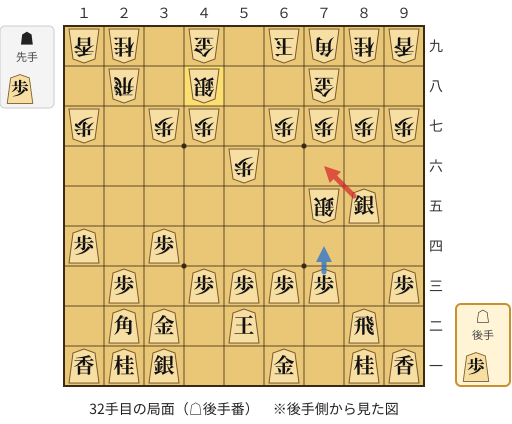

🔴 実戦 △７六銀(85)　🔵 AI推奨 △７四歩(73)　🟨 直前の相手の指し手

<details><summary>テキストの盤面図（BOD・将棋ソフトに貼り付け可）</summary>

```text
後手の持駒：歩
  ９ ８ ７ ６ ５ ４ ３ ２ １
+---------------------------+
|v香v桂 ・v金 ・ ・v銀v桂v香|一
| ・v飛 ・ ・v玉 ・v金v角 ・|二
|v歩 ・v歩v歩v歩v歩 ・v歩 ・|三
| ・ ・ ・ ・ ・ ・v歩 ・v歩|四
| ・v銀 銀 ・ ・ ・ ・ ・ ・|五
| ・ ・ ・ ・ 歩 ・ ・ ・ ・|六
| 歩 歩 歩 歩 ・ 歩 歩 ・ 歩|七
| ・ ・ 金 ・ ・ 銀 ・ 飛 ・|八
| 香 桂 角 玉 ・ 金 ・ 桂 香|九
+---------------------------+
先手の持駒：歩
後手番
手数＝31　▲４八銀　まで
```

</details>

| | 指し手 | 評価値 | 読み筋 |
|---|---|--:|---|
| 実戦 | △７六銀(85) | -173 | ▲同歩(77) △９九角成(22) ▲８八角(79) △８九馬(99) ▲１一角成(88) △３三桂(21) |
| AI 1位 | △７四歩(73) | +235 | △７四歩(73) ▲４六角(79) △８三飛(82) ▲８六歩(87) △７五歩(74) ▲８五歩(86) |
| AI 2位 | △４二銀(31) | +137 | △４二銀(31) ▲３六歩(37) △６二金(61) ▲４六角(79) △４四歩(43) ▲５七銀(48) |
| AI 3位 | △６二金(61) | +112 | △６二金(61) ▲４六角(79) △４四歩(43) ▲３六歩(37) △４二銀(31) ▲９六歩(97) |

SFEN: `ln1g2snl/1r2k1gb1/p1pppp1p1/6p1p/1sS6/4P4/PPPP1PP1P/2G2S1R1/LNBK1G1NL w Pp 32`

<a id="ply-36"></a>
### 36手目 △７四銀(65) — 疑問手

| | 着手前 | 着手後 | 差 |
|---|--:|--:|--:|
| 期待勝率 | 52.7% | 42.7% | -10.0pt |
| 評価値 | +64 | -177 | |

着手前の局面:

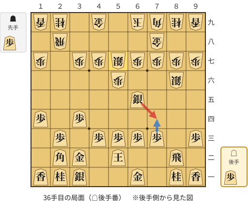

🔴 実戦 △７四銀(65)　🔵 AI推奨 △７四歩(73)　🟨 直前の相手の指し手

<details><summary>テキストの盤面図（BOD・将棋ソフトに貼り付け可）</summary>

```text
後手の持駒：歩
  ９ ８ ７ ６ ５ ４ ３ ２ １
+---------------------------+
|v香v桂 ・v金 ・ ・v銀v桂v香|一
| ・v飛 ・ ・v玉 ・v金v角 ・|二
|v歩 ・v歩v歩v歩v歩 ・v歩 ・|三
| ・ ・ ・ ・ ・ ・v歩 ・v歩|四
| ・ ・ ・v銀 ・ ・ ・ ・ ・|五
| ・ 銀 ・ ・ 歩 ・ ・ ・ ・|六
| 歩 歩 歩 歩 銀 歩 歩 ・ 歩|七
| ・ ・ 金 ・ ・ ・ ・ 飛 ・|八
| 香 桂 角 玉 ・ 金 ・ 桂 香|九
+---------------------------+
先手の持駒：歩
後手番
手数＝35　▲５七銀　まで
```

</details>

| | 指し手 | 評価値 | 読み筋 |
|---|---|--:|---|
| 実戦 | △７四銀(65) | -177 | ▲９六歩(97) △９四歩(93) ▲６八角(79) △６二金(61) ▲５八金(49) △６四歩(63) |
| AI 1位 | △７四歩(73) | +64 | △７四歩(73) ▲６六歩(67) △５四銀(65) ▲９六歩(97) △６四歩(63) ▲５八金(49) |
| AI 2位 | △７二金(61) | +55 | △７二金(61) ▲７五銀(86) △７四歩(73) ▲６六銀(75) △６四歩(63) ▲６五銀(66) |
| AI 3位 | △４二銀(31) | +50 | △４二銀(31) ▲９六歩(97) △７四歩(73) ▲６六歩(67) △５四銀(65) ▲５八金(49) |

SFEN: `ln1g2snl/1r2k1gb1/p1pppp1p1/6p1p/3s5/1S2P4/PPPPSPP1P/2G4R1/LNBK1G1NL w Pp 36`

<a id="ply-58"></a>
### 58手目 △同銀(33) — 疑問手

| | 着手前 | 着手後 | 差 |
|---|--:|--:|--:|
| 期待勝率 | 72.4% | 67.4% | -5.0pt |
| 評価値 | +578 | +435 | |

着手前の局面:

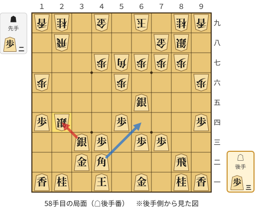

🔴 実戦 △同銀(33)　🔵 AI推奨 △６四角(42)　🟨 直前の相手の指し手

<details><summary>テキストの盤面図（BOD・将棋ソフトに貼り付け可）</summary>

```text
後手の持駒：歩三
  ９ ８ ７ ６ ５ ４ ３ ２ １
+---------------------------+
|v香v桂 ・v金 ・v玉 ・v桂v香|一
| ・v飛 ・ ・ ・v角v金 ・ ・|二
| ・ ・v歩v歩 ・v歩v銀 ・ ・|三
|v歩 ・ ・ ・v歩 ・ ・ 銀v歩|四
| ・ ・ ・v銀 ・ ・ ・ ・ ・|五
| 歩 ・ ・ ・ 歩 ・ ・ ・ 歩|六
| ・ 歩 歩 歩 角 歩 ・ ・ ・|七
| ・ 銀 金 ・ ・ ・ ・ 飛 ・|八
| 香 桂 ・ 玉 ・ 金 ・ 桂 香|九
+---------------------------+
先手の持駒：歩二
後手番
手数＝57　▲２四同銀　まで
```

</details>

| | 指し手 | 評価値 | 読み筋 |
|---|---|--:|---|
| 実戦 | △同銀(33) | +435 | ▲同角(57) △同角(42) ▲同飛(28) △２三歩打 ▲２六飛(24) △５七角打 |
| AI 1位 | △６四角(42) | +578 | △６四角(42) ▲５五歩(56) △同角(64) ▲４六歩(47) △２四銀(33) ▲同飛(28) |
| AI 2位 | △同銀(33) | +416 | △同銀(33) ▲同角(57) △同角(42) ▲同飛(28) △２三歩打 ▲２六飛(24) |
| AI 3位 | △２二歩打 | +320 | △２二歩打 ▲３三銀成(24) △同桂(21) ▲４六歩(47) △６四角(42) ▲６八角(57) |

SFEN: `ln1g1k1nl/1r3bg2/2pp1ps2/p3p2Sp/3s5/P3P3P/1PPPBP3/1SG4R1/LN1K1G1NL w 2P3p 58`

<a id="ply-66"></a>
### 66手目 △８六歩打 — 疑問手

| | 着手前 | 着手後 | 差 |
|---|--:|--:|--:|
| 期待勝率 | 84.6% | 75.8% | -8.8pt |
| 評価値 | +1022 | +686 | |

着手前の局面:

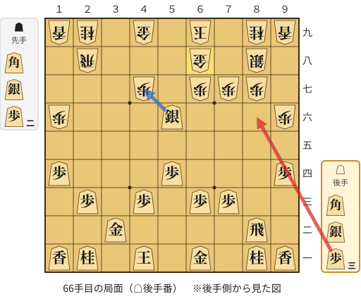

🔴 実戦 △８六歩打　🔵 AI推奨 △４七銀成(56)　🟨 直前の相手の指し手

<details><summary>テキストの盤面図（BOD・将棋ソフトに貼り付け可）</summary>

```text
後手の持駒：角　銀　歩三
  ９ ８ ７ ６ ５ ４ ３ ２ １
+---------------------------+
|v香v桂 ・v金 ・v玉 ・v桂v香|一
| ・v飛 ・ ・ ・ ・v金 ・ ・|二
| ・ ・v歩v歩 ・v歩 ・v歩 ・|三
|v歩 ・ ・ ・v歩 ・ ・ ・v歩|四
| ・ ・ ・ ・ ・ ・ ・ ・ ・|五
| 歩 ・ ・ ・v銀 ・ ・ ・ 歩|六
| ・ 歩 歩 歩 ・ 歩 ・ ・ ・|七
| ・ 銀 ・ 金 ・ ・ ・ 飛 ・|八
| 香 桂 ・ 玉 ・ 金 ・ 桂 香|九
+---------------------------+
先手の持駒：角　銀　歩二
後手番
手数＝65　▲６八金　まで
```

</details>

| | 指し手 | 評価値 | 読み筋 |
|---|---|--:|---|
| 実戦 | △８六歩打 | +686 | ▲同歩(87) △８七歩打 ▲同銀(88) △８八歩打 ▲３四角打 △４五角打 |
| AI 1位 | △４七銀成(56) | +1022 | △４七銀成(56) ▲６六角打 △４六角打 ▲２七飛(28) △５五銀打 ▲４七飛(27) |
| AI 2位 | △５七銀打 | +988 | △５七銀打 ▲７八金(68) △４七銀成(56) ▲５八歩打 △６四角打 ▲２六飛(28) |
| AI 3位 | △６四角打 | +782 | △６四角打 ▲４六角打 △５七銀打 ▲６四角(46) △６八銀不成(57) ▲同玉(69) |

SFEN: `ln1g1k1nl/1r4g2/2pp1p1p1/p3p3p/9/P3s3P/1PPP1P3/1S1G3R1/LN1K1G1NL w BS2Pbs3p 66`

<a id="ply-76"></a>
### 76手目 △８六飛(82) — 悪手

| | 着手前 | 着手後 | 差 |
|---|--:|--:|--:|
| 期待勝率 | 95.3% | 82.6% | -12.7pt |
| 評価値 | +1804 | +936 | |

着手前の局面:

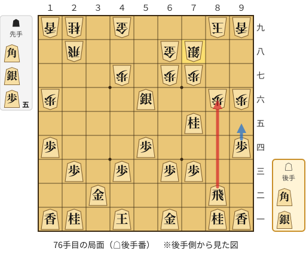

🔴 実戦 △８六飛(82)　🔵 AI推奨 △９五歩(94)　🟨 直前の相手の指し手

<details><summary>テキストの盤面図（BOD・将棋ソフトに貼り付け可）</summary>

```text
後手の持駒：角　銀
  ９ ８ ７ ６ ５ ４ ３ ２ １
+---------------------------+
|v香v桂 ・v金 ・v玉 ・v桂v香|一
| ・v飛 ・ ・ ・ ・v金 ・ ・|二
| ・ ・v歩v歩 ・v歩 ・v歩 ・|三
|v歩 ・ ・ ・v歩 ・ ・ ・v歩|四
| ・ ・v桂 ・ ・ ・ ・ ・ ・|五
| 歩 歩 ・ ・v銀 ・ ・ ・ 歩|六
| ・ ・ 歩 歩 ・ 歩 ・ ・ ・|七
| ・ ・ 銀 金 ・ ・ ・ 飛 ・|八
| 香 玉 ・ ・ ・ 金 ・ 桂 香|九
+---------------------------+
先手の持駒：角　銀　歩五
後手番
手数＝75　▲７八銀　まで
```

</details>

| | 指し手 | 評価値 | 読み筋 |
|---|---|--:|---|
| 実戦 | △８六飛(82) | +936 | ▲８七歩打 △同桂成(75) ▲同銀(78) △同飛成(86) ▲８八歩打 △８二龍(87) |
| AI 1位 | △９五歩(94) | +1804 | △９五歩(94) ▲７六銀打 △９六歩(95) ▲７五銀(76) △８七歩打 ▲７九玉(89) |
| AI 2位 | △４七銀成(56) | +1541 | △４七銀成(56) ▲５三角打 △４二角打 ▲３五角成(53) △８七歩打 ▲７九玉(89) |
| AI 3位 | △５五角打 | +1390 | △５五角打 ▲４六角打 △同角(55) ▲同歩(47) △５五角打 ▲５三角打 |

SFEN: `ln1g1k1nl/1r4g2/2pp1p1p1/p3p3p/2n6/PP2s3P/2PP1P3/2SG3R1/LK3G1NL w BS5Pbs 76`

<a id="ply-78"></a>
### 78手目 △８七歩打 — 悪手

| | 着手前 | 着手後 | 差 |
|---|--:|--:|--:|
| 期待勝率 | 85.9% | 71.2% | -14.7pt |
| 評価値 | +1086 | +543 | |

着手前の局面:

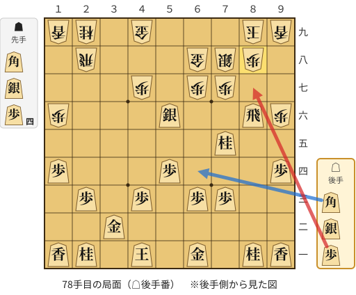

🔴 実戦 △８七歩打　🔵 AI推奨 △６四角打　🟨 直前の相手の指し手

<details><summary>テキストの盤面図（BOD・将棋ソフトに貼り付け可）</summary>

```text
後手の持駒：角　銀　歩
  ９ ８ ７ ６ ５ ４ ３ ２ １
+---------------------------+
|v香v桂 ・v金 ・v玉 ・v桂v香|一
| ・ ・ ・ ・ ・ ・v金 ・ ・|二
| ・ ・v歩v歩 ・v歩 ・v歩 ・|三
|v歩 ・ ・ ・v歩 ・ ・ ・v歩|四
| ・ ・v桂 ・ ・ ・ ・ ・ ・|五
| 歩v飛 ・ ・v銀 ・ ・ ・ 歩|六
| ・ ・ 歩 歩 ・ 歩 ・ ・ ・|七
| ・ 歩 銀 金 ・ ・ ・ 飛 ・|八
| 香 玉 ・ ・ ・ 金 ・ 桂 香|九
+---------------------------+
先手の持駒：角　銀　歩四
後手番
手数＝77　▲８八歩　まで
```

</details>

| | 指し手 | 評価値 | 読み筋 |
|---|---|--:|---|
| 実戦 | △８七歩打 | +543 | ▲同歩(88) △同桂成(75) ▲同銀(78) △同飛成(86) ▲８八歩打 △８二龍(87) |
| AI 1位 | △６四角打 | +1086 | △６四角打 ▲３七角打 △４二角(64) ▲５三歩打 △９五歩(94) ▲７六銀打 |
| AI 2位 | △５五角打 | +947 | △５五角打 ▲９七角打 △８五飛(86) ▲５八飛(28) △８六銀打 ▲５六飛(58) |
| AI 3位 | △８二飛(86) | +863 | △８二飛(86) ▲３三歩打 △同桂(21) ▲３四歩打 △４五桂(33) ▲３三銀打 |

SFEN: `ln1g1k1nl/6g2/2pp1p1p1/p3p3p/2n6/Pr2s3P/2PP1P3/1PSG3R1/LK3G1NL w BS4Pbsp 78`

<a id="ply-110"></a>
### 110手目 △６八角成(46) — 詰み逃し

| | 着手前 | 着手後 | 差 |
|---|--:|--:|--:|
| 期待勝率 | 100.0% | 100.0% | -0.0pt |
| 評価値 | 15手詰め | +35281 | |

着手前の局面:

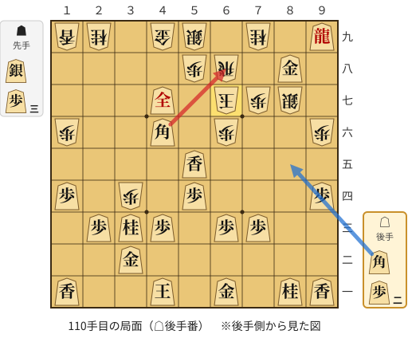

🔴 実戦 △６八角成(46)　🔵 AI推奨 △８五角打　🟨 直前の相手の指し手

<details><summary>テキストの盤面図（BOD・将棋ソフトに貼り付け可）</summary>

```text
後手の持駒：角　歩二
  ９ ８ ７ ６ ５ ４ ３ ２ １
+---------------------------+
|v香v桂 ・v金 ・v玉 ・ ・v香|一
| ・ ・ ・ ・ ・ ・v金 ・ ・|二
| ・ ・v歩v歩 ・v歩v桂v歩 ・|三
|v歩 ・ ・ ・v歩 ・ 歩 ・v歩|四
| ・ ・ ・ ・v香 ・ ・ ・ ・|五
| 歩 ・ ・ 歩 ・v角 ・ ・ 歩|六
| ・ 銀 歩 玉 ・v全 ・ ・ ・|七
| ・v金 ・ 飛 歩 ・ ・ ・ ・|八
|v龍 ・ 桂 ・ 銀 金 ・ 桂 香|九
+---------------------------+
先手の持駒：銀　歩三
後手番
手数＝109　▲６七玉　まで
```

</details>

| | 指し手 | 評価値 | 読み筋 |
|---|---|--:|---|
| 実戦 | △６八角成(46) | +35281 | ▲同銀(59) △８七金(88) ▲４二歩打 △同金(32) ▲３二銀打 △同金(42) |
| AI 1位 | △８五角打 | 15手詰め | △８五角打 ▲７六歩(77) △７九龍(99) ▲６五歩(66) △８七金(88) ▲４二歩打 |
| AI 2位 | △６八角成(46) | +35281 | △６八角成(46) ▲同銀(59) △８七金(88) ▲４二歩打 △同金(32) ▲３二銀打 |
| AI 3位 | △８七金(88) | +35281 | △８七金(88) ▲４二歩打 △同金(32) ▲３二銀打 △同金(42) |

SFEN: `ln1g1k2l/6g2/2pp1pnp1/p3p1P1p/4l4/P2P1b2P/1SPK1+s3/1g1RP4/+r1N1SG1NL w S3Pb2p 110`

<a id="ply-116"></a>
### 116手目 △７四歩(73) — 詰み逃し

| | 着手前 | 着手後 | 差 |
|---|--:|--:|--:|
| 期待勝率 | 100.0% | 100.0% | -0.0pt |
| 評価値 | 7手詰め | +6091 | |

着手前の局面:

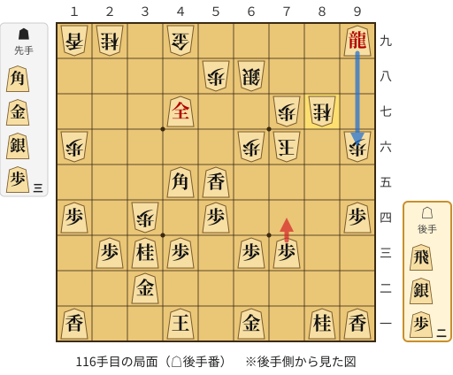

🔴 実戦 △７四歩(73)　🔵 AI推奨 △９六龍(99)　🟨 直前の相手の指し手

<details><summary>テキストの盤面図（BOD・将棋ソフトに貼り付け可）</summary>

```text
後手の持駒：飛　銀　歩二
  ９ ８ ７ ６ ５ ４ ３ ２ １
+---------------------------+
|v香v桂 ・v金 ・v玉 ・ ・v香|一
| ・ ・ ・ ・ ・ ・v金 ・ ・|二
| ・ ・v歩v歩 ・v歩v桂v歩 ・|三
|v歩 ・ ・ ・v歩 ・ 歩 ・v歩|四
| ・ ・ ・ ・v香v角 ・ ・ ・|五
| 歩 ・ 玉 歩 ・ ・ ・ ・ 歩|六
| ・ 桂 歩 ・ ・v全 ・ ・ ・|七
| ・ ・ ・ 銀 歩 ・ ・ ・ ・|八
|v龍 ・ ・ ・ ・ 金 ・ 桂 香|九
+---------------------------+
先手の持駒：角　金　銀　歩三
後手番
手数＝115　▲８七同桂　まで
```

</details>

| | 指し手 | 評価値 | 読み筋 |
|---|---|--:|---|
| 実戦 | △７四歩(73) | +6091 | ▲８五銀打 △３四角(45) |
| AI 1位 | △９六龍(99) | 7手詰め | △９六龍(99) ▲８六銀打 △８五銀打 ▲６五玉(76) △６四飛打 ▲７五玉(65) |
| AI 2位 | △７四飛打 | 7手詰め | △７四飛打 ▲７五桂(87) △９六龍(99) ▲８六銀打 △８五銀打 ▲６五玉(76) |
| AI 3位 | △７八角成(45) | +35281 | △７八角成(45) ▲４二歩打 △同金(32) ▲８六金打 △６八馬(78) ▲５六角打 |

SFEN: `ln1g1k2l/6g2/2pp1pnp1/p3p1P1p/4lb3/P1KP4P/1NP2+s3/3SP4/+r4G1NL w BGS3Prs2p 116`

