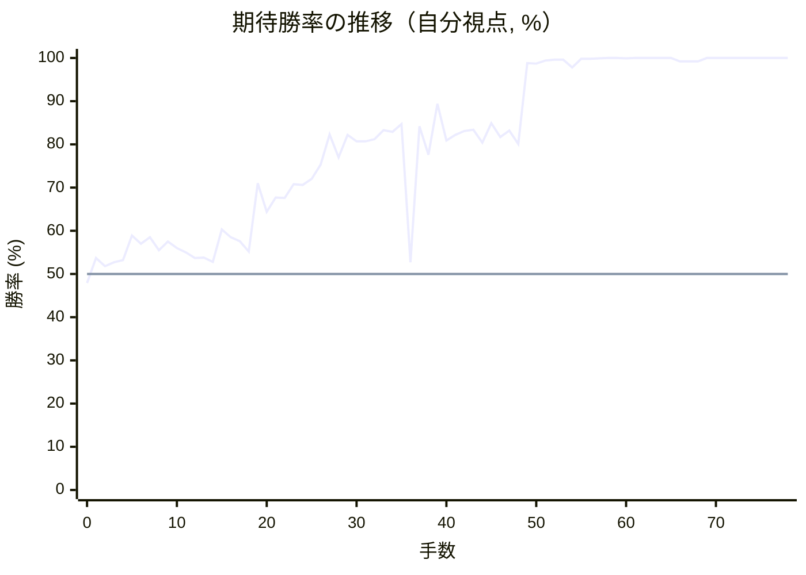
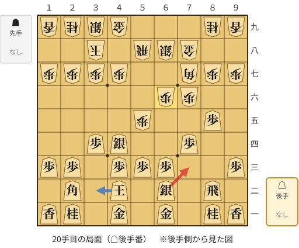
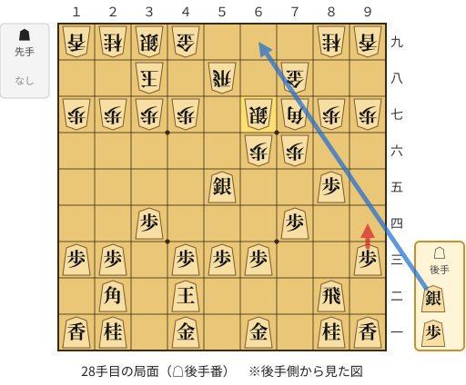
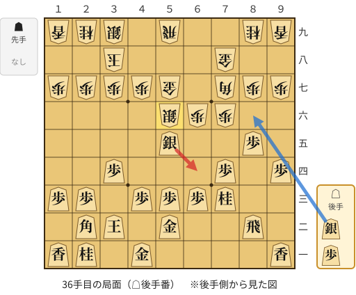
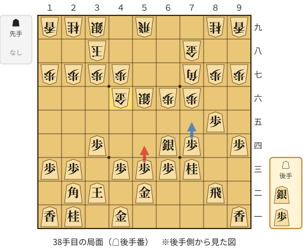
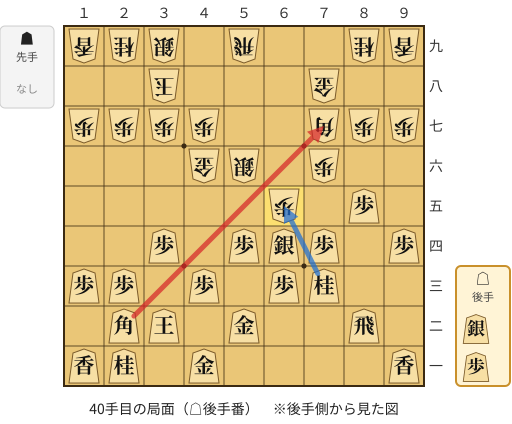

# 解析レポート zvyjto28318r

[README に戻る](../../../README.md)　/　棋譜: [CSA](../../../data/csa/shogi5/zvyjto28318r.csa)　/　解析の見方: [docs/mistake_analysis.md](../../../docs/mistake_analysis.md)

## 対局情報

| 項目 | 内容 |
|---|---|
| 日時 | 2026-10-27 22:47:02 |
| 持ち時間 | 5分 |
| 自分 | 後手（△）（1764） |
| 相手 | 相手（1429） |
| 結果 | 勝ち（詰み, 78手） |

## 解析環境

| 項目 | 内容 |
|---|---|
| エンジン | YaneuraOu NNUE 9.00git 64AVX2（V9.00/YANEURAOU_ENGINE_NNUE/AVX2） |
| 評価関数 | **水匠5**（`suisho5`） |
| nn.bin SHA-256 | `768068f0d534a0603a5d38bcd143de6bbca820d5f1c95a14d40863e5b7892d76` |
| 第1パス | movetime=150ms, MultiPV 1 |
| 第2パス | movetime=2000ms, MultiPV 3 |
| Threads / Hash | 8 / 512MB |
| 判定基準 | 疑問手 ≥5pt, 悪手 ≥10pt, 大悪手 ≥20pt（期待勝率 W(E)=1/(1+exp(-E/600))） |
| 解析日時 | 2026-11-03T04:26:21+09:00（解析バージョン 1, 31秒） |

## サマリー

| 自分の手数 | 深掘りした手 | 詰み逃し | 大悪手 | 悪手 | 疑問手 |
|--:|--:|--:|--:|--:|--:|
| 39 | 5 | 0 | 1 | 0 | 4 |

## 期待勝率の推移



<details><summary>1手ごとの数値（第1パス）</summary>

| 手数 | 指し手 | 評価値 | 勝率 | 低下 | 判定 |
|--:|---|--:|--:|--:|---|
| 1 | ▲５六歩(57) | +90 | 53.7% |  |  |
| 2 | △８四歩(83) | +43 | 51.8% | +2.0pt |  |
| 3 | ▲７六歩(77) | +66 | 52.7% |  |  |
| 4 | △３四歩(33) | +77 | 53.2% | -0.5pt |  |
| 5 | ▲５五歩(56) | +215 | 58.9% |  |  |
| 6 | △８五歩(84) | +168 | 57.0% | +1.9pt |  |
| 7 | ▲７七角(88) | +205 | 58.5% |  |  |
| 8 | △６二銀(71) | +132 | 55.5% | +3.0pt |  |
| 9 | ▲５八飛(28) | +181 | 57.5% |  |  |
| 10 | △４二玉(51) | +145 | 56.0% | +1.5pt |  |
| 11 | ▲４八玉(59) | +121 | 55.0% |  |  |
| 12 | △３二銀(31) | +90 | 53.7% | +1.3pt |  |
| 13 | ▲３八玉(48) | +91 | 53.8% |  |  |
| 14 | △３三銀(32) | +68 | 52.8% | +1.0pt |  |
| 15 | ▲７八金(69) | +250 | 60.3% |  |  |
| 16 | △４四銀(33) | +205 | 58.5% | +1.8pt |  |
| 17 | ▲６八銀(79) | +183 | 57.6% |  |  |
| 18 | △７四歩(73) | +125 | 55.2% | +2.4pt |  |
| 19 | ▲６六歩(67) | +537 | 71.0% |  |  |
| 20 | △７三銀(62) | +356 | 64.4% | +6.6pt | [疑問手](#ply-20) |
| 21 | ▲６七銀(68) | +444 | 67.7% |  |  |
| 22 | △６四銀(73) | +441 | 67.6% | +0.1pt |  |
| 23 | ▲５六銀(67) | +532 | 70.8% |  |  |
| 24 | △５五銀(64) | +526 | 70.6% | +0.2pt |  |
| 25 | ▲同銀(56) | +566 | 72.0% |  |  |
| 26 | △同銀(44) | +668 | 75.3% | -3.3pt |  |
| 27 | ▲６七銀打 | +923 | 82.3% |  |  |
| 28 | △９四歩(93) | +726 | 77.0% | +5.3pt | [疑問手](#ply-28) |
| 29 | ▲４八金(49) | +916 | 82.2% |  |  |
| 30 | △３二玉(42) | +858 | 80.7% | +1.5pt |  |
| 31 | ▲５九飛(58) | +857 | 80.7% |  |  |
| 32 | △５二金(61) | +878 | 81.2% | -0.5pt |  |
| 33 | ▲５七金(48) | +964 | 83.3% |  |  |
| 34 | △７三桂(81) | +947 | 82.9% | +0.4pt |  |
| 35 | ▲５六銀(67) | +1028 | 84.7% |  |  |
| 36 | △６四銀(55) | +65 | 52.7% | +32.0pt | [大悪手](#ply-36) |
| 37 | ▲４六金(57) | +1002 | 84.2% |  |  |
| 38 | △５四歩(53) | +746 | 77.6% | +6.5pt | [疑問手](#ply-38) |
| 39 | ▲６五歩(66) | +1278 | 89.4% |  |  |
| 40 | △７七角成(22) | +868 | 80.9% | +8.4pt | [疑問手](#ply-40) |
| 41 | ▲同桂(89) | +918 | 82.2% |  |  |
| 42 | △５三銀(64) | +954 | 83.1% | -0.9pt |  |
| 43 | ▲４五銀(56) | +967 | 83.4% |  |  |
| 44 | △８六歩(85) | +846 | 80.4% | +3.0pt |  |
| 45 | ▲同歩(87) | +1038 | 84.9% |  |  |
| 46 | △同飛(82) | +897 | 81.7% | +3.3pt |  |
| 47 | ▲８七歩打 | +961 | 83.2% |  |  |
| 48 | △７六飛(86) | +835 | 80.1% | +3.1pt |  |
| 49 | ▲８二角打 | +2624 | 98.8% |  |  |
| 50 | △６五桂(73) | +2591 | 98.7% | +0.1pt |  |
| 51 | ▲５四銀(45) | +3076 | 99.4% |  |  |
| 52 | △同銀(53) | +3255 | 99.6% | -0.2pt |  |
| 53 | ▲同飛(59) | +3258 | 99.6% |  |  |
| 54 | △７七桂成(65) | +2264 | 97.8% | +1.8pt |  |
| 55 | ▲６五銀打 | +3596 | 99.8% |  |  |
| 56 | △６六飛(76) | +3646 | 99.8% | -0.0pt |  |
| 57 | ▲７七金(78) | +4301 | 99.9% |  |  |
| 58 | △６八飛成(66) | +4586 | 100.0% | -0.0pt |  |
| 59 | ▲４八桂打 | +4941 | 100.0% |  |  |
| 60 | △５三歩打 | +4393 | 99.9% | +0.0pt |  |
| 61 | ▲３四飛(54) | +5207 | 100.0% |  |  |
| 62 | △３三歩打 | +5145 | 100.0% | +0.0pt |  |
| 63 | ▲７四飛(34) | +5805 | 100.0% |  |  |
| 64 | △５七銀打 | +5436 | 100.0% | +0.0pt |  |
| 65 | ▲７一飛成(74) | +7407 | 100.0% |  |  |
| 66 | △４六銀成(57) | +2895 | 99.2% | +0.8pt |  |
| 67 | ▲同角成(82) | +2876 | 99.2% |  |  |
| 68 | △５七銀打 | +2864 | 99.2% | +0.0pt |  |
| 69 | ▲５九銀打 | #+21 | 100.0% |  |  |
| 70 | △同龍(68) | #+18 | 100.0% | +0.0pt |  |
| 71 | ▲５六馬(46) | #+5 | 100.0% |  |  |
| 72 | △４八銀成(57) | #+6 | 100.0% | +0.0pt |  |
| 73 | ▲同銀(39) | #+5 | 100.0% |  |  |
| 74 | △２六桂打 | #+6 | 100.0% | +0.0pt |  |
| 75 | ▲同歩(27) | #+5 | 100.0% |  |  |
| 76 | △４九角打 | #+4 | 100.0% | +0.0pt |  |
| 77 | ▲３九玉(38) | #+1 | 100.0% |  |  |
| 78 | △３八金打 | #+ | 100.0% | +0.0pt |  |

</details>

## 課題局面

<a id="ply-20"></a>
### 20手目 △７三銀(62) — 疑問手

| | 着手前 | 着手後 | 差 |
|---|--:|--:|--:|
| 期待勝率 | 70.6% | 65.0% | -5.6pt |
| 評価値 | +525 | +372 | |

着手前の局面:



🔴 実戦 △７三銀(62)　🔵 AI推奨 △３二玉(42)　🟨 直前の相手の指し手

<details><summary>テキストの盤面図（BOD・将棋ソフトに貼り付け可）</summary>

```text
後手の持駒：なし
  ９ ８ ７ ６ ５ ４ ３ ２ １
+---------------------------+
|v香v桂 ・v金 ・v金 ・v桂v香|一
| ・v飛 ・v銀 ・v玉 ・v角 ・|二
|v歩 ・ ・v歩v歩v歩 ・v歩v歩|三
| ・ ・v歩 ・ ・v銀v歩 ・ ・|四
| ・v歩 ・ ・ 歩 ・ ・ ・ ・|五
| ・ ・ 歩 歩 ・ ・ ・ ・ ・|六
| 歩 歩 角 ・ ・ 歩 歩 歩 歩|七
| ・ ・ 金 銀 飛 ・ 玉 ・ ・|八
| 香 桂 ・ ・ ・ 金 銀 桂 香|九
+---------------------------+
先手の持駒：なし
後手番
手数＝19　▲６六歩　まで
```

</details>

| | 指し手 | 評価値 | 読み筋 |
|---|---|--:|---|
| 実戦 | △７三銀(62) | +372 | ▲６五歩(66) △５二金(61) ▲４六歩(47) △３二玉(42) ▲６七銀(68) △６四歩(63) |
| AI 1位 | △３二玉(42) | +525 | △３二玉(42) ▲５七銀(68) △５五銀(44) ▲２八玉(38) △５四歩(53) ▲１六歩(17) |
| AI 2位 | △５五銀(44) | +514 | △５五銀(44) ▲２八玉(38) △３二玉(42) ▲５七銀(68) △５二金(61) ▲１六歩(17) |
| AI 3位 | △１四歩(13) | +475 | △１四歩(13) ▲６七銀(68) △５五銀(44) ▲６五歩(66) △５四歩(53) ▲５六銀(67) |

SFEN: `ln1g1g1nl/1r1s1k1b1/p2ppp1pp/2p2sp2/1p2P4/2PP5/PPB2PPPP/2GSR1K2/LN3GSNL w - 20`

<a id="ply-28"></a>
### 28手目 △９四歩(93) — 疑問手

| | 着手前 | 着手後 | 差 |
|---|--:|--:|--:|
| 期待勝率 | 84.4% | 78.5% | -5.9pt |
| 評価値 | +1015 | +777 | |

着手前の局面:



🔴 実戦 △９四歩(93)　🔵 AI推奨 △６九銀打　🟨 直前の相手の指し手

<details><summary>テキストの盤面図（BOD・将棋ソフトに貼り付け可）</summary>

```text
後手の持駒：銀　歩
  ９ ８ ７ ６ ５ ４ ３ ２ １
+---------------------------+
|v香v桂 ・v金 ・v金 ・v桂v香|一
| ・v飛 ・ ・ ・v玉 ・v角 ・|二
|v歩 ・ ・v歩v歩v歩 ・v歩v歩|三
| ・ ・v歩 ・ ・ ・v歩 ・ ・|四
| ・v歩 ・ ・v銀 ・ ・ ・ ・|五
| ・ ・ 歩 歩 ・ ・ ・ ・ ・|六
| 歩 歩 角 銀 ・ 歩 歩 歩 歩|七
| ・ ・ 金 ・ 飛 ・ 玉 ・ ・|八
| 香 桂 ・ ・ ・ 金 銀 桂 香|九
+---------------------------+
先手の持駒：なし
後手番
手数＝27　▲６七銀　まで
```

</details>

| | 指し手 | 評価値 | 読み筋 |
|---|---|--:|---|
| 実戦 | △９四歩(93) | +777 | ▲５九飛(58) △１四歩(13) ▲４八銀(39) △５二金(61) ▲１六歩(17) △３二玉(42) |
| AI 1位 | △６九銀打 | +1015 | △６九銀打 ▲５九飛(58) △７八銀不成(69) ▲同銀(67) △６六銀(55) ▲６八角(77) |
| AI 2位 | △１四歩(13) | +864 | △１四歩(13) ▲５九飛(58) △１五歩(14) ▲４八銀(39) △３二玉(42) ▲５七銀(48) |
| AI 3位 | △３二玉(42) | +842 | △３二玉(42) ▲５九飛(58) △７二飛(82) ▲１六歩(17) △１四歩(13) ▲４八銀(39) |

SFEN: `ln1g1g1nl/1r3k1b1/p2ppp1pp/2p3p2/1p2s4/2PP5/PPBS1PPPP/2G1R1K2/LN3GSNL w sp 28`

<a id="ply-36"></a>
### 36手目 △６四銀(55) — 大悪手

| | 着手前 | 着手後 | 差 |
|---|--:|--:|--:|
| 期待勝率 | 87.6% | 51.0% | -36.5pt |
| 評価値 | +1172 | +25 | |

着手前の局面:



🔴 実戦 △６四銀(55)　🔵 AI推奨 △８六銀打　🟨 直前の相手の指し手

<details><summary>テキストの盤面図（BOD・将棋ソフトに貼り付け可）</summary>

```text
後手の持駒：銀　歩
  ９ ８ ７ ６ ５ ４ ３ ２ １
+---------------------------+
|v香 ・ ・ ・ ・v金 ・v桂v香|一
| ・v飛 ・ ・v金 ・v玉v角 ・|二
| ・ ・v桂v歩v歩v歩 ・v歩v歩|三
|v歩 ・v歩 ・ ・ ・v歩 ・ ・|四
| ・v歩 ・ ・v銀 ・ ・ ・ ・|五
| ・ ・ 歩 歩 銀 ・ ・ ・ ・|六
| 歩 歩 角 ・ 金 歩 歩 歩 歩|七
| ・ ・ 金 ・ ・ ・ 玉 ・ ・|八
| 香 桂 ・ ・ 飛 ・ 銀 桂 香|九
+---------------------------+
先手の持駒：なし
後手番
手数＝35　▲５六銀　まで
```

</details>

| | 指し手 | 評価値 | 読み筋 |
|---|---|--:|---|
| 実戦 | △６四銀(55) | +25 | ▲６五歩(66) △７七角成(22) ▲同桂(89) △６五桂(73) ▲同銀(56) △同銀(64) |
| AI 1位 | △８六銀打 | +1172 | △８六銀打 ▲６八角(77) △８七銀成(86) ▲７九金(78) △８六歩(85) ▲７五歩(76) |
| AI 2位 | △８六歩(85) | +1131 | △８六歩(85) ▲同歩(87) △５六銀(55) ▲同金(57) △８八歩打 ▲同角(77) |
| AI 3位 | △同銀(55) | +1101 | △同銀(55) ▲同金(57) △８六歩(85) ▲同歩(87) △８八歩打 ▲同角(77) |

SFEN: `l4g1nl/1r2g1kb1/2nppp1pp/p1p3p2/1p2s4/2PPS4/PPB1GPPPP/2G3K2/LN2R1SNL w sp 36`

<a id="ply-38"></a>
### 38手目 △５四歩(53) — 疑問手

| | 着手前 | 着手後 | 差 |
|---|--:|--:|--:|
| 期待勝率 | 86.1% | 80.6% | -5.5pt |
| 評価値 | +1093 | +855 | |

着手前の局面:



🔴 実戦 △５四歩(53)　🔵 AI推奨 △７五歩(74)　🟨 直前の相手の指し手

<details><summary>テキストの盤面図（BOD・将棋ソフトに貼り付け可）</summary>

```text
後手の持駒：銀　歩
  ９ ８ ７ ６ ５ ４ ３ ２ １
+---------------------------+
|v香 ・ ・ ・ ・v金 ・v桂v香|一
| ・v飛 ・ ・v金 ・v玉v角 ・|二
| ・ ・v桂v歩v歩v歩 ・v歩v歩|三
|v歩 ・v歩v銀 ・ ・v歩 ・ ・|四
| ・v歩 ・ ・ ・ ・ ・ ・ ・|五
| ・ ・ 歩 歩 銀 金 ・ ・ ・|六
| 歩 歩 角 ・ ・ 歩 歩 歩 歩|七
| ・ ・ 金 ・ ・ ・ 玉 ・ ・|八
| 香 桂 ・ ・ 飛 ・ 銀 桂 香|九
+---------------------------+
先手の持駒：なし
後手番
手数＝37　▲４六金　まで
```

</details>

| | 指し手 | 評価値 | 読み筋 |
|---|---|--:|---|
| 実戦 | △５四歩(53) | +855 | ▲６七銀(56) △１四歩(13) ▲５四飛(59) △４四銀打 ▲５九飛(54) △７五歩(74) |
| AI 1位 | △７五歩(74) | +1093 | △７五歩(74) ▲６五歩(66) △７七角成(22) ▲同桂(89) △７六歩(75) ▲６四歩(65) |
| AI 2位 | △４四銀打 | +898 | △４四銀打 ▲４五金(46) △同銀(44) ▲同銀(56) △７五歩(74) ▲同歩(76) |
| AI 3位 | △５四歩(53) | +821 | △５四歩(53) ▲６七銀(56) △５五歩(54) ▲６八角(77) △８四飛(82) ▲４八銀(39) |

SFEN: `l4g1nl/1r2g1kb1/2nppp1pp/p1ps2p2/1p7/2PPSG3/PPB2PPPP/2G3K2/LN2R1SNL w sp 38`

<a id="ply-40"></a>
### 40手目 △７七角成(22) — 疑問手

| | 着手前 | 着手後 | 差 |
|---|--:|--:|--:|
| 期待勝率 | 89.1% | 82.2% | -6.9pt |
| 評価値 | +1260 | +918 | |

着手前の局面:



🔴 実戦 △７七角成(22)　🔵 AI推奨 △同桂(73)　🟨 直前の相手の指し手

<details><summary>テキストの盤面図（BOD・将棋ソフトに貼り付け可）</summary>

```text
後手の持駒：銀　歩
  ９ ８ ７ ６ ５ ４ ３ ２ １
+---------------------------+
|v香 ・ ・ ・ ・v金 ・v桂v香|一
| ・v飛 ・ ・v金 ・v玉v角 ・|二
| ・ ・v桂v歩 ・v歩 ・v歩v歩|三
|v歩 ・v歩v銀v歩 ・v歩 ・ ・|四
| ・v歩 ・ 歩 ・ ・ ・ ・ ・|五
| ・ ・ 歩 ・ 銀 金 ・ ・ ・|六
| 歩 歩 角 ・ ・ 歩 歩 歩 歩|七
| ・ ・ 金 ・ ・ ・ 玉 ・ ・|八
| 香 桂 ・ ・ 飛 ・ 銀 桂 香|九
+---------------------------+
先手の持駒：なし
後手番
手数＝39　▲６五歩　まで
```

</details>

| | 指し手 | 評価値 | 読み筋 |
|---|---|--:|---|
| 実戦 | △７七角成(22) | +918 | ▲同桂(89) △５三銀(64) ▲６七銀(56) △４四歩(43) ▲１六歩(17) △１四歩(13) |
| AI 1位 | △同桂(73) | +1260 | △同桂(73) ▲２二角成(77) △同玉(32) ▲６六角打 △１二玉(22) ▲４八銀(39) |
| AI 2位 | △５五銀(64) | +1016 | △５五銀(64) ▲同銀(56) △同歩(54) ▲５四銀打 △８六歩(85) ▲同歩(87) |
| AI 3位 | △同銀(64) | +1014 | △同銀(64) ▲２二角成(77) △同玉(32) ▲４八銀(39) △５六銀(65) ▲同金(46) |

SFEN: `l4g1nl/1r2g1kb1/2np1p1pp/p1psp1p2/1p1P5/2P1SG3/PPB2PPPP/2G3K2/LN2R1SNL w sp 40`

