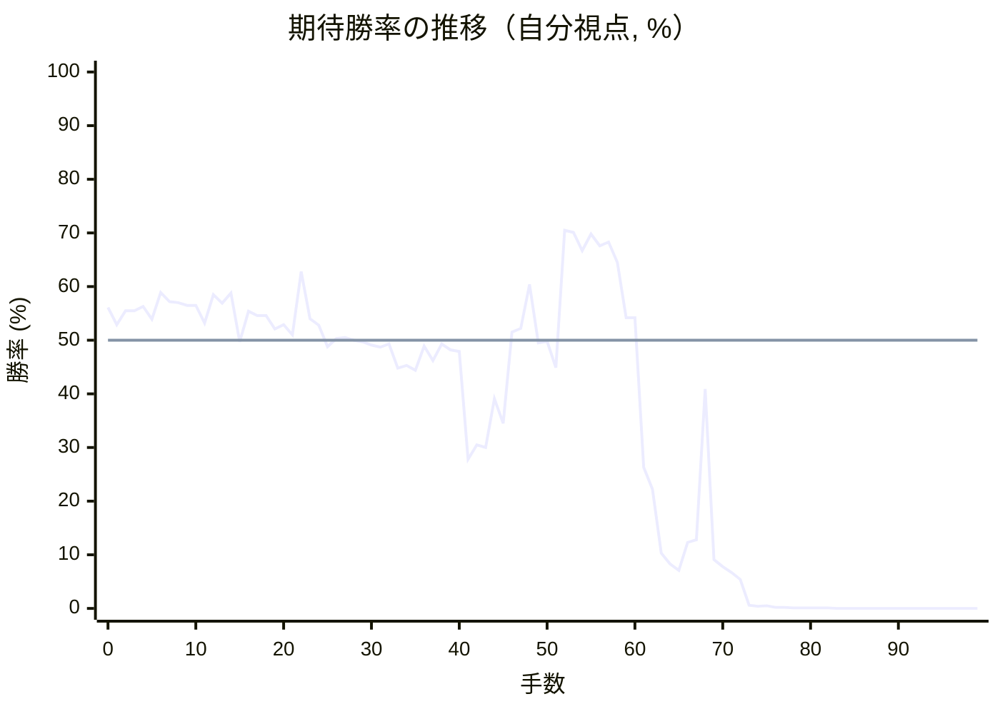
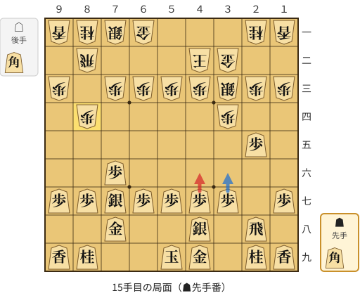
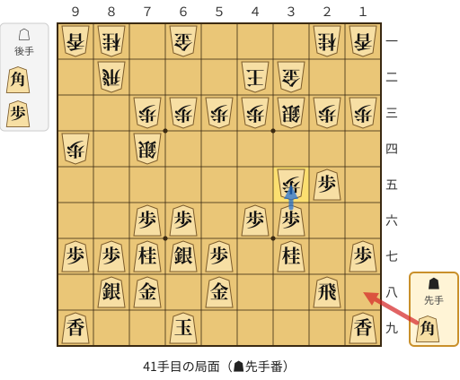
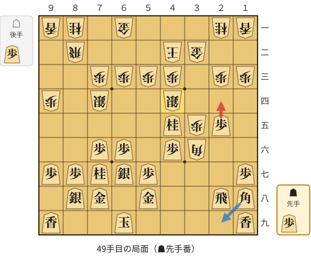
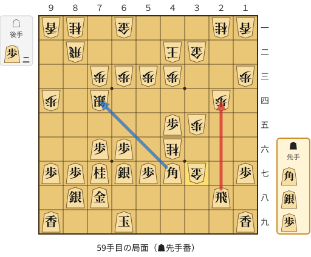
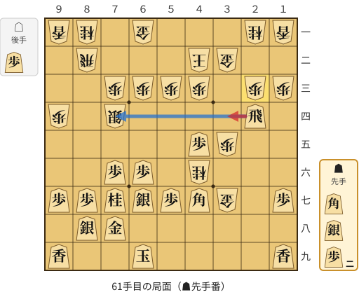
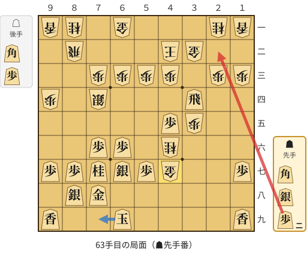
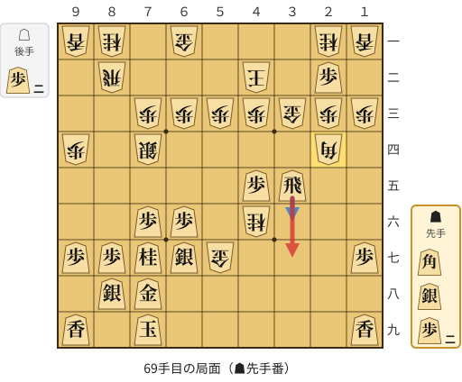

# 解析レポート zw2iwppueqwf

[README に戻る](../../../README.md)　/　棋譜: [CSA](../../../data/csa/shogi5/zw2iwppueqwf.csa)　/　解析の見方: [docs/mistake_analysis.md](../../../docs/mistake_analysis.md)

## 対局情報

| 項目 | 内容 |
|---|---|
| 日時 | 2026-11-18 00:52:23 |
| 持ち時間 | 5分 |
| 自分 | 先手（▲）（1654） |
| 相手 | 相手（1606） |
| 結果 | 勝ち（時間切れ, 99手） |

## 解析環境

| 項目 | 内容 |
|---|---|
| エンジン | YaneuraOu NNUE 9.00git 64AVX2（V9.00/YANEURAOU_ENGINE_NNUE/AVX2） |
| 評価関数 | **水匠5**（`suisho5`） |
| nn.bin SHA-256 | `768068f0d534a0603a5d38bcd143de6bbca820d5f1c95a14d40863e5b7892d76` |
| 第1パス | movetime=150ms, MultiPV 1 |
| 第2パス | movetime=2000ms, MultiPV 3 |
| Threads / Hash | 8 / 512MB |
| 判定基準 | 疑問手 ≥5pt, 悪手 ≥10pt, 大悪手 ≥20pt（期待勝率 W(E)=1/(1+exp(-E/600))） |
| 解析日時 | 2026-11-20T20:12:21+09:00（解析バージョン 1, 46秒） |

## サマリー

| 自分の手数 | 深掘りした手 | 詰み逃し | 大悪手 | 悪手 | 疑問手 |
|--:|--:|--:|--:|--:|--:|
| 50 | 8 | 0 | 3 | 2 | 2 |

## 期待勝率の推移



<details><summary>1手ごとの数値（第1パス）</summary>

| 手数 | 指し手 | 評価値 | 勝率 | 低下 | 判定 |
|--:|---|--:|--:|--:|---|
| 1 | ▲７六歩(77) | +70 | 52.9% | +3.1pt |  |
| 2 | △３四歩(33) | +132 | 55.5% |  |  |
| 3 | ▲２六歩(27) | +133 | 55.5% | -0.0pt |  |
| 4 | △３二金(41) | +153 | 56.3% |  |  |
| 5 | ▲２五歩(26) | +94 | 53.9% | +2.4pt |  |
| 6 | △８八角成(22) | +217 | 58.9% |  |  |
| 7 | ▲同銀(79) | +174 | 57.2% | +1.7pt |  |
| 8 | △２二銀(31) | +168 | 57.0% |  |  |
| 9 | ▲７七銀(88) | +158 | 56.5% | +0.4pt |  |
| 10 | △３三銀(22) | +156 | 56.5% |  |  |
| 11 | ▲７八金(69) | +77 | 53.2% | +3.3pt |  |
| 12 | △４二玉(51) | +207 | 58.5% |  |  |
| 13 | ▲４八銀(39) | +167 | 56.9% | +1.6pt |  |
| 14 | △８四歩(83) | +214 | 58.8% |  |  |
| 15 | ▲４六歩(47) | -7 | 49.7% | +9.1pt | [疑問手](#ply-15) |
| 16 | △８五歩(84) | +131 | 55.4% |  |  |
| 17 | ▲４七銀(48) | +110 | 54.6% | +0.9pt |  |
| 18 | △７二銀(71) | +111 | 54.6% |  |  |
| 19 | ▲５六銀(47) | +50 | 52.1% | +2.5pt |  |
| 20 | △９四歩(93) | +70 | 52.9% |  |  |
| 21 | ▲６六歩(67) | +23 | 51.0% | +2.0pt |  |
| 22 | △８三銀(72) | +315 | 62.8% |  |  |
| 23 | ▲５八金(49) | +96 | 54.0% | +8.8pt |  |
| 24 | △８四銀(83) | +67 | 52.8% |  |  |
| 25 | ▲６七銀(56) | -28 | 48.8% | +4.0pt |  |
| 26 | △９五銀(84) | +8 | 50.3% |  |  |
| 27 | ▲８八銀(77) | +12 | 50.5% | -0.2pt |  |
| 28 | △８六歩(85) | +1 | 50.0% |  |  |
| 29 | ▲同歩(87) | -7 | 49.7% | +0.3pt |  |
| 30 | △同銀(95) | -22 | 49.1% |  |  |
| 31 | ▲８七歩打 | -31 | 48.7% | +0.4pt |  |
| 32 | △９五銀(86) | -17 | 49.3% |  |  |
| 33 | ▲６九玉(59) | -126 | 44.8% | +4.5pt |  |
| 34 | △８四銀(95) | -112 | 45.3% |  |  |
| 35 | ▲３六歩(37) | -134 | 44.4% | +0.9pt |  |
| 36 | △８五銀(84) | -26 | 48.9% |  |  |
| 37 | ▲７七桂(89) | -91 | 46.2% | +2.7pt |  |
| 38 | △７四銀(85) | -16 | 49.3% |  |  |
| 39 | ▲３七桂(29) | -44 | 48.2% | +1.2pt |  |
| 40 | △３五歩(34) | -51 | 47.9% |  |  |
| 41 | ▲１八角打 | -573 | 27.8% | +20.1pt | [大悪手](#ply-41) |
| 42 | △３六歩(35) | -494 | 30.5% |  |  |
| 43 | ▲同角(18) | -508 | 30.0% | +0.5pt |  |
| 44 | △３五歩打 | -267 | 39.1% |  |  |
| 45 | ▲１八角(36) | -384 | 34.5% | +4.5pt |  |
| 46 | △３六角打 | +37 | 51.5% |  |  |
| 47 | ▲４五桂(37) | +52 | 52.2% | -0.6pt |  |
| 48 | △４四銀(33) | +253 | 60.4% |  |  |
| 49 | ▲２四歩(25) | -13 | 49.5% | +10.9pt | [疑問手](#ply-49) |
| 50 | △同歩(23) | -6 | 49.8% |  |  |
| 51 | ▲２九角(18) | -122 | 44.9% | +4.8pt |  |
| 52 | △４五銀(44) | +523 | 70.5% |  |  |
| 53 | ▲同歩(46) | +510 | 70.1% | +0.5pt |  |
| 54 | △４六桂打 | +418 | 66.7% |  |  |
| 55 | ▲４七金(58) | +503 | 69.8% | -3.1pt |  |
| 56 | △同角成(36) | +440 | 67.6% |  |  |
| 57 | ▲同角(29) | +460 | 68.3% | -0.7pt |  |
| 58 | △３七金打 | +358 | 64.5% |  |  |
| 59 | ▲２四飛(28) | +102 | 54.2% | +10.2pt | [悪手](#ply-59) |
| 60 | △２三歩打 | +101 | 54.2% |  |  |
| 61 | ▲３四飛(24) | -617 | 26.3% | +27.9pt | [大悪手](#ply-61) |
| 62 | △４七金(37) | -754 | 22.2% |  |  |
| 63 | ▲２二歩打 | -1298 | 10.3% | +11.8pt | [悪手](#ply-63) |
| 64 | △５七金(47) | -1441 | 8.3% |  |  |
| 65 | ▲７九玉(69) | -1544 | 7.1% | +1.2pt |  |
| 66 | △３三金(32) | -1177 | 12.3% |  |  |
| 67 | ▲３五飛(34) | -1153 | 12.8% | -0.4pt |  |
| 68 | △２四角打 | -221 | 40.9% |  |  |
| 69 | ▲３七飛(35) | -1384 | 9.1% | +31.8pt | [大悪手](#ply-69) |
| 70 | △６七金(57) | -1481 | 7.8% |  |  |
| 71 | ▲同金(78) | -1577 | 6.7% | +1.1pt |  |
| 72 | △３八桂成(46) | -1714 | 5.4% |  |  |
| 73 | ▲３五銀打 | -3055 | 0.6% | +4.8pt |  |
| 74 | △３七成桂(38) | -3302 | 0.4% |  |  |
| 75 | ▲２四銀(35) | -3126 | 0.5% | -0.1pt |  |
| 76 | △２九飛打 | -3595 | 0.2% |  |  |
| 77 | ▲６九金打 | -3876 | 0.2% | +0.1pt |  |
| 78 | △５八銀打 | -4025 | 0.1% |  |  |
| 79 | ▲６八金(67) | -4361 | 0.1% | +0.1pt |  |
| 80 | △６九銀成(58) | -4144 | 0.1% |  |  |
| 81 | ▲同金(68) | -4097 | 0.1% | -0.0pt |  |
| 82 | △５八金打 | -4496 | 0.1% |  |  |
| 83 | ▲３三銀成(24) | -5577 | 0.0% | +0.0pt |  |
| 84 | △同桂(21) | -6300 | 0.0% |  |  |
| 85 | ▲７八銀打 | -7778 | 0.0% | +0.0pt |  |
| 86 | △６八銀打 | -35281 | 0.0% |  |  |
| 87 | ▲８九玉(79) | -35281 | 0.0% | +0.0pt |  |
| 88 | △６九銀不成(68) | -35281 | 0.0% |  |  |
| 89 | ▲同銀(78) | #-7 | 0.0% | +0.0pt |  |
| 90 | △同飛成(29) | #-6 | 0.0% |  |  |
| 91 | ▲７九金打 | #-5 | 0.0% | +0.0pt |  |
| 92 | △７八銀打 | -35281 | 0.0% |  |  |
| 93 | ▲９八玉(89) | -35281 | 0.0% | +0.0pt |  |
| 94 | △７九銀不成(78) | -35281 | 0.0% |  |  |
| 95 | ▲８九銀打 | #-7 | 0.0% | +0.0pt |  |
| 96 | △８八銀成(79) | #-6 | 0.0% |  |  |
| 97 | ▲同玉(98) | #-5 | 0.0% | +0.0pt |  |
| 98 | △７九銀打 | #-4 | 0.0% |  |  |
| 99 | ▲９八玉(88) | #-3 | 0.0% | +0.0pt |  |

</details>

## 課題局面

<a id="ply-15"></a>
### 15手目 ▲４六歩(47) — 疑問手

| | 着手前 | 着手後 | 差 |
|---|--:|--:|--:|
| 期待勝率 | 59.2% | 52.4% | -6.9pt |
| 評価値 | +224 | +57 | |

着手前の局面:



🔴 実戦 ▲４六歩(47)　🔵 AI推奨 ▲３六歩(37)　🟨 直前の相手の指し手

<details><summary>テキストの盤面図（BOD・将棋ソフトに貼り付け可）</summary>

```text
後手の持駒：角
  ９ ８ ７ ６ ５ ４ ３ ２ １
+---------------------------+
|v香v桂v銀v金 ・ ・ ・v桂v香|一
| ・v飛 ・ ・ ・v玉v金 ・ ・|二
|v歩 ・v歩v歩v歩v歩v銀v歩v歩|三
| ・v歩 ・ ・ ・ ・v歩 ・ ・|四
| ・ ・ ・ ・ ・ ・ ・ 歩 ・|五
| ・ ・ 歩 ・ ・ ・ ・ ・ ・|六
| 歩 歩 銀 歩 歩 歩 歩 ・ 歩|七
| ・ ・ 金 ・ ・ 銀 ・ 飛 ・|八
| 香 桂 ・ ・ 玉 金 ・ 桂 香|九
+---------------------------+
先手の持駒：角
手数＝14　△８四歩　まで
```

</details>

| | 指し手 | 評価値 | 読み筋 |
|---|---|--:|---|
| 実戦 | ▲４六歩(47) | +57 | △１四歩(13) ▲１六歩(17) △９四歩(93) ▲９六歩(97) △６四歩(63) ▲６八玉(59) |
| AI 1位 | ▲３六歩(37) | +224 | ▲３六歩(37) △４四歩(43) ▲６八玉(59) △５二金(61) ▲３七銀(48) △４三金(52) |
| AI 2位 | ▲６八玉(59) | +215 | ▲６八玉(59) △４四歩(43) ▲３六歩(37) △７二銀(71) ▲３七銀(48) △６四歩(63) |
| AI 3位 | ▲１六歩(17) | +186 | ▲１六歩(17) △４四歩(43) ▲３六歩(37) △６四歩(63) ▲３七銀(48) △６二銀(71) |

SFEN: `lnsg3nl/1r3kg2/p1ppppspp/1p4p2/7P1/2P6/PPSPPPP1P/2G2S1R1/LN2KG1NL b Bb 15`

<a id="ply-41"></a>
### 41手目 ▲１八角打 — 大悪手

| | 着手前 | 着手後 | 差 |
|---|--:|--:|--:|
| 期待勝率 | 48.7% | 27.0% | -21.7pt |
| 評価値 | -31 | -598 | |

着手前の局面:



🔴 実戦 ▲１八角打　🔵 AI推奨 ▲同歩(36)　🟨 直前の相手の指し手

<details><summary>テキストの盤面図（BOD・将棋ソフトに貼り付け可）</summary>

```text
後手の持駒：角　歩
  ９ ８ ７ ６ ５ ４ ３ ２ １
+---------------------------+
|v香v桂 ・v金 ・ ・ ・v桂v香|一
| ・v飛 ・ ・ ・v玉v金 ・ ・|二
| ・ ・v歩v歩v歩v歩v銀v歩v歩|三
|v歩 ・v銀 ・ ・ ・ ・ ・ ・|四
| ・ ・ ・ ・ ・ ・v歩 歩 ・|五
| ・ ・ 歩 歩 ・ 歩 歩 ・ ・|六
| 歩 歩 桂 銀 歩 ・ 桂 ・ 歩|七
| ・ 銀 金 ・ 金 ・ ・ 飛 ・|八
| 香 ・ ・ 玉 ・ ・ ・ ・ 香|九
+---------------------------+
先手の持駒：角
手数＝40　△３五歩　まで
```

</details>

| | 指し手 | 評価値 | 読み筋 |
|---|---|--:|---|
| 実戦 | ▲１八角打 | -598 | △４四銀(33) ▲４五歩(46) △３六歩(35) ▲４四歩(45) △３七歩成(36) ▲２六飛(28) |
| AI 1位 | ▲同歩(36) | -31 | ▲同歩(36) △３六歩打 ▲４五桂(37) △３七歩成(36) ▲３三桂成(45) △同金(32) |
| AI 2位 | ▲４七金(58) | -181 | ▲４七金(58) △３六歩(35) ▲同金(47) △４七角打 ▲５八角打 △３六角成(47) |
| AI 3位 | ▲４五桂(37) | -206 | ▲４五桂(37) △３六歩(35) ▲４七金(58) △３四銀(33) ▲７五歩(76) △同銀(74) |

SFEN: `ln1g3nl/1r3kg2/2ppppspp/p1s6/6pP1/2PP1PP2/PPNSP1N1P/1SG1G2R1/L2K4L b Bbp 41`

<a id="ply-49"></a>
### 49手目 ▲２四歩(25) — 疑問手

| | 着手前 | 着手後 | 差 |
|---|--:|--:|--:|
| 期待勝率 | 57.5% | 48.3% | -9.2pt |
| 評価値 | +181 | -40 | |

着手前の局面:



🔴 実戦 ▲２四歩(25)　🔵 AI推奨 ▲２九角(18)　🟨 直前の相手の指し手

<details><summary>テキストの盤面図（BOD・将棋ソフトに貼り付け可）</summary>

```text
後手の持駒：歩
  ９ ８ ７ ６ ５ ４ ３ ２ １
+---------------------------+
|v香v桂 ・v金 ・ ・ ・v桂v香|一
| ・v飛 ・ ・ ・v玉v金 ・ ・|二
| ・ ・v歩v歩v歩v歩 ・v歩v歩|三
|v歩 ・v銀 ・ ・v銀 ・ ・ ・|四
| ・ ・ ・ ・ ・ 桂v歩 歩 ・|五
| ・ ・ 歩 歩 ・ 歩v角 ・ ・|六
| 歩 歩 桂 銀 歩 ・ ・ ・ 歩|七
| ・ 銀 金 ・ 金 ・ ・ 飛 角|八
| 香 ・ ・ 玉 ・ ・ ・ ・ 香|九
+---------------------------+
先手の持駒：歩
手数＝48　△４四銀　まで
```

</details>

| | 指し手 | 評価値 | 読み筋 |
|---|---|--:|---|
| 実戦 | ▲２四歩(25) | -40 | △同歩(23) ▲同飛(28) △２三歩打 ▲２九飛(24) △１八角成(36) ▲同香(19) |
| AI 1位 | ▲２九角(18) | +181 | ▲２九角(18) △２四歩(23) ▲６五桂(77) △同銀(74) ▲同歩(66) △２五角(36) |
| AI 2位 | ▲３六角(18) | +14 | ▲３六角(18) △同歩(35) ▲４七金(58) △３五銀(44) ▲７五歩(76) △同銀(74) |
| AI 3位 | ▲２四歩(25) | -26 | ▲２四歩(25) △同歩(23) ▲同飛(28) △２三歩打 ▲２九飛(24) △１八角成(36) |

SFEN: `ln1g3nl/1r3kg2/2pppp1pp/p1s2s3/5NpP1/2PP1Pb2/PPNSP3P/1SG1G2RB/L2K4L b Pp 49`

<a id="ply-59"></a>
### 59手目 ▲２四飛(28) — 悪手

| | 着手前 | 着手後 | 差 |
|---|--:|--:|--:|
| 期待勝率 | 62.6% | 50.5% | -12.1pt |
| 評価値 | +310 | +12 | |

着手前の局面:



🔴 実戦 ▲２四飛(28)　🔵 AI推奨 ▲７四角(47)　🟨 直前の相手の指し手

<details><summary>テキストの盤面図（BOD・将棋ソフトに貼り付け可）</summary>

```text
後手の持駒：歩二
  ９ ８ ７ ６ ５ ４ ３ ２ １
+---------------------------+
|v香v桂 ・v金 ・ ・ ・v桂v香|一
| ・v飛 ・ ・ ・v玉v金 ・ ・|二
| ・ ・v歩v歩v歩v歩 ・ ・v歩|三
|v歩 ・v銀 ・ ・ ・ ・v歩 ・|四
| ・ ・ ・ ・ ・ 歩v歩 ・ ・|五
| ・ ・ 歩 歩 ・v桂 ・ ・ ・|六
| 歩 歩 桂 銀 歩 角v金 ・ 歩|七
| ・ 銀 金 ・ ・ ・ ・ 飛 ・|八
| 香 ・ ・ 玉 ・ ・ ・ ・ 香|九
+---------------------------+
先手の持駒：角　銀　歩
手数＝58　△３七金　まで
```

</details>

| | 指し手 | 評価値 | 読み筋 |
|---|---|--:|---|
| 実戦 | ▲２四飛(28) | +12 | △２三歩打 ▲７四飛(24) △同歩(73) ▲５六角(47) △４九飛打 ▲６八玉(69) |
| AI 1位 | ▲７四角(47) | +310 | ▲７四角(47) △２八金(37) ▲６三角成(74) △４九飛打 ▲６八玉(69) △４八飛成(49) |
| AI 2位 | ▲２四飛(28) | +0 | ▲２四飛(28) △２三歩打 ▲７四角(47) △２四歩(23) ▲６三角成(74) △２九飛打 |
| AI 3位 | ▲３三歩打 | -177 | ▲３三歩打 △同金(32) ▲７四角(47) △同歩(73) ▲６八飛(28) △４七金(37) |

SFEN: `ln1g3nl/1r3kg2/2pppp2p/p1s4p1/5Pp2/2PP1n3/PPNSPBg1P/1SG4R1/L2K4L b BSP2p 59`

<a id="ply-61"></a>
### 61手目 ▲３四飛(24) — 大悪手

| | 着手前 | 着手後 | 差 |
|---|--:|--:|--:|
| 期待勝率 | 52.5% | 16.4% | -36.2pt |
| 評価値 | +61 | -978 | |

着手前の局面:



🔴 実戦 ▲３四飛(24)　🔵 AI推奨 ▲７四飛(24)　🟨 直前の相手の指し手

<details><summary>テキストの盤面図（BOD・将棋ソフトに貼り付け可）</summary>

```text
後手の持駒：歩
  ９ ８ ７ ６ ５ ４ ３ ２ １
+---------------------------+
|v香v桂 ・v金 ・ ・ ・v桂v香|一
| ・v飛 ・ ・ ・v玉v金 ・ ・|二
| ・ ・v歩v歩v歩v歩 ・v歩v歩|三
|v歩 ・v銀 ・ ・ ・ ・ 飛 ・|四
| ・ ・ ・ ・ ・ 歩v歩 ・ ・|五
| ・ ・ 歩 歩 ・v桂 ・ ・ ・|六
| 歩 歩 桂 銀 歩 角v金 ・ 歩|七
| ・ 銀 金 ・ ・ ・ ・ ・ ・|八
| 香 ・ ・ 玉 ・ ・ ・ ・ 香|九
+---------------------------+
先手の持駒：角　銀　歩二
手数＝60　△２三歩　まで
```

</details>

| | 指し手 | 評価値 | 読み筋 |
|---|---|--:|---|
| 実戦 | ▲３四飛(24) | -978 | △４七金(37) ▲７九玉(69) △２七角打 ▲５六銀打 △３六角成(27) ▲４七銀(56) |
| AI 1位 | ▲７四飛(24) | +61 | ▲７四飛(24) △同歩(73) ▲５六角(47) △４九飛打 ▲６八玉(69) △４七金(37) |
| AI 2位 | ▲７四角(47) | +41 | ▲７四角(47) △２四歩(23) ▲６三角成(74) △５二金(61) ▲６四馬(63) △４七金(37) |
| AI 3位 | ▲３三歩打 | -112 | ▲３三歩打 △同桂(21) ▲７四飛(24) △同歩(73) ▲同角(47) △４九飛打 |

SFEN: `ln1g3nl/1r3kg2/2pppp1pp/p1s4R1/5Pp2/2PP1n3/PPNSPBg1P/1SG6/L2K4L b BS2Pp 61`

<a id="ply-63"></a>
### 63手目 ▲２二歩打 — 悪手

| | 着手前 | 着手後 | 差 |
|---|--:|--:|--:|
| 期待勝率 | 17.7% | 6.1% | -11.6pt |
| 評価値 | -922 | -1642 | |

着手前の局面:



🔴 実戦 ▲２二歩打　🔵 AI推奨 ▲７九玉(69)　🟨 直前の相手の指し手

<details><summary>テキストの盤面図（BOD・将棋ソフトに貼り付け可）</summary>

```text
後手の持駒：角　歩
  ９ ８ ７ ６ ５ ４ ３ ２ １
+---------------------------+
|v香v桂 ・v金 ・ ・ ・v桂v香|一
| ・v飛 ・ ・ ・v玉v金 ・ ・|二
| ・ ・v歩v歩v歩v歩 ・v歩v歩|三
|v歩 ・v銀 ・ ・ ・ 飛 ・ ・|四
| ・ ・ ・ ・ ・ 歩v歩 ・ ・|五
| ・ ・ 歩 歩 ・v桂 ・ ・ ・|六
| 歩 歩 桂 銀 歩v金 ・ ・ 歩|七
| ・ 銀 金 ・ ・ ・ ・ ・ ・|八
| 香 ・ ・ 玉 ・ ・ ・ ・ 香|九
+---------------------------+
先手の持駒：角　銀　歩二
手数＝62　△４七金　まで
```

</details>

| | 指し手 | 評価値 | 読み筋 |
|---|---|--:|---|
| 実戦 | ▲２二歩打 | -1642 | △５七金(47) ▲７九玉(69) △６七金(57) ▲同金(78) △５八角打 ▲６八金(67) |
| AI 1位 | ▲７九玉(69) | -922 | ▲７九玉(69) △２七角打 ▲５六銀打 △３六角成(27) ▲８九玉(79) △５七金(47) |
| AI 2位 | ▲５五角打 | -1023 | ▲５五角打 △５七金(47) ▲７九玉(69) △６七金(57) ▲同金(78) △５八桂成(46) |
| AI 3位 | ▲６八金(78) | -1193 | ▲６八金(78) △２七角打 ▲５六銀打 △３六角成(27) ▲４七銀(56) △同馬(36) |

SFEN: `ln1g3nl/1r3kg2/2pppp1pp/p1s3R2/5Pp2/2PP1n3/PPNSPg2P/1SG6/L2K4L b BS2Pbp 63`

<a id="ply-69"></a>
### 69手目 ▲３七飛(35) — 大悪手

| | 着手前 | 着手後 | 差 |
|---|--:|--:|--:|
| 期待勝率 | 37.1% | 2.5% | -34.6pt |
| 評価値 | -317 | -2203 | |

着手前の局面:



🔴 実戦 ▲３七飛(35)　🔵 AI推奨 ▲３六飛(35)　🟨 直前の相手の指し手

<details><summary>テキストの盤面図（BOD・将棋ソフトに貼り付け可）</summary>

```text
後手の持駒：歩二
  ９ ８ ７ ６ ５ ４ ３ ２ １
+---------------------------+
|v香v桂 ・v金 ・ ・ ・v桂v香|一
| ・v飛 ・ ・ ・v玉 ・ 歩 ・|二
| ・ ・v歩v歩v歩v歩v金v歩v歩|三
|v歩 ・v銀 ・ ・ ・ ・v角 ・|四
| ・ ・ ・ ・ ・ 歩 飛 ・ ・|五
| ・ ・ 歩 歩 ・v桂 ・ ・ ・|六
| 歩 歩 桂 銀v金 ・ ・ ・ 歩|七
| ・ 銀 金 ・ ・ ・ ・ ・ ・|八
| 香 ・ 玉 ・ ・ ・ ・ ・ 香|九
+---------------------------+
先手の持駒：角　銀　歩二
手数＝68　△２四角　まで
```

</details>

| | 指し手 | 評価値 | 読み筋 |
|---|---|--:|---|
| 実戦 | ▲３七飛(35) | -2203 | △６七金(57) ▲同金(78) △３八桂成(46) ▲５七飛(37) △同角成(24) ▲同金(67) |
| AI 1位 | ▲３六飛(35) | -317 | ▲３六飛(35) △６七金(57) ▲同金(78) △５八桂成(46) ▲３五歩打 △４七銀打 |
| AI 2位 | ▲２五飛(35) | -982 | ▲２五飛(35) △５八桂成(46) ▲同銀(67) △同金(57) ▲３五歩打 △３四金(33) |
| AI 3位 | ▲３七飛(35) | -1818 | ▲３七飛(35) △６七金(57) ▲同金(78) △３八桂成(46) ▲５七飛(37) △同角成(24) |

SFEN: `ln1g3nl/1r3k1P1/2ppppgpp/p1s4b1/5PR2/2PP1n3/PPNSg3P/1SG6/L1K5L b BS2P2p 69`

