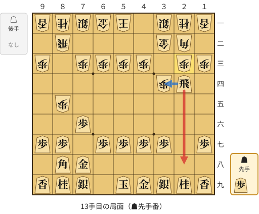
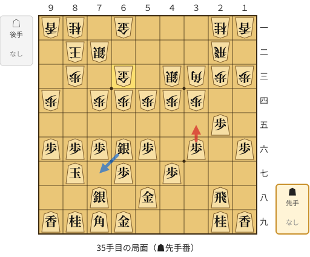

# 序盤研究ドリル（頻出局面の悪手・疑問手）

[README に戻る](../../../README.md)　/　見方: [docs/opening_study.md](../../../docs/opening_study.md)　/　データ: [opening_positions.csv](opening_positions.csv)

`analyze_opening_study.py` が自動生成。序盤に何度も出てきた同じ局面（手順前後で合流した局面を含む）のうち、疑問手以上を指したことがある局面を、累計の期待勝率損失が大きい順に並べています。

## サマリー

| 項目 | 内容 |
|---|---|
| 評価関数 | 水匠5（`suisho5`） |
| 対象 | 手合い 平手 / 持ち時間 すべて / **79 局** |
| 対象手数 | 1〜50手目の自分の手（1879 手、異なる局面 1619、2 回以上出てきた局面 93） |
| 抽出条件 | 遭遇 2 回以上・疑問手以上 1 回以上・着手前の期待勝率の平均が 15%〜85% |
| 問題局面 | **2 件**（固定化した悪手 1 件 / 分岐の迷い 1 件） |
| 別枠: 単発の大悪手 | 55 件（1回だけ出てきた局面で勝率 20pt 以上の低下） |
| 並べ替え | `total_drop` |

パターンの意味:

- **固定化した悪手**: 疑問手以上率 60% 以上で、いちばん多く指している手が疑問手以上。定跡の誤暗記や手癖の可能性 → AI 推奨手で上書きする
- **分岐の迷い**: 正しく指せた回もあるが、ときどき間違える（または指し手が割れている）。反撃手順（`reply_pv`）を見て、なぜその手が悪いのかを理解する

## 早見表

| 順位 | 手番 | 手数目安 | パターン | 遭遇 | 悪手率 | 累計勝率損失 | 最も指した悪手 | AI 最善手 |
|--:|---|--:|---|--:|--:|--:|---|---|
| [1](#pos-1) | 先手番 | 13 | 固定化した悪手 | 2 | 100% | -22.0pt | ▲２八飛(24) | ▲３四飛(24) |
| [2](#pos-2) | 後手番 | 6 | 分岐の迷い | 2 | 50% | -11.9pt | △８五歩(84) | △６二銀(71) |

## 局面別の詳細カード

<a id="pos-1"></a>
### #1 [固定化した悪手] 先手番 13手目付近（遭遇: 2回 / 疑問手以上: 2回 / 累計勝率低下: -22.0pt）

- パターン: **固定化した悪手**（Habitual Mistake）　疑問手以上率 100%（2/2）、平均勝率低下（間違えた回）-11.0pt
- 出現: 13手目、着手前の期待勝率 平均 61%



🔴 実戦 ▲２八飛(24)　🔵 AI推奨 ▲３四飛(24)　🟨 直前の相手の指し手

<details><summary>テキストの盤面図（BOD・将棋ソフトに貼り付け可）</summary>

```text
後手の持駒：なし
  ９ ８ ７ ６ ５ ４ ３ ２ １
+---------------------------+
|v香v桂v銀v金v玉 ・v銀v桂v香|一
| ・v飛 ・ ・ ・ ・v金v角 ・|二
|v歩 ・v歩v歩v歩v歩 ・v歩v歩|三
| ・ ・ ・ ・ ・ ・v歩 飛 ・|四
| ・v歩 ・ ・ ・ ・ ・ ・ ・|五
| ・ ・ 歩 ・ ・ ・ ・ ・ ・|六
| 歩 歩 ・ 歩 歩 歩 歩 ・ 歩|七
| ・ 角 金 ・ ・ ・ ・ ・ ・|八
| 香 桂 銀 ・ 玉 金 銀 桂 香|九
+---------------------------+
先手の持駒：歩
手数＝12　△２三歩　まで
```

</details>

SFEN: `lnsgk1snl/1r4gb1/p1pppp1pp/6pR1/1p7/2P6/PP1PPPP1P/1BG6/LNS1KGSNL b P 13`

**実戦での指し手比較**

| 自分の指し手 | 回数 | 判定 | AI順位 | 平均勝率低下 | 着手後評価値 | 実戦勝敗 | 主な反撃手順 (`reply_pv`) |
|---|--:|---|:-:|--:|--:|---|---|
| ▲２八飛(24) | 2 | **悪手**×2 | - | -11.0pt | -4 | 1勝1敗 | △８六歩(85) ▲同歩(87) △同飛(82) ▲２二角成(88) △同銀(31) ▲８八銀(79) |

AI順位: 第2パス（MultiPV）の候補順位。「1位※」は第1パスの最善手と一致（第2パスでは読んでいない）。

**AI 推奨の定跡（第2パス MultiPV）**

- 推奨1位: **▲３四飛(24)**（+222）　読み筋: ▲３四飛(24) △４二玉(51) ▲５八玉(59) △１四歩(13) ▲３六歩(37) △８六歩(85)
- 推奨2位: **▲２二角成(88)**（+44）　読み筋: ▲２二角成(88) △同銀(31) ▲３四飛(24) △８六歩(85) ▲同歩(87) △３三銀(22)
- 推奨3位: **▲２六飛(24)**（+16）　読み筋: ▲２六飛(24) △４二玉(51) ▲３六歩(37) △８六歩(85) ▲同歩(87) △同飛(82)

（sawpejzfp7r1 の 13手目の解析結果。対局ごとに数値が少し揺れることがあります）

**該当対局**

| 対局 | 日時 | 持ち時間 | 手数 | 指し手 | 判定 | 勝敗 |
|---|---|---|--:|---|---|---|
| [kndcpdludv3n](../reports/kndcpdludv3n.md) | 2026-10-29 21:36:13 | shogi5 | 13 | ▲２八飛(24) | **悪手** | 負 |
| [sawpejzfp7r1](../reports/sawpejzfp7r1.md) | 2026-11-10 12:20:18 | shogi5 | 13 | ▲２八飛(24) | **悪手** | 勝 |

[▲ 早見表に戻る](#早見表)

<a id="pos-2"></a>
### #2 [分岐の迷い] 後手番 6手目付近（遭遇: 2回 / 疑問手以上: 1回 / 累計勝率低下: -11.9pt）

- パターン: **分岐の迷い**（Unstable Branch）　疑問手以上率 50%（1/2）、平均勝率低下（間違えた回）-5.9pt
- 出現: 6手目、着手前の期待勝率 平均 54%



🔴 実戦 △８五歩(84)　🔵 AI推奨 △６二銀(71)　🟨 直前の相手の指し手

<details><summary>テキストの盤面図（BOD・将棋ソフトに貼り付け可）</summary>

```text
後手の持駒：なし
  ９ ８ ７ ６ ５ ４ ３ ２ １
+---------------------------+
|v香v桂v銀v金v玉v金v銀v桂v香|一
| ・v飛 ・ ・ ・ ・ ・v角 ・|二
|v歩 ・v歩v歩v歩v歩 ・v歩v歩|三
| ・v歩 ・ ・ ・ ・v歩 ・ ・|四
| ・ ・ ・ ・ ・ ・ ・ ・ ・|五
| ・ ・ 歩 歩 ・ ・ ・ ・ ・|六
| 歩 歩 角 ・ 歩 歩 歩 歩 歩|七
| ・ ・ ・ ・ ・ ・ ・ 飛 ・|八
| 香 桂 銀 金 玉 金 銀 桂 香|九
+---------------------------+
先手の持駒：なし
後手番
手数＝5　▲７七角　まで
```

</details>

SFEN: `lnsgkgsnl/1r5b1/p1pppp1pp/1p4p2/9/2PP5/PPB1PPPPP/7R1/LNSGKGSNL w - 6`

**実戦での指し手比較**

| 自分の指し手 | 回数 | 判定 | AI順位 | 平均勝率低下 | 着手後評価値 | 実戦勝敗 | 主な反撃手順 (`reply_pv`) |
|---|--:|---|:-:|--:|--:|---|---|
| △８五歩(84) | 2 | 問題なし×1 / **疑問手**×1 | - | -5.9pt | -57 | 2勝0敗 | ▲２六歩(27) △６二銀(71) ▲７八銀(79) △７四歩(73) ▲６七銀(78) △７三銀(62) |

AI順位: 第2パス（MultiPV）の候補順位。「1位※」は第1パスの最善手と一致（第2パスでは読んでいない）。

**AI 推奨の定跡（第2パス MultiPV）**

- 推奨1位: **△６二銀(71)**（+116）　読み筋: △６二銀(71) ▲２六歩(27) △６四歩(63) ▲２五歩(26) △３三角(22) ▲４八銀(39)
- 推奨2位: **△６二飛(82)**（+97）　読み筋: △６二飛(82) ▲２六歩(27) △６四歩(63) ▲２五歩(26) △７二銀(71) ▲６八銀(79)
- 推奨3位: **△６四歩(63)**（+96）　読み筋: △６四歩(63) ▲２六歩(27) △６二銀(71) ▲２五歩(26) △３三角(22) ▲４八銀(39)

（qxiged1ahfsn の 6手目の解析結果。対局ごとに数値が少し揺れることがあります）

**該当対局**

| 対局 | 日時 | 持ち時間 | 手数 | 指し手 | 判定 | 勝敗 |
|---|---|---|--:|---|---|---|
| [qxiged1ahfsn](../reports/qxiged1ahfsn.md) | 2026-11-08 15:08:47 | shogi5 | 6 | △８五歩(84) | **疑問手** | 勝 |
| [w5hd44n9v4jh](../reports/w5hd44n9v4jh.md) | 2026-10-29 19:39:39 | shogi5 | 6 | △８五歩(84) | 問題なし | 勝 |

[▲ 早見表に戻る](#早見表)

## 別枠: 単発の大悪手（1回だけ出てきた局面）

まだ1回しか出てきていない局面ですが、序盤で大きく損をした手です。同じ局面がまた出てきたら上のリストに入ります。

対局 ID のリンクから対局別レポートの該当手番に飛べます。詳細カードは `--single-blunder-cards` で出力します。

| 順位 | 対局 | 手数 | 指し手 | 判定 | 勝率低下 | AI 最善手 |
|--:|---|--:|---|---|--:|---|
| 1 | [huc6okuziluw](../reports/huc6okuziluw.md#ply-27) | 27 | ▲２六飛(25) | 大悪手 | -70.3pt | ▲７七桂(89) |
| 2 | [63qkmna4g2ds](../reports/63qkmna4g2ds.md#ply-32) | 32 | △２五飛打 | 大悪手 | -67.1pt | △７七香不成(74) |
| 3 | [6b1mcz1l326i](../reports/6b1mcz1l326i.md#ply-36) | 36 | △９六歩(95) | 大悪手 | -53.5pt | △６五銀(74) |
| 4 | [ibyp1c1n4fsv](../reports/ibyp1c1n4fsv.md#ply-36) | 36 | △４四角(22) | 大悪手 | -49.6pt | △１四歩(13) |
| 5 | [t36brtw2tnls](../reports/t36brtw2tnls.md#ply-47) | 47 | ▲２三歩打 | 大悪手 | -43.5pt | ▲４八金(49) |
| 6 | [6b1mcz1l326i](../reports/6b1mcz1l326i.md#ply-38) | 38 | △６三銀(74) | 大悪手 | -40.5pt | △６五銀(74) |
| 7 | [reqzp6yoh1d4](../reports/reqzp6yoh1d4.md#ply-15) | 15 | ▲２六飛(28) | 大悪手 | -40.0pt | ▲４六歩(47) |
| 8 | [0dqu4du7tlqd](../reports/0dqu4du7tlqd.md#ply-35) | 35 | ▲３四歩(35) | 大悪手 | -39.5pt | ▲同桂(77) |
| 9 | [ff4s8bav9rs7](../reports/ff4s8bav9rs7.md#ply-38) | 38 | △７六歩(75) | 大悪手 | -39.4pt | △２七角打 |
| 10 | [sdqp1wly06ru](../reports/sdqp1wly06ru.md#ply-45) | 45 | ▲同銀(87) | 大悪手 | -39.4pt | ▲９八銀(87) |
| 11 | [qpotmwxwtm8n](../reports/qpotmwxwtm8n.md#ply-23) | 23 | ▲４七銀(48) | 大悪手 | -38.6pt | ▲５六金(67) |
| 12 | [976gwds3rknl](../reports/976gwds3rknl.md#ply-45) | 45 | ▲同飛(28) | 大悪手 | -37.0pt | ▲７五歩(76) |
| 13 | [kndcpdludv3n](../reports/kndcpdludv3n.md#ply-33) | 33 | ▲１七桂(29) | 大悪手 | -37.0pt | ▲７七銀(88) |
| 14 | [ibyp1c1n4fsv](../reports/ibyp1c1n4fsv.md#ply-32) | 32 | △８五飛(82) | 大悪手 | -34.9pt | △３三桂(21) |
| 15 | [w23hhrkby71v](../reports/w23hhrkby71v.md#ply-45) | 45 | ▲６二歩打 | 大悪手 | -34.6pt | ▲７二銀打 |
| 16 | [avtm1zu70xp6](../reports/avtm1zu70xp6.md#ply-21) | 21 | ▲８四飛(34) | 大悪手 | -34.1pt | ▲８三角打 |
| 17 | [vlmg7sowkwdc](../reports/vlmg7sowkwdc.md#ply-49) | 49 | ▲４五桂(37) | 大悪手 | -33.8pt | ▲３四歩打 |
| 18 | [5rtfbpyzr3ec](../reports/5rtfbpyzr3ec.md#ply-49) | 49 | ▲２四角(46) | 大悪手 | -33.3pt | ▲５五角(46) |
| 19 | [ti2v7qds1qrm](../reports/ti2v7qds1qrm.md#ply-34) | 34 | △７二銀(71) | 大悪手 | -33.2pt | △２六飛(76) |
| 20 | [3bbgkz3xe5hd](../reports/3bbgkz3xe5hd.md#ply-33) | 33 | ▲３六銀(27) | 大悪手 | -33.1pt | ▲６七金(58) |
| 21 | [reqzp6yoh1d4](../reports/reqzp6yoh1d4.md#ply-23) | 23 | ▲４八銀(37) | 大悪手 | -32.3pt | ▲６四角(46) |
| 22 | [08hldm71rauz](../reports/08hldm71rauz.md#ply-37) | 37 | ▲２四歩(25) | 大悪手 | -30.8pt | ▲３五歩打 |
| 23 | [0dqu4du7tlqd](../reports/0dqu4du7tlqd.md#ply-33) | 33 | ▲３五歩(36) | 大悪手 | -30.3pt | ▲７五歩(76) |
| 24 | [reqzp6yoh1d4](../reports/reqzp6yoh1d4.md#ply-21) | 21 | ▲同銀(48) | 大悪手 | -29.8pt | ▲同金(38) |
| 25 | [atd8b3u377ka](../reports/atd8b3u377ka.md#ply-50) | 50 | △７二銀(71) | 大悪手 | -29.7pt | △３四歩(33) |
| 26 | [sr88f783j6rj](../reports/sr88f783j6rj.md#ply-24) | 24 | △７三桂(81) | 大悪手 | -28.9pt | △６三銀(62) |
| 27 | [w1n83pk42w8n](../reports/w1n83pk42w8n.md#ply-34) | 34 | △７四飛(84) | 大悪手 | -26.6pt | △８二飛(84) |
| 28 | [mdbd5x48ko53](../reports/mdbd5x48ko53.md#ply-33) | 33 | ▲４六銀(37) | 大悪手 | -26.0pt | ▲２六銀(37) |
| 29 | [as3sxs4gkx2h](../reports/as3sxs4gkx2h.md#ply-42) | 42 | △８六歩打 | 大悪手 | -26.0pt | △７四銀(85) |
| 30 | [giiimb75lt6g](../reports/giiimb75lt6g.md#ply-33) | 33 | ▲同飛(28) | 大悪手 | -25.6pt | ▲６六銀(77) |
| 31 | [4r8on6lpy0jh](../reports/4r8on6lpy0jh.md#ply-42) | 42 | △６六飛(64) | 大悪手 | -24.9pt | △６二飛(64) |
| 32 | [3bbgkz3xe5hd](../reports/3bbgkz3xe5hd.md#ply-29) | 29 | ▲同歩(67) | 大悪手 | -24.9pt | ▲同銀(77) |
| 33 | [ti2v7qds1qrm](../reports/ti2v7qds1qrm.md#ply-32) | 32 | △７六飛(86) | 大悪手 | -24.5pt | △７二銀(71) |
| 34 | [h5ccfu6chc64](../reports/h5ccfu6chc64.md#ply-32) | 32 | △６四銀(53) | 大悪手 | -23.8pt | △８六歩(85) |
| 35 | [t36brtw2tnls](../reports/t36brtw2tnls.md#ply-41) | 41 | ▲同歩(46) | 大悪手 | -23.6pt | ▲５八金(49) |
| 36 | [as3sxs4gkx2h](../reports/as3sxs4gkx2h.md#ply-38) | 38 | △８五銀打 | 大悪手 | -23.5pt | △４五歩(44) |
| 37 | [vzfpybyoukky](../reports/vzfpybyoukky.md#ply-45) | 45 | ▲３五歩(36) | 大悪手 | -23.3pt | ▲２四歩(25) |
| 38 | [y78upltfolnn](../reports/y78upltfolnn.md#ply-29) | 29 | ▲４七銀(56) | 大悪手 | -23.3pt | ▲６九角打 |
| 39 | [vfwzjqhcsp8a](../reports/vfwzjqhcsp8a.md#ply-42) | 42 | △８四飛(82) | 大悪手 | -23.3pt | △５二金(41) |
| 40 | [hsawomndbp0u](../reports/hsawomndbp0u.md#ply-49) | 49 | ▲９五歩(96) | 大悪手 | -22.5pt | ▲７五歩(76) |
| 41 | [atd8b3u377ka](../reports/atd8b3u377ka.md#ply-20) | 20 | △７六飛(86) | 大悪手 | -22.0pt | △８二飛(86) |
| 42 | [lcfsldgp37mt](../reports/lcfsldgp37mt.md#ply-46) | 46 | △３三銀(44) | 大悪手 | -21.9pt | △７二飛(82) |
| 43 | [qpotmwxwtm8n](../reports/qpotmwxwtm8n.md#ply-49) | 49 | ▲５六角(47) | 大悪手 | -21.8pt | ▲４一飛打 |
| 44 | [kndcpdludv3n](../reports/kndcpdludv3n.md#ply-37) | 37 | ▲同銀(36) | 大悪手 | -21.7pt | ▲同飛(28) |
| 45 | [huc6okuziluw](../reports/huc6okuziluw.md#ply-31) | 31 | ▲７七桂(89) | 大悪手 | -21.4pt | ▲２四歩打 |
| 46 | [y78upltfolnn](../reports/y78upltfolnn.md#ply-23) | 23 | ▲６六歩(67) | 大悪手 | -21.2pt | ▲４八飛(28) |
| 47 | [uc4x6ix8t85a](../reports/uc4x6ix8t85a.md#ply-44) | 44 | △６五歩打 | 大悪手 | -21.1pt | △８六歩打 |
| 48 | [s77bnu9186ip](../reports/s77bnu9186ip.md#ply-49) | 49 | ▲２二歩打 | 大悪手 | -20.7pt | ▲６五桂(77) |
| 49 | [61jc90j12d6l](../reports/61jc90j12d6l.md#ply-50) | 50 | △６一金(71) | 大悪手 | -20.6pt | △８三銀(74) |
| 50 | [ff4s8bav9rs7](../reports/ff4s8bav9rs7.md#ply-34) | 34 | △７五飛(76) | 大悪手 | -20.6pt | △８六飛(76) |
| 51 | [cu1szf4scqyy](../reports/cu1szf4scqyy.md#ply-27) | 27 | ▲６三角成(85) | 大悪手 | -20.5pt | ▲２七歩打 |
| 52 | [w23hhrkby71v](../reports/w23hhrkby71v.md#ply-41) | 41 | ▲同銀(56) | 大悪手 | -20.4pt | ▲５五銀(56) |
| 53 | [0dqu4du7tlqd](../reports/0dqu4du7tlqd.md#ply-41) | 41 | ▲同銀(66) | 大悪手 | -20.3pt | ▲同銀(78) |
| 54 | [4r8on6lpy0jh](../reports/4r8on6lpy0jh.md#ply-30) | 30 | △４二角(33) | 大悪手 | -20.2pt | △４五歩(44) |
| 55 | [t36brtw2tnls](../reports/t36brtw2tnls.md#ply-45) | 45 | ▲２四歩(25) | 大悪手 | -20.1pt | ▲４八金(49) |

## 集計の内訳

| 項目 | 件数 |
|---|--:|
| 対局: 対象 | 79 |
| 局面: 疑問手以上を指した局面 | 316 |
| 局面: 遭遇回数・悪手回数が基準未満 | 230 |
| 局面: 大勢判明で除外 | 29 |
